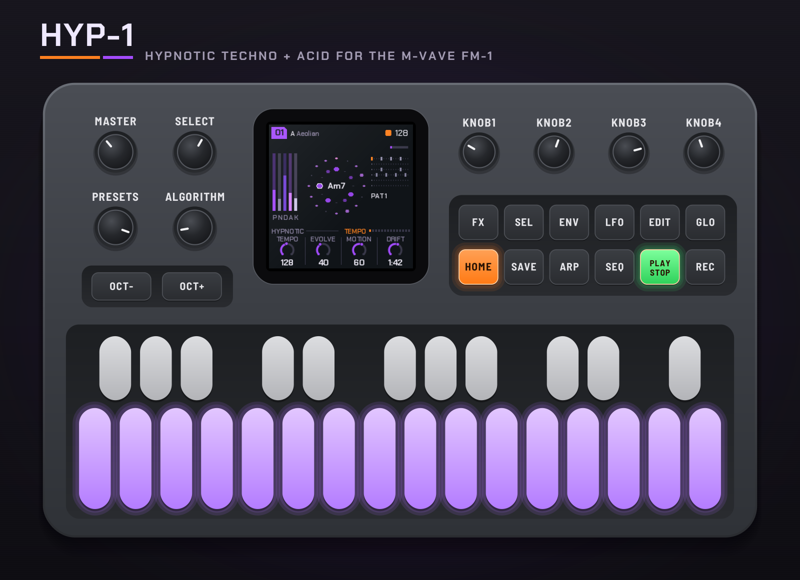

# HYP-1: hypnotic techno and acid for the M-VAVE FM-1



HYP-1 turns the M-VAVE FM-1 into a hypnotic techno and acid machine. It plays from the moment it's
switched on: a breathing pad, a deep drone, a generative 303 line and a bed of grain, over drums you
sequence. You shape the voices like a small modular, flip patterns on the bar, break it down and build it
back up, and record the whole performance into your DAW.

A [RedtailWorks](https://www.redtail.works) project, forked from [AMB-1](https://github.com/charlesvestal/fm1-amb)
by Charles Vestal. Current version: **1.0.21** (each push to `main` builds the next one).

[](https://www.youtube.com/watch?v=0UvGnZE2_VI)

*Five minutes played live on piece 01: [watch on YouTube](https://www.youtube.com/watch?v=0UvGnZE2_VI).*

- **Try it in your browser** (no FM-1 needed): <https://rustypawz.github.io/fm1-HYP1/emu/>
- **Install it** (Chrome or Edge, with the FM-1 plugged in): <https://rustypawz.github.io/fm1-HYP1/install/>
- **Read the manual**: <https://rustypawz.github.io/fm1-HYP1/manual/>, or the
  [printable PDF](docs/HYP-1_Manual.pdf) with every control numbered and every screen lettered
- **Watch it**: [a five-minute live take](https://www.youtube.com/watch?v=0UvGnZE2_VI), and more on [YouTube](https://www.youtube.com/@RedtailWorks)
- **The board**: feature requests (vote with a 👍) and comments: <https://rustypawz.github.io/fm1-HYP1/board/>
- **More from RedtailWorks**: <https://www.redtail.works>

Installing it is at your own risk, though it's hard to get stuck: the web installer can put M-VAVE's
own firmware back, and an FM-1 that fails to start twice comes up in a safe mode the installer can reach.

## What it does

- **Pad**: four breathing voices (Rhodes or sung) with their own envelope page (attack, hold,
  release, rest) and LFO page (rate, depth, shape, target).
- **Drone**: detuned saws and a sub through a resonant 24 dB low-pass, with an envelope (on each chord
  or every 1–8 bars) and an LFO (a 16-bar sweep on the cutoff by default).
- **Acid**: a generative 303-style line: 1–16 steps of chord tones with accents and slides, resonant
  filter, envelope, saw or square. Mutate rewrites steps as it plays.
- **Noise**: eight colours (white, pink, brown, blue, violet, grey, crackle, radio hiss), a tone filter
  and its own sidechain pump.
- **Drums**: a 16-step sequencer with six lanes (kick, snare, clap, closed hat, open hat, perc), six
  patterns per piece, and a level, tune and decay per lane. Hold SEQ: the 16 white keys are the steps.
- **Ten pieces** (01–10), each with its own settings, patterns and drum sounds. On Global, SAVE stores
  the piece (written as soon as the music stops, so it never interrupts a take).
- **Styles** (SEL + ALGORITHM): Hypnotic, House, Techno, Acid and Breakcore reshape every voice and the
  feel. Tempo runs from 70 to 190.
- **Links** (SEL + SEQ, amounts on the Links page): the drums patched into the voices. Each kick opens
  the drone's filter, each snare or clap flashes the pad, hats accent the acid, and the perc lane can
  clock the acid line.
- **Performance**: SAVE for a breakdown on the next bar, again for a four-bar build and the drop; an FX
  menu of momentary effects on the keys (beat repeat, reverse, tape stop, mutes and solos, filters,
  trance gate, echo throw, crush, fill), hold SAVE and tap effects to lock any number on; SEL as a shift (patterns on keys 1–6,
  pieces on the bar, copy, clear and restore lanes).
- **Remote** (SEL + GLO): plug the FM-1 in and its panel plays HYP-1 in the [emulator](https://rustypawz.github.io/fm1-HYP1/emu/)
  over USB MIDI, lights and all. With M-VAVE's firmware or any controller, the keys play straight away and
  MIDI learn maps the rest.
- Five screen themes, a boot sequence (the RedtailWorks card with its pixel red panda, then HYP-1), Chakra Petch (SIL OFL) as the screen's font.


| | |
|---|---|
|  |  |

## In short

| | |
|---|---|
| SELECT | The pages in order; with HOME held, the tempo |
| HOME · ENV · LFO · ARP · SEQ · GLO | Tempo · Pad · Drone · Acid · Drums (again: Links; hold: sequencer) · Global; press again for each voice's env and LFO |
| KNOB 1–4 | The page's four values |
| PRESETS · ALGORITHM | The piece · the mode (with SEL: the piece on the next bar · the style) |
| SAVE | Breakdown / build / drop; on Global, store the piece |
| FX | The effects menu |
| SEL | Shift (SEL + SEQ: the links on and off; SEL + GLO: remote, the panel plays the emulator) |
| PLAY · REC · EDIT | Play / stop · freeze · the next chord |
| OCT− / OCT+ | ±3 octaves: the page's voice (pad, drone, acid), or the whole song on any other page; in the sequencer, the drum |
| Keys | The scale; in the sequencer, the steps; in FX, effects |

## Versions

Each build is numbered 1.0.N from the workflow's run; the installer always offers the latest.

| Version | What came in |
|---|---|
| 1.0.21 | The documentation brought up to date; the live take on the site |
| 1.0.17 – 1.0.20 | The video tools (sequencer, voices, links, the live take); no firmware change |
| 1.0.16 | One look across the site (the installer restyled), the red panda as its mark and favicon, YouTube links |
| 1.0.15 | Boot: a pixel red panda on the RedtailWorks card, then a HYP-1 card (any button skips) |
| 1.0.13 – 1.0.14 | Remote: SEL + GLO, the FM-1's panel plays the browser emulator over USB MIDI; MIDI learn in the emulator; a vertical tour video |
| 1.0.11 – 1.0.12 | A safety review: the audio's buffers off the interrupt stack, fuzzed storage, sanitizers clean |
| 1.0.10 | FX: tapping a locked effect turns just that one off |
| 1.0.9 | OCT− / OCT+: the page's voice or the whole song, three octaves each way |
| 1.0.8 | Theme, Tune and MIDI out kept across power-off, even when changed while playing |
| 1.0.7 | Links (the drums into the voices) and FX lock mode |
| 1.0.5 – 1.0.6 | HYP-1: styles, ten pieces with their own drums, storing on Global, shift; the site |

## Building and testing

Every push to `main` builds the firmware on GitHub (`.github/workflows/firmware.yml`): JieLi's
toolchain, the tests, and the site (installer, emulator, manual, download) published to GitHub Pages.
Each build is numbered 1.B.N from the run. To build locally (see [BUILDING.md](BUILDING.md)):

```
tests/run_tests.sh      # the instrument, the platform pieces, the app in a simulator, the web builds
./build.sh              # build/amb.fwsc
python3 tools/fm1_install.py build/amb.fwsc     # install it over USB
```

`build/host/amb_host SCRIPT OUTDIR` runs the whole app on a computer from a script
(`tests/scenarios/*.amb`), with audio and screenshots coming out. `web/emu/build_clang.sh` builds the
same code for the browser with plain clang. The drum patterns are written as grids in
`tools/gen_pats.py`; the site's pictures come from `tools/site/mockups.py`, its videos from
`tools/site/video.py` (all from the firmware itself, in the simulator). [BUILDING.md](BUILDING.md) has
the details.

## Credits

HYP-1 is a [RedtailWorks](https://www.redtail.works) project ([YouTube](https://www.youtube.com/@RedtailWorks)). It is a fork of
[AMB-1](https://github.com/charlesvestal/fm1-amb) by Charles Vestal, whose generative harmony, voices
and platform work it builds on. The reverb is Jon Dattorro's plate ("Effect Design, Part 1", JAES 1997).
The platform (hardware layer, USB, update loader, storage, installer) is
[Felucca](https://github.com/hugelton/Felucca)'s by Leo Kuroshita (Hügelton Instruments), by way of
[X0X](https://github.com/charlesvestal/fm1-x0x) and FoMni-1. The idea of running FM-1 firmware in the
browser comes from [Groove OS](https://www.groove-os.com/). GPL-3.0-only; see [LICENSING.md](LICENSING.md).

M-VAVE and FM-1 are trademarks of their owners. HYP-1 is not affiliated with M-VAVE or Hügelton
Instruments.
