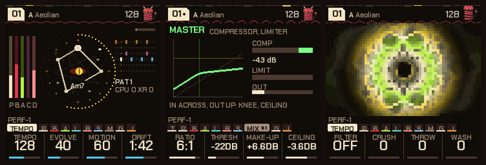
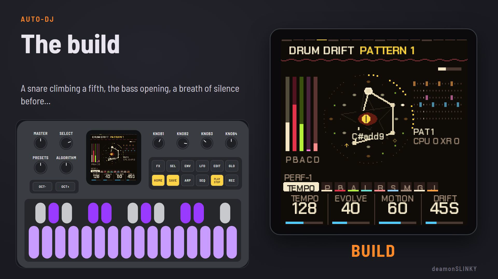
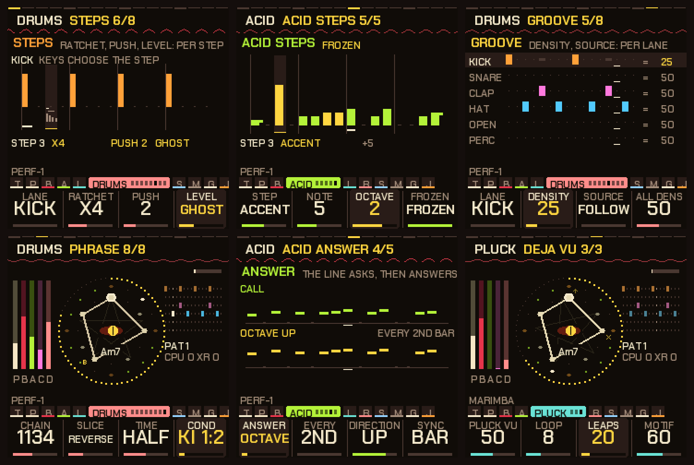
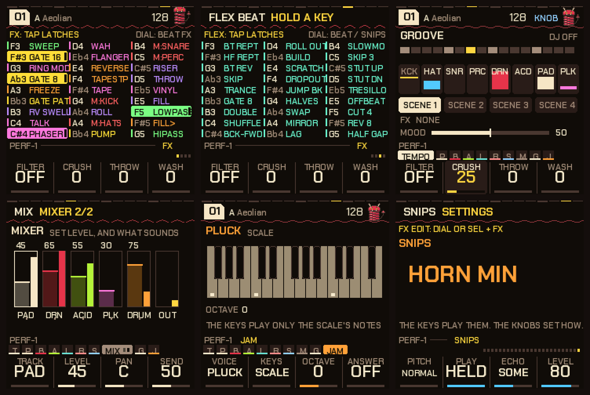
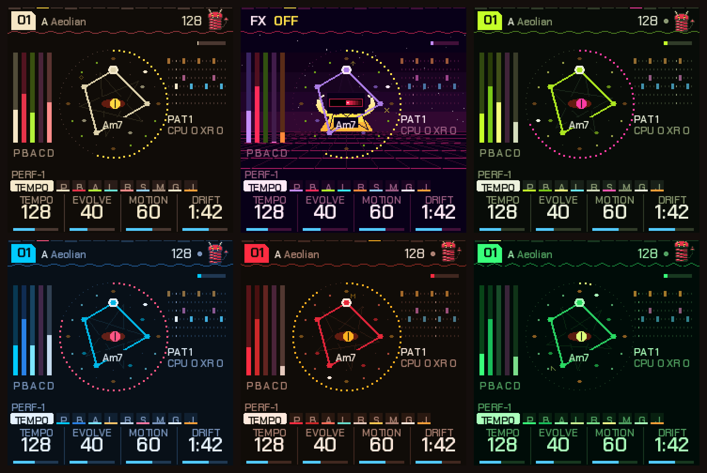

# PERF-1

**Custom live-performance firmware for the M-VAVE FM-1.** Sixteen genres of music that plays itself while you steer it: an auto-DJ, a drum sequencer with real depth, an acid line that answers itself, DX7-style FM voices (and your own), effects you can edit page by page, a mixer and a real compressor and limiter, a Jam page to play along on, scenes, and a screen that shows you what the music is doing. By **deamonSLINKY**. DEMO VIDEO https://youtu.be/NSJR3SOgDXo

*The home screen, the master bus and a visualizer.*

**Try it now:** <https://deamonslinky.github.io/PERF-1/> (the browser emulator runs the same code with sound; the installer, editor and manual are there too).

**Watch the tour (5 minutes, made from the firmware itself):** 

## What it is

PERF-1 is a custom firmware for the M-VAVE FM-1: a 5 track generative groovebox you perform on. You don't write a song and press play: you pick a piece, and it plays (a pad, a bass, a 303-style acid line, a pluck, drums), and you shape it live: break it down, build it back up, drop it, mute and solo parts, throw effects, change the pattern, take the acid somewhere else. Everything is changeable while it plays, and nothing is a loop of audio: the notes are generated by the engine on the FM-1 itself, from the key, the scale and the chord it is in. MPC Style Flex Beats, 27 effects that are all editable, or mute a track and jam directly. Auto-DJ can run the whole arc (groove, fill, breakdown, build, drop) by itself while you change the Mood, throw in dj snips, or run the effects. Open to any and all ideas and feedback. Still under heavy development, but tested constantly on a real FM-1. Many safety mechanisms in place to prevent audio drops.

## Who it's for

- **If you want to make music without first learning how to build a good song,** PERF-1 is a place to start. Every piece already sounds finished: choose a genre, press play, and you are performing from the first minute, steering a groove that holds together (the chords, the drums, the acid and the effects all follow the same key and tempo). You learn by turning things, not by programming them.
- **If you already know what you want,** it opens up. The sequencer, the sound pages, the acid line, the scales and the effects can be edited as deeply as you like, a piece you have shaped can be stored, and your own DX7 voices can be loaded. The sequencer keeps growing: per-step ratchets, push and levels, chains of patterns, slices and half or double time are in, and the acid and pluck lines can be frozen and edited step by step.

## What makes it different

- **Pieces that evolve.** Each piece is a set of rules (key, mode, tempo, which sounds, which drum patterns), not a recording. The chords move, the acid line mutates a little each time round, the pad breathes, the hats change. Leave it alone and it develops; touch it and it follows you.
- **A performance instrument, not a preset player.** One button breaks the music down, a second builds it, a third drops it. An **auto-DJ** can run the whole arc (groove, fill, breakdown, build, drop) by itself, following the chords or a bar count, and bring in the next piece. Scenes store your mix and effects and recall them on the bar. Effects are played like keys, in four banks (27 effects, 24 beat FX, 15 flex beats and 27 DJ snips, 93 keys in all): tap to latch, hold to play. A **Mood** dial moves a dozen settings at once from chill to peak.
- **Sixteen genres that behave like genres.** HYPNO (techno and acid), lofi, house, dubstep, dub, DnB, breaks, garage, electro, trap, disco, funk, reggae, synthwave, amapiano and trip-hop. Each has its own tempos, swing, drum kits and patterns, effects (vinyl and tape for lofi, a pump for house, a shimmer reverb for DnB, a gated one for synthwave), its own bass line (an octave bounce for disco, a kick-locked 808 for trap, an off-beat for house), its own pad comping and ghost notes, and its own habits for where the chords go next (the ii-V-I turnarounds of lofi, DnB and amapiano, the stepwise loops of house, the dark, sparse moves of dubstep and trap). Ten pieces each, a hundred and sixty in all.
- **A real sequencer under the generator.** Six drum lanes, sixteen steps, six patterns. Euclidean fills and rotation, a chance per lane, lanes with their own lengths (polymeter), a **density** control that thins a lane by importance (off-beats first) or fills it in without ever editing the pattern, a **source** per lane (take the hats from pattern 4 while the kick stays on pattern 1), pattern keys that play only while held, and **drum drift**: patterns that change and mutate on their own, with the backbeat protected. Per step, **ratchets** (x2 to x6, flams, swells), **push** and **level** (ghost, soft, accent); over bars, **chains** of patterns (the Amen's 1 1 3 4 among them), **slice** permutations, half and double time, and a **condition** for each lane (odd bars, the last of four, fills only).
- **The acid answers itself.** The line asks, then answers: an octave or a fifth up or down, a third within the scale, the contour mirrored round its own middle, backwards, shifted a beat, thinned, or reduced to its accents. It answers every 2nd to 8th bar or loop, or in the bar before the drums change, so it arrives with the pattern change. Like the line? **Freeze** it: the Acid steps page shows it as sixteen bars you can edit (rest, note, accent, slide, note, octave), holds it against Mutate and stores it with the piece.
- **Effects you edit, not only throw.** Beyond the 93 keys, every effect with settings has its own page that draws it: the gate's steps, the roll's speed-up, the scratch, the freeze, the phaser, the tape, the vinyl, the pump's targets. Four knobs on every page, the effect held on while you edit it so you hear what you do, four always-there performance knobs (filter, crush, throw, wash), flex-beat loops that always end on the bar line.
- **A mixer and a real master bus.** A Mixer page with a live meter and fader for every layer and the output, each layer's pan and echo/reverb send; behind it a stereo-linked compressor (ratio, threshold, make-up) and a look-ahead brick-wall limiter with its own ceiling, each genre bringing its own settings and the screen drawing the compressor's curve and the limiter's reduction as they work.
- **Jam along.** The Jam page makes the 27 keys an instrument: pluck, pad, acid or bass, every key a note of the scale (so no wrong notes), triads, or a harp up the scale, over the music as it plays; stop, and the pluck can answer your phrase back an octave up.
- **The bass can be a line, the pluck can remember.** The bass plays held, on the genre's rhythm, on the kick, in eighths, off the beat, walking or in a riff, and the pluck can keep its last few notes and bring them round again (deja vu), morphing them a note at a time.
- **Real FM voices, and yours.** A built-in six-operator FM engine plays 30 DX7-style voices as the pluck, and you can load up to 16 of your own DX7 voices from a `.syx` file over USB and play them from the pluck page. A browser **editor** shows every parameter and edits DX7 voices with a live preview on the unit.
- **You keep what you make.** Any piece, in any genre, can be stored (one button); the unit remembers your theme, tuning, effect settings and DX7 voices across power-off, and the installer page can back all of it up to a file and restore it (so trying another firmware costs you nothing).
- **A screen that tells you what is going on.** The middle of the home screen is the **sigil**: a circle that turns so the chord's root is always at the top, draws the chord as a shape (a triad is a triangle, a seventh a four-sided figure), fills round with the four-bar phrase, shows the sixteen steps of the bar and flares a rune for each plucked note. Its eye is half open in a groove, shut in a breakdown, wide and shaking in a build, and flashes on the drop. The header counts down to the drop or the next break.
- **Five tracks at once, with a safety net.** Pad, bass, acid, pluck and drums all play together (a generative firmware often runs four), which asks a lot of a chip with a 5.8 ms deadline. So the engine is built around not breaking: a second core takes the reverb, and under load more of the work; each piece is checked for level and load; a master bus with a compressor and a look-ahead limiter keeps the sum from clipping; and if a piece still gets too heavy, the engine sheds the least important work before it would drop a sample.
- **Honest about its limits.** It runs two cores and watches its own load: a status line shows CPU, dropouts and which core is doing what, USB telemetry logs it, and when a piece gets too heavy the engine sheds the least important work before it would drop audio.

*Under the generator: ratchets, push and level per step; the acid line frozen into steps you can edit; density and source per drum lane; chains, slices and half or double time; what the acid answers; the pluck remembering its phrase.*

*Playing it: the FX menu (latch or hold), the Flex Beat bank, the Perform screen (section, scenes, effects, mood), the mixer, the Jam page (all 27 keys in the scale) and the DJ snips.*
## A first minute

1. Switch on: the boot cards play and a piece starts by itself. Any key skips the cards.
2. Turn **SELECT** to walk the pages; the four knobs under the screen change what each page shows. Turn **PRESETS** for another piece; hold **GLO** and turn **PRESETS** for another genre.
3. Tap **SAVE** for a breakdown on the next bar, tap it again for a build and the drop.
4. Press **FX**: tap a key to latch an effect, hold it to play it. Hold **GLO** for the mute and solo map and the scenes.
5. Hold **SEQ** for the step sequencer; the white keys are the sixteen steps.
6. **GLO**, then **SAVE** stores the piece you are in.

The manual ([docs/MANUAL.md](docs/MANUAL.md), or the page on the site with screenshots) covers every control and page.

## The look

The screen is drawn in one look (warm black, one colour per voice: the pad bone, the bass crimson, the acid lime, the pluck ice-teal, the drums pink) in six palettes, chosen on the Global page.

## What's new in 0.14.0

The first update since the public release (0.13.0). The full list, with the development builds it came from, is in [docs/CHANGELOG.md](docs/CHANGELOG.md).

**New pages and ways to play**
- **Steps page:** a ratchet (x2 to x6, flam, swells), a push and a level (ghost, soft, accent) for every step of every drum lane, kept with the piece.
- **Bass line page:** the bass as notes (root, kick, eighths, off-beat, walk, riff) with length, move and glide; **Deja vu page:** the pluck remembers its last 4 to 32 notes and brings them round; **Feel page:** each genre's ghost notes, accents, comping rhythm and humanize; **Phrase page:** chains of patterns by bar, eight slice orders, half and double time, and a condition for each drum lane.
- **Acid steps page:** the acid line as sixteen steps you can edit, frozen so Mutate leaves it.
- **Flex Beat grows to 27 patterns, one on every key:** Jump bk, Halves, Swap, Mirror, Lag, Slowmo, Skip 3, Stut up, Stut dn, Tresillo, Offbeat, Cut 4, Rev 8 and Half gap join the original thirteen.
- **Backup and restore** from the installer page: everything the FM-1 stores goes to a `.p1bak` file and comes back, so switching firmware costs nothing.
- **Safer buttons:** factory reset is now SEL + SAVE (SAVE alone only stores), every layer's hold takes 0.4 s, a page button closes the FX menu, and HOME + SELECT sets the tempo from inside it.

**Music that behaves more like the genre**
- **Swing and looseness for every voice:** the acid, the bass line and the pad's stabs follow Swing with the drums and pluck, and Humanize loosens each of them.
- **Chord habits per genre:** ii-V-I for lofi, amapiano and disco, i-VII-VI-VII for house, i-VI-III-VII for synthwave, the i-IV vamp for funk and reggae, a pull home and a cadence at the end of each phrase. Before, every genre was close to the same random walk.
- **Sections shaped by genre:** the bar before a breakdown thins out; house, techno and dubstep keep the kick in a breakdown and drum and bass the hats; builds are two, four or eight bars by genre with the snare climbing, the kick coming back in the four-on-the-floor genres, a ringing crash and the home chord on the drop; six drum fills instead of one.
- **Dub, in place of Jungle:** one-drop, steppers and rockers at 64 to 76 BPM, a deep bass on the one and three, the skank on the off-beats, a long dotted echo and a worn tape; a breakdown keeps the kick.
- **Six more genres** (disco, funk, reggae, synthwave, amapiano and trip-hop, sixteen in all), **thirty built-in DX voices** (eight new: four guitars, slap bass, synth brass, sax and muted trumpet), and DX voice levels set by loudness, so a sustaining pad no longer sits far above a plain pluck.

**Under the hood**
- **Seamless saves:** a store while playing no longer fades the music (the flash erase is done in slices with the chip's erase-suspend).
- **The dropouts found and fixed:** the audio interrupt cleared its flag after rendering, so a render that ran a little past its 11.6 ms half also swallowed the next half's interrupt, and that half's buffer played twice. Found from a status log (each xrun was one render missing), fixed by clearing the flag first: in a 642 s lofi log the unit went from 9 dropouts in 309 s to none, with the same 88 late renders now absorbed. The `XR` count now means halves never rendered; `late` counts renders that ran long.
- **Fewer dropouts in heavy pieces:** the second core now renders the DX voices while the first does its master effects, and when a piece starts to crack the engine moves the bass and acid to the second core first, then, in three steps, gives up the least important work (DX voices, chorus, the Echoplex slap and the vinyl noise).
- **Fixes:** Flex Beat slices keep their shape at slow tempos, a pushed hit on a swung step is no longer lost, a swung pluck note no longer sounds after Stop, SAVE during a restore no longer cancels it, and a limiter that cannot be fooled by a bad sample.

## Install

Use the web installer, <https://deamonslinky.github.io/PERF-1/install/>, in Chrome or Edge with the FM-1 plugged in. **Installing firmware is at your own risk.** The installer checks the package against the unit, can put M-VAVE's own firmware back, and an FM-1 that fails to start twice comes up in a safe mode the installer can reach. Read section 1 of the manual first, and keep a way to restore the stock firmware to hand. PERF-1 keeps its own pieces, settings and DX7 voices and does not read the projects or samples of other firmwares (HYP-1, AMB-1 or the stock one); what is stored may be lost when you switch either way, so keep copies of anything you care about (your `.syx` voice files, for one). `BUILDING.md` ends with what the install does and does not protect against.

## Under the hood

- **Hardware:** JieLi AC79 (pi32v2 core, two cores at 240 MHz, a single-precision FPU, 512 KB of RAM, code run in place from flash), 44.1 kHz stereo, the screen drawn in three bands over DMA.
- **Audio:** the whole instrument renders in 5.8 ms chunks (an 11.6 ms budget for two); the plate reverb, and under load more of the work, runs on the second core and is checked for identical output either way; a master bus with a compressor and a look-ahead limiter; a six-operator FM engine on integer buses.
- **Storage:** every genre has its own flash object (A/B sectors with a commit record, so a power cut keeps the previous copy), holding packed 376-byte piece records with room to grow.
- **Tests:** about 70 scripted scenarios run the whole app in a simulator (`tests/`), alongside tests of the maths, the instrument, the flash code, the SysEx protocol and the editor.
- **Source layout and the build:** `BUILDING.md`. **Version history:** `docs/CHANGELOG.md`.

## Feedback, ideas and help

PERF-1 is young and I welcome all of it: comments, suggestions, ideas, bug reports, and help improving it. [Open an issue](https://github.com/deamonSLINKY/PERF-1/issues/new/choose) (there are templates for a bug report and a feature request, and a free-form one for anything else). A bug report is most useful with the version (shown on the boot card), the genre and piece, and, for anything about load or crackles, a status log (`tools/fm1log.py`, or the "Live status" on the installer page). Code, documentation and sound-design contributions are welcome too: see `CONTRIBUTING.md`.

## Credits and licence

PERF-1 is a fork of **HYP-1** by [RedtailWorks](https://www.redtail.works), itself a fork of **AMB-1** by Charles Vestal, built on the platform layer of **Felucca** by Leo Kuroshita (Hügelton Instruments) through X0X and FoMni. The six-operator FM engine that plays the DX7 voices, its factory voices and the second-core work are from **Melodee** by Kerem Kilic (Ellic Studio); its synthesis is after **Dexed** by Pascal Gauthier, on MSFA by Raph Levien (Google). Several generator ideas (bass line modes, pad comping, ghost notes, the pluck's deja vu loop) follow **Tuna** by delirioux ([github.com/delirioux/tuna](https://github.com/delirioux/tuna), GPL-3.0), written afresh for this engine. The reverb is Jon Dattorro's plate ("Effect Design, Part 1", JAES 1997). The git history keeps every author's commits. The idea of a browser emulator for FM-1 firmware comes from Groove OS by Peter Gombos (no code taken). The community reverse-engineering of the chip, [AL-255/FM-1-RE](https://github.com/AL-255/FM-1-RE), informed the hardware work, and the rescue route uses FM-1-transporter's protocol and kagaimiq's jl-uboot-tool.

GPL-3.0-only (`LICENSE`); the code's origins and the third-party material (fonts, the JieLi SDK) are in `LICENSING.md`. "M-VAVE" and "FM-1" are trademarks of their owners; PERF-1 is independent firmware, not affiliated with or endorsed by them.
