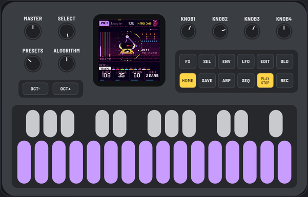
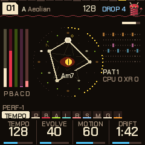
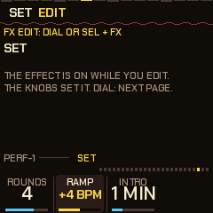

<!-- footer: PERF-1 for beginners · 0.15.1 · the full manual: deamonslinky.github.io/PERF-1/manual/ · GPL-3.0-only -->
# PERF-1 for beginners

This guide is for your first hour. No music theory needed, nothing to set up. Every step is one thing to press, and what you will hear.

When you want every detail, the [quick manual](https://deamonslinky.github.io/PERF-1/manual/PERF-1-quick-manual.pdf) has every control on eight pages, and the [full manual](https://deamonslinky.github.io/PERF-1/manual/) explains everything.

## What PERF-1 is

PERF-1 turns your M-VAVE FM-1 into a little band that plays by itself. Switch it on and music starts: drums, a bass, a soft pad, a squelchy "acid" line and a plucked melody, all made up on the spot so it never repeats exactly.

You are the conductor. You don't have to play notes. You change the chords, break the beat down and bring it back, throw effects on, mute things, and keep the moments you like.

## Before you start

- **Try it without installing.** The [emulator](https://deamonslinky.github.io/PERF-1/emu/) runs PERF-1 in your web browser, with sound. Every step in this guide works there too.
- **Installing** takes a couple of minutes with the [web installer](https://deamonslinky.github.io/PERF-1/install/) in Chrome or Edge. Use a USB cable that carries data, not a charge-only one.
- **You can always go back.** The same installer page puts M-VAVE's own firmware back. Anything you saved on the stock firmware may be lost when you switch, so keep copies of what you care about.

## The buttons you need today

Only a few. The rest can wait.

| Control | What it does for you today |
|---|---|
| **MASTER** knob | Volume. |
| **PLAY** | Stop and start the music. |
| **EDIT** | Move on to the next chord. |
| The **keys** | Change the notes the music uses. |
| **PRESETS** knob | The next piece of music. |
| **SAVE** | Break the beat down, then build it back up. |
| **FX** | Effects. |
| **HOME** | Back to the start page. Press it whenever you feel lost. |
| **GLO** | The Global page. Hold it for the mixer. |

## Your first five minutes

**1. Switch it on and listen.** After a short animation, a piece starts playing on its own. Turn **MASTER** to a comfortable level. Nothing you press in this guide can break anything.

**2. Tap EDIT.** At the start of the next bar the chord changes. The whole band follows: the bass, the pad and the melodies all move to fit. Tap it a few more times.

**3. Tap a few keys.** Each key adds a note to the music or takes one away. Tap any key, listen, tap another. There are no wrong notes to find: the band only ever plays the notes you have left on. Tap a key again to put it back.

**4. Turn PRESETS one click.** A new piece starts: a new key, a new tempo, new sounds. There are ten pieces in each style.

**5. Hold GLO and turn PRESETS.** Now you are changing the style itself. There are sixteen: techno, lofi, house, dubstep, dub, drum and bass, breaks, garage, electro, trap, disco, funk, reggae, synthwave, amapiano and trip-hop. Let go of GLO when you find one you like.

## Make it move

**6. Tap SAVE: a breakdown.** At the next bar the drums drop out and the music gets softer and dreamier.

**7. Tap SAVE again: the build and the drop.** The drums come back climbing for a few bars, there is a short silence, and then everything hits at once. This is the moment DJs live for. Tap SAVE, wait, tap SAVE, and you have done it.

**8. Press FX: effects on the keys.** Every key is now an effect, and the screen shows their names.

- **Tap** a key and the effect stays on.
- **Hold** a key and the effect lasts only while you hold it.
- Tap the same key again to switch it off, or tap **OCT-** to switch every effect off at once.
- Press **FX** again to leave. Try the gate, the phaser, the tape and the beat repeats.

## The Perform screen

**9. Press HOME, then HOME again** (not too quickly). This is the Perform screen: the eight parts of the band, and a **mood** bar.

**10. Turn ALGORITHM, the knob that sets the mood.** Turn it left for calm and sparse, right for busy and bright. The acid, the hats, the melody, the bass and the reverb all change together.

**11. Tap the keys to mute parts.** On this screen the keys switch parts of the band off and on. The screen shows which key is which. Try muting the kick drum, listen to how much it changes, then bring it back.

**12. Let it play itself.** Hold **GLO** and tap the **F5** key (the second white key from the right). "DJ" lights up at the top of the screen. Now PERF-1 runs breakdowns, builds and drops on its own, like a DJ. Do the same again to switch it off.

## Keep what you like

**13. Save the piece.** If you have changed a piece and like it, press **GLO**, then **SAVE**. The screen says it has been stored, and it is there next time you switch on.

 Every style keeps its own ten pieces.

To put a piece back the way it was at the start, go to **GLO** and hold **SEL** and **SAVE** together for a moment.

## When you want more

You don't need any of this to have fun, but it is there.

- **Turn SELECT** to walk through the pages. Each page has four knobs underneath the screen. The page name tells you what they change: the pad, the bass, the acid, the drums, the reverb and much more.
- **The Jam page** (turn SELECT past Global) turns the keys into a keyboard you can play along on. It only plays notes that fit, so you can play freely.
- **Hold HOME** for the settings.
- **The SET page** has an **Intro** that starts with just a pad and brings the band in one part at a time over a few minutes. Great for mixing in, or for playing over. You get there by holding **SEL** and pressing **FX**, then turning SELECT.

- The [quick manual](https://deamonslinky.github.io/PERF-1/manual/PERF-1-quick-manual.pdf) is eight pages to print and keep beside the FM-1.

## If something goes wrong

- **Lost on some page?** Press **HOME**.
- **An effect won't go away?** Press **FX**, then **OCT-**, then **FX** again.
- **The music stopped?** Press **PLAY**.
- **A piece sounds odd after a lot of changes?** Turn PRESETS to another piece and back, or reset it with **SEL** and **SAVE** held on the **GLO** page.
- **Want the original firmware back?** Use the [installer](https://deamonslinky.github.io/PERF-1/install/) page: "Back to the stock firmware" at the bottom.
- **Found a bug or have an idea?** Tell us on [GitHub](https://github.com/deamonSLINKY/PERF-1/issues). Most of the newest features came from ideas like yours.

## Words you will see

| Word | Means |
|---|---|
| **Piece** | One song: its key, tempo, sounds and drum patterns. Ten in each style. |
| **Genre** | A style of music, with its own drums, sounds and habits. Sixteen of them. |
| **Pad** | The soft, long chords in the background. |
| **Bass** | The low notes. |
| **Acid** | The squelchy, twisting line, after the classic Roland TB-303. |
| **Pluck** | The short, plucked melody on top. |
| **Chord** | The group of notes the band is playing around right now. EDIT moves it on. |
| **Scale** | The set of notes the music is allowed to use. The keys switch them on and off. |
| **Breakdown, build, drop** | Calm down, climb back up, then everything hits at once. SAVE runs them. |
| **Latch** | An effect that stays on after you tap its key. |
| **Auto-DJ** | PERF-1 running the breakdowns, builds and drops by itself. |
