# PERF-1

PERF-1 turns the M-VAVE FM-1 into a live-performance machine for hypnotic techno, acid, lofi, house,
dubstep, dub and more. It plays from the moment it's switched on: a breathing pad, a deep bass, a
generative 303 line and a plucked counter-melody, over drums you sequence. You shape the voices like a
small modular, flip patterns on the bar, break it down and build it back up, throw beat repeats, gates,
tape stops and DJ air horns over it, mix it, or let the auto-DJ run the set, and record the whole
performance into your DAW: the FM-1 is a USB audio and MIDI device.

PERF-1 is deamonSLINKY's fork of [HYP-1](https://www.redtail.works) by RedtailWorks (GPL-3.0). This
manual is for **PERF-1 0.14 (development)**: it is changing quickly, some of it has been tested only in the
simulator and the emulator, and it can still crash. Keep a way back to the stock firmware (section 1).

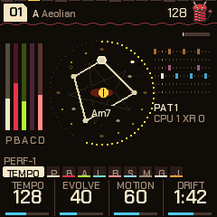

---

## Contents

1. Install
2. Getting started
3. Controls
4. The screen
5. The pages
6. Pieces, genres and storing
7. Sounds, kits and playing
8. The sequencer
9. Effects
10. Performing
11. Mixing: the mixer, space and the master bus
12. Shift
13. Settings, visualizers and what is remembered
14. Themes and MIDI
15. Your own DX7 voices
16. Load, telemetry and the logger
17. The emulator
18. Troubleshooting
19. Credits

---

## 1. Install

**Try it first:** the [PERF-1 emulator](../emu/) runs the same code in the browser, with sound, played
with the mouse, a touch screen or the keyboard.

**Install:** open the [web installer](../install/) in Chrome or Edge. Connect the FM-1 with a USB data
cable (not charge-only), straight to the computer: no hub, probe or Transporter is needed. Close anything
else that uses its MIDI port (a DAW, for instance), allow MIDI with SysEx when the browser asks, and press
**Install**. The button stays grey until the page has loaded the package; the line under it then names the
version it will write (`PERF-1 0.11...`). If that is older than the version you were told about, hard-refresh the
page (Ctrl+F5, or Cmd+Shift+R on a Mac) so the browser doesn't hand you a cached copy.

The bar and the line above it say what is happening: verifying, switching to update mode, writing,
restarting, done. **Don't unplug the cable or close the page while it writes** (the page asks before it lets
you leave). When it finishes, the FM-1 restarts into PERF-1 and the page checks that it reports the version
it was given.

> Installing firmware is at your own risk. The author accepts no responsibility if your FM-1 is damaged or misbehaves because of this custom firmware. Anything you stored (pieces, settings, DX7 voices) may be lost when the firmware is replaced: keep your own copies of the .syx files you load.

**Go back to the stock firmware:** "Back to the stock firmware", at the bottom of the same page, writes
M-VAVE's own FM-1 V15 back. Download the file it links to (`FM-1.fwsc`, also on
[m-vave.com/download](https://www.m-vave.com/download)), choose it on the page (the page checks the file's
SHA-256 and refuses any other), connect the FM-1 and press **Install the stock firmware**. It works from
PERF-1, from its safe mode and from update mode. M-VAVE's own updater, M-UPGRADE (Downloads, PC Software), works too.

**Update mode:** hold **OCT-** and **OCT+** together for 5 seconds while PERF-1 is running. After 2 seconds
the screen counts `UPDATE MODE IN 3..`; let go before the end and it says `UPDATE MODE CANCELLED`. At 5
seconds the FM-1 goes into update mode (it shows `UBOOT`), where the installer can write to it. An install
that is cut off leaves the FM-1 in update mode until a write finishes: press Install again (replug the
cable first if the page says it lost the FM-1).

**Safe mode:** if PERF-1 crashes or hangs twice in a row while starting, the FM-1 starts in safe mode
instead: a black screen, `PERF-1 SAFE MODE`, no sound, USB on, the address of the crash at the bottom.
Reinstall from the web installer, or press **PLAY** to try PERF-1 again. If even that keeps failing, the
FM-1 goes into update mode by itself. A crash while it was running is reported at the next start
(`RESTARTED AFTER A CRASH` and a `PC` address for two and a half seconds): note the address if you
report it.

### Recovering an FM-1 that won't start

Be clear about what is and isn't protected.

- **Protected:** a bad *app*. The installer checks the package it sends and each packet it writes, and
  reads the FM-1's version back after the restart. The firmware has safe mode, update mode on four failed
  starts, the OCT- + OCT+ key combo, and a USB command that enters update mode, and the installer works
  through all of them.
- **Not protected:** a damaged start-up sector or boot loader, or the power or the cable going while a write is in
  progress when no resume record has been written yet. That the interrupted-write protection works has been
  argued from the design and has **not** been tested with a real power cut. No hardware way in (pads, a
  strap, a key chord) has been found for this chip. An FM-1 that fails like that may be gone for good.

If the FM-1 doesn't start but still reaches the chip's own update mode (it appears on USB as 4C4A:8057,
`UBOOT`), `tools/fm1_rescue.py` in the source (and its wrapper `fm1_rescue.sh`) can put the stock V15 back
from a Mac, using sudo, `pyusb` and `libusb-package`. It backs up the whole flash first, writes only the 4 KiB
sectors between 0x4000 and 0x93000 that differ from V15, reads everything back, and accepts only the exact
V15 file. It was written for crash loops and uses FM-1-transporter's protocol, which was verified on
hardware upstream; treat it as a last resort, not a guarantee. Otherwise recovery needs
[FM-1-transporter](https://github.com/kurogedelic/FM-1-transporter) or hardware you may not have.

---

## 2. Getting started

1. Switch it on. The **deamonSLINKY** card shows (the slinky mascot hops twice and blinks, then the name
   and PRESENTS), then the **PERF-1** card (the version, "by deamonSLINKY", "based on HYP-1 by RedtailWorks")
   with sixteen steps filling in and the white keys lighting with them. Then a piece in the HYPNO bank starts
   playing at random. Press any button or key to skip the cards.
2. Turn **SELECT** to walk through the pages; the four knobs under the screen change what each page shows.
3. Press **SEQ** for the drums, hold it for the step sequencer, and tap the white keys to change the beat.
4. Tap keys to change the scale: each adds or removes its note. Turn **PRESETS** for another piece; hold
   **GLO** and turn **PRESETS** for another genre. On a voice's page, hold **SEL** and turn **ALGORITHM** for its other sounds.
5. Want to play the bass yourself? Press **LFO** for its page, then hold **SEL** and press **ENV**: it leaves the
   algorithm and the keys play it. **SEL** + **ENV** again gives it back. The **JAM** page (SELECT dial, after
   Global) is a keyboard that never edits the scale.
6. Tap **SAVE** for a breakdown on the next bar; tap it again for a build (four bars; two in trap, lofi and trip-hop; eight in house) and the drop.
7. Press **FX**: tap a key to latch its effect, hold it to play it.
8. **HOME** is the Tempo page; **HOME** again (not too quickly) is the Perform screen; **HOME** twice quickly
   is the visualizers; hold **HOME** for the settings.
9. Like a HYPNO piece? Go to **Global** (GLO) and press **SAVE** to store it. (Every genre stores: a piece stored in lofi or house stays there.)

---

## 3. Controls

| Control | What it does |
|---|---|
| MASTER | Volume. |
| SELECT | Steps through the pages in order. With HOME held: the tempo, from any page. In the FX menu: the bank (FX, BEAT FX, FLEX BEAT, DJ SNIPS), or, inside an effect's settings, the next page. On the visualizers: the next one. |
| PRESETS | The piece, 1 to 10. With SEL held: the piece changes on the next bar. With GLO held: the genre. |
| ALGORITHM | The mode of the scale. With SEL held: the sound of the voice on screen (on the drums' pages, the whole kit). On Perform and the visualizers: the mood. |
| KNOB 1-4 | The four values (a, b, c, d) of the page on screen. |
| OCT- | An octave down (to -3): on a voice's pages, that voice (pad, bass, acid; the pluck to -2); on any other page, the whole song. In the sequencer: the previous drum. In the FX menu: everything off. |
| OCT+ | An octave up (to +3), the same way. In the sequencer: the next drum. |
| FX | The effects menu, on and off. Twice quickly: the settings of the effect you used last. |
| SEL | Shift, held (see 12. Shift). |
| ENV | Pad; again Pad env, again Pad LFO, again Chords. With SEL held: the voice on screen off the algorithm, played by hand (again: back). |
| LFO | Bass; again Bass env, again Bass LFO. |
| ARP | Acid; again Acid env, Acid line, Pluck, Pluck 2. |
| EDIT | The next chord, on the next bar. |
| GLO | Global: root, theme, tune, genre. Here SAVE stores the piece. Held: the mix map (mutes, solos, scenes, the auto-DJ, tap tempo) and the load meter; with PRESETS, the genre. With SEL held: remote (see 17). |
| HOME | The Tempo page; again, the Perform screen; again, back to Tempo. Twice quickly: the visualizers. Held: the settings. With SELECT: the tempo. |
| SAVE | Breakdown on the next bar; again, a build and the drop; held, the drop. On Global: store the piece. |
| SEQ | Drums; again Links, Kit, Drum drift; held, the sequencer; tapped in the sequencer, back to Drums. With SEL held: the links on and off. |
| PLAY | Play and stop. |
| REC | Freeze: the chord holds and the reverb rings on, until pressed again. With SEL: Capture, the bar you played on Jam into the acid line or the pluck loop (see 10). |
| White keys | The scale (each key adds or removes its note; the root stays). On the pages of a voice played by hand, and on JAM: that voice. Sequencer: the 16 steps. FX: effects. Perform, visualizers, GLO held: the track mix. |
| Black keys | The same. |

Pressing the button of a group again steps through its pages; pressing it from another page goes back to the
page you were last on in that group.

**Holds and double taps**

| Gesture | Time | Does |
|---|---|---|
| Hold SEQ | 0.4 s | The sequencer. |
| Hold SAVE | 0.5 s | The drop, straight away on the next bar. |
| Hold SEL + SAVE on Global | 1.5 s | The piece back to factory (a card says `KEEP HOLDING: FACTORY` from 0.4 s). A plain SAVE on Global only stores. |
| Hold HOME | 0.7 s | The settings page. |
| Hold GLO | 0.4 s | The mix map. |
| Hold SEL alone | 0.4 s | A card with what shift does on this page. |
| Hold another button alone | 0.9 s | A card says what it does (ENV, LFO, ARP, EDIT, REC, OCT-, OCT+). |
| Tap an effect key | under 0.25 s | Latches it. Longer: it plays while held. |
| Hold a scene key | 0.6 s | Stores the scene. A tap recalls it. |
| FX, FX | within 0.35 s | The settings of the effect you used last. |
| HOME, HOME | within 0.45 s | The visualizers. |
| OCT- + OCT+ | 5 s | Update mode. |

Holding OCT- and OCT+ while you **switch the FM-1 on** is a different thing: hardware calibration (section 18).

---

## 4. The screen

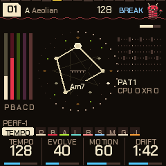

- **Top left:** the piece's number in a tag (`01` for HYPNO, `L03`, `H07`, `D02`, `J01`, `N05`, `B04`, `G09`, `E06`, `T10` for the other genres; a mark in the tag: changes not yet stored), the root and the mode.
- **Top right:** the slinky mascot, who hops on the kick, squashes on the snare, jumps on the drop, sleeps in a breakdown and shakes in a build; the tempo (`EXT` while an outside MIDI clock drives it; a play triangle beside it while stopped); then, working leftwards, what is on:

| Mark | Means |
|---|---|
| BREAK, BUILD | The section; `BREAK>`, `BUILD>`, `DROP>` while one waits for the bar. In a build, `DROP 3`: the bars to the drop. With the auto-DJ: `BREAK IN 4` in the groove's last bars, `BREAK 2` (the bars to its build) in its breakdown. |
| KNOB | An FX knob is off its home (a forgotten filter is not a mystery). |
| KEY | The drop's key change is on. |
| S1> to S4> | A scene waiting for the bar. |
| DJ | The auto-DJ is running. |
| FX | Effects are latched on and the menu is closed (the FX button blinks too). |
| a small dot | Something is waiting to be written to flash (the theme, Tune, MIDI out, a piece). |

- **Left:** the levels of the pad (P), bass (D), acid (A), pluck (C, for counter-melody) and kit (K).
- **Middle: the sigil.** A summoning circle turned so the chord's root is always at the top: the twelve notes round it (the scale's lit, the chord's bright), the chord's tones joined into a figure (a triad is a triangle, a seventh a four-sided shape, so you learn a chord's kind by its shape; its name is under the eye). It turns by the interval when the chord changes. Outside it, the 4-bar phrase fills round; then the bar's 16 steps (the kick's larger, the acid's gates tinted, the playhead white). A pentagram turns behind once in 16 bars, and runes flare by the notes the pluck plays. In the middle a demon eye: half open in a groove (its slit pupil widens on the kick, its gaze flips on the snare), shut in a breakdown, wide and trembling in a build (the phrase ring opens in spinning gaps), a white flash and a shock ring on the drop. **SEL + HOME** puts the slinky imp there instead (kept across power-off). When the engine sheds load the pentagram and runes go first. At its top right, the bar filling towards the next chord (or `held` while frozen).
- **Right:** the drum pattern playing, in a colour per lane, its number (`PAT 1`) and, when one is waiting, `> 3`; under it, the load: `CPU 41 XR 0` and below it `C2 38` and `S1` or `S2` when they apply (section 16).
- **The line above the knobs:** on the left, the sound of the voice on screen (on the drums' pages, the kit), then `BY HAND`, `+LINK` or `LINKS OFF`, and the octave when it isn't home (`OCT+2` for the page's voice, `SONG-1` for the song); on Global it says what SAVE will do (`01 SAVE: STORE`, `01 STORED`, `01 FACTORY`). On the right: the page's name and **the page dots**, one a page (25 on the SELECT dial): the page you are on bright, the others in its group dimmer. In the FX menu the dots are the four banks; inside an effect's settings, the 22 settings pages.
- **Bottom:** the four knobs: each value's name, its ring (or pips, for a switch of a few positions) and its value. The one you turned last is lit for a moment.
- **Pages that shape a sound draw it:** the envelopes and LFOs, the filters' response, the echo and reverb tails, the compressor's curve. The picture follows the knobs as you turn them, with a dot running along it. (It shows the idea, not exact milliseconds.)
- **Messages** take the header's place for a moment: `PATTERN 3 NEXT BAR`, `STORING`, `KEY CHANGE +5`.

---

## 5. The pages

SELECT walks through them in this order (31 pages; the dial stops at the ends). The buttons jump straight to
a voice, and pressing the same button again steps through that voice's envelope and LFO (and, for the pad, the
chords). On a voice's main page KNOB 1 is its level.

| Page | Reach it | a | b | c | d |
|---|---|---|---|---|---|
| Tempo | HOME | Tempo (70-190) | Evolve | Motion | Drift (20 s - 5 min a chord) |
| Pad | ENV | Level | Bright | Sound (24) | Detune |
| Pad env | ENV x2 | Attack (0.05-10 s) | Hold (0-8 s) | Release (0.1-12 s) | Rest (0-6 s) |
| Pad LFO | ENV x3 | Rate (a 1/4 note - 32 bars) | Depth | Shape (sine, triangle, saw, square, S&H, drift) | Target (filter, level, pan, pitch) |
| Chords | ENV x4 | Chord (Auto, Triads, 7ths, 9ths, Sus, Dub, Fourths) | Voicing (close / open) | Chorus (0-100) | Loop (off; 2, 4 or 8 chords repeat; with a ~, now and then one is drawn anew) |
| Bass | LFO | Level | Sound (24) | Cutoff | Reso |
| Bass env | LFO x2 | Trigger (chord, 1, 2, 4, 8 bars, off) | Attack (0.01-4 s) | Decay (0.05-16 s) | Amount |
| Bass LFO | LFO x3 | Rate (a 1/4 note - 32 bars) | Depth | Shape (as the pad's) | Target (cutoff, pitch, level, drive) |
| Bass line | LFO x4 | Mode (hold, root, kick, eighths, off-beat, walk, riff) | Length (how long a note holds) | Move (octaves, fifths, approach notes) | Glide |
| Acid | ARP | Level | Cutoff | Reso | Env mod |
| Acid env | ARP x2 | Decay | Accent | Slide | Sound (31) |
| Acid line | ARP x3 | Density | Length (1-16) | Range (1-3 oct) | Mutate (SEL + the knob: what a mutation changes: all, notes, rhythm, accents) |
| Acid answer | ARP x4 | Answer (off, octave, fifth, mirror, sparse) | Every (the 2nd ... 8th time round the line) | Direction (up, down) | - |
| Acid steps | ARP x5 | Step (the step chosen with a white key: rest, note, accent, slide, accent + slide) | Note (0-11 scale steps above the chord) | Octave (0-3) | Frozen (free, frozen) |
| Pluck | ARP x6 | Level | Sound (12 + 22 DX7 + yours) | Density | Octave (-2 to +2) |
| Pluck 2 | ARP x7 | Decay | Style (up, down, up-down, random, skip, thirds) | Rate (1/4, 3/16, 1/8, 1/16: slow to fast) | Range (1-3 oct) |
| Deja vu | ARP x8 | Pluck vu (0 new notes .. 100 locked) | Loop (4, 8, 16, 32 notes) | Leaps (an octave away) | Motif (0 off .. 100: how often a bar develops the phrase's first bar) |
| Drums | SEQ | Level | Drive | Swing (50-75 %) | Pattern (1-6, on the bar) |
| Links | SEQ x2 | K>Bass | S>Pad | H>Acid | P>Clock (off / clock) |
| Kit | SEQ x3 | Kick | Snare (and clap) | Hats (closed and open) | Perc |
| Drum drift | SEQ x4 | Change (off, next, random) | Every (the chord, 4-64 bars) | Pool (patterns 1-2 ... 1-6) | Mutate (off, shift, morph) |
| Groove | SEQ x5 | Lane (kick ... perc) | Density (0-100; 50 as written) | Source (follow, or pattern 1-6) | All dens (every lane's density) |
| Steps | SEQ x6 | Lane | Ratchet (off, x2, x3, x4, x6, flam, swell 3, swell 4) | Push (0-7 twelfths of a step late) | Level (normal, ghost, soft, accent) |
| Feel | SEQ x7 | Ghosts (0-100) | Accents (0-100; 50 as marked) | Pad comp (auto, hold, 7 rhythms) | Humanize (0-100) |
| Phrase | SEQ x8 | Chain (off, 9 chains of patterns) | Slice (off, 8 permutations, auto) | Time (normal, half, double) | Cond (the lane chosen: always, 1:2 ...) |
| Space | SELECT | Echo | Echo time (1/8, 3/16, 1/4, dotted 1/4, 1/2, 1 bar) | Reverb | Size |
| Reverb | SELECT | Type (plate, shimmer, gated) | Damping | Predelay (6-30 ms) | Amount |
| Comp/Limit | SELECT | Ratio (off - 10:1) | Thresh (-30 - 0 dB) | Make-up (0 - +12 dB) | Ceiling (-12 - 0 dB) |
| Mixer | SELECT | Track (pad, bass, acid, pluck, drums) | Level | Pan (L100 - C - R100) | Send (0-100) |
| Global | GLO | Root | Theme (6) | Tune (+-50 cents) | Genre (the bank: the same as GLO + PRESETS) |
| Jam | SELECT | Voice (pluck, pad, acid, bass) | Keys (scale, chords, harp) | Octave (-2 to +2) | Answer (off / on) |

Three more screens are off the dial: the **Sequencer** (hold SEQ; section 8), the **Perform** screen
(HOME again from Tempo; section 10) and the **visualizers** (HOME twice quickly; section 13). The Perform screen
and the visualizers have the FX knobs on their four knobs: Filter, Crush, Throw and Wash (section 9).

The old Noise page is gone: the bed of noise is now the **Vinyl** effect (section 9). The Mixer page sits between Comp/Limit (the
master bus; it was called Master) and Global.

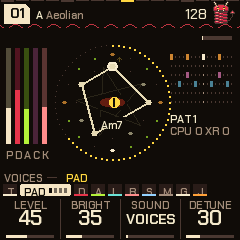

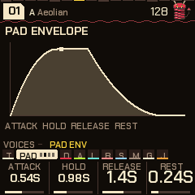

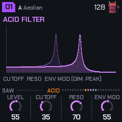

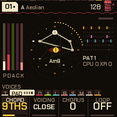

**What moves by itself.** The chord changes now and then (Drift sets how long it stays; EDIT moves it on). Each genre has its own habits in where it goes next on a seven-note scale: lofi and DnB love the fourth up (the ii-V-I turnaround), house loops by steps and thirds, dubstep and trap stay close to home on the dark side, dub keeps to a minor one-four vamp; HYPNO keeps the original walk. The **Loop** setting on the Chords page makes the last 2, 4 or 8 chords repeat.
The pad's voices breathe on unequal cycles and take the new chord's notes as they breathe in. The bass
follows the chord's root and glides. The acid line's notes are tied to the chord, so the riff transposes;
Mutate rewrites steps each time round. The pluck plays an arpeggio of the chord's tones. Motion sets how far
a slow tide swings between sparse and full, over a minute or two. Evolve makes the acid and the chords more
restless.

**Tempo.** Tempo 70-190. Hold HOME and turn SELECT for the tempo from any page, or tap it in: hold GLO and
tap **E4** four times or so. Over MIDI, an outside clock drives it and the screen says `EXT`.

### Octaves

**OCT- / OCT+** move an octave at a time, three down to three up. On the Pad, Bass or Acid pages (or their env
and LFO pages) they move that voice alone; on the Pluck pages they move the pluck, two down to two up; on any
other page, Tempo among them, they move the whole song (pad, bass and acid together). The line above the knobs
shows it when it isn't home: `OCT+2` for the page's voice, `SONG-1` for the song. The octaves are stored with the
piece. Going down, each voice stops at the bottom of what you can hear (about C1), so -2 and -3 may sound alike.

### Chords

The pad's chords come from the scale: each is built on a degree of it, and Drift sets how long one lasts
(EDIT moves on now). The **Chords** page (ENV four times) sets what kind of chord that is:

| Chord | What it plays |
|---|---|
| Auto | Sevenths on a 7-note scale (Am7, CM7, G7...), triads on a pentatonic |
| Triads | Three notes: Am, C, G |
| 7ths | Four: Am7, Dm7, CM7, on a pentatonic too |
| 9ths | 1, 3, 7 and 9, the fifth left out (four voices): Am9, CM9, G9 |
| Sus | 1, 4, 5 and the seventh: A7sus4, open and unresolved |
| Dub | The same minor 9 shape on every chord, whatever the scale says: the parallel stabs of dub techno |
| Fourths | Stacked fourths, an m11 sound: deep, hollow, modal |

**Voicing:** Close keeps the four notes together; Open drops the second from the top an octave, spreading
the chord out. **Chorus** is the pad's ensemble: three delays a side, each swept by a slow triangle, which
widens every pad sound without the pulsing a single swept delay makes (0 is off; the genres set 20-50). The
page also has **Root** (the same as on Global). For dub techno, try Chord on Dub with the pad's Dub sound
(chord stabs, dark) and the echo up: HYPNO piece 06 is set up that way.

---

## 6. Pieces, genres and storing

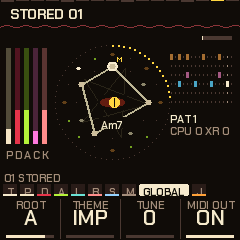

There are sixteen **genres**, each a bank of ten **pieces**. Turn **PRESETS** for another piece in the bank
(01-10 wrap round); hold **GLO** and turn **PRESETS** for another bank (it wraps too), or use the Genre knob
on the Global page. The same piece number keeps playing, in the new genre, and the genre's own effects come
with it (the lofi bank latches vinyl and tape on, house latches the pump on, and so on). Switching clears the
latched vinyl, tape, pump and phaser first. Each piece has its own settings, its own six drum patterns and its
own drum sounds; patterns 1-6 run roughly intro, groove, build, peak, variation and a thinner tool. A piece
shows a made-up title when you pick it (`VELVET RAIN`), the same one every time.

| Genre | Pieces | BPM | What it is |
|---|---|---|---|
| HYPNO | 01-10 | 118-138 | The original hypnotic techno and acid set. |
| LOFI | L01-L10 | 70-94 | Swung boom-bap: Rhodes in 7ths and 9ths over a warm bass, a soft sparse lead, the Dusty kit; vinyl and tape latched on. |
| HOUSE | H01-H10 | 118-126 | Four on the floor, claps on 2 and 4, off-beat open hats, stabs and organ, a sub or square bass, the House kit; the pump latched on. |
| DUBSTEP | D01-D10 | 136-150 | Half time, the Heavy kit, the bass as a wobble bass (its LFO on the cutoff), a harsh lead, dark pads, chords in fourths. |
| DUB | V01-V10 | 64-76 | One-drop, steppers and rockers: a sparse kick and rim, a deep bass on the one and three, the skank on the off-beats, a long dotted echo and a worn tape latched on; a breakdown keeps the kick. |
| DNB | N01-N10 | 170-178 | Two-step, liquid, roller, neuro, jump-up and half-time; the DnB kit, a shimmer reverb, a light pump and tape. |
| BREAKS | B01-B10 | 100-135 | Patterns after classic breaks (Funky Drummer, Impeach, Levee, Cold Sweat) and a big-beat stomp (some are approximations); the Break kit, a gated reverb, tape and the phaser latched on. |
| GARAGE | G01-G10 | 126-138 | Swung two-step, skippy, speed garage, a conga kick, rim Q&A (Minimal snare, House hats); tape and a light pump. |
| ELECTRO | E01-E10 | 118-130 | A syncopated kick, the clap on the backbeat, the Electro kit, a gated reverb; the phaser latched on. |
| TRAP | T01-T10 | 130-150 | The long 808 (the Trap kit), the clap on beat 3, hat rolls; a shimmer reverb and a pump under the 808. |
| DISCO | S01-S10 | 112-126 | Four on the floor, accented open off-beat hats, an octave-bouncing bass, strings and brass stabs, Wurli and clav, a little swing. |
| FUNK | F01-F10 | 96-110 | Syncopated sixteenths, ghost snares and soft kick pickups, a funk bass figure, a clav line, sixteenth comping, the Break kit. |
| REGGAE | R01-R10 | 70-84 | One-drop, steppers and rockers, the rim a touch late, a melodic bass, an off-beat skank, a long echo, the Dusty kit. |
| SYNTHWAVE | W01-W10 | 100-118 | Driving eighth-note bass, a gated reverb, a big accented snare, lots of chorus, arpeggiating acid. (On the screen: SYNTHWV.) |
| AMAPIANO | A01-A10 | 108-115 | A soft kick with shakers, a gliding syncopated bass (the log drum's part), jazzy 9ths, marimba and kalimba plucks. (AMAPI.) |
| TRIPHOP | P01-P10 | 70-88 | Slow and dusty, the snare laid back, ghosts, vinyl noise, a pluck loop that comes round again, minor and sparse. |

Inside a genre the pieces differ in sound as well as in key and tempo: each genre has a palette of sounds for
the pad, bass, acid, pluck and kits, and a piece takes one of each by its number. The pluck's sound, style and
rate vary by piece in every genre. Each genre also brings its own compressor settings (section 11).

The six after TRAP (disco, funk, reggae, synthwave, amapiano, trip-hop) use the same drum kits as the others; a kit of their own for the roots genres is planned.

**Storing (every genre):** go to **Global** and press **SAVE**. The piece is stored as it is: every page's
values, the scale and mode, its voices' sounds and kit, its patterns and its drums' sounds, in the genre you are in: the stored piece takes the
place of that genre's factory piece (piece 3 of lofi stored is piece 3 of lofi from then on; each genre has its own place in memory). The line
above the knobs says `01 SAVE: STORE` while it has changes, then `01 STORED`. Changes you don't store last while you stay in that genre
(moving between its pieces keeps them) and are gone when you change genre or switch off (the original genre's come back when you return to it).

**Factory:** on Global, hold **SEL and SAVE** together for 1.5 seconds (the screen says `KEEP HOLDING: FACTORY`; SAVE alone only stores): the piece goes back to how
it shipped, and out of the store (the slot goes back to the factory piece).

**When it's written:** at once. The FM-1 can't make sound while it writes to its memory, so a store made while
playing fades the music out (`STORING`), writes it, and fades back in exactly where it was: a pause of a
fraction of a second, the song carrying on in time with itself. MIDI clock out pauses with it. Factory works the
same way. Anything else PERF-1 keeps does the same dip (section 13).

**Power-on** always starts in HYPNO, on a piece at random: as you stored it, or with small random changes to
its factory settings if you never did.

| HYPNO piece | Character | BPM | Key |
|---|---|---|---|
| 01 | Hypnotic four on the floor | 128 | A Aeolian |
| 02 | Deep and dubby: rims, shakers | 124 | D Dorian |
| 03 | Pounding: rumble kick, claps | 132 | E Phrygian |
| 04 | Trance: offbeat opens, rolls | 138 | G Aeolian |
| 05 | Acid electro: cowbells, breaks | 130 | A Dorian |
| 06 | Dub techno: chord stabs (Dub chords), sparse, swung | 120 | F Pent minor |
| 07 | Minimal glitch: threes on fours | 134 | B Pent major |
| 08 | Rolling, tom-like percussion | 126 | Bb Mixolydian |
| 09 | Warehouse: hard, rides, rumble (the Techno kit) | 136 | C Phrygian |
| 10 | Deep field: half time, breaks | 118 | Eb Aeolian |

---

## 7. Sounds, kits and playing

Each voice has its sounds, and each drum fourteen, kept with the piece. Change them on the voice's own page
(the **Sound** knob), or from any of its pages with **SEL** + **ALGORITHM** (on the pluck pages, that steps
through the sounds that exist and wraps). The voice keeps playing what it was playing: its notes, envelope, LFO
and filter carry over to the new sound.

### The pad: 24 sounds

| # | Sound | What it is |
|---|---|---|
| 1 | Rhodes | FM, blooming as it swells |
| 2 | Voices | Sung: formants |
| 3 | Strings | Two detuned saws; Detune spreads them |
| 4 | Glass | An FM bell |
| 5 | Organ | Drawbars |
| 6 | Warm | Soft triangles |
| 7 | Stabs | Rhodes chords on the off-beats; Pad env Release is their length; Evolve adds a few |
| 8 | Dark | Voices, closed down |
| 9 | Dub | Saw chords stabbed, dark, for dub techno |
| 10 | Trance | A supersaw |
| 11 | Poly | Two detuned saws as a drifting pulse: an 80s poly |
| 12 | Hollow | Odd harmonics, like a clarinet |
| 13 | Pings | The Glass bells, stabbed |
| 14 | Hits | A house organ, stabbed |
| 15 | Rave | Supersaw stabs |
| 16 | Sine | Pure, for minimal |
| 17 | Ooh | The voices, darker and rounder |
| 18 | Wurli | An electric piano, bright, played as stabs |
| 19 | Mallet | Marimba and vibes chords: softer FM, stabbed |
| 20 | Brass | Saw chords stabbed, the filter wide open |
| 21 | Fat | A supersaw with the top closed down |
| 22 | Pluck | The Poly pulse as short stabs |
| 23 | Chapel | Drawbars with the top closed: a church organ |
| 24 | Air | An open sine: breath |

### The bass: 24 sounds

| # | Sound | What it is |
|---|---|---|
| 1 | Saws | Three, a few cents apart |
| 2 | Warm | Rounder, more sub |
| 3 | Grit | Driven |
| 4 | Dirty | A distorted sub |
| 5 | Reese | Two saws far apart: phasing |
| 6 | Pulse | Its width wandering |
| 7 | FM | The envelope opening it |
| 8 | Organ | Drawbars |
| 9 | Rumble | The sub driven, the saws far back: a techno rumble |
| 10 | Sub | A sine and its sub |
| 11 | Square | Hollow, deep house |
| 12 | Hoover | Detuned pulses and an octave down |
| 13 | Fifths | The root and its fifth: a dub chord |
| 14 | Metal | FM off the harmonics: clangy |
| 15 | Sync | A synced saw, swept by the envelope |
| 16 | Bright | The saws, the filter open |
| 17 | Wub | The sub on top, hard driven, the filter low: a dubstep wobble's body |
| 18 | Bite | FM at 2, the envelope opening it |
| 19 | Tine | FM at 3.5: an electric piano's bass |
| 20 | Clang | FM far off the harmonics |
| 21 | Gnarl | The reese driven hard |
| 22 | Wide | The hoover, softer, the sub up |
| 23 | Power | The root and its fifth, driven |
| 24 | Air | A soft open sine |

### The bass as a line

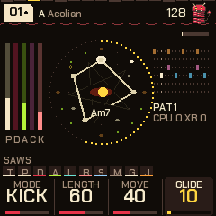

The bass can play notes instead of one held tone. The **Bass line** page (LFO four times) turns it into a bass line that follows the chord:

| Mode | The notes fall |
|---|---|
| Hold | (the original: one long note that glides to each chord's root) |
| Root | on the genre's own bass rhythm (hypnotic: the beats; lofi: a lazy three; DnB: a roll; ...) |
| Kick | on every kick hit, as an 808 or a sub does |
| Eighths | on every eighth |
| Off-beat | on the off-beat eighths (house) |
| Walk | on the beats: the root, then the third or fifth, then the fifth, then the scale note below the root, leading to the next |
| Riff | on the genre's figure: disco bounces the octave, funk and amapiano syncopate, reggae leans on the fifth |

**Length** is how long a note holds (a quarter step to five steps) before it lets go; **Move** is how often a note goes up an octave, to the fifth or to the scale note below the root instead (in Walk, how often the last beat steps below); **Glide** is the slide from note to note (0 plays each note as it is; 100 takes about 0.4 s). Each note opens the bass's filter again, with the **Bass env** page's attack and decay, so that page still shapes the sound; its Trigger setting does not apply. The sound, cutoff and reso are the **Bass** page's. A breakdown plays no notes; a build plays none in Kick mode. A bass played by hand from the keys is not a bass line.

New pieces start as a bass line in lofi (Root), house (Off-beat), dubstep and trap (Kick, long, a little glide), electro and synthwave (Eighths), disco, funk, reggae and amapiano (Riff), and trip-hop (Root); the other genres keep the bass. Every note stays between C1 and B5.

### The acid: 31 sounds

| # | Sound | What it is |
|---|---|---|
| 1-2 | Saw, Square | The 303's two |
| 3 | Driven | Pushed hard, up front |
| 4 | Sync | Hard sync, swept by the envelope |
| 5 | Pluck | FM |
| 6 | PWM | A pulse with its width moving |
| 7 | Chip | A raw 8-bit square |
| 8 | Sub | With a square an octave down |
| 9 | Trance | Three detuned saws: a trance arp |
| 10 | Bleep | A sine, the bleeps of early techno |
| 11 | Fifth | A saw and its fifth: a rave stab |
| 12 | Bell | FM at 3.5, the index falling |
| 13 | Organ | A house organ riff |
| 14 | Laser | Its pitch falling with the envelope |
| 15 | Fold | A sine folding over as the envelope opens |
| 16 | Soft | A triangle, for quiet arps |
| 17-24 | Marimba, E.Piano, Kalimba, Brass, Gong, Clav, Vibes, Digital | Parametric FM, each at its own ratio and index (Brass: the index rising as the note settles; Digital: a DX-style bell) |
| 25 | Super | Five saws spread +-24 cents: a trance lead's wall |
| 26 | CZ | Phase distortion: a cosine bent into a saw as the envelope rises, with a resonant peak, as Casio's CZ |
| 27 | Mini | Virtual analog: two saws a few cents apart and a pulse an octave down: a monosynth bass |
| 28 | Hyper | Five saws twice as wide as Super |
| 29 | CZ Pulse | Phase distortion toward a square: a hollow tone going to a buzz |
| 30 | CZ Bell | A partial at 3.5 times the pitch, ringing with the envelope |
| 31 | Lead | Two saws and a wandering pulse |

### The pluck: 12 + 30 + up to 16 sounds

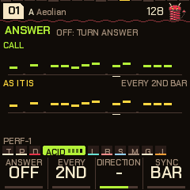

The pluck is the counter-melody: two plucked voices taking turns (a tail rings under the next note), playing an
arpeggio of the chord's tones. It is quiet by default (Level 30, Density 45; turn Level to 0 for none), plays on
the bar's grid with swung off-sixteenths, and thins out in a breakdown. Its two pages are on **ARP** (the fourth
and fifth). **Style:** up, down, up-down, random, skip (every second tone), thirds. **Rate:** 1/8, 1/16, 1/4 or
dotted 3/16. **Range:** 1-3 octaves. **Decay:** how long a note rings; for the DX sounds it sets how long the key
stays down (0.12 s to 1.7 s), and a note fades out a while after the key comes up. The MOOD macro moves its
level, decay and density.

- **Plain (12):** Pluck, Marimba, E.Piano, Kalimba, Bell, Vibes, Gong, Clav, Digital, Brass, Bleep (a plain sine), Glass. All FM at their own ratios, apart from Bleep.
- **Built-in DX7 voices (22):** DX Tine EP, DX Glass Bell, DX Round Bass, DX Brass Sect, DX Soft Pad, DX Wood Bars, DX Drawbars, DX Nylon Pick, DX Brass 2, DX Solid Bass, DX Bells, DX Marimba, DX Clavinet, DX Strings, DX Glass Pad, DX Sync Lead, DX Harp, DX Kalimba, DX Flute, DX Steel Drum, DX Saw Bass, DX Tubular. A six-voice, six-operator FM engine plays them as a DX7 would (all 32 algorithms, the envelopes with their curves and scaling, velocity, LFO, pitch envelope, feedback). Heavy patches are held to fewer voices (the bells, brass, strings and pads to three or four) to spare the processor.
- **Yours (up to 16):** DX7 voices you load yourself come after these, named `DX` and the voice's own name (section 15).

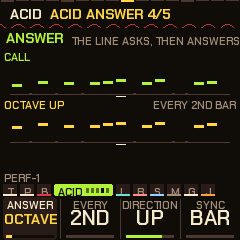

**The answer (call and response).** The **Acid answer** page (ARP four times) makes the line ask and then answer. **Every** is how often: the 2nd to the 8th bar (or loop, see Sync: with Every on 4th you hear the call three times and the answer the fourth), or **Drift**: the bar before the drums change, so the answer comes in with the pattern change (with drum drift not changing patterns it falls back to every 8th). **Answer** is how the line is changed: **Octave**, **Fifth** (seven semitones), **Third** (two degrees up or down the scale, so it stays in key), **Mirror** (the contour upside down round the line's own middle, so it stays in the line's register), **Reverse** (the line backwards), **Rotate** (the line displaced a beat), **Sparse** (only the even steps) or **Accents** (only the accented notes). **Direction** is down 2, down, the same, up or up 2: for the octave, fifth and third a step of the interval, for the others (mirror, reverse, rotate, sparse, accents) octaves. Where the move would leave the acid's register (a low line answered downwards) the answer goes the other way, so it never folds back onto the call. **Sync** is what Every counts: **Bar** (the answer is a bar, so with a line of 12 or 10 steps it begins and ends mid-line) or **Loop** (the answer is the whole line, counted in times round it, and with Drift it is the loop that starts in the bar before the drums change; use Loop for lines that are not 16 steps). The page draws the call and its answer, a dot a step at its note's height. Off by default; stored with the piece (the editor has it under Acid).

The eight newest built-in DX voices are guitars, a bass and brass: **Steel Gtr** (a strummed steel string, long ring), **Clean Gtr** (an electric that holds, a little chorus), **Muted Gtr** (the funk chank, over in a tenth of a second), **Drive Gtr** (a feedback chain for a distorted string, held), **Slap Bass**, **Synth Brass** (a swell, the bite coming up), **Sax** (a reed with a delayed vibrato) and **Mute Trumpet** (the thin, nasal vowel of a mute). They are first drafts, written for PERF-1 and tuned by numbers rather than by ear, and are used in the disco, funk, reggae, synthwave, amapiano and trip-hop genres; tell the maker what you think of them. **The DY set** (Settings page, **Voices**: DY) swaps all thirty for human-made DX7 voices of the same roles, chosen by name from public-domain banks (Pafreak's SYNTHOXICATED banks, madFame's Custom Patches and the 1980s magazine banks on Bobby Blues' page; one from Jack Deckard's collection on Dave Benson's page): `DY Tine EP` is madFame's MF EPRHOD1, `DY Sax` the Aftertouch magazine's SAXOPHONE, and so on (`tools/fm6_dy.txt` in the source lists each). The names on the unit change with the switch; the genres' balance holds, each DY voice being levelled to the DX voice it stands in for. For more, load your own: the installer page takes any DX7 `.syx` bank or single voice (section 15), and there are large free collections of them, such as [Bobby Blues' DX7 archive](https://bobbyblues.recup.ch/yamaha_dx7/dx7_patches.html), [Soundarchive](https://www.soundarchive.co/yamaha-dx7) and [Yamaha Black Boxes](https://yamahablackboxes.com/collection/yamaha-dx7-synthesizer/patches/) (the licence of each bank is its author's: PERF-1 does not include any).

### Acid steps: freeze the line and edit it

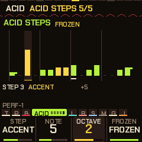

The acid line is made up as it goes and rewritten a little each time round (Mutate). To keep a line you like, and to shape it, use the **Acid steps** page (ARP five times, after Acid answer). It draws the line as sixteen bars, a step each: the height is the note, the accent in the bright colour, a short tail where a step slides into the next, a dash for a rest, and a mark under the step playing. A **white key** chooses a step; the knobs set it:

| Knob | Does |
|---|---|
| Step | **Rest**, **Note**, **Accent**, **Slide** (it slides into the next) or **Acc+Slide**. |
| Note | The note, 0 to 11 scale steps above the chord (the line follows the chord, so it moves with it). |
| Octave | 0 to 3 octaves up (on top of the Acid octave). |
| Frozen | **Free**: the line evolves (Mutate) and a new one grows with each piece. **Frozen**: the line is held as it is, Mutate leaves it alone, and it is **stored with the piece** (Global, SAVE) and comes back with it. |

Any edit freezes the line (it would otherwise be rewritten); turn Frozen back to Free to let it evolve again. Freeze it without editing by turning Frozen to Frozen on the line you are hearing. The line's length, the answer (section 7) and the Acid octave work on a frozen line as on any other. The steps beyond the Length are drawn dim and do not play. A piece stored in an earlier version has a free line.

### Deja vu: loops in the pluck, and what the acid mutates

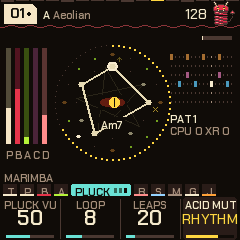

The pluck normally chooses each note afresh. The **Deja vu** page (ARP eight times) makes it remember: it keeps the last 4, 8, 16 or 32 notes (**Loop**), and each time one comes round again, **Pluck vu** is the chance it is the same note, rest or leap as last time (0: every note is new, 100: the loop is locked and repeats exactly). The chord it is played over is the chord of now, so a locked phrase follows the harmony. **Leaps** is how often a new note jumps an octave. Changing the loop's length, or a new piece, forgets the loop.

**Motif** is the pluck thinking in phrases. The first bar of each eight is kept as an idea: which sixteenths sounded and how far each note stepped up or down the chord from the one before. Each bar after then develops it with the chance the knob gives (60 by default): the same figure from where the line is (a sequence, so it follows the chords), now and then upside down (an inversion) or with a new last interval (a new ending), and the fifth bar restates it at its own pitch, the answer to the first. Most phrases start a new idea; some keep the old one and open with it again. At 0 the pluck invents every bar as before. Deja vu lies on top: a replayed note is replayed whatever the motif says.

The acid has always had this in its **Mutate** (Acid line page): each time round it rewrites a few steps. **SEL + the Mutate knob** on that page chooses what a rewrite changes: **All** (as before), **Notes** only (the rhythm stays, the notes drift: the classic acid), **Rhythm** only (the same notes come and go), or **Accents** (only the accents and slides).

### The kits: 14

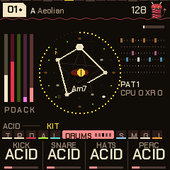

Press **SEQ** three times for the Kit page. Each knob picks one drum's sound: the kick, the snare (and the clap
with it), the hats (closed and open) and the perc, each from the same fourteen:

| Kit | The kick | The rest |
|---|---|---|
| Hypno | Deep | Metallic 808-style hats, a soft rim |
| House | Round | A wide clap, long open hats, congas |
| Techno | Hard, with a rumble tail | Tight clap, metal hats, a bell perc |
| Acid | Punchy 909-style | A cowbell for the perc |
| Break | Distorted | A cracking snare, noisy hats, a tom. The Break kick also chops the drums live (ghost snares, extra kicks, 32nd rolls; Evolve: more) and crushes them. |
| Minimal | Short and clicky | A rim for the snare, tight hats, a woodblock |
| Hard | Industrial: distorted, a long rumble | A noisy snare, a metal clank; it crushes the drums a little |
| 808 | A long boom | A snappy snare, a wide clap, a cowbell |
| Dusty | A soft round kick, ducking the rest a little | A loose low snare, a muted clap, dull short hats, a soft rim (lofi) |
| Heavy | A deep sub kick with a long tail, ducking the bass hard | A big cracking snare, a wide clap, tight hats, a metal perc (dubstep) |
| 909 | Punchy, with a click | A snappy snare, a clap, ticking hats and long open ones, a tom |
| Electro | Short and high | A tight bright snare, a thin clap, glassy hats, a zappy tom |
| DnB | Tight | A loud cracking snare, a clap, fast tiny hats, a clicky perc |
| Trap | A long 808 sub with almost no click | A snare and a wide clap together, tiny hats, a bell |

On any of the drums' pages, **SEL** + **ALGORITHM** turns all four to the next kit at once. Mix them freely: a
Techno kick under House hats is fine.

### Playing a voice by hand

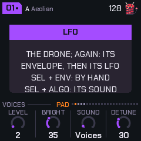

The keys set the scale, as ever. To play a voice yourself, take it off the algorithm: go to any of its pages
(**ENV** the pad, **LFO** the bass, **ARP** the acid), hold **SEL** and press **ENV**. It goes quiet and the line
above the knobs says `BY HAND`. On a page that isn't a voice's, SEL + ENV just says so. Now, while its pages are on
screen (Pad, Pad env, Pad LFO or Chords; the bass's three; the acid's three), the keys play it over the rest of
the song:

- **Pad:** up to four notes at once, each on one of its voices, with the Pad env's Attack and Release (quicker than the breaths).
- **Bass:** the last key held, two octaves down; the envelope opens on each new press.
- **Acid:** the last key held, an octave down, with its filter and envelope. A second key while one is held slides to it, as a 303 does.

Everything else carries on with the algorithm: the other voices, the chords, the drums. The keys follow the
voice's octave and the song's (OCT- / OCT+), and the lit keys still show the scale, so you can see what's in key.
It works while stopped too. A key keeps playing until you let go, even if you change page; on any other page
(Tempo, Global and so on) the keys still edit the scale. **SEL** + **ENV** on its pages again puts it back on the
algorithm. Which voices are played by hand is kept with the piece. MIDI out sends what you play, on the voice's
channel. The pluck is played on the **Jam** page instead (section 10).

### Links: the drums into the voices

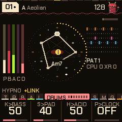

The drum hits can be patched into the voices, like trigger cables on a modular. **SEL + SEQ** turns the links on
and off without losing their amounts (`+LINK` shows on the line above the knobs while they're on); the **Links**
page (SEQ, then SEQ again) sets each one, 0 being none. They're stored with the piece.

| Link | What it does |
|---|---|
| K>Bass | Each kick opens the bass's filter, falling back over the beat: a rolling bass that follows your kick pattern. The amount sets how far and how long. |
| S>Pad | Each snare or clap flashes the pad's filter open and swells it a little, so the pad answers the backbeat. |
| H>Acid | A hat landing on an acid note accents it: busier hats, a squelchier 303. |
| P>Clock | The acid line steps only when the perc lane hits, so the perc pattern in the sequencer becomes the acid's rhythm. In a breakdown or build, with the drums out, it runs free again. |

Muting a drum with FX silences it but its hits still drive the links: mute the perc and it's a pure clock for
the acid.

---

## 8. The sequencer

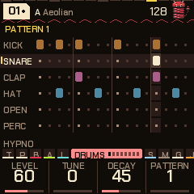

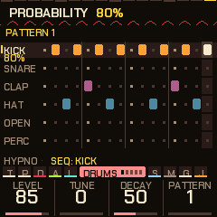

**Hold SEQ** to open it; tap SEQ to go back to the Drums page.

- Six lanes: kick, snare, clap, closed hat, open hat, perc. Sixteen steps. A lane has its own colour.
- The sixteen **white keys** are the steps of the drum you're on. They light where it hits, and the light running across them is the playhead. Tap a key to turn its hit on or off.
- **OCT-** / **OCT+** choose the drum (the previous, the next).
- The knobs: the drum's **Level**, **Tune** (+-1 octave) and **Decay**, and the **Pattern** you're editing (even before it plays; a change waits for the bar).
- With **SEL** held: white keys 1-6 (F3 G3 A3 B3 C4 D4) choose the pattern to edit, black keys 1-6 copy this pattern into pattern 1-6, OCT- clears this drum's lane, OCT+ puts back the piece's own lane.

**Tricks: SEL + a knob** (on the lane you're on):

| SEL + | Does |
|---|---|
| KNOB 1 | Fills the lane with a **Euclidean** pattern of n hits in 16 (0 clears it). |
| KNOB 2 | **Rotates** that pattern round (0-15 steps). |
| KNOB 3 | Sets the lane's **probability** in steps of 5 %: a hit sounds that often. The lane's name shows its chance when it is under 100. Rolls and fills held on top still sound. |
| KNOB 4 | Sets the lane's **length**, 1-16 steps (polymeter). Shown as `L5` under the lane's name, with a mark where it ends and the steps beyond it dimmed. 16 is the bar. A shorter lane counts steps from the start of the song, not the bar, so a 5-step hat against the 16-step kick comes round again every 80 steps. |

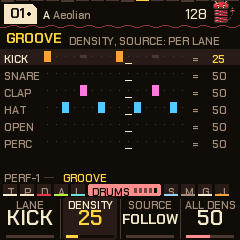

**The groove: density and a lane's own pattern.** The **Groove** page (SEQ five times, or the dial after Drum drift) draws every lane as it plays: a bright hit as written, a white one added, a dash one taken out. **Density** (50 plays the lane exactly as written; the pattern itself is never edited) takes the hits of least importance out first as you turn it down (the off-sixteenths, then the off-eighths, the beats last) and puts hits on the most important empty steps as you turn it up (at 100, half of them). **All dens** moves every lane at once. **Source** makes a lane play another pattern's lane from the next bar (take the hats from pattern 4 while the kick stays on pattern 1; on the sequencer, **black keys 1-6** set the lane you are on, **black 7** sets it back to following the piece; a pinned lane has its pattern's number after its name). Density and source are stored with the piece, and scenes carry them.

Probability and length are stored with the piece. The Euclidean fill and rotation edit the pattern, so
they stay in it if you store the piece.

### Steps: ratchets, push and level

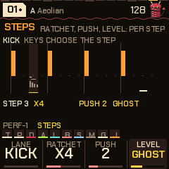

Under the six patterns each lane has **step tricks**: a **ratchet**, a **push** and a **level** for each of its sixteen steps, on the **Steps** page (SEQ six times, or the dial after Groove). KNOB 1 chooses the lane; a **white key** chooses the step (the key lights, and the page shows the lane as it plays); the other knobs set that step:

| Knob | Does |
|---|---|
| Ratchet | The hit is repeated inside its step: **x2**, **x3**, **x4**, **x6**, a **flam** (a quiet grace note just before), or a **swell** (three or four hits getting louder). |
| Push | The hit lands late, 0 to 7 twelfths of a step (a laid-back snare; at 128 BPM about 10 ms a step). It can only be late, not early. |
| Level | **Normal**, **ghost** (very soft), **soft** or **accent**. |

The page draws each step as a bar (its height the level, shifted by its push) with the ratchet's hits as small bars under it. The tricks belong to the lane's steps, whatever pattern plays, and are stored with the piece (a piece stored in 0.13 simply has none). They apply to the hits the pattern makes; a trick on a step with no hit waits for one. They do not apply in fills, builds, breakdowns, or to the hits the drop lands on, and the first bar after PLAY plays without them. Some genres ship with tricks: the off-beat hats soft (lofi, house, garage and most of the rest), the hats' off-beat accented (disco, house, electro), the backbeat accented (DnB, breaks, funk, synthwave), the snare laid back (lofi, trip-hop, reggae's rim a touch), trap's triplets and a swell on its last hat beat.

### Feel: ghosts, accents, comping and looseness

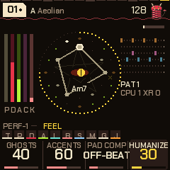

The **Feel** page (SEQ seven times) holds what makes a groove human:

- **Ghosts** (0-100): the genre's ghost notes, soft snares (and soft kicks in lofi, breaks, funk, trip-hop) on steps the pattern does not have. At 100 about six in ten of those steps sound. Lofi, house, DnB, breaks, garage, funk and trip-hop have ghost steps; the others are unchanged.
- **Accents** (0-100; 50 is as marked): how much the Steps page's accents and ghosts count. 0 plays every level alike; 100 exaggerates them.
- **Pad comp:** the rhythm of the pad's stabs, for stab-type pad sounds (Stabs, Dub, Pings, Hits, Rave, Wurli, Mallet, Brass, Pluck). **Auto** takes the genre's own; **Hold** never stabs (a stab sound plays as a held pad); the others force the stabs on any pad sound: **Off-beat**, **On-beat**, **3-3-2**, **Charleston**, **Syncopated**, **Sparse**, **Eighths**.
- **Humanize** (0-100): a little looseness, each hit a touch softer and a touch late.

### Phrase: chains, slices, half and double time, conditions

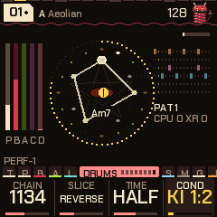

The **Phrase** page (SEQ eight times) shapes what the patterns do over several bars:

- **Chain** plays a different pattern each bar, round and round: **12** (patterns 1, 2), **1112**, **1123**, **1134** (the Amen's), **1213**, **1234**, **1232**, **1115**, or **123456**. While a chain is on, it chooses the pattern at every bar line (the Pattern knob, held pattern keys and drum drift's changes give way to it; drift's fills still come); off, the patterns are yours again. Turning it on or changing it starts it from its first bar.
- **Slice** reads the drum steps in another order (the drums only; a lane with its own length keeps its steps): **Halves** (the two halves of the bar swapped), **Stutter** (the first beat of each half repeated), **Reverse** (the bar backwards), **Delay** (the back half an eighth late), **Beats** (the middle two beats swapped), **Mirror** (the second half backwards), **Double** (the first half twice), **Swap** (the beats within each half swapped). **Auto** gives the last bar of every four a different one, drawn at random.
- **Time** reads the pattern at half speed (**Half**: over two bars, the hats in eighths: DnB into drumstep) or twice (**Double**: twice in a bar; a hit on an odd step joins the step before).
- **Cond** is the condition of the lane chosen (on Groove, Steps or the sequencer; the knob shows its first letters): **Always**, **1:2** (odd bars: the first, third ...), **2:2** (even bars), **1:4** (the first bar of four), **4:4** (the last of four), **1:8** (the first of eight), **Fill** (the lane's pattern hits sound only in fill bars) or **No fill**. A condition decides whether the pattern's hit sounds; fills still add theirs.

Everything on this page is stored with the piece (the chain and the slice as numbers; the conditions one a lane).

---

## 9. Effects

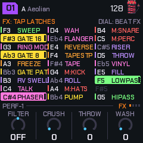

Press **FX** to open the menu; press it again to close it. While it's open, every key is an effect. The
**SELECT** dial walks four banks of keys: **FX**, **BEAT FX**, **FLEX BEAT** and **DJ SNIPS** (it stops at the
ends). The knobs are the **FX knobs**.

**Tap latches, hold plays.** Tap a key (let go within a quarter of a second) and its effect latches on; hold it
and it plays only while it's down. Tap a latched key to turn it off. Several can be latched together. A key is
found by its colour as well as its name: repeats cyan, filters green, gates and the pump yellow, the drums' mutes
red, the colour effects pink, builds violet, the transport moves (reverse, stops, scatter) orange, Flex Beat teal.
A held key is a lit tile in its colour; a latched one has a bar beside it.

**Locks outlast the menu:** close FX and the latched effects keep playing (the FX button blinks and `FX` shows by the
tempo), so the keys are free for the scale or a voice again. To turn one off, open FX and tap its key. **OCT-** in
the menu turns everything off (effects, FX knobs, mutes and solos; GLO + B3 undoes it). SAVE tapped in the menu is
still the breakdown.

**The FX knobs** (in the menu, and on the Perform screen and visualizers, where the menu isn't needed):

| Knob | Does |
|---|---|
| Filter | Left of centre, a low-pass closing from 16 kHz to about 250 Hz; right of centre, a high-pass rising from 20 Hz to about 1.6 kHz; off in the middle (`OFF`, then `LP 40` / `HP 40`). |
| Crush | Bit and sample-rate reduction (at the top, about 5.5 kHz and 5 bits). |
| Throw | Throws the mix into the echo: more of it, repeating for longer. |
| Wash | Sends the mix into the reverb. |

They aren't stored (they go home at power-off); a scene stores them. The header says `KNOB` while one is off home.

### Bank 1: FX

The 27 keys run F3 to G5; on the screen they fall down three columns of nine.

| Key | Effect | Key | Effect |
|---|---|---|---|
| F3 | Sweep: a filter swept in time with the tempo | F#4 | Tape: wow, flutter, drive |
| F#3 | Gate 16: a trance gate on the synths, 1/16 | G4 | M:KICK, a momentary mute |
| G3 | Ring mod | G#4 | Roll: repeats that speed up |
| G#3 | Gate 8: the same, 1/8 | A4 | M:HATS |
| A3 | Freeze: a granular freeze | A#4 | Pump: a sidechain ducking |
| A#3 | Gate pattern: the gate with its own pattern | B4 | M:SNARE (snare and clap) |
| B3 | Reverse swell | C5 | M:PERC |
| C4 | Talk: a vowel filter, A E I O U, across everything | C#5 | Riser: a build (a filter and wash climbing) |
| C#4 | Phaser | D5 | Throw: an echo throw |
| D4 | Wah: an auto-wah that follows the loudness | D#5 | Vinyl: crackle, hiss and pops (the bed of noise) |
| D#4 | Flanger | E5 | Fill: a drum fill |
| E4 | Reverse | F5 | Low-pass, closing in |
| F4 | Tape stop | F#5 | FILL>: a drum fill in the next bar (a tap) |
| | | G5 | High-pass |

The drums' mutes here are momentary like any held key; the other tracks' mutes and every solo are on the GLO layer (section 10).

### Bank 2: BEAT FX

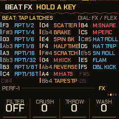

| Keys | Effect |
|---|---|
| F3 to C4 | Beat repeats, slow to fast: 1/2, 1/4, 1/6 (a quarter-note triplet), 1/8, 1/16, 1/32, then 1/8T and 1/16T (triplets). The shortest held wins; they start from the next sixteenth. |
| D4, D#4, E4 | Scatter (the last slices shuffled), Brake (a vinyl brake), Spin back |
| F4, F#4 | Half time, Scratch (an automatic scratch) |
| G4, A4, B4, C5 | The drums' mutes, as on bank 1 (kick, hats, snare, perc) |
| G#4, A#4 | Reverse, Tape stop |
| C#5, D5, D#5, E5, F5 | Drum rolls: Hat roll (the hats every step, in 32nds), Hat trip (in triplets), Snare roll (louder through the bar), Flam (a grace note before every snare and clap), Double kick (each kick again half a step on) |

Beat repeat and reverse play back the last moment of the mix (just under a second); a 1/2 repeat that doesn't fit at
slower tempos plays as a 1/4.

### Bank 3: FLEX BEAT

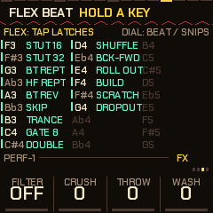

Twenty-seven one-bar patterns, one on every key, F3 to G5, that rework the last stretch of the music on the grid:
**Bt Rept** (the last beat looped), **Hf Rept** (the last half bar), **Bt Rev** (the beat
backwards), **Skip**, **Trance** (a 3-3-2 gate), **Gate 8**, **Double**, **Shuffle**, **Bck-Fwd**, **Roll out**, **Build** (live,
then a stutter that speeds up), **Scratch**, **Dropout**; **Jump bk** (the last beat again, then on), **Halves** (the
two halves of the last half bar swapped), **Swap** (sixteenths swapped in pairs), **Mirror** (forwards, then
backwards), **Lag** (late, with a hole), **Slowmo** (every sixteenth twice: half time without the pitch drop),
**Skip 3** (three against four), **Stut up** and **Stut dn** (a stutter that speeds up, or slows down),
**Tresillo** (3-3-2 on the last sixteenth), **Offbeat** (the off-beats only), **Cut 4** (a hole every fourth step),
**Rev 8** (the half bar backwards, twice), **Half gap** (the half bar once, then silence). The stutters that were
here (Stut 16, Stut 32) are the beat page's repeats. Tap latches, hold plays. The settings page (below) has
**Quant** (off, beat, bar: when it starts; bar is the default), **Mode** (one shot: the bar plays out, then a latched
pad lets go; or loop: until the pad is let go or tapped off) and **Mix** (dry to wet). A pad held down by hand repeats
its bar, and on release the current bar plays out, so it always ends on the bar line. The ring is frozen while it
plays, so the slices are the last 8 sixteenths (fewer at slow tempos).

### Bank 4: DJ SNIPS

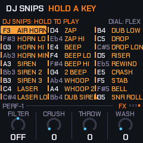

The 27 keys, F3 to G5, are sounds a DJ throws in, made on the spot: AIR HORN (held), AIR BLAST (a short blast), HORN MIN (a minor chord, held), RAVE HORN (the hoover, held), SIREN, SIREN 2,
SIREN 3, LASER, LASER LO, ZAP, ZAP HI, BEEP, BEEP LO, BEEP HI, 2 BEEP, WHOOP, WHOOP 2, DUB SIREN, DUB LOW, DROP, DROP
LONG, RISER, REWIND, CRASH, RAVE STAB (the hoover as a stab), BELL and SNR ROLL (a snare roll that speeds up). Up to four at
once. They play while held (they aren't latched). The snips page sets **Pitch** (normal, an octave up or down), **Play**
(HELD: the horns, sirens, dub siren, riser and roll sound as long as the key is down; ONE SHOT: they sound for a second
or so and every other one plays out), **Echo** (dry, some, lots: how much goes to the echo and the reverb) and **Level**.

### Settings pages

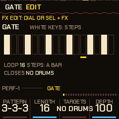

Every effect with settings has a page that draws it. Reach a page by: **SEL + a key** in the FX menu (the effect that key
plays; an effect with no settings says so), **FX twice quickly** (the effect you used last), **SEL + FX** (walks all 24,
then back to the keys; Talk and Wah come right after the phaser and flanger), or the **SELECT dial** once you are in one (no wrap). **FX** closes. The effect is on while its page
is up, so you hear what you edit (the roll, riser, scatter, brake, half time, scratch, freeze and reverse swell need a key
held to be heard). The dots at the right of the knob strip show where you are among the 22.

| Page | a | b | c | d |
|---|---|---|---|---|
| Gate | Pattern (3-3-3, tres, offbeat, Euclid 5, 7 or 9, waltz, chop, sparse, dense, dotted, 5/10, custom) | Length (2-16 steps) | Targets (no drums, pad, bass, acid, drums, hats, kick, all, no kick, kick+bass, pluck) | Depth |
| Phaser | Rate | Depth | Feedback | Mix |
| Flanger | Rate | Depth | Feedback | Mix |
| Vinyl | Level | Crackle | Hiss | Tone |
| Tape | Wow | Flutter | Drive | Dull |
| Roll | From (1/2 to 1/64) | To | Each (1/2, 1, 2 or 4 beats at a rate) | Swell |
| Pump | Depth | Release | Every (1/2, 1/4, 1/8, 1/16, or KICK: on every kick, wherever the kicks are) | Targets |
| Riser | Time (about 1-12 s) | Filter | Wash | Echo |
| Scatter | Chaos | Reverse | Slice (1/32, 1/16, 1/8) | Slices (2-8) |
| Brake | Time | Spin back | Return | Dull |
| Half time | Speed (x1.5, x2, x4) | Slide | - | - |
| Sweep | Every (8, 4, 2, 1 bar, 1/2, 1/4, 1/8) | Depth | Reso | Type (low, high, band) |
| Scratch | Every (1/4, 1/8, 1/16, 1/32) | Reach (1/16, 1/8, 1/4, 1/2) | Style (baby, pull) | - |
| Freeze | Size | Spread | Grains (1-4) | - |
| Rv swell | Length (1/2, 1, 2 beats) | Mix | - | - |
| Ring mod | Tone (40-800 Hz) | Mix | - | - |
| Auto DJ | Scenes (at once, next bar) | Groove (8, 16, 32, 64 bars, sync) | Break (short, half, full) | Fill (off, on) |
| Settings | Key (same, +2, +3, +5, +7) | Saver (off, 1, 3, 10 min) | Lights (off, show) | Voices (DX, DY): which set of thirty built-in DX7 voices the pluck's `DX` sounds are (section 7) |
| USB & MIDI | Level (knob, fixed): the USB audio follows the master knob, or stays at a fixed level so a recording does not move when you turn it | MIDI out (off, on) | - | - |
| Repeat | Pitch (-12 .. +12 semitones, stepping each repeat toward it over four beats held: a build; every repeat still starts on the grid) | Decay (0 .. 6 dB a repeat: a dub tail) | Gate (full, 3/4, half, 1/4 of the slice sounds) | Refresh (off, beat, bar: the slice is the newest again, a slip roll, where the ring is long enough for it) |
| Flex | Quant (off, beat, bar) | Mode (one shot, loop) | Mix | - |
| Snips | Pitch | Play | Echo | Level (the keys play the snips on this page, to try them) |
| Talk | Every (2 bars, 1 bar, 1/2, 1/4, 1/8) | Depth | Reso | Mix |
| Wah | Sens | Range | Reso | Mix |

The Gate page's white keys are the pattern's steps (lit where it opens; the step playing is marked); editing a step makes
the pattern "custom". A pattern of 12 or 10 steps against the bar of 16 is a polymeter. **Gate 16** and **Gate 8**
share this page. The settings, the gate's pattern and targets are kept across power-off (section 13).

---

## 10. Performing

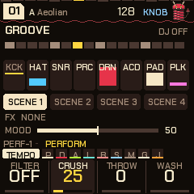

- **Breakdown: tap SAVE.** The bar before it the percussion, the open hat and half the hats drop out, so it comes as a release; then the drums stop on the next bar (house, techno, dubstep and dub keep the kick; drum and bass keeps the hats), the mix darkens, the bass closes and the pad rises, for as long as you leave it.
- **Build: tap SAVE again.** A snare roll climbing in pitch with the bass opening (four bars; two in trap, lofi and trip-hop; eight in house), the last bar with the open hat on every eighth and, in the four-on-the-floor genres, the kick back; then the drop.
- **Drop: hold SAVE.** Straight back in on the next bar. SAVE lights during a breakdown or build and blinks while one waits for the bar.
- **Freeze: REC.** The chord holds and the reverb rings on; press again to let it move.
- **Next chord: EDIT.** Moves on at the next bar.
- **The scale: the keys.** Each adds or removes its note; the root stays. ALGORITHM picks a mode.
- **Patterns.** Drums page, knob d, or SEL + white keys 1-6. A change waits for the bar, so turning past patterns plays none of them.
- **Drum drift: the patterns change by themselves** (SEQ four times). **Change** moves on to the next pattern, or a random one from 1 to the **Pool**, **Every** so many bars, or with each chord change. The bar before a change ends in a fill, the snare and hats rolling in. **Mutate** rewrites a little at the same moments: Shift moves a hit or two a step, Morph also adds or takes one. The kick and clap stay as written, and a snare on a beat never moves, so the floor and the backbeat hold, and what changes stays in the pattern (store the piece to keep it). Mutate works with Change off too, wearing one pattern in slowly. Off by default. The four settings are yours: they stay when you change piece or genre.

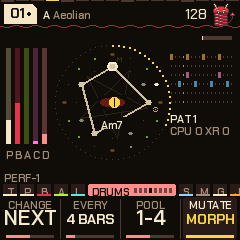

There's no song saving: record the audio (or MIDI out) into your DAW and keep the takes you like.

### The Perform screen

Press **HOME** on the Tempo page (or **HOME** on any page, then again). It shows the section (GROOVE, BREAK, BUILD) and
the auto-DJ's place in it, the bar's sixteen steps, the eight tracks (kick, hats, snare, perc, bass, acid, pad, pluck:
level, muted with a line through it, soloed filled), the four scenes, which effects are on, and the **mood**. Its
keys are the track mix (the GLO layer, below), its knobs the FX knobs, and **ALGORITHM** is the mood.

### The mix map (GLO held)

Hold **GLO** (or just press the keys on the Perform screen or a visualizer, with FX closed) and the screen maps the
keys; the load meter is at its top right. A mute is latched; the black key above a track solos it.

| Key | Does | Key | Does |
|---|---|---|---|
| F3 / F#3 | Mute / solo the kick | C5, C#5, D5, D#5 | Scenes 1-4 |
| G3 / G#3 | Hats | E5 | Reset all |
| A3 / A#3 | Snare (with the clap) | F5 | Auto-DJ on / off |
| B3 | Undo (again: redo) | F#5 | Solo the pluck |
| C4 / C#4 | Perc | G5 | DJ new pieces on / off |
| D4 / D#4 | Bass | E4 | Tap tempo |
| F4 / F#4 | Acid | A4 / A#4 | Mute / solo all four drums |
| G4 / G#4 | Pad | B4 | Mute the pluck |

- **Scenes:** a scene is which effects are latched, the mutes and solos, where the FX knobs are, and the groove (each lane's density and source pattern, and the pattern playing: from the next bar). **Tap** a scene
  key to recall it (on the next bar while playing, if Perform's Scenes is on `NEXT BAR`, the default; else at once; the FX knobs
  glide to their values over about a second); **hold** it for 0.6 s to store the state as it is now. Scenes are kept
  until power-off.
- **Undo** (B3): puts back the state before the last big change (a scene, reset, all drums muted, a clear), and again, redoes it.
- **Reset all** (E5): no effects latched, no mutes or solos, the FX knobs home. Undoable.
- **Tap tempo** (E4): tap it four times or so; the tempo is the average.

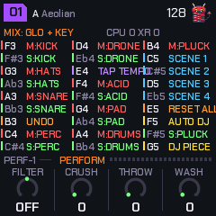

### The auto-DJ

GLO + **F5** starts it (`DJ` in the header; the Perform screen counts bars through the phase). It runs the sections by
itself, on the bar clock:

1. a **groove** (8, 16, 32 or 64 bars; 16 by default);
2. a **drum fill** as the groove's last bar (if Fill is on);
3. a **breakdown**: short (4 bars), half the groove (4 bars at least, the default), or full (as long as the groove);
4. a **build** (the genre's length), the riser rising, a breath of silence on the last two sixteenths, then the **drop**: the
   breakdown's swell and the build's dip are gone at once, with the kick, a clap and the open hat (a crash that rings) on the one, and mostly the tonic chord;
5. the groove again.

The settings (Groove, Break, Fill and Scenes) are on the **Perform** settings page. **Sync** is the fifth Groove
setting: the groove lasts until the chord changes (the **Drift** time on the Tempo page then sets the length of the
groove), the bar before a change is a fill, and the change's bar is the breakdown. With **DJ new pieces** on (GLO +
G5), the next piece in the bank comes in on the fill's bar, so the breakdown and the drop belong to it. SAVE pressed
by hand just moves the DJ on from there. If the drop's key change is on (section 13), it applies on each drop.

### Mood

On the Perform screen and the visualizers, **ALGORITHM** is a macro: 0 chill, 50 (the middle, the default) leaves the
piece as it is, 100 peak. It moves each of these by its share of the distance from 50: acid density and cutoff, the hats'
and perc's levels, the pad's brightness, the pluck's density, level and decay (shorter at peak), the bass's cutoff, drive,
reverb and echo (less at peak), Evolve and the drums' level. It moves what the engine plays, not what is stored, and it
stays where you left it when you change piece. It isn't remembered at power-off.

### Jam

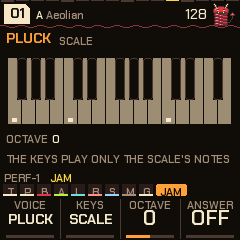

The **Jam** page (SELECT dial, after Global) turns the 27 keys into an instrument to play along with the music; the
keys never edit the scale there. **Voice:** the pluck, the pad, the acid or the bass (the one you pick stops playing its
own line while the page is up, and gets it back when you leave). **Keys:** *Scale* (every key a note of the scale: a black
key plays the scale tone at or below it, so there are no wrong notes), *Chords* (every key a triad of the scale) or *Harp*
(the keys are the scale's tones, one a key, from C3). **Octave:** -2 to +2. **Answer:** after you stop (at least two
notes, then a while of quiet), the pluck plays your phrase back an octave up at the next bar line, once, and waits for the
next. The page draws the keyboard, the scale lit and the held keys bright. If the pluck's level is nearly off, playing it
raises it to 40 so it can be heard.

**Capture (SEL + REC).** The bar you last played on Jam becomes the voice's own line, so the fastest way to write a riff is
to play it. With the voice on **acid**, the bar goes into the Acid steps page as a frozen line: each sixteenth you played a
key on becomes that note (as scale steps above the chord of the moment, so the line follows the chords from then on), a key
on a beat an accent, a key held past the next step a slide; the line is 16 steps and **Frozen**, and it plays when you leave
the Jam page. With the voice on the **pluck**, the bar goes into the Deja vu loop: Loop 16, Rate 1/16, Pluck vu 100, from the
next bar line; turn Pluck vu down to let it drift again. The pad and the bass cannot be captured yet. Capture remembers the
last 32 keys, so play the bar, then press; the header says `CAPTURED`.

---

## 11. Mixing: the mixer, space and the master bus

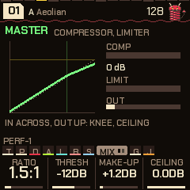

**Mixer** (SELECT dial, between Comp/Limit and Global) works on one layer at a time. **KNOB 1** chooses the layer (pad,
bass, acid, pluck, drums), **KNOB 2** its level (the same level as on the layer's own page), **KNOB 3** its **pan**
(L100 to R100; it's a balance, the middle leaves the sound as it was), **KNOB 4** its **send**: how much of it goes to the
echo and the reverb (50 is as it was, 0 none, 100 twice). The page draws a strip a layer: the level it's set to (the fader,
with its number), the level that sounds (the meter beside it), an `M` when the track is muted, its name in the accent when
soloed, the output's peak last. The chosen layer is framed and its pan ticked under it. Everything is stored with the piece.

**Space** and **Reverb** are the two sends. The echo is tempo-synced (1/8, 3/16, 1/4, dotted 1/4, 1/2, 1 bar); **Echo**
is how much it repeats, **Reverb** how much goes to the tank, **Size** how long the tail is.

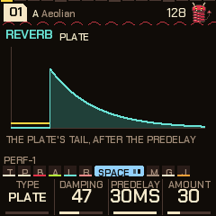

The **Reverb** page chooses the tank:

| Type | What it is |
|---|---|
| Plate | The plate reverb as it always was. Amount does nothing. |
| Shimmer | The tail an octave up, fed back into the tank and heard in the tail. Amount is its feedback. |
| Gated | The input opens the tail, it stays open for a hold (80-400 ms by Amount) and closes in about 10 ms. |

**Damping** is the tank's loss of highs (0-100, 47 by default). **Predelay** is 6-30 ms (30 by default). Genres set their own damping and predelay (lofi and
dubstep darker, house brighter and shorter), and dnb and trap use the shimmer, breaks and electro the gated. The page
draws the tail for its type.

### The master bus

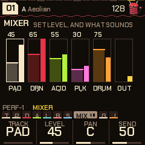

After the effects and before the MASTER volume the mix passes a stereo-linked **compressor** and a look-ahead brick-wall
**limiter**; a soft clip after the volume stays as the last safety.

| Knob | Range | Does |
|---|---|---|
| Ratio | Off, 1.5:1, 2:1, 3:1, 4:1, 6:1, 10:1 | The compressor's ratio, with a 6 dB soft knee. |
| Thresh | -30 to 0 dB | Where it starts. |
| Make-up | 0 to +12 dB | Gain after it. |
| Ceiling | -12 to 0 dB | The limiter's ceiling, before the master volume. |

The compressor has a 4 ms attack and a release that follows the programme (about 60 ms, up to 400 ms at 9 dB of
reduction). The limiter delays the audio by about 1.4 ms so the gain is in place when a peak arrives, and lets go over about
60 ms. The page draws the compressor's transfer curve (in across, out up; the dotted line is unity, the vertical tick the
threshold, the horizontal one the ceiling) and live meters: **COMP** (the compressor's reduction), **LIMIT** and **OUT** (the
output's peak). The four settings are stored with the piece. The defaults are a light 1.5:1 at -12 dB with +1.2 dB of make-up; each genre brings its own
(lofi and garage 2:1, house, dnb and electro 3:1, breaks, dubstep and trap 4:1 with more make-up), and the
limiter's ceiling is 0 dB everywhere, so it only catches overs.

---

## 12. Shift

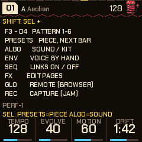

Hold **SEL** and:

| With | Does |
|---|---|
| White keys 1-6 (F3 G3 A3 B3 C4 D4) | Pattern 1-6, on the bar. The keys light the one chosen; the one still playing blinks. Tap: it stays. Held (past a quarter of a second): that pattern plays only while the key is down, and the one before comes back from the bar after you let go: a pattern 5 or 6 as a held variation. |
| PRESETS | The next or previous piece, on the next bar (`PIECE 03 NEXT BAR` until it comes). |
| ALGORITHM | The sound of the voice on screen (pad, bass, acid, pluck); on the drums' pages, the whole kit. |
| SEQ | The links on and off. |
| ENV | On a voice's page: that voice (pad, bass or acid) off the algorithm, played by hand; again, back. |
| FX | The effects' settings pages, one by one, then the keys again. |
| A key in the FX menu | That effect's settings page. |
| HOME | The sigil's middle: the eye or the imp. |
| GLO | Remote: the FM-1 plays the emulator (see 17). Stopped only (it stops the music): playing, it says `STOP FIRST`. |
| EDIT | A secret. Stopped only: it starts the music itself. |
| Black keys 1-6 (sequencer) | Copy the pattern you're editing into pattern 1-6. (Without SEL, in the sequencer, the black keys choose the lane's source: see below.) |
| OCT- (sequencer) | Clear this drum's lane. |
| OCT+ (sequencer) | This drum's lane back to the piece's own. |
| KNOB 1-4 (sequencer) | Euclid, rotation, probability, lane length. |

Keys pressed while SEL is held are never notes or effects. Hold SEL for a moment alone and a card lists them for the page you're on.

---

## 13. Settings, visualizers and what is remembered

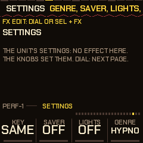

**Hold HOME** (0.7 s, without turning anything) for the **settings** page. SELECT walks on to the other effect pages;
**FX** leaves.

| Knob | Does |
|---|---|
| Key | The drop's key change: same, +2, +3, +5 or +7 semitones. When a breakdown or build gives way to the groove, the root rises for the round; the next breakdown (or a stop, or another piece) puts it back. `KEY` shows in the header. |
| Saver | The screensaver: off, 1, 3 or 10 minutes. Left alone while playing, the visualizers (the auto one) take the **whole screen** (no header, no knobs); any key, button or knob brings the page back. It doesn't come on in the FX menu or on a visualizer. |
| Lights | Off, or show: the keys' lights follow the visualizers, two chasers and kick and snare flashes in a groove, breathing in a breakdown, filling up through a build. |
| Genre | The genre: the same switch as GLO + PRESETS. |

### Visualizers

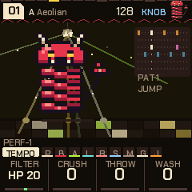

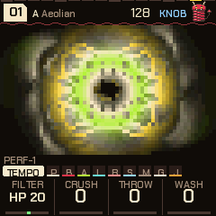

Press **HOME twice quickly** (from anywhere); **HOME** again leaves, to the Perform screen. The **SELECT** dial chooses; the
choice is remembered. The knobs stay the FX knobs, **ALGORITHM** the mood, the keys the track mix (as on Perform), and FX opens its menu over them. They are
drawn 15 times a second from what the engine already reports (the kicks and snares, the layers' levels, the chord, the
pattern, the section), in the theme's colours.

| Visualizer | What it is |
|---|---|
| PLASMA | A colour field that swirls faster with the energy and flashes on the kick. |
| KALEIDO | Curves swept by the spectrum, mirrored four ways into a feedback picture that turns and fades; a kick throws a ring. |
| BARS | A real spectrum: 24 bands from 70 Hz to 10 kHz. |
| FLUX | The media-player light show: the spectrum fed back on itself into a trippy bloom. |
| DISCO | The mascot dancing in a room: a disco ball, beams, a floor that chases along with the drum pattern. He jumps on the kicks and changes moves every couple of bars (sway, twirl, wave, headbang, stomp), sleeps in a breakdown, shakes in a build, and jumps with confetti on the drop. |
| LIFE | A cellular automaton the drums feed: the kick a cluster, the snare a spray, a hat a spark. |
| ORBIT | A harmonograph drawn from the chord's notes: it morphs with every chord. |
| AUTO | One of them, a new one at each section change and every 32 bars. |

### What is remembered across power-off

| Kept | When it's written |
|---|---|
| The pieces you stored (Global, SAVE), in any genre | At once (section 6). |
| Theme, Tune, MIDI out | A couple of seconds after the last change. |
| Every effect's settings, the gate's pattern and targets, the Auto DJ settings (scenes timing, groove, break, fill), the Settings page (key, saver, lights, voices), the USB & MIDI page's USB level, the Jam page's settings and the visualizer | A couple of seconds after you leave them alone. |
| Your DX7 voices | The same. |
| The panel calibration (if you ran it) | When you finish it. |

"A couple of seconds" is 2 s with the music stopped and 4 s while it plays; while it plays, the music dips for a moment
for the write, as for a store (a flash write stops the chip, so it fades out, writes and fades back in).

**Not kept:** the genre (it always starts in HYPNO), anything latched in FX, the FX knobs, the mood, mutes and solos, scenes,
the auto-DJ being on, edits to a piece you haven't stored, A genre sets its own tape,
vinyl and pump settings when you switch to it; the settings you saved while in HYPNO come back when you return.

### Backing up and restoring

Switching to another firmware, or reinstalling, can lose what PERF-1 has stored. The installer page's **Back up and restore** card (below the DX7 voices) keeps it:

- **Save a backup** reads everything the FM-1 has stored (the pieces you saved in every genre, the settings, the DX7 voices, the theme, Tune and MIDI out) and saves it as a `.p1bak` file. Do it *before* you install anything else. Unsaved changes to a piece are not in it (store them first, section 6), and neither is the panel's calibration, which is the unit's own.
- **Restore the chosen backup** (choose the file first) writes everything in it back, one store at a time, then the FM-1 restarts. It replaces what is stored now. The music fades out for each write; nothing else is stored until the restart. A file from an older PERF-1 loads in a newer one; a store the firmware does not recognise is refused, never written.
- Only PERF-1 reads these files, and the firmware that is on the FM-1 must be PERF-1 0.14 or later to take part (an older one does not answer, and the page says so).

---

## 14. Themes and MIDI

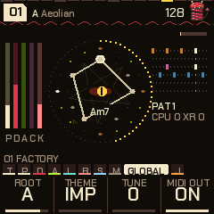

**Global** (GLO): **Root**, **Theme** (Imp, Synth, Acid, Ice, Ember, Phosphor), **Tune** (+-50 cents) and **Genre** (the bank, as GLO + PRESETS). MIDI out and the USB audio's level are on the **USB & MIDI** settings page (SEL + FX walks to it, after Settings).

**The look** is Imp in every theme; the themes are its colour variations. Warm black, one colour per voice everywhere (in Imp: the pad bone, the bass crimson, the acid lime, the pluck ice-teal, the drums pink; ember is for "now"). The header has a beat bar along its top (the beats taller, the step playing lit) and a coil under it, the slinky's spring, that stretches on the kick; a piece waiting for the bar shows as `>08` beside the key and mode. The knob strip has **tabs** (a chip a group of pages: the one you are in opens to its name and a pip a page) and shows the knobs' values large with a bar under them; hold **SEL** and the tabs give way to a one-line hint of what shift does on this page.
The theme, Tune and MIDI out are yours across all pieces.

**MIDI out** (USB): the pad's notes on channel 1, the bass on 3, the acid on 4, the drums on 10 (General MIDI notes),
and MIDI clock with start, continue and stop. The pluck and the DJ snips are not sent. Notes you play by hand go on their voice's channel.
MIDI out can be switched off on the USB & MIDI settings page.

**MIDI in:** channel 1 notes add or remove their note from the scale; clock and start / stop drive the tempo (`EXT` shows in place of the
tempo). It is read from the USB MIDI port, and from the TRS MIDI input where the build has it.

**USB audio:** the FM-1 also shows up as a stereo USB audio input (16-bit, 44.1 kHz): the master output, so a computer can record it over the
same cable. The USB settings page (SEL + FX walks to it, after Settings) chooses whether that level follows the master knob (KNOB) or stays
put at a fixed level (FIXED, about the knob at three quarters) so you can turn the speakers down without touching the recording.

---

## 15. Your own DX7 voices

PERF-1 can hold **16 of your own DX7 voices**, kept in flash, and plays them from the pluck. They come after the 22 built-in DX sounds
on the Pluck page (the Sound knob, or **SEL + ALGORITHM** on a pluck page), named `DX` and the voice's own name (ten characters).

**From the installer page:** open the [installer](../install/) and find **Load DX7 voices**. Choose one or more `.syx` files (a
32-voice bank, single voices, or a bare 4096-byte bank) and the voices in them are listed. Tick up to 16 and press **Send the chosen
voices**: the page clears what is loaded and sends them in order. **Clear the loaded voices** empties the slots. The FM-1 must be
running PERF-1 and connected (Chrome or Edge, MIDI with SysEx allowed, nothing else holding the MIDI port); the page says
`The FM-1 did not answer (an older firmware?)` if it hears nothing back.

**From any MIDI librarian:** send a DX7 SysEx dump to the FM-1's USB MIDI port. A **32-voice bank** dump replaces the loaded voices with
its first 16; a **single-voice** dump adds the voice after the last one loaded (when all 16 are full, it replaces the last). Both are checked against the
DX7's checksum. The header says what happened: `DX7 VOICES 16 LOADED`, `1 ADDED`, `CLEARED`, `BAD CHECKSUM`, `NOT TAKEN`.
(The page uses its own message too, `F0 7D 50 56`, slot, 128 bytes, checksum, `F7`; `7F` alone clears; it answers `F0 7D 50 57`
so a sender can wait for each voice.)

Good to know:

- They are written to flash a couple of seconds after the last change (the music dips, as for any save) and are still there at power-off.
- A voice plays as it was made: the algorithm, envelopes and their scaling, velocity, LFO, pitch envelope and feedback. There is no pitch bend, mod wheel, portamento or mono mode yet. The voice itself can be edited on the [editor page](../editor/) (below).
- Loaded voices are **not level-matched** to each other or to the other sounds, and play up to four notes at once. If one is too loud or quiet, turn the pluck's Level.
- A piece stores the pluck's sound **by number**: if it uses your voice in slot 3 and you load other voices, it plays what is in slot 3 now. The factory pieces never use your slots.
- The Sound knob can also land on an empty slot (`(empty)`), which is not a sound; SEL + ALGORITHM only steps through sounds that exist.

### Editing them: the editor page

The [editor](../editor/) (Chrome or Edge, the FM-1 on USB, MIDI with SysEx allowed, nothing else holding the FM-1's MIDI port) has two tabs.

**Sound** has every parameter on the pages the FM-1 itself has (Tempo, Pad, Pad env, Pad LFO, Chords, Bass, Bass env, Bass LFO, Acid, Acid env, Acid line,
Pluck, Pluck 2, Drums, Links, Kit, Drum drift, Space, Reverb, Comp/Limit, Mixer, Global), with the same labels, ranges and value names, and a last page for the rest:
each drum lane's level, tune, decay, probability and length, each layer's pan and send, the noise, the octaves and the by-hand switches. Moving a control
changes the piece that is playing, as the knob would; **to keep it, store the piece on the FM-1 itself** (GLO page, SAVE). The page reads the FM-1's values when
it connects (and again with **Read everything from the FM-1**), so what you see is what it holds. The **↺** button puts a parameter back to its default.

**DX7 voices** edits the 16 slots. **Read the slots from the FM-1**, pick one, and edit: the voice's name, the **algorithm** (all 32, drawn, with the carriers
marked and a curl for feedback; click an operator in the drawing to edit it), feedback, oscillator sync, transpose, the pitch envelope and the LFO, and for
each of the six operators its output level, ratio or fixed frequency (coarse, fine, detune), the four-stage envelope (with its graph), level scaling (break point,
left and right depth and curve), rate scaling, amplitude-modulation and velocity sensitivity. With **Live** on, every change is sent to the slot as you make it, so the
pluck plays what you are editing: **Choose it on the pluck** makes the pluck use that slot. Slots fill in order (send to the next free one to add a voice);
**Init voice** starts from a plain sine. **Choose files** loads `.syx` banks and single voices into a list to take voices from (click one to edit it); **Save the
slots as a bank** and **Save this voice** write `.syx` files for a librarian or for later. The FM-1 keeps the slots in flash a couple of seconds after the last change.

---

## 16. Load, telemetry and the logger

**The load.** On the home pages, under the drum pattern: `CPU 41 XR 0`, and below it `C2 38`, `S1`. Hold **GLO** and the same line is at
the top right of the mix map, with the auto-DJ's phase beneath it.

| Mark | Means |
|---|---|
| CPU nn | The share of the render's time budget the first core is using, measured inside the audio interrupt (it includes waiting for the second core). Drawing the screen doesn't count. |
| XR n | **Xruns**: halves of audio that were never rendered (the last 11.6 ms play a second time). Each is a click or a stutter. A render that only ran past its half is not counted: the next one starts at once and nothing is lost (the status log counts those as `late`). |
| C2 nn | The second core is working, and nn % of a chunk's time goes on its job (the pad with its chorus, the DX voices, the reverb, and at times the bass and acid: the engine moves some of this work between the cores as the load changes). `C1` instead: it stopped after a fault and everything runs on one core until power-off. |
| S1 | **Load shedding, level 1:** the engine eased off to keep up: the pad's chorus is off and the DX voices are held to four. |
| S2 | Level 2: the DX voices held to two. |

The engine steps up a level when a half is lost (an xrun) or when renders keep running past their half (six in ten seconds); one step at a time, and it steps back
one level after twenty seconds of neither. When `S1` or `S2` is on, the sound is a little thinner, not broken. The heaviest
combinations are the DX plucks with the shimmer reverb, and the fast genres (dnb, breaks).

The audio is rendered 512 frames at a time, as two renders of 256 (11.6 ms for the pair), so a slow render borrows time from a quick one beside it. The price is a few
milliseconds of latency from a key to the sound (the DX plucks, rendered a chunk ahead on the second core, sound 5.8 ms later than the plain ones).

**Live status, in the browser.** The [installer page](../install/) has a **Live status** panel: **Start** asks the FM-1 for its numbers four times a
second and shows the CPU, the second core, xruns, the longest render against its budget, what is shed or moved to another core, the
genre and piece, the flash writes and the frames drawn. **Save CSV** writes them to a file: attach it to a bug report.

**The logger.** With the FM-1 on USB, `python tools/fm1log.py` (needs `pip install mido python-rtmidi`; `--list` shows the MIDI ports,
`--port` and `--out` choose a port and a file) asks the unit for a status frame four times a second and writes `telemetry/fm1_<time>.csv`: CPU and
CPU1 %, xruns, the longest render since the last frame against its budget, the longest gap between main-loop turns and the longest screen frame (a flash
write or a long frame shows there), the shed level, flash writes (and how long the last one stopped the chip), crashes, the genre and piece, and
the first core's time by stage. Events are marked in the file (XRUN, LATE, FLASH, OVER, GAP, SHED). The unit sends nothing until it is asked, and stops
ten seconds after the last ask; a frame is dropped rather than waited for, so it can't hold the music up. `python tools/fm1sum.py telemetry/<file>.csv`
prints the load, xruns and stage times per genre and piece. `fm1log.py --bench` times loops on the chip once (the interrupts are off for a few
milliseconds: one glitch in the music) and is for development.

---

## 17. The emulator

The [emulator](../emu/) runs the firmware itself in the browser. Drag a knob up or down, or scroll over it. Click buttons and keys;
Shift-click (or right-click) a button to hold it down, click again to let go: that's how to hold SEQ, SAVE, SEL or HOME. **New start**
powers it off and on (stored pieces stay, in that browser); **Forget stored** clears them.

| Key | Does |
|---|---|
| Space | PLAY |
| Enter | REC |
| Esc | HOME |
| V / L / P | ENV / LFO / ARP |
| M | SEQ (hold: the sequencer) |
| O / C / N | GLO / EDIT / SEL |
| ` | FX |
| B | SAVE |
| Z / X | OCT- / OCT+ |
| Up / Down | SELECT |
| Q-I, A-K | White keys 1-8, 9-16 |
| 1-0, - | Black keys 1-11 |

### Playing it from the FM-1 (remote)

Plug the FM-1 in by USB, open the emulator in Chrome, Edge or Firefox, switch it on and press **Connect MIDI** (allow MIDI when the
browser asks). Then, on the FM-1, hold **SEL** and press **GLO**: the screen says REMOTE, the FM-1 stops and goes quiet, and its whole panel plays
the emulator: every button, key and knob, MASTER too. The emulator's lights come back to the FM-1's buttons and keys, so the panel reads as it always
does; the emulator's screen is the one to watch. The FM-1 shows `PLAYING THE BROWSER` while the emulator answers and `WAITING FOR THE BROWSER` when it
doesn't. **SEL** + **GLO** again gives the FM-1 back, stopped (PLAY starts it).

**For livestreams:** the emulator's **Stream view** button (or the address with `?stream`) puts the FM-1 and its screen, large, on a clean 16:9 stage for
OBS or any capture. Whatever is pressed glows, on the real FM-1 through the remote or clicked here; a knob turning gets a ring; a strip under the screen names
the last moves; FM-1 LINKED shows while the remote is on. Its small bar (Connect MIDI, Exit) and the pointer hide when the mouse rests.

How it talks, for the curious: USB MIDI channel 16. Keys are notes 48-74, buttons CC 102-115 (127 down, 0 up), the knobs CC 85-91 (64 +- the detents),
MASTER CC 7, and CC 116 is a hello each second. The emulator sends its lights back the same way, with CC 117 each second.

### Any other controller (MIDI learn)

With M-VAVE's own firmware on the FM-1, or any MIDI keyboard or controller, the keys play the emulator's keys as soon as it's connected (by pitch, F3 to G5;
notes outside fold into that range). For everything else, press **MIDI learn**, click a control on the emulator (it's outlined), then press or move the one
you want on your controller. Learn as many as you like and press **Done learning**. Buttons and keys take a note or a CC; knobs take a CC, absolute (a knob or
fader) or relative (an endless encoder: pick which in the list). The list is kept in that browser; **Forget learned** clears it.

---

## 18. Troubleshooting

- **No sound:** check MASTER, and that PLAY is lit. A piece's layer levels can be at 0: each voice's page has its level on KNOB 1 (and the Mixer shows them all). A voice marked `BY HAND` is silent until you play it (SEL + ENV puts it back); a track muted on the mix map (GLO held) or an effect latched in FX can silence things (the header shows `FX`); the voice you play on the Jam page stops its own line while that page is up; REMOTE silences the FM-1 on purpose.
- **A short dip or a tick when you change a setting or store a piece:** expected. A flash write stops the chip, so the music fades out, writes and fades back in. Settings are written a couple of seconds after your last change, so a burst of edits is one dip.
- **A stored piece came back as it was before:** it was stored while playing and the power went off before the write finished. Stores are written at once, with a short dip in the sound: do not switch off during it.
- **My changes vanished:** only a piece you stored (Global, SAVE) is kept; changes you did not store are gone when you change genre or switch off. See "What is remembered" (section 13).
- **The installer doesn't find the FM-1:** use Chrome or Edge, a USB data cable (not charge-only), and close any DAW holding its MIDI port. Allow MIDI with SysEx for the page.
- **The installer offers an old version:** hard-refresh the page (Ctrl+F5, or Cmd+Shift+R).
- **An install was cut off:** run it again; the FM-1 stays in update mode until a write finishes. If it doesn't come back at all, see "Recovering an FM-1 that won't start" in section 1.
- **A screen with `PERF-1 SAFE MODE`:** it crashed twice while starting. Reinstall from the installer, or press PLAY to try again.
- **`UPDATE MODE IN 3..` appeared:** you were holding OCT- and OCT+. Let go before the countdown ends to cancel.
- **The buttons or knobs don't match their labels:** hold OCT- and OCT+ while you switch the FM-1 on for **hardware calibration**, a Felucca feature: it asks you to press each button and turn each knob in turn and keeps the result. It gives up after 30 seconds without a touch and changes nothing.
- **The DX7 voices I loaded don't show up:** use the pluck's Sound knob or SEL + ALGORITHM on a Pluck page: they come after the 22 built-in DX sounds. Check the page said they were sent (and the header `DX7 VOICES n LOADED`), that the pluck's Level isn't 0, and that the FM-1 runs PERF-1 0.11 or later. A bank must pass the DX7 checksum.
- **Crackles or dropouts:** look at the load (section 16). Xruns (`XR`) tick up on a click; `S1` / `S2` mean the engine is already shedding. Heavy DX plucks, a shimmer reverb and the fast genres push it. Run the Live status or `fm1log.py` for a minute and send the CSV with the piece, its sounds and the tempo to deamonSLINKY.
- **The emulator doesn't see the FM-1:** close any DAW holding its MIDI port, and use Chrome, Edge or Firefox (Safari has no Web MIDI). The FM-1 must be in remote (SEL + GLO) for its panel to play the emulator.
- **MIDI notes change my scale:** MIDI in on channel 1 adds and removes notes from the scale. Use another channel or disconnect the input.

---

## 19. Credits

**Feedback and contributing.** Comments, ideas and bug reports are welcome, and anyone is invited to help: [open an issue on GitHub](https://github.com/deamonSLINKY/PERF-1/issues/new/choose) (the source is at <https://github.com/deamonSLINKY/PERF-1>). A bug report is most useful with the version (the boot card), the genre and piece, and, for anything about load or crackles, a status log (section 16).

PERF-1 is by **deamonSLINKY**: the firmware, the slinky mascot and the pages around them. It is a fork of **HYP-1**, a
[RedtailWorks](https://www.redtail.works) project, itself a fork of
[AMB-1](https://github.com/charlesvestal/fm1-amb) by Charles Vestal. The platform (USB, update loader, storage, installer) is
[Felucca](https://github.com/hugelton/Felucca) by Leo Kuroshita (@kurogedelic), Hügelton Instruments, which reaches PERF-1 by way of X0X and FoMni
(the panel calibration is Felucca's; the boot guard, knob acceleration, help cards and anti-aliased drawing came from X0X).

The six-operator FM that plays the DX7 voices, the factory voices, the second-core work (the reverb, the pad and the DX voices on the FM-1's other
processor core) and the safe core hold are from **Melodee** by Kerem Kilic (Ellic Studio, GPL-3.0). The FM itself is after
**Dexed** by Pascal Gauthier, on MSFA by Raph Levien (Google; Apache 2.0 / GPL-3.0). The idea of running FM-1 firmware in the browser comes from
[Groove OS](https://www.groove-os.com/)'s emulator. What is known about the FM-1's hardware comes largely from the
[FM-1-RE](https://github.com/AL-255/FM-1-RE) reverse-engineering work; the rescue route uses
[FM-1-transporter](https://github.com/kurogedelic/FM-1-transporter)'s protocol and JieLi's flash loader from kagaimiq's jl-uboot-tool.

The bass modes, the pad's comping rhythms, the ghost notes and accents of the genres, and the deja vu loop in the pluck follow ideas in **Tuna** by delirioux ([github.com/delirioux/tuna](https://github.com/delirioux/tuna), GPL-3.0), a generative firmware for the FM-1 on Felucca, whose random section is a port of **Marbles** by Emilie Gillet (Mutable Instruments, MIT); PERF-1's versions are written for its own engine.

Screen and page fonts: Chakra Petch and Barlow Semi Condensed (SIL OFL 1.1). Licence: GPL-3.0, no warranty.

M-VAVE and FM-1 are trademarks of their owners; PERF-1 is not affiliated with M-VAVE.

Runners: hold shift and edit the beat.
