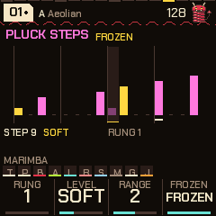
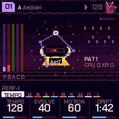

# PERF-1

PERF-1 is free firmware that turns your M-VAVE FM-1 into a groovebox that plays by itself. Switch it on and a piece of music starts: drums, a bass line, a pad, an acid line and a short plucked melody, made up as it plays so it never repeats exactly. There are sixteen styles, from techno and house to lofi, reggae and drum and bass, with ten pieces each.

You don't have to program anything to get going. You steer the music: change the chords, break the beat down and bring it back, mute parts, throw on effects, or let the auto-DJ do it for you. When you want to go deeper, almost everything can be edited, from the drum steps to the sounds, and any piece you shape can be saved. The FM-1 also works as a USB audio and MIDI device, so you can record what you play straight into your computer.

If you're new, read **Start here** below first. The numbered sections after it are the full reference.

This manual is for **PERF-1 0.15**. PERF-1 is made by deamonSLINKY, based on [HYP-1](https://www.redtail.works) by RedtailWorks, and it's free and open source (GPL-3.0). It's still young and changes often, so keep a way back to the stock firmware (section 1 explains how).

---

## Start here: your first hour

This guide is for your first hour. No music theory needed, nothing to set up. Every step is one thing to press, and what you will hear.

When you want every detail, the [quick manual](PERF-1-quick-manual.pdf) has every control on eight pages, and the rest of this manual, from section 1 on, explains everything. This part is also a [printable PDF](PERF-1-beginners-guide.pdf).

### What PERF-1 is

PERF-1 turns your M-VAVE FM-1 into a little band that plays by itself. Switch it on and music starts: drums, a bass, a soft pad, a squelchy "acid" line and a plucked melody, all made up on the spot so it never repeats exactly.

You are the conductor. You don't have to play notes. You change the chords, break the beat down and bring it back, throw effects on, mute things, and keep the moments you like.

### Before you start

- **Try it without installing.** The [emulator](https://deamonslinky.github.io/PERF-1/emu/) runs PERF-1 in your web browser, with sound. Every step in this guide works there too.
- **Installing** takes a couple of minutes with the [web installer](https://deamonslinky.github.io/PERF-1/install/) in Chrome or Edge. Use a USB cable that carries data, not a charge-only one.
- **You can always go back.** The same installer page puts M-VAVE's own firmware back. Anything you saved on the stock firmware may be lost when you switch, so keep copies of what you care about.

### The buttons you need today

Only a few. The rest can wait.

| Control | What it does for you today |
|---|---|
| **MASTER** knob | Volume. |
| **PLAY** | Stop and start the music. |
| **EDIT** | Move on to the next chord. |
| The **keys** | Change the notes the music uses. |
| **PRESETS** knob | The next piece of music. |
| **SAVE** | Break the beat down, then build it back up. |
| **FX** | Effects. |
| **HOME** | Back to the start page. Press it whenever you feel lost. |
| **GLO** | The Global page. Hold it for the mixer. |

### Your first five minutes

**1. Switch it on and listen.** After a short animation, a piece starts playing on its own. Turn **MASTER** to a comfortable level. Nothing you press in this guide can break anything.

**2. Tap EDIT.** At the start of the next bar the chord changes. The whole band follows: the bass, the pad and the melodies all move to fit. Tap it a few more times.

**3. Tap a few keys.** Each key adds a note to the music or takes one away. Tap any key, listen, tap another. There are no wrong notes to find: the band only ever plays the notes you have left on. Tap a key again to put it back.

**4. Turn PRESETS one click.** A new piece starts: a new key, a new tempo, new sounds. There are ten pieces in each style.

**5. Hold GLO and turn PRESETS.** Now you are changing the style itself. There are sixteen: techno, lofi, house, dubstep, dub, drum and bass, breaks, garage, electro, trap, disco, funk, reggae, synthwave, amapiano and trip-hop. Let go of GLO when you find one you like.

### Make it move

**6. Tap SAVE: a breakdown.** At the next bar the drums drop out and the music gets softer and dreamier.

**7. Tap SAVE again: the build and the drop.** The drums come back climbing for a few bars, there is a short silence, and then everything hits at once. This is the moment DJs live for. Tap SAVE, wait, tap SAVE, and you have done it.

**8. Press FX: effects on the keys.** Every key is now an effect, and the screen shows their names.

- **Tap** a key and the effect stays on.
- **Hold** a key and the effect lasts only while you hold it.
- Tap the same key again to switch it off, or tap **OCT-** to switch every effect off at once.
- Press **FX** again to leave. Try the gate, the phaser, the tape and the beat repeats.

### The Perform screen

**9. Press HOME, then HOME again** (not too quickly). This is the Perform screen: the eight parts of the band, and a **mood** bar.

**10. Turn ALGORITHM, the knob that sets the mood.** Turn it left for calm and sparse, right for busy and bright. The acid, the hats, the melody, the bass and the reverb all change together.

**11. Tap the keys to mute parts.** On this screen the keys switch parts of the band off and on. The screen shows which key is which. Try muting the kick drum, listen to how much it changes, then bring it back.

**12. Let it play itself.** Hold **GLO** and tap the **F5** key (the second white key from the right). "DJ" lights up at the top of the screen. Now PERF-1 runs breakdowns, builds and drops on its own, like a DJ. Do the same again to switch it off.

### Keep what you like

**13. Save the piece.** If you have changed a piece and like it, press **GLO**, then **SAVE**. The screen says it has been stored, and it is there next time you switch on.

 Every style keeps its own ten pieces.

To put a piece back the way it was at the start, go to **GLO** and hold **SEL** and **SAVE** together for a moment.

### When you want more

You don't need any of this to have fun, but it is there.

- **Turn SELECT** to walk through the pages. Each page has four knobs underneath the screen. The page name tells you what they change: the pad, the bass, the acid, the drums, the reverb and much more.
- **The Jam page** (turn SELECT past Global) turns the keys into a keyboard you can play along on. It only plays notes that fit, so you can play freely.
- **Hold HOME** for the settings.
- **The SET page** has an **Intro** that starts with just a pad and brings the band in one part at a time over a few minutes. Great for mixing in, or for playing over. You get there by holding **SEL** and pressing **FX**, then turning SELECT.

- The [quick manual](https://deamonslinky.github.io/PERF-1/manual/PERF-1-quick-manual.pdf) is eight pages to print and keep beside the FM-1.

### If something goes wrong

- **Lost on some page?** Press **HOME**.
- **An effect won't go away?** Press **FX**, then **OCT-**, then **FX** again.
- **The music stopped?** Press **PLAY**.
- **A piece sounds odd after a lot of changes?** Turn PRESETS to another piece and back, or reset it with **SEL** and **SAVE** held on the **GLO** page.
- **Want the original firmware back?** Use the [installer](https://deamonslinky.github.io/PERF-1/install/) page: "Back to the stock firmware" at the bottom.
- **Found a bug or have an idea?** Tell us on [GitHub](https://github.com/deamonSLINKY/PERF-1/issues). Most of the newest features came from ideas like yours.

### Words you will see

| Word | Means |
|---|---|
| **Piece** | One song: its key, tempo, sounds and drum patterns. Ten in each style. |
| **Genre** | A style of music, with its own drums, sounds and habits. Sixteen of them. |
| **Pad** | The soft, long chords in the background. |
| **Bass** | The low notes. |
| **Acid** | The squelchy, twisting line, after the classic Roland TB-303. |
| **Pluck** | The short, plucked melody on top. |
| **Chord** | The group of notes the band is playing around right now. EDIT moves it on. |
| **Scale** | The set of notes the music is allowed to use. The keys switch them on and off. |
| **Breakdown, build, drop** | Calm down, climb back up, then everything hits at once. SAVE runs them. |
| **Latch** | An effect that stays on after you tap its key. |
| **Auto-DJ** | PERF-1 running the breakdowns, builds and drops by itself. |

---

## Contents

1. Install
2. Getting started
3. Controls
4. The screen
5. The pages
6. Pieces, genres and storing
7. Sounds, kits and playing
8. The sequencer
9. Effects
10. Performing
11. Mixing: the mixer, space and the master bus
12. Shift
13. Settings, visualizers and what is remembered
14. Themes and MIDI
15. Your own DX7 voices
16. Load, telemetry and the logger
17. The emulator
18. Troubleshooting
19. Credits

---

## 1. Install

You can try PERF-1 before you install it. The [PERF-1 emulator](../emu/) runs the same firmware in your web
browser, with sound. Play it with the mouse, a touch screen or your computer keyboard.

### Installing PERF-1

1. Open the [web installer](../install/) in Chrome or Edge.
2. Connect the FM-1 straight to the computer with a USB cable that carries data (some cables only charge).
   You don't need a hub, a probe or Transporter.
3. Close any other program that uses the FM-1's MIDI port, such as your DAW (recording software).
4. When the browser asks, allow MIDI with SysEx. SysEx is the kind of MIDI message the installer uses to
   send the firmware.
5. Wait until the **Install** button isn't grey (the page is still loading the firmware). The line under it
   names the version it will write (`PERF-1 0.15.1`, for example). If that's older than you expected, hard-refresh the
   page (Ctrl+F5, or Cmd+Shift+R on a Mac) so the browser doesn't use an old saved copy.
6. Press **Install**.

The bar and the line above it show each stage: verifying, switching to update mode, writing, restarting,
done. **Don't unplug the cable or close the page while it writes.** The page asks before it lets you leave.
When it's finished, the FM-1 restarts into PERF-1 and the page checks that it reports the right version.

> Installing firmware is at your own risk. The author accepts no responsibility if your FM-1 is damaged or misbehaves because of this custom firmware. Anything you stored (pieces, settings, DX7 voices) may be lost when the firmware is replaced: keep your own copies of the .syx files you load.

### Going back to the stock firmware

"Back to the stock firmware", at the bottom of the same page, puts M-VAVE's own FM-1 firmware, V15, back on
the unit.

1. Download the file the page links to, `FM-1.fwsc`. It's also on
   [m-vave.com/download](https://www.m-vave.com/download).
2. Choose that file on the page. The page checks the file's SHA-256 fingerprint and refuses any other file.
3. Connect the FM-1 and press **Install the stock firmware**.

It works from PERF-1, from safe mode and from update mode. M-VAVE's own updater, M-UPGRADE (Downloads,
PC Software), works too.

### Update mode

In update mode the installer can write to the FM-1. To enter it yourself, hold **OCT-** and **OCT+**
together for 5 seconds while PERF-1 is running.

- After 2 seconds the screen counts down: `UPDATE MODE IN 3..`.
- Let go before the end and it says `UPDATE MODE CANCELLED`.
- At 5 seconds the FM-1 goes into update mode and shows `UBOOT`.

If an install is cut off, the FM-1 stays in update mode until a write finishes. Press **Install** again. If
the page says it lost the FM-1, unplug the cable and plug it back in first.

### Safe mode

If PERF-1 crashes or freezes twice in a row while starting up, the FM-1 starts in safe mode instead. The
screen is black and says `PERF-1 SAFE MODE`, with the address of the crash at the bottom. There's no sound,
but USB works. From here you can:

- reinstall from the web installer, or
- press **PLAY** to try starting PERF-1 again.

If starting keeps failing even then, the FM-1 goes into update mode by itself, ready for the installer.

If PERF-1 crashes while it's running, the next start tells you: the screen shows `RESTARTED AFTER A CRASH`
and a `PC` address for two and a half seconds. If you report the crash, note that address.

### Recovering an FM-1 that won't start

- **Covered:** a bad PERF-1 install. The installer checks the package before sending it, checks each packet
  it writes, and reads the FM-1's version back after the restart. On the FM-1 there's safe mode, update mode
  after four failed starts, the **OCT-** + **OCT+** hold, and a USB command that enters update mode. The
  installer works from all of them.
- **Not covered:** a damaged start-up sector or boot loader (the part of the memory that starts the FM-1),
  or the power or cable going during a write before the installer has saved its record of where to resume.
  The protection for cut-off writes is reasoned from the design and has **not** been tested with a real
  power cut. No hardware way in (test pads, a strap, a key combination) has been found for this chip. An
  FM-1 that fails like that may be gone for good.

If the FM-1 won't start but still reaches the chip's own update mode (it shows up on USB as 4C4A:8057,
`UBOOT`), the PERF-1 source has a rescue tool, `tools/fm1_rescue.py` (and its wrapper `fm1_rescue.sh`). It
puts the stock V15 back from a Mac, using sudo, `pyusb` and `libusb-package`. It backs up the whole memory
first, writes only the 4 KiB sectors between 0x4000 and 0x93000 that differ from V15, reads everything back
to check, and accepts only the exact V15 file. It was written for an FM-1 stuck crashing at start-up, and it
uses FM-1-transporter's method, which that project tested on real hardware. Treat it as a last resort, not
a guarantee. Otherwise, recovery needs
[FM-1-transporter](https://github.com/kurogedelic/FM-1-transporter) or hardware you may not have.

---

## 2. Getting started

New to PERF-1? **Start here**, at the top of this manual, walks you through your first hour. This is the
short version.

1. Switch it on. The **deamonSLINKY** card shows (the slinky mascot hops twice and blinks, then the name and
   PRESENTS), then the **PERF-1** card (the version, "by deamonSLINKY", "based on HYP-1 by RedtailWorks"),
   with sixteen steps filling in and the white keys lighting with them. Any button or key skips the cards.
   Then a random piece from the HYPNO bank starts playing.
2. Turn **SELECT** to move through the pages. The four knobs under the screen change what each page shows.
3. Press **SEQ** for the drums. Hold it for the step sequencer, and tap the white keys to change the beat.
4. Tap keys to change the scale: each key adds its note or takes it away. Turn **PRESETS** for another piece.
   Hold **GLO** and turn **PRESETS** for another genre. On a voice's page, hold **SEL** and turn
   **ALGORITHM** to hear that voice's other sounds.
5. Want to play the bass yourself? Press **LFO** for the bass page, then hold **SEL** and press **ENV**. The
   bass stops playing its own part and the keys play it instead. Press **SEL** + **ENV** again to hand it
   back. The **JAM** page (turn **SELECT** past Global) is a keyboard that never changes the scale.
6. Tap **SAVE** for a breakdown on the next bar. Tap it again for a build and then the drop. A build lasts
   four bars (two in trap, lofi and trip-hop, eight in house).
7. Press **FX** for the effects. Tap a key to latch its effect on, or hold the key to play the effect only
   while you hold it.
8. **HOME** goes to the Tempo page. Press **HOME** again, not too quickly, for the Perform screen. Press it
   twice quickly for the visualizers. Hold it for the settings.
9. Like a HYPNO piece? Go to **Global** (**GLO**) and press **SAVE** to store it. Storing works in every
   genre: a piece you store in lofi or house stays there.

---

## 3. Controls

| Control | What it does |
|---|---|
| **MASTER** | Volume. |
| **SELECT** | Steps through the pages in order. With **HOME** held: the tempo, from any page. In the FX menu: the bank (FX, BEAT FX, FLEX BEAT, DJ SNIPS), or inside an effect's settings, the next settings page. On the visualizers: the next one. |
| **PRESETS** | The piece, 1 to 10. With **SEL** held, the new piece starts on the next bar. With **GLO** held: the genre. |
| **ALGORITHM** | The mode of the scale, which sets its mood (Aeolian is the natural minor, Dorian a brighter minor, Phrygian a darker one, Mixolydian a major with a flat seventh). With **SEL** held: the sound of the voice on screen (on the drum pages, the whole kit). On the Perform screen and the visualizers: the mood. |
| **KNOB1**-**KNOB4** | The four values (a, b, c, d) of the page on screen. |
| **OCT-** | Down an octave, to -3. On a voice's pages it moves that voice (pad, bass or acid; the pluck goes down to -2). On any other page it moves the whole song. In the sequencer it picks the previous drum. In the FX menu it turns every effect off. |
| **OCT+** | Up an octave, to +3, the same way. In the sequencer it picks the next drum. |
| **FX** | Opens and closes the effects menu. Press it twice quickly for the settings of the effect you used last. |
| **SEL** | Shift: hold it while you use another control (section 12). |
| **ENV** | The Pad page. Again: Pad env, Pad LFO, Chords. With **SEL** held: takes the voice on screen off its automatic part so you play it by hand (again: hands it back). |
| **LFO** | The Bass page. Again: Bass env, Bass LFO, Bass line. |
| **ARP** | The Acid page. Again: Acid env, Acid line, Acid answer, Acid steps, Pluck, Pluck 2, Deja vu, Pluck steps. |
| **EDIT** | The next chord, on the next bar. |
| **GLO** | The Global page: root, theme, tune, genre. Here **SAVE** stores the piece. Held: the mix map (mutes, solos, scenes, the auto-DJ, tap tempo) and the load meter. Held with **PRESETS**: the genre. With **SEL** held: remote (section 17). |
| **HOME** | The Tempo page. Again: the Perform screen, then back to Tempo. Twice quickly: the visualizers. Held: the settings. Held with **SELECT**: the tempo. |
| **SAVE** | A breakdown on the next bar. Again: a build and the drop. Held: the drop. On Global: stores the piece. |
| **SEQ** | The Drums page. Again: Links, Kit, Drum drift, Groove, Steps, Feel, Phrase. Held: the sequencer. Tapped in the sequencer: back to Drums. With **SEL** held: the links on and off. |
| **PLAY** | Play and stop. |
| **REC** | Freeze: the chord holds and the reverb rings on until you press it again. With **SEL**: Capture, which writes the bar you played on Jam into the acid line or the pluck loop (section 10). |
| White keys | The scale: each key adds or removes its note (the root stays). On the pages of a voice played by hand, and on Jam: that voice. In the sequencer: the 16 steps. In the FX menu: the effects. On Perform, the visualizers, and with **GLO** held: the track mix. |
| Black keys | The same as the white keys. |

Pressing a group's button again steps through that group's pages. Pressing it from another page takes you
back to the page you were last on in that group.

**Holds and double taps**

| Gesture | Time | Does |
|---|---|---|
| Hold **SEQ** | 0.4 s | Opens the sequencer. |
| Hold **SAVE** | 0.5 s | The drop, straight away on the next bar. |
| Hold **SEL** + **SAVE** on Global | 1.5 s | Puts the piece back to factory. From 0.4 s a card says `KEEP HOLDING: FACTORY`. A plain **SAVE** on Global only stores. |
| Hold **HOME** | 0.7 s | The settings page. |
| Hold **GLO** | 0.4 s | The mix map. |
| Hold **SEL** alone | 0.4 s | A card shows what shift does on this page. |
| Hold another button alone | 0.9 s | A card says what it does (**ENV**, **LFO**, **ARP**, **EDIT**, **REC**, **OCT-**, **OCT+**). |
| Tap an effect key | under 0.25 s | Latches the effect on. Hold it longer and it plays only while held. |
| Hold a scene key | 0.6 s | Stores the scene. A tap recalls it. |
| **FX**, **FX** | within 0.35 s | The settings of the effect you used last. |
| **HOME**, **HOME** | within 0.45 s | The visualizers. |
| **OCT-** + **OCT+** | 5 s | Update mode. |

Holding **OCT-** and **OCT+** while you **switch the FM-1 on** does something else: it calibrates the
hardware (section 18).

---

## 4. The screen

**Top left.** The piece's tag: its number, with a letter for the genre (`01` for HYPNO, `L03`, `H07`, `D02`,
`V01` for dub, `N05` for DnB, `B04`, `G09`, `E06`, `T10`, `S03`, `F01`, `R07`, `W01`, `A05`, `P02` for the others). A mark in the tag means the piece has changes
you haven't stored. Next to the tag are the root and the mode.

**Top right.** The slinky mascot. It hops on the kick, squashes on the snare, jumps on the drop, sleeps in a
breakdown and shakes in a build. Next to it is the tempo. It says `EXT` while an outside MIDI clock (another
device sending its tempo over MIDI) drives it, and shows a play triangle beside it while stopped. To the left
of those, marks show what's on:

| Mark | Means |
|---|---|
| BREAK, BUILD | The section playing. `BREAK>`, `BUILD>` or `DROP>` means one is waiting for the next bar. In a build, `DROP 3` counts the bars to the drop. With the auto-DJ, `BREAK IN 4` shows in the last bars of a groove, and `BREAK 2` in a breakdown counts the bars to its build. |
| KNOB | An FX knob isn't at its home position. If the sound is unexpectedly filtered, this is why. |
| KEY | The drop's key change is on. |
| S1> to S4> | A scene is waiting for the next bar. |
| DJ | The auto-DJ is running. |
| FX | Effects are latched on and the menu is closed. The **FX** button blinks too. |
| a small dot | Something is waiting to be saved to memory (the theme, Tune, MIDI out, a piece). |

**Left.** The levels of the pad (P), bass (D), acid (A), pluck (C, for counter-melody) and kit (K).

**Middle: the sigil.** A circle that shows the harmony.

- The twelve notes sit around it, with the chord's root always at the top. Scale notes are lit, chord notes
  bright.
- The chord's notes are joined into a shape: a triad (three-note chord) is a triangle, a seventh chord a
  four-sided shape. You learn a chord's kind by its shape. Its name is under the eye.
- When the chord changes, the circle turns by the distance from the old root to the new one.
- Outside it, a ring fills over each 4-bar phrase. Outside that are the bar's 16 steps: the kick's are
  larger, the acid's are tinted, the playhead is white.
- Behind it, a pentagram turns once every 16 bars, and runes flare by the notes the pluck plays.
- In the middle is a demon eye. In a groove it's half open: the pupil widens on the kick and the gaze flips
  on the snare. It shuts in a breakdown. In a build it opens wide and trembles, and the phrase ring breaks
  into spinning gaps. The drop brings a white flash and a shock ring. **SEL** + **HOME** puts the slinky imp
  there instead (kept after power-off).
- At the top right, a bar fills towards the next chord change, or says `held` while frozen.
- When the FM-1 is working hard, it stops drawing the pentagram and runes first.

**Right.** The drum pattern playing, each lane in its own colour, and its number (`PAT 1`). When another
pattern is waiting, `> 3`. Under it is the load readout, which shows how hard the FM-1 is working:
`CPU 41 XR 0`, and below it `C2 38` and `S1` or `S2` when they apply. Section 16 explains them.

**The line above the knobs.** On the left, the sound of the voice on screen (on the drum pages, the kit).
After it comes `BY HAND` when you're playing the voice yourself, `+LINK` or `LINKS OFF`, and the octave when
it isn't at home (`OCT+2` for the page's voice, `SONG-1` for the whole song). On Global this line says what
**SAVE** will do: `01 SAVE: STORE`, `01 STORED` or `01 FACTORY`. On the right are the page's name and the page
dots, one dot per page (32 on the SELECT dial). The page you're on is bright, and the other pages in its group
are dimmer. In the FX menu the dots are the four banks. Inside an effect's settings they're the 22 settings
pages.

**Bottom.** The four knobs. Each shows its value's name, a ring (or pips, for a switch with only a few
positions) and the value. The knob you turned last lights up for a moment.

**Pictures.** Pages that shape a sound draw it: the envelopes and LFOs, the filter's response, the echo and
reverb tails, the compressor's curve. The picture follows the knobs as you turn them, with a dot running
along it. It shows the shape, not exact milliseconds.

**Messages.** Short messages take the place of the header for a moment, such as `PATTERN 3 NEXT BAR`,
`STORING` or `KEY CHANGE +5`.

---

## 5. The pages

Turn **SELECT** to move through the pages in this order. There are 32, and the dial stops at each end. The
voice buttons jump straight to a voice. Pressing the same button again steps through that voice's envelope
and LFO pages (and, for the pad, the chords). On a voice's main page, **KNOB1** is its level. The a to d
columns are **KNOB1** to **KNOB4**.

| Page | Reach it | a | b | c | d |
|---|---|---|---|---|---|
| Tempo | **HOME** | Tempo (70-190) | Evolve | Motion | Drift (how long a chord lasts: 1-32 bars in a genre, 20 s to 5 min in HYPNO) |
| Pad | **ENV** | Level | Bright | Sound (24) | Detune |
| Pad env | **ENV** x2 | Attack (0.05-10 s) | Hold (0-8 s) | Release (0.1-12 s) | Rest (0-6 s) |
| Pad LFO | **ENV** x3 | Rate (a 1/4 note to 32 bars) | Depth | Shape (sine, triangle, saw, square, S&H, drift) | Target (filter, level, pan, pitch) |
| Chords | **ENV** x4 | Chord (Auto, Triads, 7ths, 9ths, Sus, Dub, Fourths) | Voicing (close, open) | Chorus (0-100) | Loop (off, or repeat the last 2, 4 or 8 chords. With a ~, now and then one chord is picked anew.) |
| Bass | **LFO** | Level | Sound (24) | Cutoff | Reso |
| Bass env | **LFO** x2 | Trigger (each chord, every 1, 2, 4 or 8 bars, or off) | Attack (0.01-4 s) | Decay (0.05-16 s) | Amount |
| Bass LFO | **LFO** x3 | Rate (a 1/4 note to 32 bars) | Depth | Shape (as the pad's) | Target (cutoff, pitch, level, drive) |
| Bass line | **LFO** x4 | Mode (hold, root, kick, eighths, off-beat, walk, riff, and nine named figures) | Length (how long each note holds) | Move (octaves, fifths, approach notes) | Glide |
| Acid | **ARP** | Level | Cutoff | Reso | Env mod |
| Acid env | **ARP** x2 | Decay | Accent | Slide | Sound (31) |
| Acid line | **ARP** x3 | Density | Length (1-16) | Range (1-3 octaves) | Mutate (hold **SEL** and turn to choose what a mutation changes: all, notes, rhythm or accents) |
| Acid answer | **ARP** x4 | Answer (off, octave, fifth, third, mirror, reverse, rotate, sparse, accents) | Every (the 2nd to the 8th time round the line, or Drift: the bar before the drums change) | Direction (down 2, down, same, up, up 2) | Sync (bar, or the whole loop) |
| Acid steps | **ARP** x5 | Step (pick one with a white key: rest, note, accent, slide, accent + slide) | Note (0-11 scale steps above the chord) | Octave (0-3) | Frozen (free, frozen) |
| Pluck | **ARP** x6 | Level | Sound (12 + 30 DX7 + yours) | Density | Octave (-2 to +2) |
| Pluck 2 | **ARP** x7 | Decay | Style (up, down, up-down, random, skip, thirds) | Rate (1/4, 3/16, 1/8, 1/16, slow to fast) | Range (1-3 octaves) |
| Deja vu | **ARP** x8 | Pluck vu (0 always new notes, 100 locked) | Loop (4, 8, 16, 32 notes) | Leaps (notes jumping an octave) | Motif (0 off to 100: how often a bar reworks the phrase's first bar) |
| Pluck steps | **ARP** x9 | Step (pick a step with a white key: rest, soft, note, accent) | Note (1-12: the chord's notes, low to high) | Octave (the pluck's, -2 to +2) | Frozen (free, frozen) |
| Drums | **SEQ** | Level | Drive | Swing (50-75 %) | Pattern (1-6, changes on the bar) |
| Links | **SEQ** x2 | K>Bass | S>Pad | H>Acid | P>Clock (off, clock) |
| Kit | **SEQ** x3 | Kick | Snare (and clap) | Hats (closed and open) | Perc |
| Drum drift | **SEQ** x4 | Change (off, next, random) | Every (each chord, or 4-64 bars) | Pool (patterns 1-2 up to 1-6) | Mutate (off, shift, morph) |
| Groove | **SEQ** x5 | Lane (kick to perc) | Density (0-100; 50 plays as written) | Source (follow, or pattern 1-6) | All dens (every lane's density at once) |
| Steps | **SEQ** x6 | Lane | Ratchet (off, x2, x3, x4, x6, flam, swell 3, swell 4) | Push (0-7 twelfths of a step late) | Level (normal, ghost, soft, accent) |
| Feel | **SEQ** x7 | Ghosts (0-100) | Accents (0-100; 50 as marked) | Pad comp (auto, hold, 7 rhythms) | Humanize (0-100) |
| Phrase | **SEQ** x8 | Chain (off, or 9 chains of patterns) | Slice (off, 8 reorderings, auto) | Time (normal, half, double) | Cond (for the chosen lane: always, 1:2 ...) |
| Space | **SELECT** | Echo | Echo time (1/8, 3/16, 1/4, dotted 1/4, 1/2, 1 bar) | Reverb | Size |
| Reverb | **SELECT** | Type (plate, shimmer, gated) | Damping | Predelay (6-30 ms) | Amount |
| Comp/Limit | **SELECT** | Ratio (off to 10:1) | Thresh (-30 to 0 dB) | Make-up (0 to +12 dB) | Ceiling (-12 to 0 dB) |
| Mixer | **SELECT** | Track (pad, bass, acid, pluck, drums) | Level | Pan (L100, C, R100) | Send (0-100) |
| Global | **GLO** | Root | Theme (6) | Tune (+-50 cents) | Genre (the bank, the same as **GLO** + **PRESETS**) |
| Jam | **SELECT** | Voice (pluck, pad, acid, bass) | Keys (scale, chords, harp) | Octave (-2 to +2) | Answer (off, on) |

Words on these pages:

- An **envelope** (env) shapes how a sound starts and fades each time it plays.
- An **LFO** is a slow wobble that moves the Target up and down. S&H jumps to a random value each cycle.
- **Cutoff** is where the filter starts cutting the highs (lower is darker). **Reso** (resonance) adds a
  squelchy peak there. **Env mod** is how far the acid's envelope opens the filter on each note.
- An **accent** is a louder note. A **slide** or **glide** bends smoothly into the next note.
- **Swing** plays every second sixteenth a little late. 50 % is straight.
- A **ratchet** is a step that plays as a quick roll. A flam is two hits very close together.
- **Ghosts** are very quiet hits between the main ones.
- **Send** is how much of a track goes to the echo and reverb. A **cent** is a hundredth of a semitone.

Three more screens are off the dial: the **Sequencer** (hold **SEQ**; section 8), the **Perform** screen
(**HOME** again from Tempo; section 10) and the **visualizers** (**HOME** twice quickly; section 13). On the
Perform screen and the visualizers, the four knobs are the FX knobs: Filter, Crush, Throw and Wash
(section 9).

For a bed of noise, use the **Vinyl** effect (section 9). The Mixer page sits between Comp/Limit (the master
bus) and Global.

**What moves by itself**

The chord changes on a bar line every few bars. How often depends on the genre:

| Bars per chord | Genres |
|---|---|
| 2 | house, disco, garage, lofi, reggae, synthwave |
| 4 | dub, DnB, breaks, electro, trap, funk, amapiano, trip-hop |
| 8 | dubstep |

**Drift** on the Tempo page changes that pace. Below 20 the chords change four times as often, below 45
twice as often. Above 80 they last twice as long, above 95 four times as long. The Tempo page shows the result
in bars. In HYPNO a chord lasts for a time instead: Drift sets 20 seconds to 5 minutes, a little random, and
the change waits for the next bar line. In any genre, **EDIT** moves on to the next chord.

On a seven-note scale, each genre has its own habits for which chord comes next:

- Lofi and DnB love to move up a fourth (the ii-V-I turnaround of jazz).
- House loops by steps and thirds.
- Dubstep and trap stay close to the home chord, on the dark side.
- Dub keeps to a minor vamp between the first and fourth chords.
- HYPNO keeps its original walk.

Lofi, DnB, breaks, garage, disco, reggae and amapiano use cadences (a strong pull back home). In a minor key
their V chord (built on the scale's fifth note) raises the scale's seventh note a semitone, as in the
harmonic minor. That note is the V chord's third, and the acid and bass raise it too. Diminished chords (the
tense chord on the seventh note of a major key, the second of a minor one) are rare in every genre. Where a
genre would lead home through one, it goes through V instead.

The **Loop** setting on the Chords page repeats the last 2, 4 or 8 chords, counted back from the chord
playing now. So a loop of two is the home chord and one other. Picking a new piece empties the loop. Most
genres come with one: four chords in house, disco, garage, trap and synthwave, two in dubstep, DnB, electro,
amapiano and trip-hop. Lofi (for its turnarounds), dub, funk, reggae and breaks keep walking.

The voices follow the chords. The pad's notes swell and fade on cycles of different lengths, and each note
takes the new chord's pitch as it swells back in. The bass follows the chord's root and glides. The acid
line's notes are tied to the chord, so the riff moves with it. **Mutate** rewrites some of its steps each time
round. The pluck plays an arpeggio, the chord's notes one after another. **Motion** sets how far the music
slowly swings between sparse and full, over a minute or two. **Evolve** makes the acid and the chords more
restless.

**Tempo.** Tempo runs from 70 to 190. To set it from any page, hold **HOME** and turn **SELECT**. To tap it
in, hold **GLO** and tap `E4` four times or so. When an outside MIDI clock drives PERF-1, it follows that
clock and the screen says `EXT`.

### Octaves

**OCT-** and **OCT+** move an octave at a time, from three down to three up.

- On the Pad, Bass or Acid pages (or their env and LFO pages), they move that voice alone.
- On the Pluck pages they move the pluck, from two down to two up.
- On any other page, Tempo included, they move the whole song: pad, bass and acid together.

The line above the knobs shows the octave when it isn't at home: `OCT+2` for the page's voice, `SONG-1` for
the song. Octaves are stored with the piece. Going down, each voice stops at the lowest note you can hear
(about C1), so -2 and -3 may sound the same.

### Chords

The pad's chords are built on the notes of the scale. How long each lasts is set as above (the genre's pace
and Drift, or **EDIT**). The **Chords** page (**ENV** four times) sets what kind of chord it plays:

| Chord | What it plays |
|---|---|
| Auto | Seventh chords on a 7-note scale (Am7, CM7, G7 ...), triads on a pentatonic (5-note) scale |
| Triads | Three notes: Am, C, G |
| 7ths | Four notes: Am7, Dm7, CM7. On a pentatonic scale too. |
| 9ths | The 1st, 3rd, 7th and 9th, with the fifth left out (four notes): Am9, CM9, G9 |
| Sus | The 1st, 4th, 5th and 7th: A7sus4. Open and unresolved. |
| Dub | The same minor 9 shape on every chord, whatever the scale says. These are the parallel chord stabs of dub techno. |
| Fourths | Notes stacked in fourths, an m11 sound. Deep, hollow and modal. |

**Voicing** sets how the chord is spread. Close keeps the four notes together. Open drops the second-highest
note an octave, spreading the chord out. **Chorus** makes the pad sound wider, like several players at once,
without an obvious pulsing. 0 is off. The genres set it between 20 and 50. The page also has **Root**, the
same as on Global.

For dub techno, set Chord to Dub, pick the pad's Dub sound (dark chord stabs) and turn the echo up. HYPNO
piece 06 is set up that way.

---

## 6. Pieces, genres and storing

PERF-1 has sixteen **genres**. Each is a bank of ten **pieces**, ready-made songs to play and change.

- Turn **PRESETS** for another piece in the bank. It goes from 01 to 10 and wraps round.
- Hold **GLO** and turn **PRESETS** for another bank (it wraps round too), or use the Genre knob on the Global
  page.

When you change genre, the same piece number keeps playing in the new genre, and the genre's own effects
come on with it. For example, lofi latches vinyl and tape on, and house latches the pump on (the pump ducks
the music on each kick, so it seems to breathe with the beat). Changing genre first clears any vinyl, tape,
pump or phaser you had latched.

Each piece has its own settings, its own six drum patterns and its own drum sounds. Patterns 1 to 6 run
roughly: intro, groove, build, peak, variation, and a thinner one to mix with. When you pick a piece it shows
a made-up title, such as `VELVET RAIN`, the same one every time.

| Genre | Pieces | BPM | What it is |
|---|---|---|---|
| HYPNO | 01-10 | 118-138 | The original hypnotic techno and acid set. |
| LOFI | L01-L10 | 70-94 | Swung boom-bap. Rhodes chords in 7ths and 9ths over a warm bass, a soft sparse lead, the Dusty kit. Vinyl and tape latched on. |
| HOUSE | H01-H10 | 118-126 | Four on the floor, claps on 2 and 4, open hats on the off-beats, stabs and organ, a sub or square bass, the House kit. The pump latched on. |
| DUBSTEP | D01-D10 | 136-150 | Half time, the Heavy kit, a wobble bass (its LFO moves the cutoff), a harsh lead, dark pads, chords in fourths. |
| DUB | V01-V10 | 64-76 | One-drop, steppers and rockers rhythms. A sparse kick and rim, a deep bass on beats one and three, the off-beat chord chops (the skank), a long dotted echo and worn tape latched on. A breakdown keeps the kick. |
| DNB | N01-N10 | 170-178 | Two-step, liquid, roller, neuro, jump-up and half-time. The DnB kit, a shimmer reverb, a light pump and tape. |
| BREAKS | B01-B10 | 100-135 | Patterns after classic breaks (Funky Drummer, Impeach, Levee, Cold Sweat) and a big-beat stomp. Some are approximations. The Break kit, a gated reverb, tape and the phaser latched on. |
| GARAGE | G01-G10 | 126-138 | Swung two-step, skippy beats and speed garage. A conga kick, rim shots that call and answer, the Minimal snare and House hats. Tape and a light pump. |
| ELECTRO | E01-E10 | 118-130 | A syncopated kick, the clap on the backbeat, the Electro kit, a gated reverb. The phaser latched on. |
| TRAP | T01-T10 | 130-150 | The long 808 bass (the Trap kit), the clap on beat 3, hat rolls. A shimmer reverb, and a pump under the 808. |
| DISCO | S01-S10 | 112-126 | Four on the floor, accented open hats on the off-beats, a bass bouncing in octaves, strings and brass stabs, Wurli and clav, a little swing. |
| FUNK | F01-F10 | 96-110 | Syncopated sixteenths, ghost snares and soft kick pickups, a funk bass figure, a clav line, sixteenth-note chords, the Break kit. |
| REGGAE | R01-R10 | 70-84 | One-drop, steppers and rockers, the rim a touch late, a melodic bass, an off-beat skank, a long echo, the Dusty kit. |
| SYNTHWAVE | W01-W10 | 100-118 | A driving eighth-note bass, a gated reverb, a big accented snare, lots of chorus, an arpeggiating acid. (On the screen: SYNTHWV.) |
| AMAPIANO | A01-A10 | 108-115 | A soft kick with shakers, a gliding syncopated bass (playing the log drum's part), jazzy 9ths, marimba and kalimba plucks. (On the screen: AMAPI.) |
| TRIPHOP | P01-P10 | 70-88 | Slow and dusty, the snare laid back, ghost notes, vinyl noise, a pluck loop that comes round again, minor and sparse. |

Pieces in the same genre differ in sound as well as in key and tempo. Each genre has a set of sounds for the
pad, bass, acid, pluck and kits, and each piece takes one of each, picked by its number. The pluck's sound,
style and rate change from piece to piece in every genre. Each genre also has its own compressor settings
(section 11).

Disco, funk, reggae, synthwave, amapiano and trip-hop use the same drum kits as the other genres.

### Storing a piece

This works in every genre. Go to **Global** and press **SAVE**. The piece is stored as it is: every page's
values, the scale and mode, the voices' sounds and kit, the patterns and the drum sounds. It's stored in the
genre you're in and takes the place of that genre's factory piece: store piece 3 of lofi, and piece 3 of lofi
is yours from then on. Each genre has its own place in memory. The line above the knobs says
`01 SAVE: STORE` while the piece has changes, then `01 STORED`.

Changes you don't store last while you stay in that genre, even if you move between its pieces. They're
gone when you change genre or switch off, and the genre's pieces come back as they were when you return.

**Back to factory.** On Global, hold **SEL** and **SAVE** together for 1.5 seconds. The screen says
`KEEP HOLDING: FACTORY` while you hold. The piece goes back to how it shipped, and its slot goes back to the
factory piece. **SAVE** alone only stores.

**When it's written.** Straight away. The FM-1 can't make sound while it writes to its memory. So if the music
is playing, it fades out (the screen says `STORING`), writes, and fades back in exactly where it was. The
pause is a fraction of a second, and the song stays in time with itself. MIDI clock out pauses with it.
Factory works the same way, and so does anything else PERF-1 saves (section 13).

**At power-on** PERF-1 always starts in HYPNO, on a random piece. If you stored that piece, it plays as you
stored it. If you didn't, it plays the factory piece with small random changes.

| HYPNO piece | Character | BPM | Key |
|---|---|---|---|
| 01 | Hypnotic four on the floor | 128 | A Aeolian |
| 02 | Deep and dubby, with rims and shakers | 124 | D Dorian |
| 03 | Pounding, with a rumble kick and claps | 132 | E Phrygian |
| 04 | Trance, with off-beat open hats and rolls | 138 | G Aeolian |
| 05 | Acid electro, with cowbells and breaks | 130 | A Dorian |
| 06 | Dub techno: chord stabs (Dub chords), sparse, swung | 120 | F Pent minor |
| 07 | Minimal glitch, with patterns in threes over the four beats | 134 | B Pent major |
| 08 | Rolling, tom-like percussion | 126 | Bb Mixolydian |
| 09 | Warehouse: hard, with rides and rumble (the Techno kit) | 136 | C Phrygian |
| 10 | Deep field, with half time and breaks | 118 | Eb Aeolian |

---

## 7. Sounds, kits and playing

Each voice has its own list of sounds, and each drum can take its sound from any of fourteen kits. The sounds you
pick are stored with the piece.

To change a voice's sound, turn the **Sound** knob on its page, or hold **SEL** and turn **ALGORITHM** on any of its
pages. On the pluck pages, SEL + ALGORITHM skips to the next sound that's actually there and wraps round from the
last to the first. The voice keeps its notes, envelope, LFO and filter. Only the sound changes.

A few words used below. **FM** is the way the DX7 and the FM-1 make sound: one tone bends another, which is good for
bells, electric pianos and metallic sounds. A **saw** is the buzzy waveform behind most analog synth sounds. **Detuned**
means a few copies of a sound slightly out of tune with each other, which makes it wider. A **sub** is an extra tone an
octave below. A **filter** cuts the high end of a sound. Opening it makes the sound brighter.

### The pad: 24 sounds

| # | Sound | What it is |
|---|---|---|
| 1 | Rhodes | An FM electric piano that gets brighter as it swells |
| 2 | Voices | A sung choir |
| 3 | Strings | Four detuned saws. The Detune knob spreads them. |
| 4 | Glass | An FM bell |
| 5 | Organ | A drawbar organ |
| 6 | Warm | Soft triangle waves |
| 7 | Stabs | Short Rhodes chords on the off-beats. Release on the Pad env page sets their length. Evolve adds a few more. |
| 8 | Dark | The Voices, muffled |
| 9 | Dub | Short, dark saw chords for dub techno |
| 10 | Trance | A supersaw: four detuned saws plus one an octave up |
| 11 | Poly | Two detuned saws with a slowly drifting pulse, like an 80s polysynth |
| 12 | Hollow | A hollow tone, like a clarinet |
| 13 | Pings | The Glass bells as short stabs |
| 14 | Hits | A house organ as stabs |
| 15 | Rave | Supersaw stabs |
| 16 | Sine | A pure tone, for minimal |
| 17 | Ooh | The Voices, darker and rounder |
| 18 | Wurli | A bright electric piano, played as stabs |
| 19 | Mallet | Marimba and vibes chords as stabs, a softer FM sound |
| 20 | Brass | Saw chords as stabs, with the filter wide open |
| 21 | Fat | A supersaw with the top end cut |
| 22 | Pluck | The Poly sound as short stabs |
| 23 | Chapel | A church organ (drawbars with the top end cut) |
| 24 | Air | An open sine, like breath |

The saw sounds (Strings, Dub, Trance, Poly, Rave, Brass, Fat and Pluck) go through an analog-style filter with a sub
an octave below them. The filter is a four-pole low-pass with resonance, which means a strong cut of the high end with
a peak where it cuts. It opens with each swell or stab and closes after it. **Bright** opens it further, and the Pad
LFO with its Target on Filter sweeps it.

### The bass: 24 sounds

| # | Sound | What it is |
|---|---|---|
| 1 | Saws | Three saws, slightly detuned |
| 2 | Warm | Rounder, with more sub |
| 3 | Grit | Overdriven |
| 4 | Dirty | A distorted sub |
| 5 | Reese | Two saws far out of tune, so they phase against each other |
| 6 | Pulse | A pulse wave whose width wanders |
| 7 | FM | An FM bass that the envelope opens up |
| 8 | Organ | A drawbar organ |
| 9 | Rumble | A driven sub with the saws far back, for techno rumble |
| 10 | Sub | A sine with a sub under it |
| 11 | Square | Hollow, for deep house |
| 12 | Hoover | Detuned pulses plus an octave down |
| 13 | Fifths | The root and its fifth, a dub chord |
| 14 | Metal | Clangy FM |
| 15 | Sync | A saw with hard sync (one oscillator restarting another, for a tearing sound), swept by the envelope |
| 16 | Bright | The Saws with the filter open |
| 17 | Wub | A hard-driven sub with the filter low, the body of a dubstep wobble |
| 18 | Bite | A biting FM bass that the envelope opens up |
| 19 | Tine | An electric piano's low end |
| 20 | Clang | Even more clangy FM than Metal |
| 21 | Gnarl | The Reese, driven hard |
| 22 | Wide | A softer Hoover with more sub |
| 23 | Power | The root and its fifth, driven |
| 24 | Air | A soft, open sine |

### The bass as a line

Want the bass to play a rhythm instead of one long note? Use the **Bass line** page (press **LFO** four times). It
turns the bass into a line that follows the chord. **Mode** picks where the notes fall.

In the figures below, 1 2 3 4 are the beats, "and" is the eighth between two beats, and "e" and "a" are the
sixteenths either side of the "and". So "and-of-2" is halfway between beats 2 and 3.

| Mode | Where the notes fall |
|---|---|
| Hold | No line: one long note that glides to each chord's root |
| Root | On the genre's own bass rhythm (hypnotic on the beats, lofi a lazy three, DnB a roll, and so on) |
| Kick | On every kick, as an 808 or sub bass does |
| Eighths | On every eighth |
| Off-beat | On the off-beat eighths, as in house |
| Walk | On the beats: the root, then the third or fifth, then the fifth, then the scale note just below the root, leading into the next bar |
| Riff | On the genre's own figure. Disco bounces the octave, funk and amapiano syncopate, reggae leans on the fifth. |
| Octaves | Eighths bouncing between the root and its octave (disco) |
| Two-step | 1, and-of-2, and-of-3 (garage, drum and bass) |
| One-drop | 1, a-of-1, and-of-2, 3 (reggae) |
| Log drum | 1, a-of-1, and-of-2, and-of-3, a-of-4 (amapiano) |
| Skippy | A skipping sub that jumps up to the fifth and the octave |
| Funk | 1, a-of-1, 3, and-of-3 |
| Big beat | 1, e-of-2, 3, 4 |
| Dub | 1, 3, and-of-3 |
| Gallop | Three sixteenths a beat |

The named figures work in any genre. Each is a rhythm with up to four notes, so it sounds the same every bar.
"The fifth" is the fifth above the root when the chord has one. A 9th, Dub or
Fourths chord has no fifth among its first notes, so the line uses the chord's third note instead.

| Knob | Does |
|---|---|
| Mode | Where the notes fall (the table above) |
| Length | How long each note holds before it lets go, from a quarter of a step to five steps |
| Move | How often a note jumps up an octave, to the fifth, or to the scale note below the root instead. In Walk, how often the last beat steps below. |
| Glide | The slide from one note to the next. 0 plays each note straight. 100 takes about 0.4 s. |

Each note opens the bass's filter again, using the attack and decay from the **Bass env** page, so that page still
shapes the sound. Its Trigger setting doesn't apply to a bass line. The sound, cutoff and resonance come from the
**Bass** page. A breakdown plays no bass notes, and in Kick mode a build plays none either. When you play the bass by
hand from the keys, the bass line stops. Every note stays between C1 and B5.

New pieces start with these bass lines:

| Genre | Bass line |
|---|---|
| Lofi, DnB, trip-hop | Root |
| House | Off-beat |
| Dubstep, trap | Kick, long notes, a little glide |
| Electro, synthwave | Eighths |
| Disco, funk, reggae, amapiano, breaks, garage | Riff |
| HYPNO, dub | Hold (the plain held bass) |

### The acid: 31 sounds

The acid voice is modelled on the Roland TB-303, the small bass synth behind acid house.

| # | Sound | What it is |
|---|---|---|
| 1-2 | Saw, Square | The 303's own two waveforms |
| 3 | Driven | Pushed hard and up front |
| 4 | Sync | Hard sync, swept by the envelope |
| 5 | Pluck | A plucked FM tone |
| 6 | PWM | A pulse wave whose width moves |
| 7 | Chip | A raw 8-bit square, like an old game console |
| 8 | Sub | With a square an octave below |
| 9 | Trance | Three detuned saws, for a trance arp |
| 10 | Bleep | A sine, the bleeps of early techno |
| 11 | Fifth | A saw plus its fifth, a rave stab |
| 12 | Bell | An FM bell that mellows as it rings |
| 13 | Organ | A house organ riff |
| 14 | Laser | The pitch drops with the envelope |
| 15 | Fold | A sine that folds over itself and gets buzzier as the envelope opens |
| 16 | Soft | A triangle, for quiet arps |
| 17-24 | Marimba, E.Piano, Kalimba, Brass, Gong, Clav, Vibes, Digital | FM instruments, each with its own character. Brass gets brighter as the note settles. Digital is a DX-style bell. |
| 25 | Super | Five saws spread wide (+-24 cents), a wall of trance lead |
| 26 | CZ | In the style of Casio's CZ synths: a smooth tone that bends into a saw as the envelope rises, with a resonant peak |
| 27 | Mini | An analog-style monosynth bass: two slightly detuned saws and a pulse an octave down |
| 28 | Hyper | Like Super, spread twice as wide |
| 29 | CZ Pulse | CZ-style, a hollow tone that turns into a buzz |
| 30 | CZ Bell | CZ-style, a bell tone that rings with the envelope |
| 31 | Lead | Two saws and a wandering pulse |

### The acid answer: call and response

The **Acid answer** page (press **ARP** four times) makes the acid line ask and then answer. Every few bars it plays
a changed version of itself. It's off by default, stored with the piece, and listed under Acid in the editor
(section 15).

| Setting | Does |
|---|---|
| Answer | How the line is changed. **Octave**. **Fifth** (seven semitones). **Third** (two notes up or down the scale, so it stays in key). **Mirror** (the line turned upside down around its own middle note, so it stays in the same range). **Reverse** (the line backwards). **Rotate** (the line shifted by a beat). **Sparse** (only the even steps). **Accents** (only the accented notes). |
| Every | How often the answer comes, from every 2nd to every 8th bar (or time round the line, see Sync). On 4th, you hear the call three times and the answer on the fourth. **Drift** brings the answer in the bar before the drums change pattern (Drum drift, section 10). If Drum drift isn't changing patterns, Drift falls back to every 8th. |
| Direction | Down 2, Down, Same, Up or Up 2. For Octave, Fifth and Third it moves the line by that interval once or twice. For the others it moves by octaves. If the answer would leave the acid's range (a low line answered downwards), it goes the other way instead, so it never lands back on the call. |
| Sync | What Every counts. **Bar**: the answer lasts one bar, so with a line of 12 or 10 steps it starts and ends partway through the line. **Loop**: the answer is the whole line, and Every counts times round it. With Drift, the answer is the loop that starts in the bar before the drums change. Use Loop for lines that aren't 16 steps long. |

The page draws the call and its answer, one dot per step at the height of its note.

### The pluck: 12 + 30 + up to 16 sounds

The pluck is the counter-melody, a second, lighter line over the rest. It plays an **arpeggio**: the chord's notes
one after another rather than all at once. Two plucked voices take turns, so each note's tail rings on under the
next. It plays in time with the bar, with swing on the off-sixteenths (swing makes every second note land a little
late, for a shuffle), and it thins out in a breakdown.

It's quiet by default (Level 30, Density 45). Turn Level to 0 to turn it off. Its two pages are **Pluck** and
**Pluck 2**, on **ARP** (press it six and seven times). The mood (section 10) moves its level, decay and density.

| Setting | Does |
|---|---|
| Style | The order of the notes: up, down, up-down, random, skip (every second chord note), or thirds |
| Rate | How fast: 1/4, 3/16 (a dotted eighth), 1/8 or 1/16 |
| Range | How many octaves the arpeggio spans, 1-3 |
| Decay | How long a note rings. For the DX sounds it sets how long the key is held down (0.12 s to 1.7 s), and the note fades out a while after the key comes up. |

The pluck has three groups of sounds:

- **Plain (12):** Pluck, Marimba, E.Piano, Kalimba, Bell, Vibes, Gong, Clav, Digital, Brass, Bleep, Glass. All are FM except Bleep, which is a plain sine.
- **Built-in DX7 voices (30):** DX Tine EP, DX Glass Bell, DX Round Bass, DX Brass Sect, DX Soft Pad, DX Wood Bars, DX Drawbars, DX Nylon Pick, DX Brass 2, DX Solid Bass, DX Bells, DX Marimba, DX Clavinet, DX Strings, DX Glass Pad, DX Sync Lead, DX Harp, DX Kalimba, DX Flute, DX Steel Drum, DX Saw Bass, DX Tubular, and the eight described below. The DX7 is Yamaha's classic 1983 FM synth. These voices play just as they would on one: all 32 algorithms (the ways its six tone generators are wired together), the envelopes with their curves and scaling, velocity, LFO, pitch envelope and feedback. The pluck plays up to six notes at once. Heavy patches play fewer (the bells, brass, strings and pads three or four) to keep the load down.
- **Yours (up to 16):** DX7 voices you load yourself come after the built-in ones, named `DX` plus the voice's own name (section 15).

The last eight built-in DX voices are guitars, a bass and brass:

| Voice | What it is |
|---|---|
| Steel Gtr | A strummed steel string with a long ring |
| Clean Gtr | An electric guitar that holds, with a little chorus |
| Muted Gtr | The funk "chank", over in a tenth of a second |
| Drive Gtr | A distorted guitar, held |
| Slap Bass | A slapped bass |
| Synth Brass | A swell, with the bite coming up |
| Sax | A reed with a vibrato that comes in late |
| Mute Trumpet | The thin, nasal sound of a muted trumpet |

These eight are first drafts, written for PERF-1 and tuned by numbers rather than by ear. The disco, funk, reggae,
synthwave, amapiano and trip-hop genres use them. Tell the maker what you think of them.

**The DY set.** On the Settings page, **Voices** chooses between two sets. **DY** (the default) swaps all thirty
built-in voices for DX7 patches made by people, of the same kind, chosen by name from public-domain banks:
Pafreak's SYNTHOXICATED banks, madFame's Custom Patches, the 1980s magazine banks on Bobby Blues' page, and one from
Jack Deckard's collection on Dave Benson's page. **DX** puts the built-in set back. Each DY voice shows its bank's
own name. For example, madFame's `MF EPRHOD1` stands in for the Tine EP and the Aftertouch magazine's `SAXOPHONE`
for the Sax. The full list is in the PERF-1 source. The names on the screen change with the switch. Each DY voice is
set to the same loudness as the DX voice it replaces, so the genres' mix stays balanced.

For more sounds, load your own. The installer page takes any DX7 `.syx` bank or single voice (section 15), and there
are large free collections, such as [Bobby Blues' DX7 archive](https://bobbyblues.recup.ch/yamaha_dx7/dx7_patches.html),
[Soundarchive](https://www.soundarchive.co/yamaha-dx7) and
[Yamaha Black Boxes](https://yamahablackboxes.com/collection/yamaha-dx7-synthesizer/patches/). Each bank's licence is
its author's. PERF-1 doesn't include any of them.

### Pluck steps: freeze the pluck's loop and edit it

Like a pluck phrase and want to keep it, or write your own? The **Pluck steps** page (press **ARP** nine times, after
Deja vu) holds the pluck's loop and lets you edit it one step at a time.

The page is laid out like Acid steps. It shows one bar as sixteen steps, each drawn as a bar, and the height is the
step's note. A note here is one of the chord's notes, counted from low to high across the pluck's octaves (1 is the
lowest). Because the notes come from the chord playing, your line follows the harmony when the chord changes. An accent is drawn in the bright colour, a soft note dim, a rest as a
dash, and a mark sits under the step that's playing.

1. Press a **white key** to choose a step.
2. Turn **Step** to set what it plays: Rest, Soft, Note or Accent.
3. Turn **Note** (1-12) to set its note.
4. **Octave** moves the whole pluck up or down (-2 to +2), the same as on the Pluck page. How many octaves the
   notes span is **Range**, on Pluck 2.

**Frozen** holds the line. Any edit freezes it. Freezing also sets Deja vu's Loop to 16, the pluck's Rate to 1/16
and Pluck vu to 100, so every note comes round the same each bar. A frozen line stays when you start a new piece, and
it's **stored with the piece** (a note and a kind for each step). Set Frozen back to Free and the loop belongs to
Deja vu again, and a new piece forgets it.

With the Jam page's voice on the pluck, Capture (**SEL** + **REC**) writes the bar you just played into this page
(section 10).

### Acid steps: freeze the line and edit it

The acid line makes itself up as it goes, and Mutate rewrites a little of it each time round. To keep a line you
like and shape it, use the **Acid steps** page (press **ARP** five times, after Acid answer).

The page draws the line as sixteen bars, one per step, the same way as Pluck steps. The height is the note, and a
short tail means the step slides into the next. Press a **white key** to choose a step, then set it with the knobs:

| Knob | Does |
|---|---|
| Step | **Rest**, **Note**, **Accent** (louder and brighter), **Slide** (glides into the next note, as on a 303) or **Acc+Slide** |
| Note | The note, 0 to 11 scale steps above the chord. The line follows the chord, so it moves when the chord changes. |
| Octave | 0 to 3 octaves up, on top of the Acid octave |
| Frozen | **Free**: the line keeps changing (Mutate), and a new one grows with each piece. **Frozen**: the line holds as it is, Mutate leaves it alone, and it's **stored with the piece** (Global, SAVE) and comes back with it. |

Any edit freezes the line, so Mutate can't rewrite it. Turn Frozen back to Free to let it change again. To keep
the line you're hearing as it is, turn Frozen to Frozen. The line's Length, the
answer (above) and the Acid octave all work on a frozen line as usual. Steps beyond the Length are drawn dim and
don't play. A piece stored with older firmware starts with a free line.

### Deja vu: loops in the pluck, and what the acid mutates

Left alone, the pluck picks every note fresh. The **Deja vu** page (press **ARP** eight times) makes it remember, so
phrases come back.

| Knob | Does |
|---|---|
| Pluck vu | Each time a note comes round again, the chance it's the same note, rest or leap as last time. 0: every note is new. 100: the loop is locked and repeats exactly. |
| Loop | How many notes it remembers: 4, 8, 16 or 32 |
| Leaps | How often a new note jumps an octave |
| Motif | How often a bar develops the phrase's opening idea (0 off, 100 always; 60 by default) |

A locked phrase is always played over the chord of the moment, so it follows the harmony. Changing the Loop length,
or starting a new piece, forgets the loop.

**Motif** makes the pluck think in phrases. The first bar of every eight is kept as an idea: which sixteenths played
and how far each note stepped up or down the chord from the one before. Each bar after it then develops the idea,
as often as the knob says. It plays the same shape starting from wherever the line is (so it follows the chords),
sometimes upside down, or with a new last step. The fifth bar plays the idea again at its first pitch, as an answer
to the first bar. Most phrases start a new idea. Some open with the old one again. At 0, the pluck
makes up every bar fresh. Deja vu wins over Motif: a note that Deja vu replays is replayed whatever the motif says.

The acid has its own version of this, **Mutate** on the Acid line page, which rewrites a few steps each time round.
Hold **SEL** and turn the Mutate knob on that page to choose what a rewrite changes:

- **All:** anything.
- **Notes:** the rhythm stays and the notes drift, the classic acid move.
- **Rhythm:** the same notes come and go.
- **Accents:** only the accents and slides.

### The kits: 14

Press **SEQ** three times for the Kit page. Each knob picks one drum's sound from the same fourteen kits: the kick,
the snare (with the clap), the hats (closed and open) and the perc.

Some kits **duck** other parts: each kick briefly turns them down, which gives a pumping feel. Some **crush** the
drums, adding a grainy, lo-fi grit. 808 and 909 are Roland's classic drum machines.

| Kit | The kick | The rest |
|---|---|---|
| Hypno | Deep | Metallic 808-style hats, a soft rim |
| House | Round | A wide clap, long open hats, congas |
| Techno | Hard, with a rumble tail | A tight clap, metal hats, a bell perc |
| Acid | Punchy, 909-style | A cowbell for the perc |
| Break | Distorted | A cracking snare, noisy hats, a tom. The Break kick also chops the drums up live (ghost snares, extra kicks, fast 32nd rolls, more with Evolve) and crushes them. |
| Minimal | Short and clicky | A rim for the snare, tight hats, a woodblock |
| Hard | Industrial, distorted, with a long rumble | A noisy snare, a metal clank. It crushes the drums a little. |
| 808 | A long boom | A snappy snare, a wide clap, a cowbell |
| Dusty | Soft and round, ducking the rest a little | A loose low snare, a muted clap, dull short hats, a soft rim (lofi) |
| Heavy | A deep sub kick with a long tail, ducking the bass hard | A big cracking snare, a wide clap, tight hats, a metal perc (dubstep) |
| 909 | Punchy, with a click | A snappy snare, a clap, ticking hats and long open ones, a tom |
| Electro | Short and high | A tight bright snare, a thin clap, glassy hats, a zappy tom |
| DnB | Tight | A loud cracking snare, a clap, fast tiny hats, a clicky perc |
| Trap | A long 808 sub with almost no click | A snare and a wide clap together, tiny hats, a bell |

On any of the drums' pages, **SEL** + **ALGORITHM** switches all four to the next kit at once. Mix them freely. A
Techno kick under House hats is fine.

### Playing a voice by hand

Normally the keys set the scale. You can also take a voice away from the algorithm and play it yourself:

1. Go to any of the voice's pages: **ENV** for the pad, **LFO** for the bass, **ARP** for the acid.
2. Hold **SEL** and press **ENV**. The voice goes quiet and the line above the knobs says `BY HAND`. (On a page that isn't a voice's, SEL + ENV just tells you so.)
3. Play the keys. While that voice's pages are on screen (Pad, Pad env, Pad LFO or Chords; the bass's three pages; the acid's three pages), the keys play it over the rest of the song.

How each voice plays:

- **Pad:** up to four notes at once, each on one of its voices, with Attack and Release from the Pad env page (quicker than its own slow swells).
- **Bass:** the last key held, two octaves down. The envelope opens on each new press.
- **Acid:** the last key held, an octave down, with its filter and envelope. Press a second key while holding one and it slides to it, as a 303 does.

Everything else carries on by itself: the other voices, the chords and the drums. The keys follow the voice's octave
and the song's (**OCT-** / **OCT+**), and the lit keys still show the scale, so you can see what's in key. It works
while stopped too. A key keeps playing until you let go, even if you change page. On any other page (Tempo, Global and
so on) the keys edit the scale as usual.

To give the voice back to the algorithm, press **SEL** + **ENV** on its pages again. Which voices are played by hand
is stored with the piece. MIDI out sends what you play, on the voice's channel. The pluck is played on the **Jam** page
instead (section 10).

### Links: the drums into the voices

Links let the drum hits push the voices around, like trigger cables on a modular synth. **SEL** + **SEQ** turns the
links on and off without losing their settings, and `+LINK` shows on the line above the knobs while they're on. Set
each one on the **Links** page (press **SEQ** twice). 0 means off. They're stored with the piece.

| Link | What it does |
|---|---|
| K>Bass | Each kick opens the bass's filter, which then closes again over the beat. The bass rolls along with your kick pattern. The amount sets how far it opens and how long it takes to close. |
| S>Pad | Each snare or clap flashes the pad's filter open and makes it a little louder, so the pad answers the backbeat. |
| H>Acid | A hat that lands on an acid note accents it. Busier hats make a squelchier 303. |
| P>Clock | The acid line only moves on when the perc lane hits, so the perc pattern in the sequencer becomes the acid's rhythm. In a breakdown or build, when the drums drop out, the acid runs free again. |

Muting a drum with FX silences it, but its hits still drive the links. Mute the perc and it becomes a silent clock
for the acid.

---

## 8. The sequencer

The sequencer is where you write the drum patterns. **Hold SEQ** to open it. Tap **SEQ** to go back to the Drums page.

- There are six **lanes**, one for each drum: kick, snare, clap, closed hat, open hat and perc. Each has sixteen steps and its own colour.
- The sixteen **white keys** are the steps of the drum you're on. They light where it hits, and a moving light shows where the beat is. Tap a key to turn that hit on or off.
- **OCT-** and **OCT+** choose the previous or next drum.
- The knobs set the drum's **Level**, **Tune** (+-1 octave) and **Decay**, and which **Pattern** you're editing. You can edit a pattern before it plays. A pattern change waits for the next bar.

With **SEL** held:

| SEL + | Does |
|---|---|
| White keys 1-6 (F3 G3 A3 B3 C4 D4) | Choose the pattern to edit |
| Black keys 1-6 | Copy this pattern into pattern 1-6 |
| OCT- | Clear this drum's lane |
| OCT+ | Put back the piece's own lane |

**Tricks: SEL + a knob**, on the lane you're on:

| SEL + | Does |
|---|---|
| KNOB 1 | Fills the lane with a **Euclidean** pattern: n hits in 16 steps, spread as evenly as possible. Many traditional rhythms are built this way. 0 clears the lane. |
| KNOB 2 | **Rotates** that pattern, shifting it 0-15 steps later round the bar. |
| KNOB 3 | Sets the lane's **probability**, in steps of 5 %. That's the chance each hit sounds. Below 100, the lane's name shows its chance. Rolls and fills you hold on top still sound. |
| KNOB 4 | Sets the lane's **length**, 1-16 steps. 16 is a full bar. A shorter lane loops on its own, against the others. This is called **polymeter**. The screen shows `L5` (for 5 steps) under the lane's name, with a mark where it ends and the steps beyond dimmed. A short lane counts from the start of the song, not the bar, so a 5-step hat against the 16-step kick lines up again only every 80 steps. |

Probability and length are stored with the piece. The Euclidean fill and rotation change the pattern itself, so they
stay in it if you store the piece.

**The Groove page: density and borrowing lanes.** The **Groove** page (press **SEQ** five times, or turn the dial
past Drum drift) makes a lane busier or sparser without editing it, or lets it play another pattern's lane. It draws
every lane as it plays: a bright hit is as written, a white one is added, a dash is one taken out.

| Knob | Does |
|---|---|
| Lane | The lane you're setting (kick ... perc) |
| Density | 50 plays the lane exactly as written. Turn it down and the least important hits drop out first (the off-sixteenths, then the off-eighths, the beats last). Turn it up and hits are added on the most important empty steps (at 100, half of them). The pattern itself is never changed. |
| Source | **Follow** plays the piece's own lane. Pattern 1-6 makes the lane play that pattern's lane from the next bar. For example, take the hats from pattern 4 while the kick stays on pattern 1. A lane set like this shows its pattern's number after its name. |
| All dens | Moves every lane's density at once |

You can also set Source in the sequencer: **black keys 1-6** set it for the lane you're on, and **black key 7** sets
it back to following the piece. Density and Source are stored with the piece, and scenes carry them.

### Steps: ratchets, push and level

Each lane also has **step tricks**, a ratchet, a push and a level for each of its sixteen steps. They sit under the
six patterns, so they apply whichever pattern is playing. Set them on the **Steps** page (press **SEQ** six times, or
turn the dial past Groove).

1. Turn KNOB 1 to choose the lane.
2. Press a **white key** to choose the step. The key lights, and the page shows the lane as it plays.
3. Set the step with the other knobs:

| Knob | Does |
|---|---|
| Ratchet | Repeats the hit inside its step, as a quick roll: **x2**, **x3**, **x4**, **x6**. A **flam** adds a quiet grace note just before the hit. A **swell** plays three or four hits getting louder. |
| Push | Makes the hit land late, 0 to 7 twelfths of a step, for a laid-back snare. At 128 BPM each twelfth is about 10 ms. It can only be late, never early. |
| Level | **Normal**, **ghost** (very soft), **soft** or **accent** |

The page draws each step as a bar. Its height is the level, the push shifts it right, and the ratchet's hits show
underneath.

The tricks are stored with the piece. Pieces stored with older firmware have none. They act on the hits the pattern
plays, so a trick on an empty step waits until a hit lands there. They're skipped in fills, builds and breakdowns, on
the hit the drop lands on, and in the first bar after **PLAY**.

Some genres come with tricks already set. The off-beat hats are soft in lofi, house, garage and most of the rest.
The off-beat hats are accented in disco, house and electro. The backbeat is accented in DnB, breaks, funk and
synthwave. The snare is laid back in lofi and trip-hop, and reggae's rim a touch. Trap has triplet rolls and a swell
on its last hat beat.

### Feel: ghosts, accents, comping and looseness

The **Feel** page (press **SEQ** seven times) holds the things that make a groove sound played by a person.

| Knob | Does |
|---|---|
| Ghosts (0-100) | Adds the genre's **ghost notes**, very soft hits between the main ones: soft snares, plus soft kicks in lofi, breaks, funk and trip-hop. They go on steps the pattern doesn't have. At 100, about six in ten of those steps sound. Lofi, house, DnB, breaks, garage, funk and trip-hop have ghost steps. The other genres don't change. |
| Accents (0-100) | How much the accents and ghosts from the Steps page count. 50 plays them as marked, 0 plays every level the same, 100 exaggerates them. |
| Pad comp | The rhythm of the pad's stabs (comping is the rhythm a keyboard player chops chords in). It affects the stab sounds: Stabs, Dub, Pings, Hits, Rave, Wurli, Mallet, Brass and Pluck. **Auto** uses the genre's own rhythm. **Hold** never stabs, so a stab sound plays as a held pad. The other choices force stabs on any pad sound: **Off-beat**, **On-beat**, **3-3-2** (eighths grouped 3+3+2), **Charleston** (the old jazz "long-short" rhythm), **Syncopated**, **Sparse** and **Eighths**. |
| Humanize (0-100) | A little looseness. Each hit lands a touch softer and a touch late. |

### Phrase: chains, slices, half and double time, conditions

The **Phrase** page (press **SEQ** eight times) shapes what the patterns do over several bars. Everything on it is
stored with the piece, including the condition for each lane.

**Chain** plays a different pattern each bar, round and round. The choices are **12** (patterns 1, 2), **1112**,
**1123**, **1134** (the chain of the Amen break, the famous drum loop), **1213**, **1234**, **1232**, **1115** and
**123456**. While a chain is on, it picks the pattern at every bar line. The Pattern knob, held pattern keys and Drum
drift's pattern changes give way to it, but Drum drift's fills still come. Turn it off and the patterns are yours
again. Turning a chain on, or changing it, starts it from its first bar.

**Slice** plays the drum steps in a different order. It affects only the drums, and a lane with its own length keeps
its steps.

| Slice | What you hear |
|---|---|
| Halves | The two halves of the bar swapped |
| Stutter | The first beat of each half repeated |
| Reverse | The bar backwards |
| Delay | The second half an eighth late |
| Beats | The middle two beats swapped |
| Mirror | The second half backwards |
| Double | The first half twice |
| Swap | The beats within each half swapped |
| Auto | The last bar of every four gets one of the above, picked at random |

**Time** changes the speed the pattern is read at. **Half** stretches it over two bars, with the hats in eighths
(turns DnB into drumstep). **Double** plays it twice in a bar, and a hit on an odd step joins the step before.

**Cond** sets a **condition** for the lane chosen on the Groove page, the Steps page or the sequencer: which bars
its hits play in. The knob shows the first letters of its setting.

| Cond | The lane's hits play |
|---|---|
| Always | Every bar |
| 1:2 | Odd bars (the first, third ...) |
| 2:2 | Even bars |
| 1:4 | The first bar of every four |
| 4:4 | The last bar of every four |
| 1:8 | The first bar of every eight |
| Fill | Only in fill bars |
| No fill | Everywhere except fill bars |

A condition only decides whether the pattern's own hits sound. Fills still add theirs.

---

## 9. Effects

The effects are for changing the music live while it plays. Press **FX** to open the effects menu, and press it again to close it. While the menu is open, every key is an effect.

The keys hold four banks of effects: **FX**, **BEAT FX**, **FLEX BEAT** and **DJ SNIPS**. Turn the **SELECT** dial to move between them. It stops at the first and last bank. The knobs become the **FX knobs** (below).

### Tap or hold

- **Tap** a key (let go within a quarter of a second) and its effect stays on. This is called latching. Tap it again to turn it off.
- **Hold** a key and the effect plays only while you hold it.

You can latch several effects at once. On the screen, a held key shows as a lit tile, and a latched one has a bar beside it.

Each kind of effect has its own colour, so you can find keys at a glance:

| Colour | Effects |
|---|---|
| Cyan | Repeats |
| Green | Filters |
| Yellow | Gates and the pump |
| Red | The drum mutes |
| Pink | Colour effects (phaser, flanger and the like) |
| Violet | Builds |
| Orange | Moves that bend the playback: reverse, stops, scatter |
| Teal | Flex Beat |

**Latched effects keep playing after you close the menu.** The **FX** button blinks and `FX` shows next to the tempo, to remind you. The keys go back to playing the scale or a voice. To turn an effect off, open FX again and tap its key.

To turn everything off at once, press **OCT-** in the FX menu. This clears all effects, puts the FX knobs back to their home positions, and clears all mutes and solos. If you didn't mean it, **GLO** + `B3` undoes it. Tapping **SAVE** in the FX menu still starts a breakdown (section 10).

### The FX knobs

These four knobs work in the FX menu, on the Perform screen and on the visualizers, so you don't need the menu open to use them.

| Knob | What it does |
|---|---|
| Filter | Turn left of centre for a low-pass filter, which cuts the highs and makes the sound darker. It closes from 16 kHz down to about 250 Hz. Turn right of centre for a high-pass filter, which cuts the lows and thins the sound out. It rises from 20 Hz to about 1.6 kHz. In the middle it's off. The screen shows `OFF` in the middle and readings like `LP 40` or `HP 40` as you turn. |
| Crush | Makes the sound grittier and more lo-fi, like an old sampler. Turned all the way up, it's about 5.5 kHz and 5 bits. |
| Throw | Sends the mix into the echo. Turn it up for more echo that repeats for longer. |
| Wash | Sends the mix into the reverb. |

The FX knobs aren't saved. They go back to home when you power off. A scene does store them (section 10). While any FX knob is away from home, the header says `KNOB`.

### Bank 1: FX

The 27 keys run from `F3` to `G5`. On the screen they're laid out in three columns of nine.

| Key | Effect | What it does |
|---|---|---|
| F3 | Sweep | A filter sweeps up and down in time with the tempo. |
| F#3 | Gate 16 | A trance gate: chops the synths on and off in sixteenth notes. |
| G3 | Ring mod | Gives the sound a metallic, bell-like clang. |
| G#3 | Gate 8 | The same gate, in eighth notes. |
| A3 | Freeze | Grabs the sound and holds it as a steady drone, built from tiny repeated grains of it. |
| A#3 | Gate pattern | The gate playing its own rhythm, which you set on the Gate page. |
| B3 | Reverse swell | The last beat or so plays backwards once, getting louder as it goes. |
| C4 | Talk | Makes the whole mix "talk" by sweeping it through the vowels A E I O U. |
| C#4 | Phaser | A swirling, sweeping sound. |
| D4 | Wah | An auto-wah: a filter that opens up as the music gets louder. |
| D#4 | Flanger | A jet-plane whoosh. |
| E4 | Reverse | Plays the music backwards. |
| F4 | Tape stop | The music slows down and stops, like a tape machine switched off. |
| F#4 | Tape | Makes it sound like worn tape: wobbling pitch (wow and flutter) and drive. |
| G4 | M:KICK | Mutes the kick while you hold the key. |
| G#4 | Roll | Repeats that speed up. |
| A4 | M:HATS | Mutes the hi-hats while held. |
| A#4 | Pump | Ducks the sound in a rhythm so it "pumps", the way music does when a kick is pushing it down. This is called sidechain ducking. |
| B4 | M:SNARE | Mutes the snare and the clap while held. |
| C5 | M:PERC | Mutes the percussion while held. |
| C#5 | Riser | A build-up: a filter and the reverb climbing. |
| D5 | Throw | Throws the mix into the echo. |
| D#5 | Vinyl | Adds record crackle, hiss and pops underneath. |
| E5 | Fill | Plays a drum fill. |
| F5 | Low-pass | A low-pass filter that closes in, making the sound darker. |
| F#5 | FILL> | Tap it and the drums play a fill in the next bar. |
| G5 | High-pass | A high-pass filter that thins the sound out from the bottom. |

The drum mutes here work only while you hold them, like any held key. To mute the other tracks, or to solo anything, use the mix map on the **GLO** layer (section 10).

### Bank 2: BEAT FX

These effects chop and rework the beat.

| Keys | Effect | What it does |
|---|---|---|
| F3 to C4 | Beat repeats | Loops a short slice of what just played, over and over. From slow to fast: 1/2, 1/4, 1/6 (a quarter-note triplet), 1/8, 1/16, 1/32, then 1/8T and 1/16T (triplets, three in the space of two). If you hold more than one, the shortest wins. A repeat starts on the next sixteenth note. |
| D4 | Scatter | Shuffles the last few slices into a new order. |
| D#4 | Brake | Slows the music to a halt, like a record when you stop the turntable. |
| E4 | Spin back | Spins the music backwards, like a DJ pulling a record back. |
| F4 | Half time | Makes the music play at half speed. |
| F#4 | Scratch | An automatic record scratch. |
| G4, A4, B4, C5 | Drum mutes | The same as on bank 1: kick, hats, snare, perc. |
| G#4 | Reverse | Plays the music backwards. |
| A#4 | Tape stop | Slows the music to a stop. |
| C#5 | Hat roll | The hi-hats play every step, in 32nd notes. |
| D5 | Hat trip | The hi-hats roll in triplets. |
| D#5 | Snare roll | A snare roll that gets louder through the bar. |
| E5 | Flam | A quick extra hit just before every snare and clap. |
| F5 | Double kick | Each kick plays again half a step later. |

Beat repeat and reverse play back the last moment of the mix, just under a second of it. At slow tempos a 1/2 repeat doesn't fit in that, so it plays as a 1/4.

### Bank 3: FLEX BEAT

Flex Beat chops up the last moment of the music and replays it as a new one-bar pattern, locked to the beat. There are 27 patterns, one on every key from `F3` to `G5`:

| Pattern | What it does |
|---|---|
| **Bt Rept** | Loops the last beat. |
| **Hf Rept** | Loops the last half bar. |
| **Bt Rev** | Plays the last beat backwards. |
| **Skip** | Loops the last beat with every other sixteenth left out. |
| **Trance** | A 3-3-2 gate: the music cuts on and off in a three, three, two rhythm. |
| **Gate 8** | Cuts the music on and off in eighth notes. |
| **Double** | Plays each sixteenth of the last beat twice. |
| **Shuffle** | Loops the last beat with its sixteenths in a new order. |
| **Bck-Fwd** | The last beat forwards, then backwards. |
| **Roll out** | Plays normally for three beats, then a stutter on the last beat. |
| **Build** | Plays normally, then a stutter that speeds up. |
| **Scratch** | Rocks the last two sixteenths back and forth, like a scratch. |
| **Dropout** | Mostly silence, with the music coming through on a few steps. |
| **Jump bk** | Jumps back to repeat the last beat, then carries on. |
| **Halves** | Swaps the two halves of the last half bar. |
| **Swap** | Swaps the sixteenth notes in pairs. |
| **Mirror** | Forwards, then backwards. |
| **Lag** | Plays late, leaving a gap. |
| **Slowmo** | Plays every sixteenth twice: half time without the pitch dropping. |
| **Skip 3** | A pattern in threes over the bar of four. |
| **Stut up** | A stutter that speeds up. |
| **Stut dn** | A stutter that slows down. |
| **Tresillo** | The 3-3-2 rhythm (called tresillo) on the last sixteenth. |
| **Offbeat** | Plays only the off-beats. |
| **Cut 4** | Leaves a gap every fourth step. |
| **Rev 8** | Plays the half bar backwards, twice. |
| **Half gap** | Plays the half bar once, then silence. |

For plain stutters, use the beat repeats on bank 2.

Tap a key to latch it, or hold it to play it. A pad you hold down keeps repeating its bar. When you let go, the bar that's playing finishes, so it always ends on the bar line.

Flex Beat works on the last 8 sixteenth notes you heard (fewer at slow tempos), and it keeps working on that same stretch for as long as it plays.

The Flex settings page (below) has three settings:

- **Quant** sets when a pattern starts: at once (off), on the next beat, or on the next bar. Bar is the default.
- **Mode** is one shot or loop. In one shot, the bar plays to its end and then a latched pad turns itself off. In loop, it keeps going until you let go of the pad or tap it off.
- **Mix** goes from dry (just the music) to wet (just the Flex pattern).

### Bank 4: DJ SNIPS

These are the sound effects a DJ throws in over a set, made on the spot. The 27 keys, `F3` to `G5`, are:

AIR HORN (held), AIR BLAST (a short blast), HORN MIN (a minor chord, held), RAVE HORN (the "hoover" rave sound, held), SIREN, SIREN 2, SIREN 3, LASER, LASER LO, ZAP, ZAP HI, BEEP, BEEP LO, BEEP HI, 2 BEEP, WHOOP, WHOOP 2, DUB SIREN, DUB LOW, DROP, DROP LONG, RISER, REWIND, CRASH, RAVE STAB (the hoover as a short stab), BELL and SNR ROLL (a snare roll that speeds up).

Up to four can sound at once. Snips play when you press the key. They don't latch.

The Snips settings page has four settings:

- **Pitch**: normal, an octave up, or an octave down.
- **Play**: HELD or ONE SHOT. In HELD, the long sounds (the horns, sirens, dub siren, riser and snare roll) last as long as you hold the key, and the others play to their end. In ONE SHOT, every snip plays to its end, and the long ones last a second or so.
- **Echo**: dry, some or lots. How much of the snips goes to the echo and the reverb.
- **Level**: how loud the snips are.

While the Snips page is up, the keys play the snips, so you can try them out.

### Settings pages

Every effect that has settings has its own page, with a picture of what the effect is doing. You can get to a page in four ways:

- In the FX menu, hold **SEL** and press a key. You get the page for that key's effect. If the effect has no settings, the screen says so.
- Press **FX** twice quickly for the page of the effect you used last.
- Press **SEL** + **FX** to step through all the settings pages, then back to the keys. Talk and Wah come right after the phaser and the flanger.
- Once you're on a settings page, turn the **SELECT** dial to move to the next or previous one. It stops at the ends.

Press **FX** to close the page.

The effect is switched on while its page is showing, so you hear what you change. The roll, riser, scatter, brake, half time, scratch, freeze and reverse swell only sound while you hold a key. The dots at the right of the knob strip show where you are in the list of pages.

The four knobs, **KNOB1** to **KNOB4**, set the four settings on each page:

| Page | **KNOB1** | **KNOB2** | **KNOB3** | **KNOB4** |
|---|---|---|---|---|
| Gate (chops the sound on and off in a rhythm) | Pattern: 3-3-3, tres, offbeat, Euclid 5, 7 or 9, waltz, chop, sparse, dense, dotted, 5/10, custom | Length: 2-16 steps | Targets: no drums, pad, bass, acid, drums, hats, kick, all, no kick, kick+bass, pluck | Depth |
| Phaser (a swirling sweep) | Rate | Depth | Feedback | Mix |
| Flanger (a jet-plane whoosh) | Rate | Depth | Feedback | Mix |
| Vinyl (record crackle and hiss) | Level | Crackle | Hiss | Tone |
| Tape (wobbly, driven tape sound) | Wow | Flutter | Drive | Dull |
| Roll (repeats that speed up) | From: 1/2 to 1/64 | To | Each: 1/2, 1, 2 or 4 beats at a rate | Swell |
| Pump (rhythmic ducking) | Depth | Release | Every: 1/2, 1/4, 1/8, 1/16, or KICK (on every kick, wherever the kicks fall) | Targets |
| Riser (a build-up) | Time: about 1-12 s | Filter | Wash | Echo |
| Scatter (shuffled slices) | Chaos | Reverse | Slice: 1/32, 1/16, 1/8 | Slices: 2-8 |
| Brake (a record slowing to a stop) | Time | Spin back | Return | Dull |
| Half time (half-speed playback) | Speed: x1.5, x2, x4 | Slide | - | - |
| Sweep (a filter moving in time) | Every: 8, 4, 2, 1 bar, 1/2, 1/4, 1/8 | Depth | Reso | Type: low, high, band |
| Scratch (a record scratch) | Every: 1/4, 1/8, 1/16, 1/32 | Reach: 1/16, 1/8, 1/4, 1/2 | Style: baby, pull | - |
| Freeze (holds the sound as a drone) | Size | Spread | Grains: 1-4 | - |
| Rv swell (backwards, getting louder) | Length: 1/2, 1, 2 beats | Mix | - | - |
| Ring mod (a metallic clang) | Tone: 40-800 Hz | Mix | - | - |
| Auto DJ (runs the sections for you; section 10) | Scenes: at once, next bar | Groove: 8, 16, 32, 64 bars, sync | Break: short, half, full | Fill: off, on |
| SET (shapes a longer DJ set; section 10) | Rounds: 1, 2, 4, 8 | Ramp: off, +2, +4, +8, +12 BPM | Intro: off, 1, 2, 4, 8 min | - |
| Settings | Key: same, +2, +3, +5, +7 | Saver: off, 1, 3, 10 min | Lights: off, show | Voices: DX, DY |
| USB & MIDI | Level: knob, fixed | MIDI out: off, on | Scanlines: off, on | - |
| Repeat (the beat repeats on bank 2) | Pitch: -12 to +12 semitones | Decay: 0 to 6 dB a repeat | Gate: full, 3/4, half, 1/4 | Refresh: off, beat, bar |
| Flex (Flex Beat) | Quant: off, beat, bar | Mode: one shot, loop | Mix | - |
| Snips (DJ snips) | Pitch | Play | Echo | Level |
| Talk (vowel sounds) | Every: 2 bars, 1 bar, 1/2, 1/4, 1/8 | Depth | Reso | Mix |
| Wah (auto-wah) | Sens | Range | Reso | Mix |

What some of these mean:

- **Mix** is the balance between the plain sound and the effect. **Reso** (resonance) makes the filter ring and whistle at its setting. **Feedback** feeds the effect back into itself for a stronger result. **Targets** chooses which parts of the music the effect works on.
- **Gate patterns.** Euclid 5, 7 or 9 spreads 5, 7 or 9 hits as evenly as possible over the steps. Custom is a pattern you edit yourself (below).
- **Roll.** From and To set the speed the repeats start and end at. Each sets how often a roll happens.
- **Riser.** Time is how long it takes to climb. Filter, Wash and Echo set how much of each it builds up.
- **Settings page.** Key is the drop's key change (section 13). Saver is the screensaver. Lights makes the key lights follow the music. Voices chooses which set of thirty built-in DX7 voices the pluck's `DX` sounds use (section 7).
- **USB & MIDI page.** Level chooses whether the USB audio follows the **MASTER** knob or stays at a fixed level, so a recording doesn't change when you turn the volume. MIDI out sends notes out over USB. Scanlines darkens every other row of the screen by a quarter, like an old CRT TV.
- **Repeat page.** Pitch makes each repeat step toward that pitch over four beats while you hold the key, which sounds like a build. Every repeat still starts on the beat grid. Decay makes each repeat quieter than the last, for a dub-style tail. Gate sets how much of each slice sounds: all of it, 3/4, half or 1/4. Refresh grabs a fresh slice of the newest music every beat or bar, which DJs call a slip roll. It only works where there's enough recent music held to do it.

**The Gate page.** The white keys show the pattern's steps. They're lit where the gate opens, and the step that's playing is marked. Press a key to edit a step, and the pattern becomes "custom". A pattern of 12 or 10 steps against the bar of 16 drifts against the beat and comes back around, which is called a polymeter. **Gate 16** and **Gate 8** share this page.

All of these settings, and the gate's pattern and targets, are kept when you power off (section 13).

---

## 10. Performing

These are the moves for playing a set live. Most of them wait for the next bar, so everything stays in time.

- **Breakdown: tap SAVE.** In the bar before the breakdown, the percussion, the open hi-hat and half the hats drop out, to let the energy go. Then the drums stop on the next bar. In house, techno, dubstep and dub the kick keeps going, and in drum and bass the hats keep going. The mix gets darker, the bass filter closes and the pad gets louder. The breakdown lasts as long as you leave it.
- **Build: tap SAVE again.** A snare roll climbs in pitch while the bass opens up. It lasts four bars (two in trap, lofi and trip-hop, eight in house). In the last bar the open hat plays every eighth note, and in the four-on-the-floor genres the kick comes back. Then comes the drop.
- **Drop: hold SAVE.** Everything comes straight back in on the next bar. **SAVE** lights up during a breakdown or build, and blinks while it waits for the bar.
- **Freeze: REC.** The chord holds and the reverb rings on. Press **REC** again to let the music move on.
- **Next chord: EDIT.** Moves to the next chord at the next bar.
- **The scale: the keys.** Each key adds its note to the scale or takes it away. The root note always stays. **ALGORITHM** picks a mode (a ready-made scale).
- **Patterns.** Change the drum pattern with **KNOB4** on the Drums page, or with **SEL** + white keys 1-6. A change waits for the next bar, so if you turn the knob past several patterns, only the one you stop on plays.

**Drum drift** makes the drums change by themselves as you play. Press **SEQ** four times to get to it. It's off by default. It has four settings:

- **Change** moves to the next pattern, or to a random one from pattern 1 up to the **Pool** number.
- **Every** sets how often: every so many bars, or with each chord change. The bar before each change ends in a fill, with the snare and hats rolling in.
- **Mutate** rewrites the pattern a little at the same moments. **Shift** moves a hit or two by a step. **Morph** also adds or removes a hit.

The kick and clap always stay as written, and a snare on a beat never moves, so the groove keeps its footing. What Mutate changes stays in the pattern, so store the piece to keep it. Mutate also works with Change off, slowly wearing one pattern into something new. Your Drum drift settings stay the same when you change piece or genre.

PERF-1 doesn't save songs. To keep a performance, record the audio (or the MIDI out) into your computer's recording software, and keep the takes you like.

### The Perform screen

Press **HOME** on the Tempo page to get here. From any other page, press **HOME** twice. The screen shows:

- the section you're in (GROOVE, BREAK, BUILD) and how far the auto-DJ is through it
- the sixteen steps of the bar
- the eight tracks (kick, hats, snare, perc, bass, acid, pad, pluck) with their levels. A muted track has a line through it, and a soloed one is filled in.
- the four scenes
- which effects are on
- the **mood**

On this screen the keys are the track mix (the mix map, below), the knobs are the FX knobs, and **ALGORITHM** sets the mood.

### The mix map (GLO held)

The mix map lets you mute, solo and recall scenes while you play. Hold **GLO** and the screen shows what each key does. On the Perform screen or a visualizer you don't need to hold **GLO**: just press the keys, with FX closed. The load meter is at the top right.

A mute stays on until you press the key again. The black key above a track solos it, so you hear only that track.

| Key | Does |
|---|---|
| F3 / F#3 | Mute / solo the kick |
| G3 / G#3 | Mute / solo the hats |
| A3 / A#3 | Mute / solo the snare (with the clap) |
| B3 | Undo (press again to redo) |
| C4 / C#4 | Mute / solo the perc |
| D4 / D#4 | Mute / solo the bass |
| E4 | Tap tempo |
| F4 / F#4 | Mute / solo the acid |
| G4 / G#4 | Mute / solo the pad |
| A4 / A#4 | Mute / solo all four drums |
| B4 | Mute the pluck |
| C5, C#5, D5, D#5 | Scenes 1-4 |
| E5 | Reset all |
| F5 | Auto-DJ on / off |
| F#5 | Solo the pluck |
| G5 | DJ new pieces on / off |

**Scenes** are snapshots of your performance that you can jump back to. A scene stores which effects are latched, the mutes and solos, where the FX knobs are, and the groove: each drum lane's density and source pattern, and the pattern that's playing (which comes back from the next bar).

- **Tap** a scene key to recall it. While the music plays, it comes in on the next bar if the Scenes setting on the Auto DJ page is `NEXT BAR` (the default). Otherwise it comes in at once. The FX knobs glide to their stored positions over about a second.
- **Hold** a scene key for 0.6 seconds to store things as they are right now.

Scenes are kept until you power off.

**Undo** (`B3`) puts things back as they were before the last big change: a scene, a reset, muting all drums, or a clear. Press it again to redo.

**Reset all** (`E5`) turns off every latched effect, clears all mutes and solos, and puts the FX knobs back home. You can undo it.

**Tap tempo** (`E4`): tap it four times or so in time with the beat you want. The tempo becomes the average of your taps.

### The auto-DJ

The auto-DJ plays the breakdowns, builds and drops for you, so you can focus on the effects and the mix. Press **GLO** + `F5` to start it. `DJ` shows in the header, and the Perform screen counts the bars through each part. It runs through these sections, always on the bar:

1. A **groove** of 8, 16, 32 or 64 bars (16 by default).
2. A **drum fill** in the last bar of the groove, if Fill is on.
3. A **breakdown**: short (4 bars), half the length of the groove (at least 4 bars, the default), or full (as long as the groove).
4. A **build** (its length depends on the genre). The riser climbs, and the music cuts out for the last two sixteenth notes. Then the **drop**: everything comes back at once on the first beat, with the kick, a clap and an open hat that rings like a crash, usually on the home chord of the key.
5. The groove again.

You set Groove, Break, Fill and Scenes on the **Auto DJ** settings page. Groove has a fifth setting, **Sync**. With Sync, the groove lasts until the chord changes. (How long a chord lasts is set by **Drift** on the Tempo page.) The bar before a chord change is a fill, and the bar of the change is the breakdown.

Turn on **DJ new pieces** (**GLO** + `G5`) and the auto-DJ brings in the next piece in the bank on the fill's bar, so the breakdown and the drop belong to the new piece. If you press **SAVE** yourself, the auto-DJ simply carries on from there. If the drop's key change is on (section 13), it happens on each drop.

The **SET** settings page shapes a longer set. It comes after USB & MIDI on the dial.

- **Rounds** gives each piece 1, 2, 4 or 8 rounds before DJ new pieces moves on. A round is one groove, breakdown, build and drop. The header and the Perform screen count them, like `R2/4`.
- **Ramp** makes the tempo climb over a piece's rounds of groove, by +2, +4, +8 or +12 BPM, one BPM at a time. If you change the tempo by hand, the climb carries on from there. The next piece starts at its own tempo.
- **Intro** builds the music up slowly from nothing. When you press Play, the tracks come in one at a time over 1, 2, 4 or 8 minutes. The pad starts in the first bar, then come the hats, the perc, the kick, the snare, the bass, the pluck and last the acid, each a seventh of the way further through. This is handy for mixing in from another deck, or for scratching or sampling over just a pad and a hat. The header counts down, like `INTRO 1:42`, and the auto-DJ stays in its groove until every track is in. Stop and Play again to restart the intro.

### Mood

Mood is one control that makes the whole piece calmer or more intense. On the Perform screen and the visualizers, **ALGORITHM** sets it. 0 is chill, 100 is peak, and 50 (the middle, and the default) leaves the piece as it is.

The further you turn from 50, the more it changes these:

- the acid's density and filter cutoff (how bright it is)
- the levels of the hats and the perc
- the pad's brightness
- the pluck's density, level and decay (shorter toward peak)
- the bass's cutoff and drive
- the reverb and echo (less toward peak)
- Evolve
- the drums' level

Mood changes what you hear, but it doesn't change the stored piece. It stays where you left it when you change piece. It isn't remembered when you power off.

### Jam

The **Jam** page turns the 27 keys into an instrument so you can play along with the music. Turn the **SELECT** dial to it; it comes after Global. On this page the keys never change the scale.

| Knob | Setting | What it does |
|---|---|---|
| **KNOB1** | Voice | Which sound you play: the pluck, the pad, the acid or the bass. While the page is up, that part stops playing its own line. It gets it back when you leave. |
| **KNOB2** | Keys | *Scale*: every key plays a note of the scale. A black key plays the scale note at or below it, so there are no wrong notes. *Chords*: every key plays a three-note chord (a triad) from the scale. *Harp*: the keys play the scale's notes in order, one per key, from C3. |
| **KNOB3** | Octave | -2 to +2. |
| **KNOB4** | Answer | When it's on and you stop playing (after at least two notes and a short pause), the pluck plays your phrase back an octave higher at the next bar line. It does this once, then waits for your next phrase. |

The page shows a keyboard with the scale's notes lit and the keys you hold bright. If the pluck's level is turned almost all the way down, playing it raises it to 40 so you can hear it.

**Capture (SEL + REC).** The quickest way to write a riff is to play it. Capture takes the bar you last played on the Jam page and makes it that voice's own line:

- With the voice on **acid**, the bar goes into the Acid steps page as a 16-step line, set to **Frozen**. Each sixteenth where you played a key gets that note. The notes are stored relative to the chord at the time, so the line follows the chords from then on. A key played on a beat becomes an accent (a louder note), and a key held past the next step becomes a slide (the pitch glides into the next note). The line plays when you leave the Jam page.
- With the voice on the **pluck**, the bar goes into the Deja vu loop, set to Loop 16, Rate 1/16 and Pluck vu 100, starting at the next bar line. Turn Pluck vu down to let it drift again.
- The pad and the bass can't be captured.

Capture remembers your last 32 key presses, so play the bar first, then press **SEL** + **REC**. The header says `CAPTURED`.

---

## 11. Mixing: the mixer, space and the master bus

The **Mixer** page sets the balance between the parts. Turn the **SELECT** dial to it; it sits between Comp/Limit and Global. It works on one layer at a time.

| Knob | Does |
|---|---|
| **KNOB1** | Chooses the layer: pad, bass, acid, pluck or drums. |
| **KNOB2** | The layer's level. It's the same level as on the layer's own page. |
| **KNOB3** | The layer's **pan**, its place from left to right: L100 to R100. It works like a balance knob, and the middle leaves the sound as it was. |
| **KNOB4** | The layer's **send**: how much of it goes to the echo and the reverb. 50 is as it was, 0 is none, 100 is twice as much. |

The page draws a strip for each layer. Each strip shows the level you've set (the fader, with its number) and the level you're actually hearing (the meter beside it). A muted track shows an `M`, and a soloed one has its name in the highlight colour. The last strip is the output's peak level. The layer you've chosen has a frame round it, with a tick under it for its pan. Everything on this page is stored with the piece.

**Space** and **Reverb** are the pages for the echo and the reverb. The echo is in time with the tempo: 1/8, 3/16, 1/4, dotted 1/4, 1/2 or 1 bar. **Echo** sets how much it repeats, **Reverb** how much goes into the reverb, and **Size** how long the reverb tail is.

The **Reverb** page chooses the type of reverb:

| Type | What it is |
|---|---|
| Plate | A classic, smooth reverb. Amount does nothing. |
| Shimmer | The tail is shifted an octave up and fed back into the reverb, so it sparkles. Amount sets how much is fed back. |
| Gated | The tail opens with the sound, stays open for a set time and then cuts off sharply (in about 10 ms). Amount sets that time, from 80 to 400 ms. |

**Damping** (0-100, 47 by default) makes the reverb lose its highs, so higher settings sound darker. **Predelay** (6-30 ms, 30 by default) is a short gap before the reverb starts, which keeps the sound clear.

Each genre sets its own damping and predelay. Lofi and dubstep are darker, and house is brighter and shorter. Drum and bass and trap use the shimmer, and breaks and electro use the gated reverb. The page draws the tail for the type you've chosen.

### The master bus

The master bus is the last stage before the sound leaves the FM-1. It evens out the volume and stops it from clipping. After the effects, and before the **MASTER** volume, the mix goes through two stages:

- a **compressor**, which turns the loud parts down so the mix sounds tighter and more even. It works on both sides of the stereo together.
- a **limiter**, a hard ceiling the sound can't go over. It looks a moment ahead (it delays the sound by about 1.4 ms, too little to hear), so it's ready before a peak arrives, and lets go over about 60 ms.

After the **MASTER** volume there's also a gentle soft clip as a last safety net.

| Knob | Range | Does |
|---|---|---|
| Ratio | Off, 1.5:1, 2:1, 3:1, 4:1, 6:1, 10:1 | How hard the compressor squeezes. Higher is stronger. It eases in gently (a 6 dB soft knee). |
| Thresh | -30 to 0 dB | The threshold: how loud the sound has to get before the compressor starts working. |
| Make-up | 0 to +12 dB | Turns the sound back up after compressing. |
| Ceiling | -12 to 0 dB | The limiter's ceiling, before the **MASTER** volume. |

The compressor reacts in 4 ms. It lets go in about 60 ms, more slowly (up to 400 ms) when it's turning the sound down by 9 dB or more.

The page draws the compressor's curve, with the sound going in along the bottom and coming out up the side. The dotted line is where in and out are equal, the upright tick is the threshold, and the flat tick is the ceiling. There are also live meters: **COMP** (how much the compressor is turning down), **LIMIT** (how much the limiter is) and **OUT** (the output's peak).

The four settings are stored with the piece. The default is a light 1.5:1 at -12 dB, with +1.2 dB of make-up. Each genre brings its own: lofi and garage use 2:1, house, drum and bass and electro 3:1, and breaks, dubstep and trap 4:1 with more make-up. The limiter's ceiling is 0 dB in every genre, so it only catches sounds that would clip.

---

## 12. Shift

**SEL** is the shift button. Hold it and the keys, buttons and knobs do something else:

| Hold SEL and press | What happens |
|---|---|
| White keys 1-6 (F3 G3 A3 B3 C4 D4) | Switches to pattern 1-6 on the next bar. The key of the pattern you chose lights up, and the one still playing blinks until the change. Tap the key and the new pattern stays. Hold it for more than a quarter of a second and that pattern plays only while you hold the key. Let go and the previous pattern comes back from the next bar. This is a good way to use pattern 5 or 6 as a held variation. |
| **PRESETS** | Next or previous piece, on the next bar. The screen shows `PIECE 03 NEXT BAR` until it changes. |
| **ALGORITHM** | Steps through the sounds of the voice on screen (pad, bass, acid, pluck). On the drum pages it steps through whole kits. |
| **SEQ** | Turns the links (drum hits patched into the voices, section 7) on and off. |
| **ENV** | On a pad, bass or acid page: takes that voice away from the automatic part so it only plays what you play by hand. Press again to hand it back. |
| **FX** | Walks through the effects' settings pages one by one, then back to the keys. |
| A key in the FX menu | Opens that effect's settings page. |
| **HOME** | Changes the middle of the sigil on the home screen: the eye or the imp. |
| **GLO** | Remote: the FM-1's panel plays the emulator (section 17). Works only when stopped, because it stops the music. If the music is playing, the screen says `STOP FIRST`. |
| **EDIT** | A secret. Works only when stopped. It starts the music by itself. |
| Black keys 1-6 (in the sequencer) | Copies the pattern you're editing into pattern 1-6. Without SEL, the black keys in the sequencer choose the lane's source (section 8). |
| **OCT-** (in the sequencer) | Clears this drum's lane. |
| **OCT+** (in the sequencer) | Puts this drum's lane back to the piece's own pattern. |
| **KNOB1**-**KNOB4** (in the sequencer) | Euclid, rotation, probability, lane length. |

While SEL is held, keys never play notes or effects. Hold SEL on its own for a moment and a card pops up listing what shift does on the page you're on.

---

## 13. Settings, visualizers and what is remembered

To open the **settings** page, **hold HOME** for just under a second (0.7 s) without turning anything. The **SELECT** dial moves on to the other effect pages. **FX** leaves.

| Knob | What it does |
|---|---|
| Key | A key change for the drop: same, +2, +3, +5 or +7 semitones. When a breakdown or build ends and the groove comes back in, the whole piece moves up by this much for that round. The next breakdown, a stop or another piece moves it back. `KEY` shows in the header while it's on. |
| Saver | The screensaver: off, 1, 3 or 10 minutes. If you leave the FM-1 alone while it plays, the visualizers (the AUTO one) take over the **whole screen**, with no header and no knobs. Any key, button or knob brings the page back. It doesn't come on in the FX menu or while a visualizer is already up. |
| Lights | Off or show. With show, the key lights join in with the visualizers. In a groove you get two chasers and flashes on the kick and snare. In a breakdown they slowly pulse. In a build they fill up. |
| Voices | Which set of DX7 voices the pluck uses: **DY**, thirty human-made voices from public-domain banks (the default), or **DX**, the thirty built-in ones. |

### Visualizers

The visualizers are animations that move with the music. Press **HOME twice quickly** from anywhere to open them, and **HOME** again to go back to the Perform screen. Turn the **SELECT** dial to choose one. Your choice is remembered.

While a visualizer is up, the knobs are still the FX knobs, **ALGORITHM** still sets the mood, and the keys still set the track mix, as on Perform. **FX** opens its menu over the picture. Everything is drawn in your theme's colours and follows the kicks and snares, the level of each part, the chord, the pattern and the section.

| Visualizer | What you see |
|---|---|
| PLASMA | A field of colour that swirls faster as the music gets more intense, and flashes on the kick. |
| KALEIDO | Curves drawn from the sound, mirrored four ways like a kaleidoscope, turning and fading. A kick throws out a ring. |
| BARS | A real spectrum analyser: 24 bars from 70 Hz (low) to 10 kHz (high). |
| FLUX | A media-player style light show: the spectrum folded back on itself into a trippy bloom. |
| DISCO | The mascot dancing in a room with a disco ball, light beams and a floor that lights up along with the drum pattern. He jumps on the kicks and changes moves every couple of bars (sway, twirl, wave, headbang, stomp). He sleeps in a breakdown, shakes in a build, and jumps with confetti on the drop. |
| LIFE | A Game of Life style pattern of cells that the drums feed: the kick drops a cluster, the snare a spray, a hat a spark. |
| ORBIT | A looping line drawing (a harmonograph) made from the notes of the chord. It changes shape with every chord. |
| AUTO | Picks one of the others, and switches to a new one at each section change and every 32 bars. |

### What is remembered across power-off

| Kept | When it's saved |
|---|---|
| The pieces you stored (Global, **SAVE**), in any genre | Straight away (section 6). |
| Theme, Tune, MIDI out | A couple of seconds after your last change. |
| Every effect's settings, the gate's pattern and targets, the Auto DJ settings (scenes timing, groove, break, fill), the SET page (rounds, ramp, intro), the Settings page (key, saver, lights, voices), the USB & MIDI page's USB level and Scanlines, the Jam page's settings and your visualizer | A couple of seconds after you stop changing them. |
| Your DX7 voices | The same. |
| The panel calibration (if you ran it) | When you finish it. |

"A couple of seconds" is 2 seconds with the music stopped and 4 seconds while it plays. While it plays, the sound dips for a moment during the save, the same as when you store a piece: the music fades out, the FM-1 saves, and the music fades back in.

**Not kept:** the genre (the FM-1 always starts in HYPNO), anything latched in FX, the FX knobs, the mood, mutes and solos, scenes, whether the auto-DJ is on, and edits to a piece you haven't stored. Also, each genre sets its own tape, vinyl and pump settings when you switch to it. The settings you saved while in HYPNO come back when you return to it.

### Backing up and restoring

Installing another firmware, or reinstalling, can wipe what PERF-1 has stored. The **Back up and restore** card on the installer page (below the DX7 voices) protects it:

- **Save a backup** reads everything the FM-1 has stored and saves it as a `.p1bak` file: the pieces you saved in every genre, the settings, the DX7 voices, the theme, Tune and MIDI out. Do this *before* you install anything else. Changes to a piece that you haven't stored aren't included (store them first, section 6). The panel calibration isn't included either, because it belongs to that particular unit.
- **Restore the chosen backup** (choose the file first) writes everything in the file back, one item at a time, then the FM-1 restarts. It replaces what is stored now. The music fades out for each write, and nothing else is saved until the restart. A backup from an older PERF-1 loads into a newer one. Anything in the file the firmware doesn't recognise is refused and never written.
- Only PERF-1 reads these files, and the FM-1 must be running PERF-1 0.14 or later. An older version doesn't answer, and the page tells you so.

---

## 14. Themes and MIDI

The **Global** page (**GLO**) has four knobs:

- **Root**: the key the music is in.
- **Theme**: the colours. Choose Imp, Synth, Acid, Ice, Ember or Phosphor.
- **Tune**: fine tuning, +-50 cents (a cent is a hundredth of a semitone).
- **Genre**: the bank of pieces, the same as **GLO** + **PRESETS**.

MIDI out and the USB audio level are on the **USB & MIDI** settings page. Press **SEL** + **FX** to walk to it; it comes right after Settings.

Synth is a look of its own, the Synth Imp, shown below. A night sky sits behind the sigil, with a striped sun on the horizon. The sun sinks in a breakdown, rises through a build and flashes on the drop. A floor of lines runs towards the horizon once a beat, and the imp glows like a neon tube.

All the other themes are colour versions of the Imp look. The background is a warm black, and each voice keeps one colour everywhere. In Imp, the pad is bone white, the bass crimson, the acid lime, the pluck ice-teal and the drums pink. The ember colour marks whatever is happening right now.

Along the top of the header is a beat bar. The beats are taller marks, and the step playing is lit. Under it is a coil, the slinky's spring, which stretches on each kick. A piece waiting for the next bar shows as `>08` beside the key and mode.

The knob strip at the bottom has **tabs**. Each tab is one group of pages. The tab you're in opens up to show its name, with a dot for each page. The knob values are shown large, with a bar under each. Hold **SEL** and the tabs are replaced by a one-line hint of what shift does on this page.

The theme, Tune and MIDI out apply to all pieces.

**MIDI out** (over USB): the FM-1 sends what it plays as MIDI notes, so you can record them or drive other synths.

| Part | MIDI channel |
|---|---|
| Pad | 1 |
| Pluck | 2 |
| Bass | 3 |
| Acid | 4 |
| Drums | 10 (General MIDI drum notes) |

It also sends MIDI clock (the tempo signal other gear follows) with start, continue and stop. A pluck note lasts as long as it sounds (a plain sound's decay, or a DX voice's key time), and its level is sent as the velocity. The DJ snips are not sent. Notes you play by hand go out on their voice's channel. You can switch MIDI out off on the USB & MIDI settings page.

**MIDI in:** notes on channel 1 add their note to the scale, or remove it if it's already there. MIDI clock and start / stop from other gear set the tempo, and `EXT` shows where the tempo usually is. The FM-1 listens on its USB MIDI port, and on the TRS MIDI input where the build has one.

**USB audio:** the FM-1 also shows up on a computer as a stereo USB audio input (16-bit, 44.1 kHz). It carries the master output, so you can record the FM-1 over the same cable. On the USB & MIDI settings page, the level can follow the **MASTER** knob (KNOB) or stay at a fixed level (FIXED, about the same as the knob at three quarters). With FIXED you can turn your speakers down without changing the recording.

---

## 15. Your own DX7 voices

The DX7 was Yamaha's classic FM synth, and thousands of its sounds (voices) are free online as `.syx` files. PERF-1 can hold **16 of your own DX7 voices** and plays them on the pluck. They stay stored when you switch off. On the Pluck page they come after the 22 built-in DX sounds: use the Sound knob, or **SEL** + **ALGORITHM** on a pluck page. Each shows as `DX` and the voice's own name (ten characters).

### Loading them from the installer page

1. Open the [installer](../install/) and find **Load DX7 voices**.
2. Choose one or more `.syx` files. A 32-voice bank, single voices or a bare 4096-byte bank all work. The voices in them are listed.
3. Tick up to 16 and press **Send the chosen voices**. The page clears what is loaded and sends them in order.

**Clear the loaded voices** empties the slots.

The FM-1 must be running PERF-1 and connected. Use Chrome or Edge, allow MIDI with SysEx (the kind of MIDI message that carries sound data) when the browser asks, and make sure nothing else is using the FM-1's MIDI port. If the FM-1 doesn't answer, the page says `The FM-1 did not answer (an older firmware?)`.

### Loading them from a MIDI librarian

You can also send a DX7 SysEx dump from any MIDI librarian app to the FM-1's USB MIDI port.

- A **32-voice bank** replaces the loaded voices with its first 16.
- A **single voice** is added after the last one loaded. If all 16 slots are full, it replaces the last one.

Both are checked against the DX7's checksum, so a damaged file is rejected. The header tells you what happened: `DX7 VOICES 16 LOADED`, `1 ADDED`, `CLEARED`, `BAD CHECKSUM` or `NOT TAKEN`.

(For people writing their own tools: the page uses its own message too, `F0 7D 50 56`, slot, 128 bytes, checksum, `F7`. `7F` alone clears. The FM-1 answers `F0 7D 50 57` so a sender can wait for each voice.)

### Good to know

- Voices are saved a couple of seconds after your last change (the music dips, as for any save) and are still there after power-off.
- A voice plays as it was made: the algorithm, the envelopes and their scaling, velocity, LFO, pitch envelope and feedback. Pitch bend, mod wheel, portamento and mono mode aren't supported yet. You can edit the voice itself on the [editor page](../editor/) (below).
- Loaded voices are **not level-matched**, to each other or to the other sounds, and play up to four notes at once. If one is too loud or too quiet, turn the pluck's Level.
- A piece remembers the pluck's sound **by slot number**. If it uses your voice in slot 3 and you then load other voices, it plays whatever is in slot 3 now. The factory pieces never use your slots.
- The Sound knob can land on an empty slot, shown as `(empty)`, which makes no sound. **SEL** + **ALGORITHM** skips empty slots.

### Editing them: the editor page

The [editor](../editor/) lets you change sounds and DX7 voices from a computer. Use Chrome or Edge, with the FM-1 on USB, MIDI with SysEx allowed, and nothing else using the FM-1's MIDI port. It has two tabs.

**Sound** has every setting from the FM-1's own pages (Tempo, Pad, Pad env, Pad LFO, Chords, Bass, Bass env, Bass LFO, Acid, Acid env, Acid line, Pluck, Pluck 2, Drums, Links, Kit, Drum drift, Space, Reverb, Comp/Limit, Mixer, Global), with the same names, ranges and values. A last page has the rest: each drum lane's level, tune, decay, probability and length, each layer's pan and send, the noise, the octaves and the by-hand switches.

Moving a control changes the piece that's playing, just like turning the knob. **To keep the change, store the piece on the FM-1 itself** (GLO page, **SAVE**). The page reads the FM-1's values when it connects, and again when you press **Read everything from the FM-1**, so what you see is what the FM-1 holds. The **↺** button puts a setting back to its default.

**DX7 voices** edits the 16 slots. Press **Read the slots from the FM-1**, pick a slot and edit:

- the voice's name
- the **algorithm** (how the six operators are wired together). All 32 are drawn, with the operators you hear (carriers) marked and a curl for feedback. Click an operator in the drawing to edit it.
- feedback, oscillator sync, transpose, the pitch envelope and the LFO
- for each of the six operators: output level, ratio or fixed frequency (coarse, fine, detune), the four-stage envelope (with a graph), level scaling (break point, left and right depth and curve), rate scaling, amplitude-modulation sensitivity and velocity sensitivity.

With **Live** on, every change goes to the slot as you make it, so the pluck plays what you're editing. **Choose it on the pluck** sets the pluck to that slot. Slots fill in order, so send to the next free one to add a voice. **Init voice** starts from a plain sine wave.

**Choose files** loads `.syx` banks and single voices into a list you can take voices from (click one to edit it). **Save the slots as a bank** and **Save this voice** write `.syx` files for a librarian or for later. The FM-1 saves the slots a couple of seconds after your last change.

---

## 16. Load, telemetry and the logger

Read this if the sound crackles or stutters, or if you want to report a problem. It explains the small numbers on the home screen and how to record a status log to send with a bug report.

### The load line on screen

On the home pages, under the drum pattern, there's a line like `CPU 41 XR 0`, with `C2 38` and `S1` below it. Hold **GLO** and the same line is at the top right of the mix map, with the auto-DJ's phase beneath it.

| You see | It means |
|---|---|
| CPU nn | How hard the FM-1 is working to make the sound, in percent. Drawing the screen doesn't count. |
| XR n | How many dropouts there have been. Each one is a click or a stutter, where a tiny bit of sound repeats. If this number goes up, you heard a glitch. |
| C2 nn | The FM-1's second processor is helping, and is nn % busy. |
| C1 | The second processor stopped after a fault, and everything runs on one until you switch off. Switching off and on again brings it back. |
| S1 | The FM-1 is easing off to keep up. The pad's chorus is off and the DX voices are limited to four notes at once. |
| S2 | Easing off further. The DX voices are limited to two notes. |

The FM-1 eases off one step when there's a dropout, or when it nearly runs out of time six times within ten seconds. It goes back one step after twenty seconds without either. With `S1` or `S2` on, the sound is a little thinner, but not broken.

The heaviest combinations are the DX plucks with the shimmer reverb, and the fast genres (dnb, breaks). If you hear crackles there, that's the likely cause.

There's always a delay of a few milliseconds between pressing a key and hearing it. The DX plucks come in very slightly later than the plain sounds.

### Recording a status log in the browser

The easiest way to record what's happening:

1. Connect the FM-1 by USB and open the [installer page](../install/).
2. Find the **Live status** panel and press **Start**. It asks the FM-1 for its numbers four times a second and shows the CPU, the second processor, dropouts, the longest render against its budget, what is shed or moved to the other processor, the genre and piece, the flash writes and the frames drawn.
3. Play the piece that crackles for a minute or so.
4. Press **Save CSV** to save the log as a file.
5. Attach the file to a bug report, with the piece, its sounds and the tempo (section 19 has the link).

### Recording with the logger (for people comfortable with Python)

The PERF-1 source has a small Python tool that records the same kind of log from a computer.

1. Install what it needs: `pip install mido python-rtmidi`.
2. With the FM-1 on USB, run `python tools/fm1log.py`. Use `--list` to see the MIDI ports, and `--port` and `--out` to choose a port and a file name.
3. It writes `telemetry/fm1_<time>.csv`. Send that file.

`python tools/fm1sum.py telemetry/<file>.csv` prints a summary of the load, dropouts and stage times for each genre and piece. Don't use `fm1log.py --bench` while making music: it's a development test that causes one glitch.

The FM-1 sends nothing until it's asked, and stops ten seconds after the last ask. If it's busy it skips a reading rather than wait, so logging can't hold up the music.

### Details for helpers

| Item | Detail |
|---|---|
| CPU nn | Share of the render's time budget the first core uses, measured inside the audio interrupt, including waiting for the second core. Screen drawing isn't counted. |
| XR n (xruns) | Halves of audio that were never rendered; the last 11.6 ms play a second time. A render that only ran past its half isn't counted, since the next starts at once and nothing is lost. The status log counts those as `late`. |
| C2 nn | Percent of a chunk's time the second core spends on its job: the pad with its chorus, the DX voices, the reverb, and at times the bass and acid. The engine moves some of this work between the cores as the load changes. `C1`: the second core stopped after a fault. |
| Shedding | S1: pad chorus off, DX voices held to four. S2: DX voices held to two. Steps up on an xrun or on six late renders in ten seconds, one level at a time; steps back one level after twenty seconds of neither. |
| Audio blocks | 512 frames at a time, as two renders of 256 (11.6 ms for the pair), so a slow render borrows time from a quick one beside it. The DX plucks are rendered a chunk ahead on the second core and sound 5.8 ms later than the plain ones. |
| Logger columns | CPU and CPU1 %, xruns, the longest render since the last frame against its budget, the longest gap between main-loop turns, the longest screen frame (a flash write or a long frame shows there), the shed level, flash writes (and how long the last one stopped the chip), crashes, the genre and piece, and the first core's time by stage. |
| Logger events | XRUN, LATE, FLASH, OVER, GAP, SHED. |
| `fm1log.py --bench` | Times loops on the chip once. Interrupts are off for a few milliseconds, so the music glitches once. For development. |

---

## 17. The emulator

The [emulator](../emu/) runs the real PERF-1 firmware in your web browser, so you can try it without the FM-1 or follow along with this manual.

- Drag a knob up or down, or scroll over it.
- Click buttons and keys.
- To hold a button down, Shift-click (or right-click) it, and click again to let go. That's how you hold **SEQ**, **SAVE**, **SEL** or **HOME**.
- **New start** switches it off and on. Stored pieces stay, in that browser. **Forget stored** clears them.

| Computer key | FM-1 control |
|---|---|
| Space | **PLAY** |
| Enter | **REC** |
| Esc | **HOME** |
| V / L / P | **ENV** / **LFO** / **ARP** |
| M | **SEQ** (hold for the sequencer) |
| O / C / N | **GLO** / **EDIT** / **SEL** |
| ` | **FX** |
| B | **SAVE** |
| Z / X | **OCT-** / **OCT+** |
| Up / Down | **SELECT** |
| Q-I, A-K | White keys 1-8, 9-16 |
| 1-0, - | Black keys 1-11 |

### Playing it from the FM-1 (remote)

You can use the real FM-1's panel to play the emulator, which is handy for streaming or for seeing the screen large.

1. Plug the FM-1 in by USB.
2. Open the emulator in Chrome, Edge or Firefox, switch it on and press **Connect MIDI**. Allow MIDI when the browser asks.
3. On the FM-1, hold **SEL** and press **GLO**. The screen says REMOTE, the FM-1 stops and goes quiet, and its whole panel now plays the emulator: every button, key and knob, **MASTER** too.

The emulator's lights are sent back to the FM-1's buttons and keys, so the panel lights up as usual, but watch the emulator's screen. The FM-1 shows `PLAYING THE BROWSER` while the emulator is answering and `WAITING FOR THE BROWSER` when it isn't. Press **SEL** + **GLO** again to get the FM-1 back. It comes back stopped (**PLAY** starts it).

**For livestreams:** the emulator's **Stream view** button (or adding `?stream` to the address) puts the FM-1 and its screen, large, on a clean 16:9 stage for OBS or any capture software. Whatever is pressed glows, whether on the real FM-1 through the remote or clicked in the browser. A turning knob gets a ring, and a strip under the screen names the last moves. FM-1 LINKED shows while the remote is on. The small bar (Connect MIDI, Exit) and the mouse pointer hide when the mouse is still.

How it talks, for the curious: USB MIDI channel 16. Keys are notes 48-74, buttons are CC 102-115 (127 down, 0 up), the knobs are CC 85-91 (64 plus or minus the number of clicks), **MASTER** is CC 7, and CC 116 is a hello sent each second. The emulator sends its lights back the same way, with CC 117 each second.

### Any other controller (MIDI learn)

You can play the emulator from an FM-1 running M-VAVE's own firmware, or from any MIDI keyboard or controller. As soon as it's connected, its keys play the emulator's keys by pitch, from F3 to G5. Notes outside that range are folded into it.

To use the controller's other buttons and knobs:

1. Press **MIDI learn**.
2. Click a control on the emulator. It gets an outline.
3. Press or move the control you want on your controller.
4. Repeat for as many as you like, then press **Done learning**.

Buttons and keys can take a note or a CC. Knobs take a CC, either absolute (a normal knob or fader) or relative (an endless encoder that turns forever; pick which in the list). The list is kept in that browser. **Forget learned** clears it.

---

## 18. Troubleshooting

**No sound.**
Check the **MASTER** knob, and that **PLAY** is lit. Then check:
- A layer's level may be at 0. Each voice's page has its level on **KNOB1**, and the Mixer shows them all.
- A voice marked `BY HAND` is silent until you play it. **SEL** + **ENV** on its page gives it back to the automatic part.
- A track may be muted on the mix map (hold **GLO** to see it).
- An effect latched in FX can silence things. The header shows `FX` when one is latched.
- On the Jam page, the voice you play stops its own line while that page is up.
- REMOTE silences the FM-1 on purpose (section 17).

**A short dip or tick when you change a setting or store a piece.**
That's normal. While the FM-1 saves, the music fades out and back in. Settings are saved a couple of seconds after your last change, so lots of quick edits make just one dip.

**A stored piece came back the way it was before.**
It was stored while playing and the power went off before the save finished. Stores happen straight away, with a short dip in the sound. Don't switch off during the dip.

**My changes vanished.**
Only a piece you stored (Global, **SAVE**) is kept. Changes you didn't store are lost when you change genre or switch off. See "What is remembered" in section 13.

**The installer doesn't find the FM-1.**
Use Chrome or Edge and a USB data cable (some cables only charge). Close any music software (DAW) that might be using the FM-1's MIDI port. Allow MIDI with SysEx for the page when asked.

**The installer offers an old version.**
Hard-refresh the page: Ctrl+F5, or Cmd+Shift+R on a Mac.

**An install was cut off.**
Run it again. The FM-1 stays in update mode until an install finishes. If it doesn't come back at all, see "Recovering an FM-1 that won't start" in section 1.

**The screen says `PERF-1 SAFE MODE`.**
The FM-1 crashed twice while starting up. Reinstall from the installer, or press **PLAY** to try again.

**`UPDATE MODE IN 3..` appeared.**
You were holding **OCT-** and **OCT+** together. Let go before the countdown ends and it cancels.

**The buttons or knobs don't match their labels.**
Run the **hardware calibration** (a Felucca feature). Hold **OCT-** and **OCT+** while you switch the FM-1 on. It asks you to press each button and turn each knob in turn, and saves the result. If you don't touch anything for 30 seconds it gives up and changes nothing.

**The DX7 voices I loaded don't show up.**
Use the pluck's Sound knob, or **SEL** + **ALGORITHM** on a Pluck page. Your voices come after the 30 built-in DX7 voices. Check that the page said they were sent and the header showed `DX7 VOICES n LOADED`, that the pluck's Level isn't 0, and that the FM-1 runs PERF-1 0.11 or later. A bank must pass the DX7 checksum.

**Crackles or dropouts.**
Look at the load line (section 16). `XR` goes up by one with each click. `S1` or `S2` mean the FM-1 is already easing off to keep up. Heavy DX plucks, a shimmer reverb and the fast genres push it hardest. Record a status log for a minute (Live status on the installer page, or `fm1log.py`) and send the CSV to deamonSLINKY, with the piece, its sounds and the tempo.

**The emulator doesn't see the FM-1.**
Close any DAW using the FM-1's MIDI port, and use Chrome, Edge or Firefox (Safari doesn't support Web MIDI). For the FM-1's panel to play the emulator, the FM-1 must be in remote (**SEL** + **GLO**).

**MIDI notes change my scale.**
MIDI notes coming in on channel 1 add and remove notes from the scale. Send on another channel, or unplug the MIDI input.

---

## 19. Credits

**Feedback and contributing.** Comments, ideas and bug reports are welcome, and anyone is invited to help: [open an issue on GitHub](https://github.com/deamonSLINKY/PERF-1/issues/new/choose). The source is at <https://github.com/deamonSLINKY/PERF-1>. A bug report helps most when it includes the version (shown on the boot card), the genre and piece, and, for anything about load or crackles, a status log (section 16).

PERF-1 is by **deamonSLINKY**: the firmware, the slinky mascot and the pages around them. It is a fork of **HYP-1**, a [RedtailWorks](https://www.redtail.works) project, which is itself a fork of [AMB-1](https://github.com/charlesvestal/fm1-amb) by Charles Vestal.

The platform (USB, update loader, storage, installer) is [Felucca](https://github.com/hugelton/Felucca) by Leo Kuroshita (@kurogedelic), Hügelton Instruments. It reaches PERF-1 by way of X0X and FoMni. The panel calibration is Felucca's. The boot guard, knob acceleration, help cards and anti-aliased drawing came from X0X.

The six-operator FM that plays the DX7 voices, the factory voices, the second-core work (the reverb, the pad and the DX voices on the FM-1's other processor core) and the safe core hold are from **Melodee** by Kerem Kilic (Ellic Studio, GPL-3.0). The FM itself is after **Dexed** by Pascal Gauthier, on MSFA by Raph Levien (Google; Apache 2.0 / GPL-3.0).

The idea of running FM-1 firmware in the browser comes from [Groove OS](https://www.groove-os.com/)'s emulator. What is known about the FM-1's hardware comes largely from the [FM-1-RE](https://github.com/AL-255/FM-1-RE) reverse-engineering work. The rescue route uses [FM-1-transporter](https://github.com/kurogedelic/FM-1-transporter)'s protocol and JieLi's flash loader from kagaimiq's jl-uboot-tool.

The bass modes, the pad's comping rhythms, the ghost notes and accents of the genres, and the deja vu loop in the pluck follow ideas in **Tuna** by delirioux ([github.com/delirioux/tuna](https://github.com/delirioux/tuna), GPL-3.0), a generative firmware for the FM-1 on Felucca. Tuna's random section is a port of **Marbles** by Emilie Gillet (Mutable Instruments, MIT). PERF-1's versions are written for its own engine.

Screen and page fonts: Chakra Petch and Barlow Semi Condensed (SIL OFL 1.1). Licence: GPL-3.0, no warranty.

M-VAVE and FM-1 are trademarks of their owners; PERF-1 is not affiliated with M-VAVE.

Runners: hold shift and edit the beat.
