# HYP-1

HYP-1 turns the M-VAVE FM-1 into a hypnotic techno and acid machine. It plays from the moment it's
switched on: a breathing pad, a deep drone, a generative 303 line and a bed of grain, over drums you
sequence. You shape the voices like a small modular, flip patterns on the bar, break it down and build it
back up, and record the whole performance into your DAW. A printable version of this manual, with every
control numbered and every screen lettered, is the [PDF manual](HYP-1_Manual.pdf).

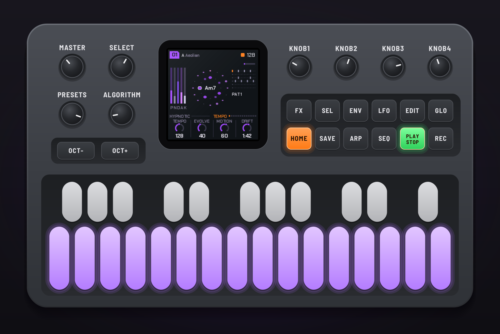

---

## Contents

1. Install
2. Getting started
3. Controls
4. The screen
5. The pages
6. Pieces and storing
7. Styles
8. The sequencer
9. Effects
10. Performing
11. Shift
12. Themes and MIDI
13. The emulator
14. Troubleshooting
15. Credits

---

## 1. Install

**Try it first:** the [HYP-1 emulator](../emu/) runs the same code in the browser, with sound, played
with the mouse, a touch screen or the keyboard.

**Install:** open the [web installer](../install/) in Chrome or Edge, connect the FM-1 with a USB data
cable, close anything else using its MIDI port (a DAW, for instance) and press Install. Don't unplug it
while it's writing; when it finishes, the FM-1 restarts into HYP-1.

**Go back:** "Back to the stock firmware", at the bottom of the same page, puts M-VAVE's firmware back.
M-VAVE's own updater, M-UPGRADE, works too.

> Installing firmware is at your own risk. If an install is cut off, run it again: the FM-1 stays in update mode until it finishes. Holding OCT− and OCT+ for 5 seconds also enters update mode.

---

## 2. Getting started

1. Switch it on. The RedtailWorks card shows, then a piece starts playing at random.
2. Turn **SELECT** to walk through the pages; the four knobs under the screen change what each page shows.
3. Press **SEQ** for the drums, hold it for the step sequencer, and tap the white keys to change the beat.
4. Turn **PRESETS** for another piece. Hold **SEL** and turn **ALGORITHM** to hear it as house, techno, acid or breakcore.
5. Tap **SAVE** for a breakdown on the next bar; tap it again for a four-bar build and the drop.
6. Press **FX** and hold keys for effects.
7. Like a piece? Go to **Global** (GLO) and press **SAVE** to store it.

---

## 3. Controls

| # | Control | What it does |
|---|---|---|
| 1 | MASTER | Volume. |
| 2 | SELECT | Steps through the pages in order. With HOME held: the tempo, from any page. |
| 3 | PRESETS | The piece, 01–10. With SEL held: the piece changes on the next bar. |
| 4 | ALGORITHM | The mode of the scale. With SEL held: the piece's style. |
| 5–8 | KNOB 1–4 | The four values (a, b, c, d) of the page on screen. |
| 10 | OCT− | The acid line an octave down. In the sequencer: the previous drum. |
| 11 | OCT+ | The acid line an octave up. In the sequencer: the next drum. |
| 12 | FX | The effects menu, on and off. |
| 13 | SEL | Shift, held (see 11. Shift). |
| 14 | ENV | Pad; press again for Pad env, again for Pad LFO. |
| 15 | LFO | Drone; again for Drone env, again for Drone LFO. |
| 16 | EDIT | The next chord, on the next bar. |
| 17 | GLO | Global: root, theme, tune, MIDI out. Here SAVE stores the piece. |
| 18 | HOME | The Tempo page. Hold it and turn SELECT for the tempo. |
| 19 | SAVE | Breakdown on the next bar; again, a build and the drop; held, the drop. On Global: store the piece. In FX, held: lock mode. |
| 20 | ARP | Acid; again for Acid env, again for Acid line. |
| 21 | SEQ | Drums; again, Links; held, the sequencer; tapped in the sequencer, back to Drums. With SEL held: the links on and off. |
| 22 | PLAY | Play and stop. |
| 23 | REC | Freeze: the chord holds until pressed again. |
| 24 | White keys | The scale (each key adds or removes its note; the root stays). Sequencer: the 16 steps. FX: effects. |
| 25 | Black keys | The scale. FX: effects. |

Hold any button alone for a second and a card on the screen says what it does (except PLAY, SEL, SAVE,
SEQ and FX, whose hold means something else).

---

## 4. The screen

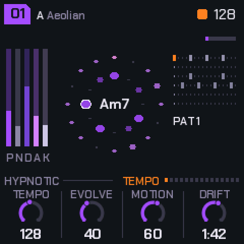

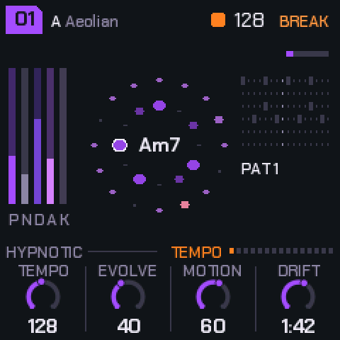

- **Top left:** the piece's number in a tag (a dot in it: changes not yet stored), the root and the mode.
- **Top right:** the beat light and the tempo; the section (BREAK, BUILD, blinking while it waits for the bar); a small dot while a store waits to be written.
- **Left:** the levels of the pad (P), noise (N), drone (D), acid (A) and the kit (K).
- **Middle:** the scale as a ring with the chord in it; around it, the acid loop, one dot a step.
- **Right:** the drum pattern playing, its number, and a bar filling towards the next chord.
- **The line above the knobs:** the piece's style on the left; on the right, the page's name and a dot for each page.
- **Bottom:** the four knobs: each value's name, its ring and its value.

---

## 5. The pages

SELECT walks through them in this order. The buttons jump straight to a voice, and pressing the same
button again steps through that voice's envelope and LFO. KNOB 1 is always a voice's level.

| Page | Reach it | a | b | c | d |
|---|---|---|---|---|---|
| Tempo | HOME | Tempo (70–190) | Evolve | Motion | Drift (20 s – 5 min a chord) |
| Pad | ENV | Level | Bright | Colour (Rhodes / Voices) | Detune |
| Pad env | ENV ×2 | Attack | Hold | Release | Rest |
| Pad LFO | ENV ×3 | Rate (1/4 – 32 bars) | Depth | Shape | Target (filter, level, pan, pitch) |
| Noise | SELECT | Level | Colour (8) | Tone | Pump |
| Drone | LFO | Level | Octave | Cutoff | Reso |
| Drone env | LFO ×2 | Trigger (chord, 1–8 bars, off) | Attack | Decay | Amount |
| Drone LFO | LFO ×3 | Rate | Depth | Shape | Target (cutoff, pitch, level, drive) |
| Acid | ARP | Level | Cutoff | Reso | Env mod |
| Acid env | ARP ×2 | Decay | Accent | Slide | Wave (saw / square) |
| Acid line | ARP ×3 | Density | Length (1–16) | Range (1–3 oct) | Mutate |
| Drums | SEQ | Level | Drive | Swing | Pattern (1–6, on the bar) |
| Links | SEQ ×2 | K>Drone | S>Pad | H>Acid | P>Clock (off / on) |
| Space | SELECT | Echo | Echo time (1/8 – 1 bar) | Reverb | Size |
| Global | GLO | Root | Theme | Tune | MIDI out |

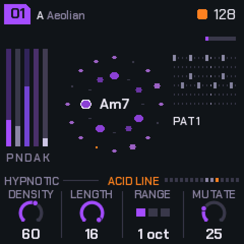

**What moves by itself.** The chord changes now and then (Drift sets how long it stays; EDIT moves it on).
The pad's voices breathe on unequal cycles and take the new chord's notes as they breathe in. The drone
follows the chord's root and glides. The acid line's notes are tied to the chord, so the riff transposes;
Mutate rewrites steps each time round. Motion sets how far a slow tide swings between sparse and full,
over a minute or two. Evolve makes the acid and the chords more restless.

---

## 6. Pieces and storing

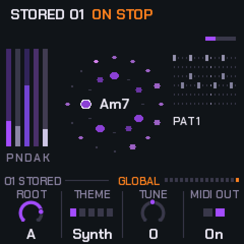

There are ten pieces, **01–10**, on PRESETS. Each has its own settings, its own six drum patterns and
its own drum sounds; patterns 1–6 run roughly intro, groove, build, peak, variation and a thinner tool.
While the power is on, each piece keeps your changes as you left it.

**Storing:** go to **Global** and press **SAVE**. The piece is stored as it is: every page's values, the
scale and mode, its style, its patterns and its drums' sounds. The line above the knobs says
`01 SAVE: STORE` while it has changes, then `01 STORED`.

**Factory:** on Global, hold SAVE for 1.5 seconds (the screen says HOLD: FACTORY): the piece goes back to
how it shipped and out of the store.

**When it's written:** writing to the FM-1's memory silences it for a moment, so a store made while
playing is written as soon as you stop. A small dot by the tempo means a write is waiting.

> Stop the music before you switch off, or a store still waiting is lost.

**Power-on** starts on a piece at random: as you stored it, or with small random changes to its factory
settings if you never did. Theme, Tune and MIDI out are yours across all pieces and are kept too.

| Piece | Character | BPM | Key |
|---|---|---|---|
| 01 | Hypnotic four on the floor | 128 | A Aeolian |
| 02 | Deep and dubby: rims, shakers | 124 | D Dorian |
| 03 | Pounding: rumble kick, claps | 132 | E Phrygian |
| 04 | Trance: offbeat opens, rolls | 138 | G Aeolian |
| 05 | Acid electro: cowbells, breaks | 130 | A Dorian |
| 06 | Dub techno: sparse, swung | 120 | F Pent minor |
| 07 | Minimal glitch: threes on fours | 134 | B Pent major |
| 08 | Rolling, tom-like percussion | 126 | Bb Mixolydian |
| 09 | Warehouse: hard, rides, rumble (Techno) | 136 | C Phrygian |
| 10 | Deep field: half time, breaks | 118 | Eb Aeolian |

---

## 7. Styles

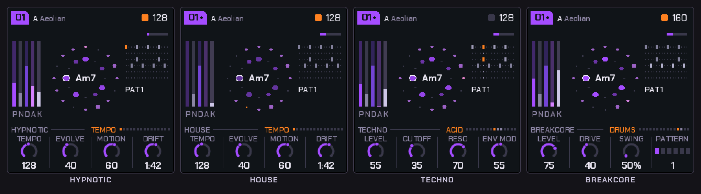

Hold **SEL** and turn **ALGORITHM**. A style reshapes every voice's sound and the feel: the drums'
tones and decays, the swing, how the pad plays, the drone's grit, the acid's drive. Your patterns, levels
and settings stay as they are. Switching style moves the tempo into the style's range; after that any
tempo from 70 to 190 works. The style is stored with the piece.

| Style | BPM | What it does |
|---|---|---|
| Hypnotic | 110–145 | Deep kick, metallic 808-style hats, breathing pad, smooth drone. |
| House | 118–128 | Round kick, shuffle, wide clap, long open hats, congas. The pad stabs chords on the off-beats (Pad env Release sets their length; Evolve adds a few). Warm bass, more pump. |
| Techno | 128–138 | Hard, driven kick with a rumble tail, tight clap, metal hats, a bell perc. Dark pad, gritty drone. |
| Acid | 120–132 | Punchy 909-style kit with a cowbell and a little swing. The 303 driven and up front; pad and drone pulled back. |
| Breakcore | 160–180 | Distorted, crushed drums chopped live: ghost snares, extra kicks, 32nd rolls (Evolve: more). Dirty sub; the acid at half time. |

### Links: the drums into the voices

The drum hits can be patched into the voices, like trigger cables on a modular. **SEL + SEQ** turns the
links on and off without losing their amounts (+LINK shows on the line above the knobs while they're
on); the **Links** page (SEQ, then SEQ again) sets each one, 0 being none. They're stored with the piece.

| Link | What it does |
|---|---|
| K>Drone | Each kick opens the drone's filter, falling back over the beat: a rolling bass that follows your kick pattern. The amount sets how far and how long. |
| S>Pad | Each snare or clap flashes the pad's filter open and swells it a little, so the pad answers the backbeat. |
| H>Acid | A hat landing on an acid note accents it: busier hats, a squelchier 303. |
| P>Clock | The acid line steps only when the perc lane hits, so the perc pattern in the sequencer becomes the acid's rhythm. In a breakdown or build, with the drums out, it runs free again. |

Muting a drum with FX silences it but its hits still drive the links: mute the perc and it's a pure
clock for the acid.

---

## 8. The sequencer

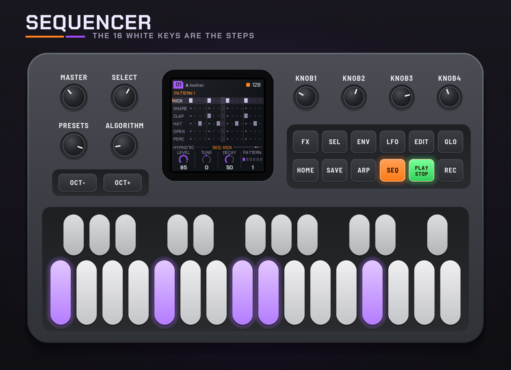

**Hold SEQ** to open it; tap SEQ to go back to the Drums page.

- Six lanes: kick, snare, clap, closed hat, open hat, perc. Sixteen steps.
- The sixteen **white keys** are the steps of the drum you're on. They light where it hits, and the light running across them is the playhead. Tap a key to turn its hit on or off.
- **OCT−** / **OCT+** choose the drum.
- The knobs: the drum's **Level**, **Tune** (±1 octave) and **Decay**, and the **Pattern** you're editing (even before it plays).
- With **SEL** held: black keys 1–6 copy this pattern into pattern 1–6, OCT− clears this drum's lane, OCT+ puts back the piece's own lane, white keys 1–6 choose the pattern to edit.

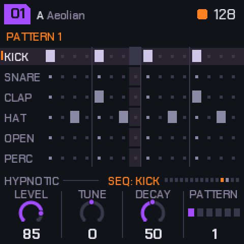

---

## 9. Effects

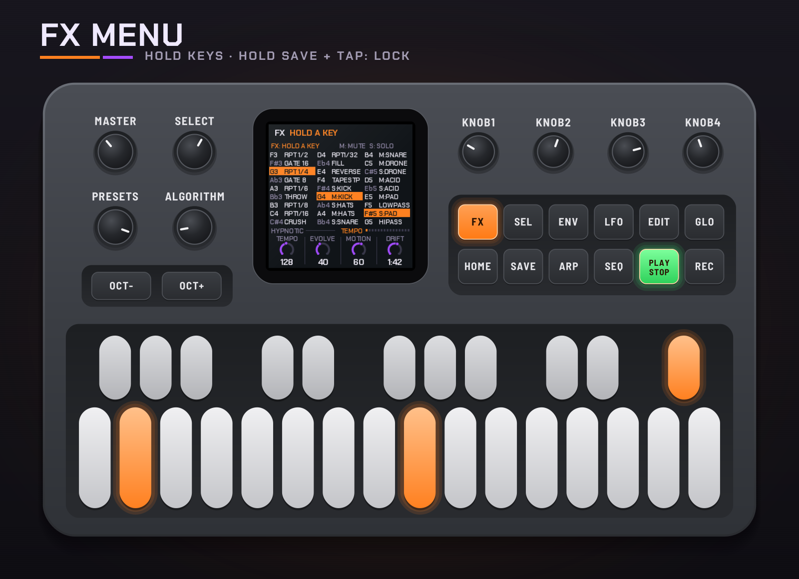

Press **FX** to open the menu; press it again to close it. While it's open, every key is an effect,
playing while you hold it.

**Locking:** hold **SAVE** for lock mode. Each key you tap locks its effect on (it turns purple), one at
a time or several together; tap a locked one again to unlock it. Keys already held when SAVE goes down
lock too. Let go of SAVE and the locks stay while you play other effects over them. Closing FX lets them
all go. Tapping SAVE alone in FX is still the breakdown.

For example: FX, then hold SAVE, tap Gate 1/8, tap Crush, let go of SAVE: both stay on.

| Keys | Notes | Effect |
|---|---|---|
| White 1–6 | F3 G3 A3 B3 C4 D4 | Beat repeat 1/2, 1/4, 1/6, 1/8, 1/16, 1/32, from the next sixteenth (the shortest held wins) |
| White 7–8 | E4, F4 | Reverse, tape stop |
| White 9–14 | G4 A4 B4 C5 D5 E5 | Mute kick, hats, snare (with clap and perc), drone, acid, pad (with noise) |
| White 15–16 | F5, G5 | Low-pass, high-pass, closing in |
| Black 1–5 | F#3 Ab3 Bb3 C#4 Eb4 | Gate 1/16, gate 1/8, echo throw, crush, drum fill |
| Black 6–11 | F#4 Ab4 Bb4 C#5 Eb5 F#5 | Solo kick, hats, snare, drone, acid, pad |

Beat repeat and reverse play back the last moment of the mix (just under a second); a 1/2 repeat that
doesn't fit at slower tempos plays as a 1/4.

---

## 10. Performing

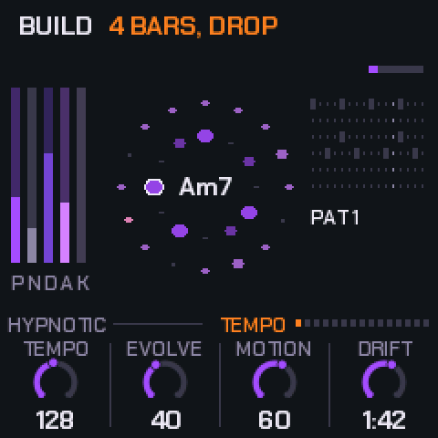

- **Breakdown: tap SAVE.** The drums drop out on the next bar, the drone closes and the pad rises, for as long as you leave it.
- **Build: tap SAVE again.** A four-bar snare roll with the drone opening, then the drop.
- **Drop: hold SAVE.** Straight back in on the next bar. SAVE lights during a breakdown or build and blinks while one waits for the bar.
- **Freeze: REC.** The chord holds and the reverb rings on; press again to let it move.
- **Next chord: EDIT.** Moves on at the next bar.
- **The scale: the keys.** Each adds or removes its note; the root stays. ALGORITHM picks a mode.
- **Patterns.** Drums page, knob d, or SEL + white keys 1–6. A change waits for the bar, so turning past patterns plays none of them.

There's no song saving: record the audio (or MIDI out) into your DAW and keep the takes you like.

---

## 11. Shift

Hold **SEL** and:

| With | Does |
|---|---|
| White keys 1–6 | Pattern 1–6, on the bar. The keys light the one chosen; the one still playing blinks. |
| PRESETS | The next or previous piece, on the next bar ("PIECE 03 NEXT BAR" until it comes). |
| ALGORITHM | The piece's style. |
| SEQ | The links on and off. |
| Black keys 1–6 (sequencer) | Copy the pattern you're editing into pattern 1–6. |
| OCT− (sequencer) | Clear this drum's lane. |
| OCT+ (sequencer) | This drum's lane back to the piece's own. |

Keys pressed while SEL is held are never notes or effects.

---

## 12. Themes and MIDI

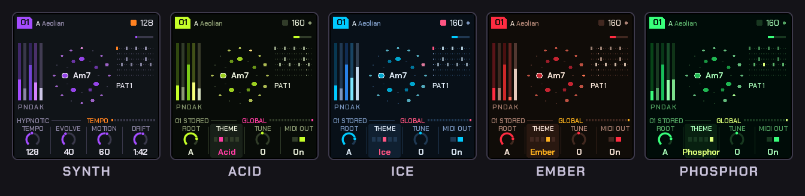

**Global** (GLO): **Root**, **Theme** (Synth, Acid, Ice, Ember, Phosphor), **Tune** (±50 cents) and
**MIDI out**.

**MIDI out** (USB): the pad's notes on channel 1, the drone on 3, the acid on 4, the drums on 10
(General MIDI notes), and MIDI clock with start and stop.

**MIDI in:** channel 1 notes add or remove their note from the scale; clock and start / stop drive the
tempo (EXT shows in place of the tempo).

---

## 13. The emulator

The [emulator](../emu/) runs the firmware itself in the browser. Drag a knob up or down, or scroll over
it. Click buttons and keys; Shift-click (or right-click) a button to hold it down, click again to let go:
that's how to hold SEQ, SAVE, SEL or HOME. **New start** powers it off and on (stored pieces stay, in that
browser); **Forget stored** clears them.

| Key | Does |
|---|---|
| Space | PLAY |
| Enter | REC |
| Esc | HOME |
| V / L / P | ENV / LFO / ARP |
| M | SEQ (hold: the sequencer) |
| O / C / N | GLO / EDIT / SEL |
| ` | FX |
| B | SAVE |
| Z / X | OCT− / OCT+ |
| Up / Down | SELECT |
| Q–I, A–K | White keys 1–8, 9–16 |
| 1–0, - | Black keys 1–11 |

---

## 14. Troubleshooting

- **No sound:** check MASTER, and that PLAY is lit. A piece's layer levels can be at 0: each voice's page has its level on KNOB 1.
- **The installer doesn't find the FM-1:** use Chrome or Edge, a USB data cable (not charge-only), and close any DAW holding its MIDI port.
- **An install was cut off:** run it again; the FM-1 stays in update mode until it finishes.
- **A stored piece came back as it was before:** it was stored while playing and the power went off before the music stopped.
- **Crackles or dropouts:** please report the piece, style and tempo (an issue on GitHub, or via [redtail.works](https://www.redtail.works)).

---

## 15. Credits

HYP-1 is a [RedtailWorks](https://www.redtail.works) project, a fork of
[AMB-1](https://github.com/charlesvestal/fm1-amb) by Charles Vestal. The platform (USB, update loader,
storage, installer) is [Felucca](https://github.com/hugelton/Felucca) by Leo Kuroshita (@kurogedelic),
Hügelton Instruments. Screen font: Chakra Petch (SIL OFL). Licence: GPL-3.0.

M-VAVE and FM-1 are trademarks of their owners; HYP-1 is not affiliated with M-VAVE.
