# PERF-1

PERF-1 is free firmware that turns your M-VAVE FM-1 into a groovebox that plays by itself. When you switch it on, a piece of music starts. The piece has drums, a bass line, a pad, an acid line and a short plucked melody. PERF-1 makes up the music while it plays, so the music never repeats exactly. There are twenty-two styles, from techno and house to lofi, hip-hop, reggae, drum and bass, trance and ambient. Each style has ten pieces.

You do not have to program anything to start. You control the music. You change the chords, you take the beat out (a breakdown) and bring it back, you mute parts and you add effects. Or the auto-DJ can do these things for you. If you want to do more, you can edit almost everything, from the drum steps to the sounds. You can save each piece that you change.

The FM-1 also works as a USB audio and MIDI device. Thus, you can record what you play directly into your computer.

If you are new, read **Start here** below first. The numbered sections after it are the full reference.

PERF-1 is made by deamonSLINKY. It is free and open source (GPL-3.0-only). The credits (section 19) give the people whose work it uses. PERF-1 is still new and it changes frequently. Thus, keep a way to go back to the stock firmware, M-VAVE's own firmware (section 1 explains how).

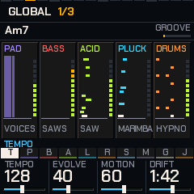

---

## Start here: your first hour

This guide is for your first hour. You do not need music theory, and you do not have to set up anything. Each step is one thing to press. Each step also tells you what you will hear.

If you want all the details, the [quick manual](https://deamonslinky.github.io/PERF-1/manual/PERF-1-quick-manual.pdf) shows every control on eight pages. The rest of this manual, from section 1, explains everything. This part is also a [printable PDF](https://deamonslinky.github.io/PERF-1/manual/PERF-1-beginners-guide.pdf).

### What PERF-1 is

PERF-1 turns your M-VAVE FM-1 into a small band that plays by itself. When you switch it on, music starts. You hear drums, a bass, a soft pad, an "acid" line (a twisting line with a sharp, wet sound) and a plucked melody. PERF-1 makes up all of this music while it plays, so it never repeats exactly.

You control the band. You do not have to play notes. You change the chords. You take the beat out and bring it back. You add effects, you mute parts, and you keep the moments that you like.

### Before you start

- **Try it before you install it.** The [emulator](https://deamonslinky.github.io/PERF-1/emu/) runs PERF-1 in your web browser, with sound. All the steps in this guide also work there.
- **To install**, use the [web installer](https://deamonslinky.github.io/PERF-1/install/) in Chrome or Edge. It takes a couple of minutes. Use a USB cable that carries data. Do not use a cable that only charges.
- **You can always go back.** The same installer page puts M-VAVE's own firmware back. Keep copies of the items that are important to you. When you change the firmware, you can lose the items that you saved on the stock firmware.

### The buttons you need today

You need only a few buttons. The other buttons can wait.

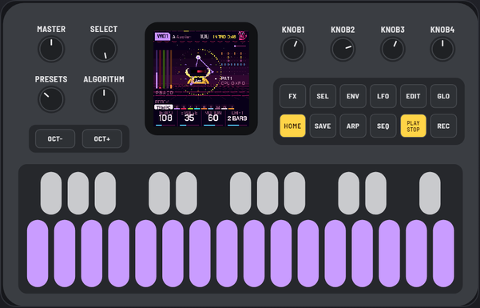

| Control | What it does for you today |
|---|---|
| **MASTER** knob | Sets the volume. |
| **PLAY** | Stops and starts the music. Each start makes a new track with its own code (see Track codes). |
| **EDIT** | Goes to the next chord. |
| The **keys** | Play along with the music. Every note fits the music. |
| **PRESETS** knob | Goes to the next piece of music. |
| **SAVE** | Takes the beat out (a breakdown), then builds it back up. |
| **FX** | Opens the effects. |
| **HOME** | Goes back to the start page. Press it when you do not know where you are. |
| **GLO** | Opens the Global page. Hold it for the mix map: mutes, solos and scenes. |

### Your first five minutes

**1. Switch it on and listen.** After a short animation, a piece starts to play by itself. Turn **MASTER** to a comfortable volume. Nothing that you press in this guide can cause damage.

**2. Tap EDIT.** At the start of the next bar, the chord changes. The whole band follows: the bass, the pad and the melodies all change to fit the chord. Tap it a few more times.

**3. Play a few keys.** The keys play a melody over the band. Every key is a note of the music's scale, so no note is wrong. Play anything, slowly or quickly, and it fits. The chords and the scale of the piece do not change.

**4. Turn PRESETS one click.** A new piece starts, with a new key, a new tempo (speed) and new sounds. There are ten pieces in each style.

**5. Hold GLO and turn PRESETS.** Now you change the style. There are twenty-two styles: techno, lofi, house, dubstep, dub, drum and bass, breaks, garage, electro, trap, disco, funk, reggae, synthwave, amapiano, trip-hop, industrial, psytrance, dark forest, hip-hop, trance and ambient. When you find a style that you like, release GLO.

### Make it move

**6. Tap SAVE: a breakdown.** At the next bar, the drums stop. The music becomes softer and more dreamy.

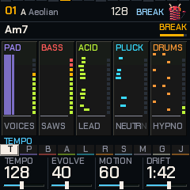

**7. Tap SAVE again: the build and the drop.** The drums come back and climb for a few bars. Then there is a short silence. Then all the parts play together at once. DJs like this moment very much. Tap SAVE, wait, and tap SAVE again. That is all.

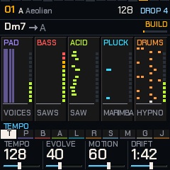

**8. Press FX: effects on the keys.** Now each key is an effect. The screen shows the names of the effects.

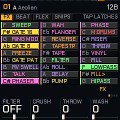
- **Tap** a key to keep its effect on.
- **Hold** a key to use its effect only while you hold the key.
- To stop an effect, tap the same key again. To stop all the effects at once, tap **OCT-**.
- To leave, press **FX** again. Try the gate, the phaser, the tape and the beat repeats.

### The Perform screen, a first look

**9. Press HOME, then HOME again** (do not press too quickly). This is the Perform screen. It shows the eight parts of the band and a **mood** bar.

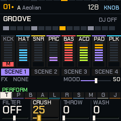

**10. Turn ALGORITHM, the knob that sets the mood.** Turn it left for calm music with few notes. Turn it right for busy, bright music. The acid, the hats (the hi-hats), the melody, the bass and the reverb (the sound of a room) all change together.

**11. Tap the keys to mute parts.** On this screen, the keys turn the parts of the band off and on. The screen shows which key controls which part. Mute the kick drum and listen to the difference. Then turn it on again.

**12. Let it play itself.** Hold **GLO** and tap the **F5** key (the second white key from the right). "DJ" comes on at the top of the screen. Now PERF-1 does the breakdowns, builds and drops by itself, like a DJ. To stop this, do the same again.

### Keep what you like

**13. Save the piece.** If you changed a piece and you like it, press **GLO**, then **SAVE**. The screen shows that it stored the piece. The piece is there the next time that you switch on.

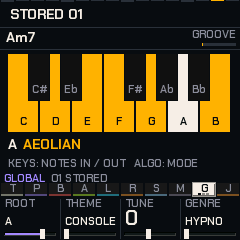

 Each style keeps its own ten pieces.

To put a piece back to how it was at the start, go to **GLO**. Then hold **SEL** and **SAVE** together for a moment.

### When you want more

You do not need these things to have fun, but they are there.

- **Turn SELECT** to go through the pages. Each page has four knobs below the screen. The page name tells you what the knobs change: the pad, the bass, the acid, the drums, the reverb and much more.
- **The Jam page** (turn SELECT past Global) sets what the keys play. It can be the pluck, the pad, the acid or the bass, as single notes or full chords. It also sets how high the notes are. On the pages of a part (the pad's, bass's, acid's or pluck's pages), the keys play that part.
- **Change the scale** on the **Global** page (press GLO). On this page, each key adds a note to the music or removes it. ALGORITHM sets the mode of the scale (a brighter or darker minor, or a major). On all other pages, ALGORITHM sets the mood.
- **Hold HOME** for the settings.
- **The SET page** has an **Intro**. The Intro starts with only a pad. Then it brings in the band, one part at a time, over a few minutes. It is good for mixing in, or for playing over. To get there, hold **HOME**, then turn **SELECT** to SET.

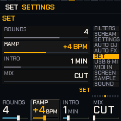
- The [quick manual](https://deamonslinky.github.io/PERF-1/manual/PERF-1-quick-manual.pdf) has eight pages. Print it and keep it next to the FM-1.

### If something goes wrong

- **You do not know where you are?** Press **HOME**.
- **An effect does not stop?** Press **FX**, then **OCT-**, then **FX** again.
- **The music stopped?** Press **PLAY**.
- **A piece sounds strange after many changes?** Turn PRESETS to a different piece and then back. Or reset the piece: on the **GLO** page, hold **SEL** and **SAVE**.
- **You want the original firmware back?** Go to the [installer](https://deamonslinky.github.io/PERF-1/install/) page. Use "Back to the stock firmware" at the bottom.
- **You found a bug (a problem) or you have an idea?** Tell us on [GitHub](https://github.com/deamonSLINKY/PERF-1/issues). Most of the newest features came from ideas like yours.

### Words you will see

| Word | Means |
|---|---|
| **Piece** | One song: its key, tempo, sounds and drum patterns. There are ten in each style. |
| **Genre** | A style of music, with its own drums, sounds and typical ways to play. There are twenty-two. |
| **Pad** | The soft, long chords in the background. |
| **Bass** | The low notes. |
| **Acid** | The twisting line with a sharp, wet sound, in the style of the classic Roland TB-303. |
| **Pluck** | The short, plucked melody on top. |
| **Chord** | The group of notes that the band plays around at this moment. EDIT changes it to the next chord. |
| **Scale** | The set of notes that the music can use. The keys play only these notes. On the Global page, the keys add or remove these notes. |
| **Breakdown, build, drop** | The music becomes calm, climbs back up, then all the parts play at once. SAVE starts them. |
| **Latch** | An effect that stays on after you tap its key. |
| **Auto-DJ** | PERF-1 does the breakdowns, builds and drops by itself. |

---

## Contents

1. Install
2. Getting started
3. Controls
4. The screen
5. The pages
6. Pieces, genres and storing
7. Sounds, kits and playing
8. The sequencer
9. Effects
10. Performing
11. Mixing: the mixer, space and the master bus
12. Shift
13. Settings, visualizers and what is remembered
14. Themes and MIDI
15. Your own DX7 voices
16. Load, telemetry and the logger
17. The emulator
18. Troubleshooting
19. Credits

---

## 1. Install

You can try PERF-1 before you install it. The [PERF-1 emulator](../emu/) runs the same firmware in your web browser, with sound. Play it with the mouse, a touch screen or your computer keyboard.

### Installing PERF-1

1. Open the [web installer](../install/) in Chrome or Edge.
2. Connect the FM-1 directly to the computer with a USB cable that carries data (some cables only charge).
   You do not need a hub, a probe or Transporter.
3. Close all other programs that use the FM-1's MIDI port, for example your DAW (recording software).
4. When the browser asks, allow MIDI with SysEx. SysEx is the type of MIDI message that the installer uses to
   send the firmware.
5. Wait until the **Install** button is not grey (while it is grey, the page is still loading the firmware). The line
   below the button shows the version that it will write (for example, `PERF-1 1.0.0`). If that version is older than
   you expected, hard-refresh the page (Ctrl+F5, or Cmd+Shift+R on a Mac). Then the browser does not use an old saved copy.
6. Press **Install**.

The bar and the line above it show each stage: verifying, switching to update mode, writing, restarting,
done. **Do not disconnect the cable or close the page while it writes.** If you try to leave, the page asks you first.
When the install is complete, the FM-1 restarts into PERF-1. Then the page checks that the FM-1 reports the correct version.

The page counts finished installs, so the maker can see how many people use PERF-1: it sends only the version number
(nothing about you or your FM-1), and the total shows under the page's heading.

> Install firmware at your own risk. The author accepts no responsibility if this custom firmware damages your FM-1 or makes it work incorrectly. Keep your own copies of the .syx files that you load. When you replace the firmware, you can lose all the items that you stored (pieces, settings, DX7 voices).

### Going back to the stock firmware

The "Back to the stock firmware" part, at the bottom of the same page, puts M-VAVE's own FM-1 firmware, V15, back on
the unit.

1. Download the file that the page links to, `FM-1.fwsc`. It is also on
   [m-vave.com/download](https://www.m-vave.com/download). M-VAVE's link now gives V16. For V15, the page also
   links to the copy of M-VAVE's original file that the Internet Archive kept
   ([V15](https://web.archive.org/web/20261009203224id_/https://yms-file-store.oss-cn-hongkong.aliyuncs.com/software/firmware/FM-1.fwsc)). The page checks the fingerprint of each file before it writes anything.
2. Select that file on the page. The page checks the SHA-256 fingerprint of the file (a code that identifies the
   exact file). It refuses all other files.
3. Connect the FM-1. Then press **Install the stock firmware**.

This works from PERF-1, from safe mode and from update mode. M-VAVE's own updater, M-UPGRADE (Downloads,
PC Software), also works from PERF-1 0.16.13 and later. M-UPGRADE 3.11 does not find older PERF-1 builds ("A USB MIDI device is
present but did not answer"). For those builds, use the button on this page.

**V16.** M-UPGRADE now offers V16 (`FM-1_016`), the newer firmware from M-VAVE. From PERF-1 0.16.15 and later, you can go in
either direction. M-UPGRADE changes PERF-1 directly to V16, and this page installs PERF-1 on an FM-1 that runs V16. The button
on this page accepts the V15 file or the V16 file.

V16 changes the FM-1's boot head, the first 16 KB of its memory. PERF-1 lets that change occur only between M-VAVE's own V15
and V16 heads. With an older PERF-1, the FM-1 shows `UPDATE FAILED` and M-UPGRADE times out (error 258). In that case, select
V15's `FM-1.fwsc` with **Select firmware** in M-UPGRADE, or use the button on this page. Then update the stock V15 to V16 with
M-UPGRADE.

**One program at a time.** On Windows, only one program at a time can use the FM-1's MIDI port. This page and the Pieces page
release the port 4 seconds after they last communicated with the FM-1. (Live status keeps the port while it runs.) Thus,
M-UPGRADE or your music software can open the port while the page is still open. If a program says that the FM-1 is busy or
"present but did not answer", close the other programs and pages that use the port. Then disconnect the FM-1 and connect it again.

### Update mode

In update mode, the installer can write to the FM-1. To start update mode yourself, hold **OCT-** and **OCT+**
together for 5 seconds while PERF-1 runs.

- After 2 seconds, the screen counts down: `UPDATE MODE IN 3..`.
- If you release the buttons before the end, the screen shows `UPDATE MODE CANCELLED`.
- At 5 seconds, the FM-1 goes into update mode and shows `UBOOT`.

If an install stops before the end, the FM-1 stays in update mode until a write is complete. Press **Install** again. If
the page says that it lost the FM-1, first disconnect the cable and connect it again. If the cable comes out while the installer
checks the package (before it writes), nothing is written. The FM-1 then waits with a dark screen: switch it off and on, and PERF-1 starts as before.

### Safe mode

If PERF-1 crashes or freezes two times in sequence while it starts, the FM-1 starts in safe mode instead. The
screen is black and shows `PERF-1 SAFE MODE`, with the address of the crash at the bottom. There is no sound,
but USB works. In safe mode, you can:

- install again from the web installer, or
- press **PLAY** to try to start PERF-1 again.

If the start still fails after this, the FM-1 goes into update mode automatically, ready for the installer.

If PERF-1 crashes while it runs, the next start tells you. The screen shows `RESTARTED AFTER A CRASH`
and a `PC` address for two and a half seconds. If you report the crash, write down that address.

### Recovering an FM-1 that won't start

**An install that stopped before the end (PERF-1 0.16.17 and later).** If the power or the cable is lost while PERF-1 installs,
switch the FM-1 on again. The key lights flash three times and the screen stays dark. This means that the FM-1 waits for the
installer. Then do these steps:

1. Connect the FM-1.
2. Open the Install page.
3. Press **Install** again. The installer completes the install.

To get to this mode on purpose, hold **OCT-** alone while you switch the FM-1 on. If the lights give one long flash instead,
the rescue was not possible. The FM-1 is then in the chip's own USB mode (below).

This function comes from ChoralRoot's boot stub (a small program that the FM-1 starts through), as Melodee uses it. PERF-1
starts through it at every start. It was tested on a real FM-1 (2026-11-21): the cable pulled and the power cut at different points
of an install (while it checks, just after the loader starts, at about a third and at nine tenths of the write, and at the restart),
and 40 starts in a row. Each time, the install completed and the pieces, kits and settings were all there. Even so, do not stop an install on purpose.

The first install of 0.16.17 over an older PERF-1 has a short time, near the start, that is not protected yet. Keep the cable
connected and the power on until the install is complete. If you install the stock firmware or a different firmware, that
install removes the boot stub.

- **Covered:** a bad PERF-1 install. The installer checks the package before it sends it. It checks each packet
  that it writes. After the restart, it reads back the FM-1's version. On the FM-1, there is safe mode, update mode
  after four failed starts, the **OCT-** + **OCT+** hold, and a USB command that starts update mode. The
  installer works from all of them.
- **Not covered:** a damaged start-up sector or boot loader (the part of the memory that starts the FM-1).
  Also not covered: a loss of power or cable during a write, before the installer has saved its record of where to continue.
  The protection for stopped writes was tested with real cable pulls and power cuts (above). Nobody has found a hardware way in for this chip (test pads, a strap, a key combination). An
  FM-1 that fails in this way can be permanently lost.

If the FM-1 does not start but it still gets to the chip's own update mode (one long flash; it shows on USB as
4C4A:8057, `UBOOT`), use **Melodee's recovery tool**. It is the easiest way back on all computers. Download `fm1-recover`
for Windows, Linux or Mac from the [Melodee 1.4.0 release](https://github.com/keremimo/melodee/releases). You do not
need Python. The tool puts M-VAVE's own V15 back (`FM-1.fwsc` from M-VAVE: the tool accepts only the unchanged
file). Then install PERF-1 again from the web installer.

On Windows, the tool needs the WinUSB driver for that one device (4C4A:8057). Install the driver one time with
[Zadig](https://zadig.akeo.ie/). Do not change the driver of the FM-1's normal MIDI and audio device. First, run
`fm1-recover --info`: it only reads, and it does not write. The tool keeps a full backup of the memory before it writes.
It is Kerem Kilic's (Ellic Studio), from the Melodee project, and it is not part of PERF-1.

On a Mac, the PERF-1 source also has its own rescue tool, `tools/fm1_rescue.py` (and its wrapper `fm1_rescue.sh`). It
puts the stock V15 back from a Mac. It uses sudo, `pyusb` and `libusb-package`. First, it makes a backup of the full memory.
Then it writes only the parts of the memory that are different from V15, and it never touches the part that starts the unit.
Then it reads all of the memory back to check it. It accepts only the exact V15 file.

The tool was written for an FM-1 that crashes at each start. It uses the method of FM-1-transporter, which that project
tested on real hardware. Use it only as a last resort. It is not a guarantee. In other cases, recovery needs
[FM-1-transporter](https://github.com/kurogedelic/FM-1-transporter) or hardware that you possibly do not have.

---

## 2. Getting started

Are you new to PERF-1? **Start here**, at the top of this manual, takes you through your first hour. This section is the
short version.

1. Switch it on. The **deamonSLINKY** card shows (the slinky mascot jumps twice and blinks, then the name and
   PRESENTS show). Then the **PERF-1** card shows (a festival picture, the version, "by deamonSLINKY", GPL-3.0).
   On it, sixteen steps fill in and the white keys come on with them. Push any button or key to skip the cards.
   Then the music starts: the piece that you played last, or a HYPNO piece at random (SETTINGS, **Start**).
2. Turn **SELECT** to go through the pages. The four knobs below the screen change what each page shows.
3. Press **SEQ** for the drums. Hold it for the step sequencer (the drum beat as 16 steps). Then tap the white keys
   to change the beat.
4. Play the keys. On the page of a voice, the keys play that voice over the music. On other pages, they play the
   voice of the Jam page. Turn **PRESETS** for a different piece.
   Hold **GLO** and turn **PRESETS** for a different genre. On the page of a voice, hold **SEL** and turn
   **ALGORITHM** to hear the other sounds of that voice.
5. Do you want to play the bass yourself? Press **LFO** for the bass page. Then hold **SEL** and press **ENV**. The
   bass stops its own part, and the keys play the bass instead. To give the part back to the bass, press **SEL** + **ENV**
   again. The **JAM** page (turn **SELECT** past Global) is a keyboard that never changes the scale.
6. Tap **SAVE** for a breakdown on the next bar. Tap it again for a build and then the drop. A build is
   four bars long. It is two bars in lofi, trip-hop, hip-hop and ambient. It is eight bars in house, dubstep, DnB,
   psytrance and trance.
7. Press **FX** for the effects. Tap a key to latch its effect on (to keep it on). Or hold the key to play the effect only
   while you hold it.
8. **HOME** goes to the Tempo page. Press **HOME** again, not too quickly, for the Perform screen. Press it
   twice quickly for the visualizers. Hold it for the settings.
9. Do you like a piece? Go to **Global** (**GLO**) and press **SAVE** to store it. Storing works in every
   genre: a piece that you store in lofi or house stays there.

---

## 3. Controls

| Control | What it does |
|---|---|
| **MASTER** | Sets the volume. |
| **SELECT** | Goes through the pages in order. With **HOME** held: sets the tempo, from any page. In the FX menu: selects the bank (FX, BEAT FX, FLEX BEAT, DJ SNIPS). In the settings of an effect: goes to the next settings page. On the visualizers: goes to the next visualizer. |
| **PRESETS** | Selects the piece, 1 to 10. With **SEL** held, the new piece starts on the next bar. With **GLO** held: selects the genre. |
| **ALGORITHM** | Sets the mood, on all pages but three (so that a turn never changes the scale by accident). On the **Chords** page, the **Progression** page and **Global**: sets the mode of the scale (Aeolian is the natural minor, Dorian is a brighter minor, Phrygian is a darker minor, Mixolydian is a major with a flat seventh; the fourteen modes are in the list under **The scales**, section 5). With **SEL** held: sets the sound of the voice on the screen (on the drum pages, the full kit). |
| **KNOB1**-**KNOB4** | Set the four values (a, b, c, d) of the page on the screen. |
| **OCT-** | Moves down one octave, to -3. On the pages of a voice, it moves that voice (pad, bass or acid; the pluck goes down to -2). On all other pages, it moves the whole song. In the sequencer, it selects the previous drum. In the FX menu, it turns off all the effects. |
| **OCT+** | Moves up one octave, to +3, in the same way. In the sequencer, it selects the next drum. |
| **FX** | Opens and closes the effects menu. Held: opens the settings of the effect that you used last, from any page. |
| **SEL** | Shift: hold it while you use a different control (section 12). Tapped alone on the Perform screen or a visualizer: the **swell**. The swell lifts the mood, the throw and the wash over one bar, and lets them back down over four bars (tap again during the swell: they go back immediately; turn a knob: the swell stops where it is). With **ARP**: the acid answers on the next bar. |
| **ENV** | Opens the Pad page. Again: Pad env, Pad LFO, Chords, Progression. With **SEL** held: takes the voice on the screen off its automatic part, so that you play it by hand (again: gives the part back). |
| **LFO** | Opens the Bass page. Again: Bass env, Bass LFO, Bass line, Bass steps, Bass answer. |
| **ARP** | Opens the Acid page. Again: Acid env, Acid line, Acid answer, Acid steps, Pluck, Pluck 2, Deja vu, Pluck steps. |
| **EDIT** | Goes to the next chord, on the next bar. Held: opens the Progression page, your own chords. |
| **GLO** | Opens the Global page: root, theme, tune, genre. On this page, **SAVE** stores the piece. Held: opens the mix map (mutes, solos, scenes, the auto-DJ, tap tempo) and the load meter. Held with **PRESETS**: selects the genre. With **SEL** held: remote (section 17). |
| **HOME** | Opens the Tempo page. Again: the Perform screen, then back to Tempo. Twice quickly: the visualizers. Held: the settings. Held with **SELECT**: sets the tempo. |
| **SAVE** | Starts a breakdown on the next bar. Again: a build and the drop. Held: the drop. On Global: stores the piece. |
| **SEQ** | Opens the Drums page. Again: Links, Kit, Drum drift, Groove, Steps, Feel, Phrase. Held: opens the sequencer. Tapped in the sequencer: goes back to Drums. With **SEL** held: turns the links on and off. |
| **PLAY** | Plays and stops. Each start is a new track with its own code. On the Code page, it plays the track again from the start (or the code that you typed in). |
| **REC** | Freeze: the chord stays and the reverb continues to sound until you press it again (or STOP). On the Jam page, REC alone is the phrase recorder instead (up to four bars, played back as you played them). With **SEL**: Capture. Capture writes the bar that you played on Jam into the acid line, the pluck loop or the bass steps (section 10). On an Acid page, it keeps the acid's answer as its line. In the FX menu, it is the gesture recorder. |
| White keys | Play a voice. On the pages of the pad, bass, acid or pluck, they play that voice. On other pages, they play the voice of the Jam page (with the Keys and Octave settings of Jam). On **Global**: the scale; each key adds or removes its note (the root stays). In the sequencer: the 16 steps. In the FX menu: the effects. On Perform, on the visualizers, and with **GLO** held: the track mix. |
| Black keys | The same as the white keys. |

If you press the button of a group again, it goes through the pages of that group. If you press it from a different page,
it takes you back to the last page that you used in that group.

**Holds and double taps**

| Gesture | Time | Does |
|---|---|---|
| Hold **SEQ** | 0.4 s | Opens the sequencer. |
| Hold **SAVE** | 0.5 s | Starts the drop immediately, on the next bar. |
| Hold **SEL** + **SAVE** on Global | 1.5 s | Puts the piece back to its factory settings. From 0.4 s, a card shows `KEEP HOLDING: FACTORY`. A plain **SAVE** on Global only stores the piece. |
| Hold **SEL** + **SAVE** on Global, stopped | 6 s | Puts every piece that you stored, in every genre, back to its factory settings. From 3 s, a card shows `KEEP HOLDING: EVERY PIECE, ALL GENRES`. |
| Hold **HOME** | 0.7 s | Opens the settings pages (**SELECT** goes through them). |
| Hold **FX** | 0.5 s | Opens the settings of the effects, from the effect that you used last (**SELECT** goes through them). |
| Hold **GLO** | 0.4 s | Opens the mix map. |
| Hold **SEL** alone | 0.4 s | A card shows what shift does on this page. |
| Hold **EDIT** | 0.4 s | Opens the Progression page. |
| Hold another button alone | 0.9 s | A card tells you what the button does (**ENV**, **LFO**, **ARP**, **REC**, **OCT-**, **OCT+**). |
| Tap an effect key | under 0.25 s | Latches the effect on. If you hold the key longer, the effect plays only while you hold it. |
| Hold a scene key | 0.6 s | Stores the scene. A tap recalls the scene. |
| **HOME**, **HOME** | within 0.45 s | Opens the visualizers. |
| **OCT-** + **OCT+** | 5 s | Starts update mode. |

If you hold **OCT-** and **OCT+** while you **switch the FM-1 on**, they do a different thing: they calibrate the
hardware (section 18).

---

## 4. The screen

The screen has five bands. From top to bottom, they are: the header, the chord, the five voices, the page tabs and
the knobs. Every colour theme uses this layout (its name is Console). The themes change only its colours.

**The header, left.** This part shows the tag of the piece. The tag is the number of the piece, with a letter for
the genre (`01` for HYPNO, `L03`, `H07`, `D02`, `V01` for dub, `N05` for DnB, `B04`, `G09`, `E06`, `T10`, `S03`, `F01`, `R07`, `W01`, `A05`, `P02`, `I04`, `Y01`, `O08`, `M06`, `U03`, `Z02` for the others; the table in section 6 has them all). A mark in the tag shows that the piece has changes
that you did not store. The root and the mode are next to the tag.

**The header, right.** This part shows the tempo. When an outside MIDI clock (another device that sends its tempo
over MIDI) controls the tempo, the tempo shows `EXT`. When PERF-1 is stopped, a play triangle shows next to the
tempo. On battery, a cell shows the charge. When USB supplies power to the FM-1, the cell has a bolt in it. The
slinky imp (a small figure) shows here for a moment at a drop, a breakdown or a build. To the left, marks show what
is on:

| Mark | Means |
|---|---|
| BREAK, BUILD | The section that plays now. `BREAK>`, `BUILD>` or `DROP>` means that a section waits for the next bar. In a build, `DROP 3` counts the bars until the drop. With the auto-DJ, `BREAK IN 4` shows in the last bars of a groove. In a breakdown, `BREAK 2` counts the bars until its build. |
| ARM, REC, PHR | The phrase recorder: it waits for your first note, it records, or it plays your phrase. |
| ARM, REC, LOOP, AUTO | The gesture recorder: it waits, it records, it loops your knob moves, or Auto FX plays them. |
| KNOB | An FX knob is not at its home position. If the sound has a filter on it and you do not know why, this is the cause. |
| KEY | The key change of the drop is on. |
| S1> to S4> | A scene waits for the next bar. |
| DJ | The auto-DJ runs. |
| FX | Effects are latched on (they stay on) and the menu is closed. The **FX** button also blinks. |
| a small dot | Something waits to be saved to memory (the theme, Tune, MIDI out, a piece). |

**The chord.** This band shows the chord that plays now (`Am7`). After it are an arrow and the root of the next
chord. `V OF NEXT` shows when the next chord leads into the chord after it. `BORROWED` shows when the next chord
comes from outside the key. `HELD` means that the chords are frozen (they do not change). On the right are the
section (`GROOVE`, `BREAK`, `BUILD`) and a bar. The bar fills as the next chord change comes nearer.

**The five voices.** Each voice has a strip: the pad, bass, acid, pluck and drums, in their colours. At the bottom
of each strip is the sound of the voice (on the drums, the kit). A meter shows its level.

- The bass, acid and pluck show the notes of the bar. The notes fall to the playhead. Higher notes are higher on
  the screen, and accents are bigger. The slides of the acid are joined. A held drone is a long bar. The pad shows
  its held voices. The drums show their lanes.
- On the pages of a voice, its strip opens wide. It shows a picture of what the voice plays: the pad's notes on two
  octaves of keys, the bass, acid and pluck as a roll of the bar, the drums as six lanes of sixteen steps. The other
  voices become thin strips with their meters.
- A voice that is muted or that rests is dim. A muted voice is red.

The main screen does not show how hard the FM-1 works. Hold **GLO** to see the mix map. Its corner shows `CPU` and
`XR` after a dropout, or while PERF-1 reduces its work. The help card of **GLO** always shows them (hold GLO alone for about a second). Section 16 explains them.

**The tabs.** This band shows the name of the page in the colour of its voice. After it are ten keys, one for each
group of pages (Tempo, Pad, Bass, Acid, pLuck, dRums, Space, Mix, Global, Jam). Your group is lit, with a pip (a
small dot) for each of its pages. The dark pip is the page that you are on.

**The line above the knobs.** After the name of the page, this line shows the sound of the voice on the screen (on
the drum pages, the kit). After that, it can show `BY HAND` when you play the voice yourself, and `+LINK` or
`LINKS OFF`. It also shows the octave when the octave is not at home (`OCT+2` for the voice of the page, `SONG-1`
for the whole song). On Global, this line tells you what **SAVE** will do: `01 SAVE: STORE`, `01 STORED` or `01 FACTORY`. In the FX menu and in the settings of the effects, dots on the right show
the four banks or the settings pages. The dot for the one that you are on is bright.

**Bottom.** This band shows the four knobs. Each knob shows its name, its value and a fader. The units are small,
after the number: `0.54 s`, `-3.0 dB`. When you turn a knob, it gets a soft ring and becomes brighter for a moment.

**Pictures.** Pages that shape a sound show a picture of it: the envelopes and LFOs, the response of the filter,
the tails of the echo and reverb, and the curve of the compressor. The picture changes with the knobs as you turn
them. A dot moves along it. The picture shows the shape, not the exact milliseconds.

**Messages.** Short messages replace the header for a moment. Examples are `PATTERN 3 NEXT BAR`, `STORING` and
`KEY CHANGE +5`.

---

## 5. The pages

Turn **SELECT** to move through the pages in this order. There are 37 pages. The dial stops at each end. The voice
buttons go directly to a voice. Push the same button again to go through the envelope and LFO pages of that voice
(and, for the pad, the chords and the progression). On the main page of a voice, **KNOB1** is its level. The
columns a to d are **KNOB1** to **KNOB4**. These knobs go to eleven: a knob that goes 0-100 has one more notch after 100. That notch shows **11**, in red. The value is still 100.

| Page | Reach it | a | b | c | d |
|---|---|---|---|---|---|
| Tempo | **HOME** | Tempo (70-190) | Evolve | Motion | Drift (how long a chord lasts: 1-32 bars in a genre, 20 s to 5 min in HYPNO; hold **SEL** and turn it to choose bars or seconds) |
| Pad | **ENV** | Level | Bright | Sound (24) | Detune |
| Pad env | **ENV** x2 | Attack (0.05-10 s) | Hold (0-8 s) | Release (0.1-12 s) | Rest (0-6 s) |
| Pad LFO | **ENV** x3 | Rate. Turn left for faster and right for slower: from 1/16T at the far left to 32 bars at the far right, with dotted and triplet values between (1/2., 1/4., 1/8., 1/4T, 1/8T). While the music plays, the LFO is locked to the bar. | Depth | Shape (sine, triangle, saw, square, S&H, drift) | Target (filter, level, pan, pitch; or another voice or effect: acid cut, acid reso, echo time, punch cut) |
| Chords | **ENV** x4 | Chord (Auto, Triads, 7ths, 9ths, Sus, Dub, Fourths, 11ths) | Voicing (close, open) | Comp: how the pad plays the chords (auto, hold, 7 stab rhythms) | Loop (off, or repeat the last 2, 4 or 8 chords. With a ~, sometimes one chord is chosen again.) |
| Progression | **ENV** x5, or hold **EDIT** | Chord (a chord of the scale, or Hold) | Type (Piece's, Triad, 7th, 9th, Sus, Dub, Fourths, 11th) | Bars (1, 2, 4, 8) | Play (Walk, Loop) |
| Bass | **LFO** | Level | Sound (24) | Cutoff | Reso |
| Bass env | **LFO** x2 | Trigger (each chord, every 1, 2, 4 or 8 bars, or off) | Attack (0.01-4 s) | Decay (0.05-16 s) | Amount |
| Bass LFO | **LFO** x3 | Rate (the same as the pad's: 32 bars down to a 1/16T for a fast wobble, with dotted and triplet values between; locked to the bar) | Depth | Shape (the same as the pad's) | Target (cutoff, pitch, level, drive, reso; or acid cut, acid reso, echo time) |
| Bass line | **LFO** x4 | Mode (hold, root, kick, eighths, off-beat, walk, riff, 13 named figures, and Steps) | Length (how long each note holds) | Move (octaves, fifths, approach notes) | Glide |
| Bass steps | **LFO** x5 | Step (choose one with a white key: rest, note, accent, glide, accent + glide, hold: the note before continues through it) | Note (root, 2nd .. 7th, octave: scale steps above the root of the chord) | Octave (down, mid, up) | Mode (Steps plays them) |
| Bass answer | **LFO** x6 | Answer (off, octave, fifth, run, busy, sparse, slide) | Every (2-8 bars, drift, with acid, after acid) | Acid ans (the kind of acid answer) | Mode |
| Acid | **ARP** | Level | Cutoff | Reso | Env mod |
| Acid env | **ARP** x2 | Decay | Accent | Slide | Sound (31) |
| Acid line | **ARP** x3 | Density | Length (1-16) | Range (1-3 octaves) | Mutate (hold **SEL** and turn it to choose what a mutation changes: all, notes, rhythm or accents) |
| Acid answer | **ARP** x4 | Answer (off, octave, fifth, third, mirror, reverse, rotate, sparse, accents) | Every (2 to 8 bars or loops of the line, or Drift: the bar before the drums change) | Direction (down 2, down, same, up, up 2) | Level (same, +2, +4, +6 dB) |
| Acid steps | **ARP** x5 | Step (choose one with a white key: rest, note, accent, slide, accent + slide) | Note (0-15 scale steps above the chord) | Octave (0-3) | Frozen (free, frozen) |
| Pluck | **ARP** x6 | Level | Sound (12 + 60 DX7 + yours) | Density | Octave (-2 to +2) |
| Pluck 2 | **ARP** x7 | Decay | Style (up, down, up-down, random, skip, thirds) | Rate (1/4, 3/16, 1/8, 1/16, slow to fast) | Range (1-3 octaves) |
| Deja vu | **ARP** x8 | Pluck vu (0 always new notes, 100 locked) | Loop (4, 8, 16, 32 notes) | Leaps (notes that jump an octave) | Motif (0 off to 100: how often a bar plays a changed version of the first bar of the phrase) |
| Pluck steps | **ARP** x9 | Step (choose a step with a white key: rest, soft, note, accent) | Note (1-12: the notes of the chord, low to high) | Octave (the pluck's, -2 to +2) | Frozen (free, frozen) |
| Drums | **SEQ** | Level | Drive | Swing (50-75 %) | Pattern (1-6, changes on the bar) |
| Links | **SEQ** x2 | K>Bass | S>Pad | H>Acid | - |
| Kit | **SEQ** x3 | Kick | Snare (and clap) | Hats (closed and open) | Perc |
| Drum drift | **SEQ** x4 | Change (off, next, random; with off, Form on the Settings page decides) | Every (each chord, or 4-64 bars) | Pool (patterns 1-2 up to 1-6) | Mutate (off, shift, morph) |
| Groove | **SEQ** x5 | Lane (kick to perc) | Density (0-100; 50 plays as written) | Source (follow, or pattern 1-6) | All dens (the density of every lane at one time) |
| Steps | **SEQ** x6 | Lane | Ratchet (off, x2, x3, x4, x6, flam, swell 3, swell 4) | Push (0-7 twelfths of a step late) | Level (normal, ghost, soft, accent) |
| Feel | **SEQ** x7 | Ghosts (0-100) | Accents (0-100; 50 as marked) | - | Humanize (0-100) |
| Phrase | **SEQ** x8 | Chain (off, or 9 chains of patterns) | Slice (off, 8 reorderings, auto) | Time (normal, half, double) | Cond (for the chosen lane: always, 1:2 ...) |
| Space | **SELECT** | Echo | Echo time (1/8, 3/16, 1/4, dotted 1/4, 1/2, 1 bar) | Reverb | Size |
| Reverb | **SELECT** | Type (plate, shimmer, gated) | Damping | Predelay (6-30 ms) | Amount |
| Comp/Limit | **SELECT** | Ratio (off to 10:1) | Thresh (-30 to 0 dB) | Make-up (0 to +12 dB) | Ceiling (-12 to 0 dB) |
| Mixer | **SELECT** | Track (pad, bass, acid, pluck, drums) | Level | Pan (L100, C, R100) | Send (0-100) |
| Global | **GLO** | Root | Theme (7) | Tune (+-50 cents) | Genre (the bank, the same as **GLO** + **PRESETS**) |
| Set list | **GLO** x2 | Slot (1-16; or a white key) | Piece (the pieces of every genre, or Empty) | Bars (Auto, 4-128) | Play (off, loop, once) |
| Code | **GLO** x3 | Place (1-9) | Letter | Roll (a new code) | |
| Jam | **SELECT** | Voice (pluck, pad, acid, bass) | Keys (scale, chords, harp, all 12) | Octave (-2 to +2) | Sound (the sound of that voice) |

Words on these pages:

- An **envelope** (env) shapes how a sound starts and fades each time it plays.
- An **LFO** is a slow wobble that moves the Target up and down. S&H jumps to a random value each cycle.
  Each LFO can also move another voice or an effect. The piece stores this setting. **Acid cut** and **Acid reso** give the acid its own wah or wobble. **Echo time** wobbles the tape echo (at full depth, it sounds like a dub siren). The **Punch cut** target of the pad LFO sweeps the punch-in FILTER while you hold it (an auto-wah on the tracks that it takes). The **Reso** target of the bass LFO moves the resonance of the bass. The rates from 1/8 on lock the LFO to the beat.
- **Cutoff** is the point where the filter starts to cut the high sounds (lower is darker). **Reso** (resonance)
  adds a sharp, strong peak at that point. **Env mod** is how far the envelope of the acid opens the filter on each
  note.
- An **accent** is a louder note. A **slide** or **glide** bends smoothly into the next note.
- **Swing** plays every second sixteenth note a little late. 50 % is straight (no swing).
- A **ratchet** is a step that plays as a quick roll. A flam is two hits very close together.
- **Ghosts** are very quiet hits between the main hits.
- **Send** is how much of a track goes to the echo and reverb. A **cent** is a hundredth of a semitone.

Three more screens are not on the dial: the **Sequencer** (hold **SEQ**; section 8), the **Perform** screen
(push **HOME** again from Tempo; section 10) and the **visualizers** (push **HOME** twice quickly; section 13). On
the Perform screen and the visualizers, the four knobs are the FX knobs: Filter, Crush, Throw and Wash (section 9).

For a constant background noise, use the **Vinyl** effect (section 9). The Mixer page is between Comp/Limit (the
master bus) and Global.

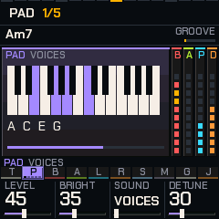

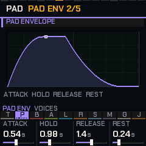

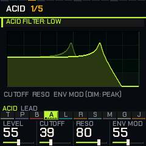

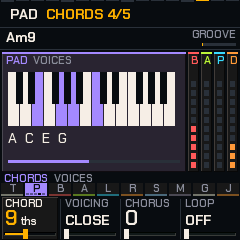

**What moves by itself**

The chord changes on a bar line every few bars. The genre sets how often:

| Bars per chord | Genres |
|---|---|
| 2 | house, disco, garage, lofi, reggae, synthwave, industrial, hip-hop |
| 4 | dub, DnB, breaks, electro, trap, funk, amapiano, trip-hop, trance |
| 8 | dubstep, psytrance, dark forest, ambient |

**Drift** on the Tempo page changes that rate. Below 20, the chords change four times as often. Below 45, they
change twice as often. Above 80, they last twice as long. Above 95, they last four times as long. The Tempo page
shows the result in bars.

In HYPNO, a chord lasts for a time, not for a number of bars. Drift sets 20 seconds to 5 minutes, with a small
random change. The chord change then waits for the next bar line. In any genre, **EDIT** goes to the next chord.

Any piece can use bars or seconds. To change it, hold **SEL** and turn Drift right for bars or left for seconds.
HYPNO in bars starts from four bars for each chord. The other genres in seconds work as HYPNO does. The piece
stores this setting. The genres keep their own setting if you do not change it.

On a seven-note scale, each genre has its own habits for the next chord:

- Lofi and DnB often move up a fourth (the ii-V-I turnaround of jazz).
- House loops by steps and thirds.
- Dubstep and trap stay near the home chord, on the dark side.
- Dub stays on a minor vamp (a repeated pattern) between the first and fourth chords.
- HYPNO keeps its original walk.

Lofi, DnB, breaks, garage, disco, reggae, amapiano and hip-hop use cadences (a strong pull back home). In a minor key, their
V chord (built on the fifth note of the scale) raises the seventh note of the scale by a semitone, as in the
harmonic minor. That note is the third of the V chord, and the acid and bass also raise it. Diminished chords (the
tense chord on the seventh note of a major key, the second of a minor key) are rare in every genre. When a genre
would lead home through a diminished chord, it goes through V instead.

The **Loop** setting on the Chords page repeats the last 2, 4 or 8 chords. It counts back from the chord that
plays now. Thus, a loop of two is the home chord and one other chord. When you choose a new piece, the loop
becomes empty. Most genres have a loop at the start: four chords in house, disco, garage, trap and synthwave, two
in dubstep, DnB, electro, amapiano and trip-hop. Lofi (for its turnarounds), dub, funk, reggae and breaks keep
walking.

The voices follow the chords. The pad's notes swell and fade on cycles of different lengths. Each note takes the
pitch of the new chord when it swells back in. The bass follows the root of the chord and glides. The notes of the
acid line are tied to the chord, so the riff moves with the chord. **Mutate** rewrites some of its steps each time
the line repeats.

The pluck plays an arpeggio: the notes of the chord one after another. **Motion** sets how far the music slowly
changes between sparse and full, over a minute or two. **Evolve** makes the acid and the chords change more.

**Tempo.** The tempo goes from 70 to 190. To set it from any page, hold **HOME** and turn **SELECT**. To tap the
tempo, hold **GLO** and tap `E4` approximately four times. When an outside MIDI clock controls PERF-1, PERF-1
follows that clock and the screen shows `EXT`.

### Octaves

**OCT-** and **OCT+** move one octave at a time, from three down to three up.

- On the Pad, Bass or Acid pages (or their env and LFO pages), they move only that voice.
- On the Pluck pages, they move the pluck, from two down to two up.
- On all other pages, Tempo included, they move the whole song: pad, bass and acid together.

The line above the knobs shows the octave when it is not at home: `OCT+2` for the voice of the page, `SONG-1` for
the song. The piece stores the octaves. When a voice goes down, it stops at the lowest note that you can hear
(about C1). Thus, -2 and -3 can sound the same.

### The scales

**ALGORITHM** on the Chords page, the Progression page or Global selects the scale. Every scale starts on the root of the piece (Root on Global).

| Scale | Its notes over A | Sounds |
|---|---|---|
| Ionian | A B C# D E F# G# | the major scale: bright, settled |
| Dorian | A B C D E F# G | a lighter minor: house, funk, dub |
| Phrygian | A Bb C D E F G | a dark minor, with the flat second: techno, dark psy |
| Lydian | A B C# D# E F# G# | major with a raised fourth: dreamy, floating |
| Mixolydian | A B C# D E F# G | major with a flat seventh: bluesy, rock |
| Aeolian | A B C D E F G | the natural minor: most of the minor pieces |
| Pent maj, Pent min | five notes | no wrong notes; no circle of chords to walk |
| Locrian | A Bb C D Eb F G | the darkest: its own home chord is diminished |
| Harm. min | A B C D E F G# | harmonic minor: the minor with a strong pull home (E major leads to A minor) |
| Mel. min | A B C D E F# G# | melodic minor, the "jazz minor": minor below, major above |
| Phr. dom | A Bb C# D E F G | Phrygian dominant: flamenco, the Middle East, psytrance |
| Hung. min | A B C D# E F G# | Hungarian minor: harmonic minor with a raised fourth, very dark |
| Dbl. harm | A Bb C# D E F G# | double harmonic ("Arabic"): two wide steps, exotic |

The chord walk never goes to a diminished or augmented chord (for example, C+ in harmonic minor). Thus, these
scales play the strong chords of the scale, and the melody lines give the colour of the scale. The borrowed chords
and the dominants of the next chord (section 5, the circle) are for the first six scales. The newer seven-note
scales already have their own colour. A progression that you set by hand plays any chord that you put in it.

### Chords

The chords of the pad are built on the notes of the scale. The length of each chord is set as above (the pace of
the genre and Drift, or **EDIT**). The **Chords** page (push **ENV** four times) sets the type of chord that the
pad plays:

| Chord | What it plays |
|---|---|
| Auto | Seventh chords on a 7-note scale (Am7, CM7, G7 ...), triads on a pentatonic (5-note) scale |
| Triads | Three notes: Am, C, G |
| 7ths | Four notes: Am7, Dm7, CM7. Also on a pentatonic scale. |
| 9ths | The 1st, 3rd, 7th and 9th, without the fifth (four notes): Am9, CM9, G9 |
| Sus | The 1st, 4th, 5th and 7th: A7sus4 (CM7sus4 where the seventh is major; a sus2 where the fourth would be sharp, as on F in A minor). It sounds open and unresolved. |
| Dub | The same minor 9 shape on every chord, whatever the scale. These are the parallel chord stabs of dub techno. |
| Fourths | The notes of the scale stacked in fourths (shown as A4ths on the home chord of a minor key), an m11 sound. Where the next fourth of the scale would be a tritone, it uses the note below, as in the "So What" chord. It sounds deep, hollow and modal. |
| 11ths | The 1st, 7th, 9th and 11th, without the third and fifth (four notes): open and floating, as an 11th chord is usually played. |

**Filter types.** The saw sounds of the pad (Strings, Dub, Trance, Poly, Rave, Brass, Fat, Pluck: on the other pad sounds, the page shows NO FILTER), the bass and the acid each go through a resonant filter. The standard type is
low-pass (it cuts the high sounds). The **FILTERS** settings page (hold **HOME**: it is the first one) changes the
type of each filter:

| Type | Sounds like |
|---|---|
| Low | The standard type: the top of the sound is cut. Cutoff closes it down. |
| High | The bottom of the sound is removed: thin and airy. It is good for a build or for a lead that must be clear in the mix. On the bass and the pad, its corner is lower than the corner of the low-pass, so it makes them thinner but does not remove them. |
| Band | Only a band around the cutoff: nasal, like a telephone. It is very good with resonance. |
| Notch | A gap at the cutoff: hollow, with a phaser-like sound as the cutoff moves. |
| Peak | The band at the cutoff is louder than the rest: a bite that sounds like a vowel. |
| 303 | The acid only: a diode ladder, the type of filter in the Roland TB-303. It sounds darker than Low, with a softer slope and a rounder resonance. As you turn up Reso, the middle gets thinner, as on a 303, but the bass below it stays full (its low end is kept out of the resonance, as on the original). It is rounder and more liquid than Low. It squeals and does not whistle when Reso and SCREAM are high. |

**Making it scream.** The **SCREAM** settings page (the next page after FILTERS) pushes the filters of the acid
and the bass into a raw, screaming sound, like an acid line through a distortion pedal. It is part of the piece,
like FILTERS: store the piece to keep it. At 0, everything sounds as before.

| Knob | What it does |
|---|---|
| Drive | Pushes the sound harder into the filter and saturates it: thicker, louder, rawer. |
| Scream | Takes the resonance far above the top of Reso, near the point where the filter sings on its own. With Reso high and Cutoff that moves, this makes the scream. |
| Wow | Accented notes open the resonance and the drive more: the "wow" of the acid on the accents. |
| Target | Which voice: the acid, the bass, or both. |

On an acid piece, start with Scream at 60 and Drive at 40. Then turn the Cutoff and Env mod of the acid (or let an
LFO on **Acid cut** do it). If the acid gets too loud, turn its level down a little. The limiter holds it, but the
limiter then makes the rest of the mix quieter.

**The wub.** In DUBSTEP, and with the Wub sound in any genre, the bass LFO on the cutoff makes a wub in the same
way as a producer makes one. A clean sine sub stays below it. The oscillator of the sound goes through a resonant
low-pass filter. The LFO sweeps this filter from about 70 Hz up to 3-4 kHz. A vowel band above it gives the "yoi".

After the filter, the sound is driven hard, so it growls more as the filter opens. It is also high-passed, so the
sub stays clean. On the drop, the speed of the LFO follows a rhythm, beat by beat over two bars (1/4, 1/8, 1/8T,
1/16, 1/2). Each piece has its own rhythm, and a second one every 8 bars (the Wub sound does this in any genre).
DNB pieces 2 and 6 and INDUS pieces 4 and 8 have it. Through a build, the LFO speeds up from 1/4 to 1/16.

Depth sets how far the filter opens. Shape sets how it moves (Sine: closed on the beat, open between; Saw: open,
then it closes; Square: open and shut; S&H: a level each cycle). Cutoff sets where it starts. Reso sets how much
it sings. SCREAM on the bass drives it harder. For the old wobble, set the Target to any value other than Cutoff.

A wobble (the bass LFO moves the cutoff) works with every filter type. The filter types are part of the piece, and
the piece stores them. This is the MultiFilter idea from Caustic, made again here.

**Voicing** sets how the chord is spread. Close keeps the four notes together. Open moves the second-highest note
down an octave, which spreads the chord out. **Comp** sets how the pad plays the chords. **Auto** uses the rhythm
of the genre for the stab sounds (short chords). **Hold** never plays stabs (a stab sound plays as a held pad, like
a drone). The other seven settings force stabs on any pad sound (section 8, Feel, describes them).

Since 0.17.82, the **Chorus** of the pad (it makes the pad sound wider) is on the CHORUS settings page. The **Root**
of the song is on Global.

For dub techno:

1. Set Chord to Dub.
2. Choose the Dub sound for the pad (dark chord stabs).
3. Turn the echo up.

HYPNO piece 06 has these settings.

### Your own progression

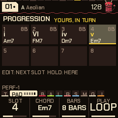

On the **Progression** page, you write the chords yourself. To open it, hold **EDIT** or press **ENV** five
times. A short push of **EDIT** still goes to the next chord.

The page has eight slots. Each slot holds one chord of the scale, its type and the number of bars that it lasts. The
first eight white keys select the slot that you edit. Until you change a value, the page shows the chords that you
heard last. You can start from those chords.

| Knob | Does |
|---|---|
| Chord | The chord of the slot. You select it from the chords of the scale. The page shows each chord as a numeral (I to VII, in small letters for a minor chord) and its name, for example Am7. **Hold** keeps the slot empty: the chord before it continues to play for its bars. |
| Type | The type of chord that this slot plays. **Piece's** uses the Chord setting on the Chords page of the Pad, as every slot did before. The other types give the slot its own chord type: **Triad** (three notes), **7th**, **9th**, **Sus** (the fourth replaces the third), **Dub** (a minor ninth stab, a short chord), **Fourths** (fourths of the scale, one on top of the other) or **11th** (root, seventh, ninth and eleventh). All types except Dub use only notes of the scale. |
| Bars | The length of the slot's chord: 1, 2, 4 or 8 bars. |
| Play | **Walk**: the genre selects the chords, as usual. **Loop**: your slots play one after the other. |

When you turn Chord, Type or Bars, Play changes to Loop. Your progression starts on the next bar, from slot 1. The
loop ends at the last slot that has a chord. Thus a four-chord progression needs only slots 1 to 4. **EDIT** goes
to the next slot. At the drop of a build, the progression goes back to slot 1.

**Fills.** When you push one of the **black keys**, it writes a full progression into the slots. The first five keys
write circle of fifths fills. Each of these fills moves round the circle of fifths: each chord is a fifth below the
chord before it, as the scale permits. This fall by a fifth gives the strongest pull in harmony. It makes a
progression sound as if it goes back to its home chord. The other six keys write progressions that are very common
in songs (from Steven's chord chart in the PERF-1 issues).

| Black key | Writes | In C major | In A minor |
|---|---|---|---|
| 1 (F#) | ii V I I | Dm G C C | Bdim Em Am Am |
| 2 (G#) | vi ii V I | Am Dm G C | F Bdim Em Am |
| 3 (A#) | iii vi ii V I I | Em Am Dm G C C | C F Bdim Em Am Am |
| 4 (C#) | I vi ii V (the turnaround) | C Am Dm G | Am F Bdim Em |
| 5 (D#) | The full circle: I IV vii iii vi ii V I | C F Bdim Em Am Dm G C | Am Dm G C F Bdim Em Am |
| 6 (F#) | I IV V V | C F G G | Am Dm Em Em |
| 7 (G#) | I I IV vi | C C F Am | Am Am Dm F |
| 8 (A#) | I IV I V | C F C G | Am Dm Am Em |
| 9 (C#) | I iii IV vi | C Em F Am | Am C Dm F |
| 10 (D#) | I vi IV | C Am F | Am F Dm |
| 11 (F#) | IV V IV I | F G F C | Dm Em Dm Am |

Each chord gets the Bars value of the slot that you selected. Thus, first select a slot and set its Bars. The fill
empties the slots after it, and Play changes to Loop. The types that you gave the slots do not change.

The chords stay in the scale. Thus in a minor key, the V is minor (v), unless the genre raises it for the cadence
(the chord move that ends a phrase). The THEORY screen shows that G# in red. The fill is stored with the piece, as
any progression is. A pentatonic scale has no circle of fifths to walk, so the fills are off in that scale.

The black keys blink faintly on this page. This shows that they have a function. Look at the THEORY screen while the
progression plays. You see the progression walk round the circle.

**Pedal: follow the chords, or hold the key.** **White key 9** changes the **bass** between two modes, and **white key 10** changes the **pad**:

- **Follows** (the usual mode): the voice moves with each chord.
- **Pedal**: the voice stays on the key while the chords move above it. The bass holds the root of the key. (A walking bass walks the chord of the key.) The pad holds the chord of the key (Am7 in A minor) while the progression goes round. This is a pedal point, the oldest drone method (a drone is one note that you hold for a long time). When the chords move away from the held note, the music gets tension. When the chords go back to I, the tension goes away. Use it when you play a guitar or a synth over the music.

While a voice is on Pedal, its key is lit, and the bottom of the page shows which voice it is. This is your setting, not a setting of the piece. It stays as you set it, when you change pieces and after power-off. The THEORY screen continues to show the chords as they move.

The chords are steps of the scale, not fixed notes. Thus they follow the key. If you change the root or the mode,
the progression moves with it. The chord kind, the voicing (the order and spacing of the chord notes) and the other
settings of the Chords page still apply. In the genres with a cadence, the V chord in a minor key gets its raised
seventh, as it does in the walk.

While Play is on Loop, the walk, Drift and the chord Loop setting have no effect. To give the chords back to the
genre, set Play to Walk. The genre then selects the chords again, and your slots stay for later. The progression is
stored with the piece.

---

## 6. Pieces, genres and storing

PERF-1 has twenty-two **genres**. Each genre is a bank of ten **pieces**. A piece is a ready-made song that you can
play and change.

- To select another piece in the bank, turn **PRESETS**. The number goes from 01 to 10, and then it continues from
  the other end.
- To select another bank, hold **GLO** and turn **PRESETS** (this also continues from the other end). Or, use the
  Genre knob on the Global page.

When you change genre, the same piece number continues to play in the new genre. The effects of the new genre also
come on. For example, lofi latches vinyl and tape on, and house latches the pump on (a latched effect stays on). The
pump makes the music quieter on each kick, so the music seems to breathe with the beat. When you change genre,
PERF-1 first clears all vinyl, tape, pump or phaser that you latched.

Each piece has its own settings, its own six drum patterns and its own drum sounds. Patterns 1 to 6 are
approximately: intro, groove, build, peak, variation, and a thinner pattern to use in a mix. When you select a
piece, the screen shows a made-up title, for example `VELVET RAIN`. The title is the same each time.

| Genre | Pieces | BPM | What it is |
|---|---|---|---|
| HYPNO | 01-10 | 118-138 | The original hypnotic techno and acid set. |
| LOFI | L01-L10 | 70-94 | Swung boom-bap (a hip-hop beat). Rhodes chords in 7ths and 9ths over a warm bass, a soft lead with few notes, the Dusty kit. Vinyl and tape are latched on. |
| HOUSE | H01-H10 | 118-126 | Four on the floor (a kick on each beat), claps on 2 and 4, open hats on the off-beats, stabs and organ, a sub or square bass, the House kit. The pump is latched on. |
| DUBSTEP | D01-D10 | 136-150 | Half time, the Heavy kit, a wub bass (see **The wub** below), a harsh lead, dark pads, chords in fourths. After a drop: 8 bars half time, then 8 bars at full time, then half time again. 8-bar builds that end in 32nds and triplets, and the wub gets faster through them. |
| DUB | V01-V10 | 64-76 | One-drop, steppers and rockers rhythms. A kick and rim with few notes, a deep bass on beats one and three, short off-beat chords (the skank), a long dotted echo and worn tape latched on. A breakdown is a dub-out: the drums and the bass line continue, and the other parts stop. |
| DNB | N01-N10 | 170-178 | Two-step, liquid, roller, neuro, jump-up and half-time. The DnB kit, a shimmer reverb, a light pump and tape. |
| BREAKS | B01-B10 | 100-135 | Patterns based on classic breaks (Funky Drummer, Impeach, Levee, Cold Sweat) and a big-beat stomp. Some patterns are approximations. The Break kit, a gated reverb, tape and the phaser latched on. |
| GARAGE | G01-G10 | 126-138 | Swung two-step, beats with skips, and speed garage. A conga kick, rim shots that play a call and an answer, the Minimal snare and House hats. Tape and a light pump. |
| ELECTRO | E01-E10 | 118-130 | A syncopated kick, the clap on the backbeat, the Electro kit, a gated reverb. The phaser is latched on. |
| TRAP | T01-T10 | 130-150 | The long 808 bass (the Trap kit), the clap on beat 3, hats in 16ths with rolls (two per piece), an open hat and a rim. Fills roll the hats in 32nds and triplets. A shimmer reverb, and a pump under the 808. |
| DISCO | S01-S10 | 112-126 | Four on the floor, accented open hats on the off-beats, a bass that jumps between octaves, strings and brass stabs, Wurli and clav, a little swing. |
| FUNK | F01-F10 | 96-110 | Syncopated sixteenths, ghost snares (very quiet snare notes) and soft kick pickups, a funk bass figure, a clav line, sixteenth-note chords, the Dusty and 909 kicks. A breakdown is the drums alone. |
| REGGAE | R01-R10 | 70-84 | One-drop, steppers and rockers, the rim a little late, a melodic bass, an off-beat skank, a long echo, the Dusty kit. |
| SYNTHWAVE | W01-W10 | 100-118 | A strong eighth-note bass, a gated reverb, a big accented snare, much chorus, an acid that plays arpeggios (chord notes one after the other). The minor pieces play i-VI-III-VII again and again. The major pieces play the decade's I-vi-IV-V. (On the screen: SYNTHWV.) |
| AMAPIANO | A01-A10 | 108-115 | A soft kick with shakers, a syncopated bass that glides (it plays the part of the log drum), jazz-style 9ths, marimba and kalimba plucks. (On the screen: AMAPI.) |
| TRIPHOP | P01-P10 | 70-88 | Slow and dusty, the snare laid back (a little late), ghost notes, vinyl noise, a pluck loop that comes back again, minor, with few notes. |
| INDUS | I01-I10 | 118-145 | Industrial techno, EBM and industrial breakbeat. Driven, harsh drums tuned against each other (the snare a tritone up, the perc a semitone off). The Hard kit, with chops (short cut pieces) of the Break kit in some pieces. Broken and off-beat kicks, an EBM stomp, perc in threes against the beat. Phrygian and minor, suspended and fourths chords, a bass with grind, metal and bell sounds, a gated reverb and hard tape. Fills roll on the off-beats and in triplets. |
| PSY | Y01-Y10 | 92-146 | Psytrance: progressive, full-on and goa (132-146). A short kick on every beat, with the rolling bass between the kicks (K-B-B-B), and each bass note clear of the kick. Soft 16th hats, the open hat off the beat, the acid as the lead with a strong resonant sound, a dotted (3/16) echo, phrygian and minor, a chord held for 8 bars. Y01, Y02 and Y10 are psy-ambient and psychill (92-112): a downtempo beat, a held bass, a wide shimmer reverb. Use the set list and the Mix on the SET page to go from the slow, spacey pieces into the trance and back. |
| FOREST | O01-O10 | 148-165 | Dark forest and dark psy: the same rolling bass under hats on every 16th, and glitch percussion in threes against the four beats, hat rolls, triplets, hard drums over a short kick, phrygian and fourths, a chord that almost does not move. |
| HIPHOP | M01-M10 | 86-98 | Boom-bap instrumentals: the kick off the one, a loud snare on 2 and 4, an MPC swing, the bass on the kick, minor loops of one and four (the real V of harmonic minor in M03 and M10), Rhodes, strings, organ, a muted trumpet. M06 and M08 are G-funk (Mixolydian, the acid sounds like a whistle). M05 and M09 are dark. The Boom kit. |
| TRANCE | U01-U10 | 132-140 | Classic and uplifting trance (PSY is psytrance): four on the floor, the open hat off every beat, the bass off the beat, the supersaw lead, the Trance pad, four-chord minor loops of four bars, long breakdowns and eight-bar builds with a snare roll. |
| AMBIENT | Z01-Z10 | 70-88 | No beat, or almost no beat: a soft kick from time to time, a ride, a shaker, bars with no drums. Long pads, a held bass, slow chords in Lydian, Ionian and Dorian, a long shimmer. A piece to open a set, or to rest in a set. |

The sections also follow the usual style of each genre. House, dubstep, DnB, trap, disco, synthwave, industrial, psy, forest, hip-hop and trance
stop all parts for the last beat before the drop. Lofi, dub, reggae, amapiano and trip-hop use the perc for the build, not a
snare roll. In a breakdown, breaks and funk play only the drums; industrial, forest and hip-hop keep the hats (hip-hop the bass too). Each genre has its own fills: house and disco ramp
and rush, dub and reggae drag, trap and dubstep roll in triplets, garage rolls its rim, and disco, funk and synthwave
play a tom that falls in pitch. In HYPNO, the kick stops for the last beat of every eighth bar.

Pieces in the same genre have different sounds, and also different keys and tempos. Each genre has a set of sounds
for the pad, bass, acid, pluck and kits. Each piece uses one of each, and its number selects which one. In every
genre, the sound, style and rate of the pluck change from piece to piece. Each genre also has its own compressor
settings (section 11). A compressor makes the loud and the quiet parts closer in level.

**Each piece has a role.** In every genre except HYPNO, each piece after the first has a different arrangement on top
of the basic plan of the genre. Thus the ten pieces do not sound like one song in ten keys:

| Role | What changes |
|---|---|
| Classic | the genre as written (always piece 1) |
| Bass-led | the bass line is the main part: the pad and pluck are further back, and the line moves more |
| Chords | the pad is in front and plays chords in rhythm (comping); the bass line is simple under it |
| Acid | the acid is the lead and answers its own phrases; the pluck stays clear of it |
| Pluck hook | the pluck keeps its riff (Deja vu) and is in front; the pad is darker |
| Space | more echo (a dotted quarter) and reverb, fewer notes, thinner hats |
| Peak | more drive, a brighter sound, more notes in the pluck and in the hats |
| Dark | filters closed, a duller room |
| Across the bar | the perc in 12 against the bar, a shorter acid loop, the pluck skips |
| Left field | the phrase cut into slices, large jumps in the pluck, a less usual acid, the pad moves more |

The roles go to different piece numbers in each genre. The things that make a genre do not change: its kit, swing,
drum patterns, tempo, scales, chords and sounds. Each genre also keeps the parts that make it that genre: house,
dubstep, dub, funk, disco, reggae, trap, amapiano, drum and bass, psy and forest keep their bass line; psy and forest
keep their acid; lofi, synthwave and trip-hop keep their pad; the breakbeat and percussion genres keep their drum
lanes. Each setting that a role changes is a normal setting, and you can turn it back. A piece that you stored keeps
the settings that you stored. The roles change only the factory pieces.

Two factory pieces come from players, through the Library: FUNK 10 is Golfhole's "Funky Space Jam" and HOUSE 09 is
Roj's "About last night". They play as their makers shared them. Global shows who made them (`F10 BY GOLFHOLE`).

### Storing a piece

You can store a piece in every genre. Go to **Global** and press **SAVE**. PERF-1 stores the piece as it is now: the
values of every page, the scale and mode, the sounds and kit of the voices, the patterns and the drum sounds. PERF-1
stores it in the current genre, and it replaces the factory piece of that genre. For example, if you store piece 3
of lofi, piece 3 of lofi is yours from then on. Each genre has its own place in memory.

While the piece has changes, the line above the knobs shows `01 SAVE: STORE`. After you store it, the line shows
`01 STORED`.

If you do not store your changes, they stay while you stay in that genre, also when you move between its pieces.
When you change genre or switch off, these changes are lost. When you go back to the genre, its pieces are as they
were before.

**Back to factory.** On Global, hold **SEL** and **SAVE** together for 1.5 seconds. While you hold, the screen shows
`KEEP HOLDING: FACTORY`. The piece goes back to its factory settings, and its slot goes back to the factory piece.
**SAVE** alone only stores.

**Everything back to factory.** Use this if you do not know what you stored by accident. Stop the music. Then, on
Global, hold **SEL** and **SAVE** for 6 seconds. When you hold past the reset of the piece, the screen shows
`KEEP HOLDING: EVERY PIECE, ALL GENRES`. Then PERF-1 goes through the genres one by one, and the screen shows how
many pieces it put back.

Your settings, voices and set list do not change. If the music plays, PERF-1 resets only the piece, and the screen
shows `STOP FIRST`.

**Start from nothing.** On Global, hold **SEL** and press **OCT-**. The screen shows `EMPTY PIECE`. The piece that
plays keeps its sounds, kit, key and tempo. It loses all other settings: there are no drums, and the pad holds the
home chord of the key. The bass, the acid and the pluck each change to its steps, and every step is a rest (no note).
Nothing changes automatically (Evolve, drum drift, the answers and ghost notes are off). Then build the piece up:

- Put the drums in the **sequencer** (hold **SEQ**, section 8).
- Put the bass on **Bass steps** (**LFO** x5), the acid on **Acid steps** (**ARP** x5) and the pluck on **Pluck steps** (**ARP** x9). Select a step with a white key. Then turn its kind from rest to a note.
- Put the chords on the **Progression** page (hold **EDIT**). Start with one chord, then add more slots.

**SAVE** stores it in the place of that piece. If you change your mind, hold **SEL + SAVE** to get the factory piece
back.

**When it is written.** PERF-1 writes immediately. The FM-1 cannot make sound while it writes to its memory. Thus, if
the music plays, the music fades out (the screen shows `STORING`). Then PERF-1 writes, and the music fades back in at
exactly the same point. The pause is less than a second, and the song stays in time with itself. MIDI clock out (the
tempo signal that PERF-1 sends to other devices) also pauses. Back to factory operates in the same way, and so does
all other data that PERF-1 saves (section 13).

**At power-on**, PERF-1 goes back to the piece that you played last, as it is stored (Settings, **Start**: Last). With
**Random**, it starts on a random HYPNO piece. A piece that you never stored plays its factory settings with small
random changes.

| HYPNO piece | Character | BPM | Key |
|---|---|---|---|
| 01 | Hypnotic four on the floor | 128 | A Aeolian |
| 02 | Deep and in a dub style, with rims and shakers | 124 | D Dorian |
| 03 | Hard and heavy, with a rumble kick and claps | 131 | E Dorian |
| 04 | Trance, with off-beat open hats and rolls | 138 | G Aeolian |
| 05 | Acid electro, with cowbells and breaks | 130 | A Dorian |
| 06 | Dub techno: chord stabs (Dub chords), few notes, swung | 120 | F Pent minor |
| 07 | Minimal glitch, with patterns in threes over the four beats | 134 | B Pent major |
| 08 | Percussion that rolls and sounds like toms | 123 | Bb Mixolydian |
| 09 | Warehouse: hard, with rides and rumble (the Techno kit) | 136 | C Phrygian |
| 10 | Deep field, with half time and breaks | 118 | Eb Aeolian |

---

## 7. Sounds, kits and playing

Each voice has its own list of sounds. Each drum can take its sound from any of twenty-three kits, and from three more kits that you load yourself. The sounds that you
select are stored with the piece.

To change the sound of a voice, turn the **Sound** knob on its page. Or, hold **SEL** and turn **ALGORITHM** on any
of its pages. On the pluck pages, SEL + ALGORITHM goes to the next sound that is really there. After the last sound,
it goes back to the first. The voice keeps its notes, envelope (how the sound starts and fades), LFO (a slow wave that
moves a setting) and filter. Only the sound changes.

Some words that this section uses: **FM** is the method that the DX7 and the FM-1 use to make sound. One tone bends
another tone. FM is good for bells, electric pianos and metallic sounds. A **saw** is the waveform with a bright,
buzzing sound that most analog synth sounds use.

**Detuned** means some copies of a sound, each slightly out of tune with the others. This makes the sound wider. A
**sub** is an extra tone an octave below. A **filter** cuts the high sounds. When you open the filter, the sound
becomes brighter.

### The pad: 24 sounds

| # | Sound | What it is |
|---|---|---|
| 1 | Rhodes | An FM electric piano. It gets brighter as it swells (gets louder). |
| 2 | Voices | A sung choir |
| 3 | Strings | Four detuned saws. The Detune knob spreads them. |
| 4 | Glass | An FM bell |
| 5 | Organ | A drawbar organ |
| 6 | Warm | Soft triangle waves |
| 7 | Stabs | Short Rhodes chords on the off-beats. Release on the Pad env page sets their length. Evolve adds some more chords. |
| 8 | Dark | The Voices, muffled |
| 9 | Dub | Short, dark saw chords for dub techno |
| 10 | Trance | A supersaw: four detuned saws plus one an octave up |
| 11 | Poly | Two detuned saws with a pulse that drifts slowly, like an 80s polysynth |
| 12 | Hollow | A hollow tone, like a clarinet |
| 13 | Pings | The Glass bells as short stabs |
| 14 | Hits | A house organ as stabs |
| 15 | Rave | Supersaw stabs |
| 16 | Sine | A pure tone, for minimal |
| 17 | Ooh | The Voices, darker and rounder |
| 18 | Wurli | A bright electric piano, played as stabs |
| 19 | Mallet | Marimba and vibes chords as stabs, a softer FM sound |
| 20 | Brass | Saw chords as stabs, with the filter fully open |
| 21 | Fat | A supersaw with the high sounds cut |
| 22 | Pluck | The Poly sound as short stabs |
| 23 | Chapel | A church organ (drawbars with the high sounds cut) |
| 24 | Air | An open sine, like breath |

The saw sounds (Strings, Dub, Trance, Poly, Rave, Brass, Fat and Pluck) go through an analog-style filter with a sub
an octave below them. The filter is a four-pole low-pass with resonance. This means that it cuts the high sounds
strongly, with a peak at the point where it cuts. The filter opens with each swell or stab and closes after it.
**Bright** opens it more. When the Target of the Pad LFO is on Filter, the LFO sweeps the filter.

### The bass: 24 sounds

| # | Sound | What it is |
|---|---|---|
| 1 | Saws | Three saws, slightly detuned |
| 2 | Warm | Rounder, with more sub |
| 3 | Grit | Overdriven (distorted) |
| 4 | Dirty | A distorted sub |
| 5 | Reese | Two saws far out of tune, so they phase against each other |
| 6 | Pulse | A pulse wave with a width that moves |
| 7 | FM | An FM bass that the envelope opens up |
| 8 | Organ | A drawbar organ |
| 9 | Rumble | A driven sub with the saws far back, for techno rumble |
| 10 | Sub | A sine with a sub under it |
| 11 | Square | Hollow, for deep house |
| 12 | Hoover | Detuned pulses plus an octave down |
| 13 | Fifths | The root and its fifth, a dub chord |
| 14 | Metal | FM with a metallic, ringing sound |
| 15 | Sync | A saw with hard sync (one oscillator restarts another, for a tearing sound), swept by the envelope |
| 16 | Bright | The Saws with the filter open |
| 17 | Wub | Saws over a clean sub: the dubstep wub (see **The wub**), in any genre |
| 18 | Bite | A biting FM bass that the envelope opens up |
| 19 | Solid | A round FM bass with a strong attack, the classic DX7 bass |
| 20 | Growl | FM with a grind an octave under the note |
| 21 | Gnarl | The Reese, driven hard |
| 22 | Wide | A softer Hoover with more sub |
| 23 | Power | The root and its fifth, driven |
| 24 | Air | A soft, open sine |

### The bass as a line

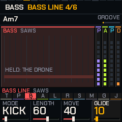

Use the **Bass line** page to make the bass play a rhythm instead of one long note. To open it, press **LFO** four
times. The page turns the bass into a line that follows the chord. **Mode** sets where the notes fall.

In the figures below, 1 2 3 4 are the beats. "and" is the eighth between two beats (half a beat after the beat). "e"
and "a" are the sixteenths on each side of the "and". So "and-of-2" is halfway between beats 2 and 3.

| Mode | Where the notes fall |
|---|---|
| Hold | No line. One long note that glides to the root of each chord |
| Root | On the bass rhythm of the genre (hypnotic on the beats, lofi a relaxed three, DnB a roll, and so on) |
| Kick | On every kick, as an 808 or sub bass does |
| Eighths | On every eighth |
| Off-beat | On the eighths between the beats (the off-beats), as in house |
| Walk | On the beats. First the root, then the third or fifth, then the fifth, then a lead-in to the next bar. The lead-in is the scale note just below the root, or, half of the time, the note a half step below. That note is a chromatic approach: it is the one passing note that PERF-1 plays outside the scale |
| Riff | On the figure of the genre. Disco jumps up and down the octave. Funk and amapiano are syncopated (the notes fall off the beat). Reggae puts weight on the fifth. |
| Octaves | Eighths that jump between the root and its octave (disco) |
| Two-step | 1, and-of-2, and-of-3 (garage, drum and bass) |
| One-drop | 1, a-of-1, and-of-2, 3 (reggae) |
| Log drum | 1, a-of-1, and-of-2, and-of-3, a-of-4 (amapiano) |
| Skippy | A sub bass that skips and jumps up to the fifth and the octave |
| Funk | 1, a-of-1, 3, and-of-3 |
| Big beat | 1, e-of-2, 3, 4 |
| Dub | 1, 3, and-of-3 |
| Gallop | Three sixteenths on each beat |
| Steps | Your own sixteen steps, from the **Bass steps** page (below) |
| Rolling | Every sixteenth except the ones on the beat. The notes roll around the kick (rolling techno, psy) |
| Tresillo | 3 + 3 + 2 sixteenths, two times in each bar (dancehall, reggaeton) |
| Push | 1, and-of-2, and-of-3, then the last sixteenth an octave up. This last note pushes into the next bar |
| Bounce | 1, and-of-1, and-of-2, 3, and-of-3, and-of-4 (house, garage) |

The named figures work in all genres. Each one is a rhythm with up to four notes, so it sounds the same in every bar.
"The fifth" is the fifth above the root, when the chord has one. A 9th, Dub or Fourths chord has no fifth in its first
notes. For these chords, the line uses the third note of the chord instead.

| Knob | Does |
|---|---|
| Mode | Where the notes fall (see the table above) |
| Length | How long each note holds before it stops, from a quarter of a step to five steps |
| Move | How often a note jumps up an octave, to the fifth, or to the scale note below the root instead. In Walk, how often the last beat steps below. |
| Glide | The slide from one note to the next. At 0, each note plays straight. At 100, the slide takes about 0.4 s. |

Each note opens the bass filter again. It uses the attack and decay from the **Bass env** page (how fast the sound
starts and fades), so that page still shapes the sound. The Trigger setting on that page does not apply to a bass line.
The sound, cutoff and resonance come from the **Bass** page.

A breakdown plays no bass notes. In Kick mode, a build also plays no bass notes. When you play the bass by hand from
the keys, the bass line stops. Every note stays between C1 and B5.

New pieces start with these bass lines:

| Genre | Bass line |
|---|---|
| Lofi, dub, DnB, trip-hop | Root |
| House | Off-beat |
| Dubstep, trap | Kick, long notes, a little glide |
| Electro, synthwave | Eighths |
| Disco, funk, reggae, amapiano, breaks, garage | Riff |
| HYPNO | Hold (the plain held bass) |

### Bass steps: write the bass line yourself

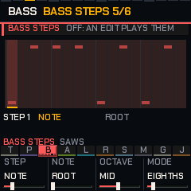

Use the **Bass steps** page to write your own bass line. To open it, press **LFO** five times (the page after Bass
line). The page gives the bass sixteen steps (one bar), like the Acid steps and Pluck steps pages. When you open it,
it already holds the bar that the bass played last. So you can start from a line that works and change what you want.

- Press a **white key** to select a step. The sixteen white keys are the sixteen steps. The step that you selected is
  lit.
- **Step** (KNOB1): sets rest, note, accent (louder), glide, accent and glide, or **hold**. With glide, the note slides
  in from the note before, without a new attack. With hold, the note before continues to sound through this step. Some
  holds in a row make a long note.
- **Note** (KNOB2): the root, 2nd, 3rd, 4th, 5th, 6th, 7th or octave, counted in the scale above the root of the chord.
  The notes follow the chords: a 5th is always the fifth of the chord that plays.
- **Octave** (KNOB3): down, mid or up.
- **Mode** (KNOB4): the mode of the bass line. **Steps** plays your steps. Any edit changes the mode to Steps. To try
  the other modes, turn the knob again. Your steps stay.

The steps are part of the piece. To keep them, save the piece (**GLO**, then **SAVE**). A shared piece also contains
them. A piece without steps plays its own bass line.

### The bass answer

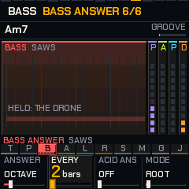

The **Bass answer** page lets the bass answer, as the acid does. To open it, press **LFO** six times (the page after
Bass steps). Every few bars, the bass plays a changed version of its line for one bar. The answer needs a bass line to
change. So it does nothing while the Mode of the bass is Hold. KNOB4 is the Mode, so you can select a line from this
page.

| Setting | Does |
|---|---|
| Answer | How the line changes. **Octave**: every second note jumps up an octave. **Fifth**: every second root goes to the fifth. **Run**: on the last beat, the line climbs the scale from the root, as a fill into the next bar. **Busy**: the line adds a note, root and octave, on every eighth that it leaves empty. **Sparse**: two notes in the bar, held long. **Slide**: every note glides from the note before, and every second note jumps an octave. The result is legato (smooth and connected), as on a 303. **Off** is the default. |
| Every | When it answers. **2 bars** to **8 bars** (in the last bar of each). **Drift**: in the bar before the drums change pattern. **With acid**: in the same bar as the acid answer. **After acid**: in the bar after the acid answer. This way, the acid calls and the bass replies. |
| Acid ans | The kind of acid answer (the same knob as on the Acid answer page). This lets you set a call and response from one page. |
| Mode | The mode of the bass line (as on Bass line). |

The answer settings are part of the piece, like FILTERS and SCREAM. To keep them, save the piece. A shared piece also
contains them. Some factory pieces have an answer: the Bass-led pieces play a run into every fourth bar, and the Peak
pieces play busy every eighth bar. `ANSWER` shows over the bass strip on Home while the bass answers.

### The acid: 31 sounds

The acid voice is modelled on the Roland TB-303. The TB-303 is the small bass synth that gave acid house its sound.

| # | Sound | What it is |
|---|---|---|
| 1-2 | Saw, Square | The two waveforms of the 303 |
| 3 | Driven | Driven hard, loud and at the front of the mix |
| 4 | Sync | Hard sync, which the envelope sweeps |
| 5 | Pluck | A plucked FM tone |
| 6 | PWM | A pulse wave with a width that moves |
| 7 | Chip | A raw 8-bit square, like an old game console |
| 8 | Sub | With a square an octave below |
| 9 | Trance | Three detuned saws, for a trance arp |
| 10 | Bleep | A sine, like the bleeps of early techno |
| 11 | Fifth | A saw plus its fifth, a rave stab |
| 12 | Bell | An FM bell that becomes softer as it rings |
| 13 | Organ | A house organ riff |
| 14 | Laser | The pitch drops with the envelope |
| 15 | Fold | A sine that folds over itself. It becomes buzzier as the envelope opens |
| 16 | Soft | A triangle, for quiet arps |
| 17-24 | Marimba, E.Piano, Kalimba, Brass, Gong, Clav, Vibes, Digital | FM instruments, each with its own character. Brass becomes brighter as the note settles. Digital is a DX-style bell. |
| 25 | Super | Five saws spread wide (+-24 cents), for a thick, full trance lead |
| 26 | CZ | In the style of the Casio CZ synths: a smooth tone that changes into a saw as the envelope rises, with a resonant peak |
| 27 | Mini | An analog-style monosynth bass: two slightly detuned saws and a pulse an octave down |
| 28 | Hyper | Like Super, but spread two times as wide |
| 29 | CZ Pulse | CZ style: a hollow tone that changes into a buzz |
| 30 | CZ Bell | CZ style: a bell tone that rings with the envelope |
| 31 | Lead | Two saws and a pulse that wanders |

### The acid answer: call and response

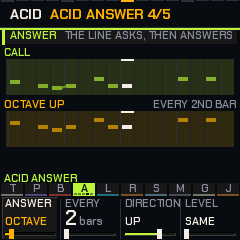

The **Acid answer** page makes the acid line ask and then answer. To open it, press **ARP** four times. Every few
bars, the line plays a changed version of itself. The answer is off by default. It is stored with the piece, and the
editor shows it under Acid (section 15).

| Setting | Does |
|---|---|
| Answer | How the line changes. **Octave**. **Fifth** (seven semitones). **Third** (two notes up or down the scale, so it stays in key). **Mirror** (the line upside down around its own middle note, so it stays in the same range). **Reverse** (the line backwards). **Rotate** (the line moved by one beat). **Sparse** (only the even steps). **Accents** (only the accented notes). |
| Every | How often the answer comes, and what it counts. **2 bars** to **8 bars**: the answer lasts one bar. So with a line of 12 or 10 steps, the answer starts and ends in the middle of the line. On 4 bars, you hear the call three times and the answer on the fourth bar. **Drift** puts the answer in the bar before the drums change pattern (Drum drift, section 10). If Drum drift does not change patterns, the answer comes every 8th bar. Turn the knob past Drift to get **2 loops** to **8 loops** and **Drift lp**. These work the same way, but they count the times through the line, and the answer is the whole line. Use loops for lines that are not 16 steps long. |
| Direction | Down 2, Down, Same, Up or Up 2. For Octave, Fifth and Third, it moves the line by that interval one time or two times. For the other answers, it moves the line by octaves. If the answer would go out of the range of the acid (for example, a low line with a downward answer), it goes in the other direction. So the answer never lands back on the call. |
| (SEL + ARP) | Plays the answer on the next bar (with loops: the next time through the line), whatever the count. Use it to make your own call and response. A change to the Answer or the Direction does not start the count again. A change to Every starts it again. |
| Level | How loud the answer is, compared with the call: **Same**, **+2 dB**, **+4 dB** or **+6 dB**. Use it to make the answer clear when you play with it. This is a setting of the unit, kept for every piece (like the effect settings). It is not stored with a piece. |

The page shows the call and its answer. Each step is one dot, at the height of its note.

**Keep the answer.** If you like what the answer did, go to any Acid page and press **SEL + REC**. The answer becomes
the line itself, and the line is frozen (it stops changing) (`ANSWER KEPT`). The answer then continues to answer the
new line. To keep it, save the piece.

### The pluck: 12 + 60 + up to 16 sounds

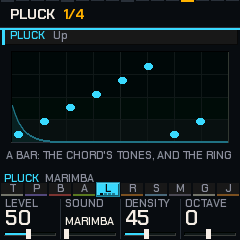

The pluck is the counter-melody: a second, lighter line over the other parts. It plays an **arpeggio**: the notes of
the chord one after another, not all at the same time. Two plucked voices take turns, so the end of each note continues
to ring under the next note. The pluck plays in time with the bar, with swing on the off-sixteenths. Swing makes every
second note play a little late, for a shuffle feel. In a breakdown, the pluck plays fewer notes.

By default, the pluck stays in the background, below the other parts (Level 50, Density 45). To turn it off, set Level
to 0. Its two pages are **Pluck** and **Pluck 2**, on **ARP** (press it six times and seven times). The mood (section
10) changes its level, decay and density.

| Setting | Does |
|---|---|
| Style | The order of the notes: up, down, up-down, random, skip (every second chord note), or thirds |
| Rate | How fast: 1/4, 3/16 (a dotted eighth), 1/8 or 1/16 |
| Range | How many octaves the arpeggio covers, 1-3 |
| Decay | How long a note rings. For the DX sounds, it sets how long the key is held down (0.12 s to 1.7 s). The note then fades out some time after the key comes up. |

The pluck has three groups of sounds:

- **Plain (12):** Pluck, Marimba, E.Piano, Kalimba, Bell, Vibes, Gong, Clav, Digital, Brass, Bleep, Glass. All are FM, except Bleep, which is a plain sine.
- **Built-in DX7 voices (60):** the thirty below and thirty more (see "Thirty more" below). MF EPRHOD1 (an electric piano), WINEGLASS (a glass bell), SMOOTHBASS, FULL-BRASS, EASY DXPAD (a soft pad), FLUTEMRMBA (wooden bars), DRAWBARS, GITARA AKU (a nylon guitar), ROLAND BRS (brass), SOLID BASS, TEMPLEBELL, DX MARIMBA, CLAVINET, SOFTSTRNGS (strings), SHIMMERPAD (a glass pad), SKY SYNC (a sync lead), HARFA LSR (a harp), DX KALIMBA, FLUTE BLOW, STEEL PANS, MOOGBASS (a saw bass), TUBUL-BELL, and the eight described below. Each voice shows its own name. DX MARIMBA and DX KALIMBA keep DX at the front, to make them different from the plain Marimba and Kalimba. The DX7 is the classic 1983 FM synth from Yamaha. These voices play as they do on a DX7: all 32 algorithms (the ways its six tone generators connect together), the envelopes with their curves and scaling, velocity, LFO, pitch envelope and feedback. The pluck plays up to six notes at the same time. Heavy patches play fewer notes, to keep the load down: the bells, brass, strings and pads play three or four.
- **Yours (up to 16):** DX7 voices that you load yourself come after the built-in voices. Each one shows the voice's own name (section 15).

The last eight built-in DX voices are guitars, a bass and brass:

| Voice | What it is |
|---|---|
| PEDALSTEEL | A pedal steel guitar |
| CHOR.STRAT | A clean electric guitar, with chorus |
| GUITARDAMP | A muted guitar, the funk "chank" sound |
| AXE | A distorted guitar |
| SLAPS | A slapped bass |
| MFSYNBRASS | Synth brass |
| SAXOPHONE | A saxophone |
| SOLO TRPT | A solo trumpet |

The disco, funk, reggae, synthwave, amapiano and trip-hop genres use them.

**Who made them.** The thirty are DX7 patches that people made. They were chosen by kind from public-domain banks:
Pafreak's SYNTHOXICATED banks, madFame's Custom Patches (`MF EPRHOD1`, `SHIMMERPAD`), the 1980s magazine banks on Bobby
Blues' page (the Aftertouch magazine's `SAXOPHONE`), one from Jack Deckard's collection on Dave Benson's page, and
`CHOR.STRAT` from Jezreel's folder. Each one shows its own name. Each one is set to a matching
loudness, so the mix of each genre stays balanced.

**Thirty more.** After the first thirty on the **Sound** list come thirty more DX7 voices that people made. They come
from the same public-domain pages (Clyde Jones', Toby's, Frank Carvalho's, Narfman's, Godric's and Jezreel's folders,
and the Aftertouch, Guitares & Claviers and E&MM magazine banks). Each one shows its own name. Seven
were added in the 2026-11-13 audit, each one a kind of instrument that the set did not have (HARPSICHORD, ACCORDION,
OBOE, PAN PIPE, KOTO, CIMBALOM, BANJO). What each one is:

| On the screen | What it is | On the screen | What it is |
|---|---|---|---|
| WURLITZER | Wurlitzer electric piano | TSQR DECAY | Sequencer pluck |
| TF-RHODES | Bright Rhodes | CS 80 | Warm poly (CS-80 style) |
| REAL GRAND | Grand piano | ANALOG 1 | Analog poly |
| ARCTICKEYS | Digital keys | PAN PIPE | Pan flute, breathy |
| HARPSICHORD | Harpsichord | ANGEL VOX | Choir pad |
| MAGICM1ORG | House organ (M1 style) | Fairlt.Vox | Sampled-choir style voice |
| ACCORDION | Accordion | WD SQ BASS | Square bass |
| Farfisa1 | Combo organ | KOTO | Koto |
| PROPHET | Poly synth (Prophet style) | CIMBALOM | Cimbalom (hammered strings) |
| JUNO 106 7 | Poly keys (Juno style) | Femalevibe | Vibraphone |
| OBOE | Oboe | BANJO | Banjo |
| Saw3Op | Saw lead | DOUG22PICK | Picked pluck |
| SquarePWM | PWM lead | SITAR VIII | Sitar |
| Techno2 | Techno lead | NEUTRNPLUK | Pluck |
| ETH. STAB | Stab | SHORTHORNS | Short horn section |

**Stereo.** A DX7 voice is mono. The pluck makes its DX voices wider with a light ensemble effect. The sound above
200 Hz goes through a delay on each side, and the delay changes slowly. So the voice spreads about as wide as the plain
pluck. The lows, the bass voices and the reverb and echo sends stay in the middle.

For more sounds, load your own. The installer page accepts any DX7 `.syx` bank or single voice (section 15). There are
large free collections, for example [Bobby Blues' DX7 archive](https://bobbyblues.recup.ch/yamaha_dx7/dx7_patches.html),
[Soundarchive](https://www.soundarchive.co/yamaha-dx7) and
[Yamaha Black Boxes](https://yamahablackboxes.com/collection/yamaha-dx7-synthesizer/patches/). The licence of each bank
is the licence of its author. PERF-1 does not include any of them.

### Pluck steps: freeze the pluck's loop and edit it

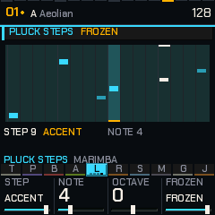

Use the **Pluck steps** page to keep a pluck phrase that you like, or to write your own. To open it, press **ARP**
nine times (the page after Deja vu). The page holds the loop of the pluck and lets you edit it one step at a time.

The page has the same layout as Acid steps. It shows one bar as sixteen steps, and each step shows as a bar. The height
is the note of the step. A note here is one of the notes of the chord, counted from low to high across the octaves of
the pluck (1 is the lowest). The notes come from the chord that plays, so your line follows the harmony when the chord
changes. An accent shows in the bright colour, a soft note shows dim, and a rest shows as a dash. A mark shows under
the step that is playing.

1. Press a **white key** to select a step.
2. Turn **Step** to set what it plays: Rest, Soft, Note or Accent.
3. Turn **Note** (1-12) to set its note.
4. Turn **Octave** to move the whole pluck up or down (-2 to +2), the same as on the Pluck page. **Range**, on
   Pluck 2, sets how many octaves the notes cover.

**Frozen** holds the line. Any edit freezes the line. When the line freezes, PERF-1 also sets the Deja vu Loop to 16,
the pluck Rate to 1/16 and Pluck vu to 100. So every note comes back the same in each bar. A frozen line stays when you
start a new piece, and it is **stored with the piece** (a note and a kind for each step). If you set Frozen back to
Free, the loop belongs to Deja vu again, and a new piece forgets it.

When the voice of the Jam page is on the pluck, Capture (**SEL** + **REC**) writes the bar that you just played into
this page (section 10).

### Acid steps: freeze the line and edit it

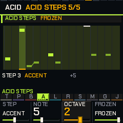

The acid line makes itself up as it plays. Mutate changes a small part of it each time through the line. To keep a
line that you like and shape it, use the **Acid steps** page. To open it, press **ARP** five times (the page after
Acid answer).

The page shows the line as sixteen bars, one for each step, the same way as Pluck steps. The height is the note. A
short tail shows that the step slides into the next step. Press a **white key** to select a step. Then set the step
with the knobs:

| Knob | Does |
|---|---|
| Step | **Rest**, **Note**, **Accent** (louder and brighter), **Slide** (glides into the next note, as on a 303) or **Acc+Slide** |
| Note | The note, 0 to 15 scale steps above the chord. The line follows the chord, so it moves when the chord changes. |
| Octave | 0 to 3 octaves up, added to the Acid octave |
| Frozen | **Free**: the line continues to change (Mutate), and a new line grows with each piece. **Frozen**: the line stays as it is, and Mutate does not change it. The line is **stored with the piece** (Global, SAVE) and comes back with it. |

Any edit freezes the line, so Mutate cannot change it. To let the line change again, turn Frozen back to Free. To keep
the line that you hear now, turn Frozen to Frozen. The Length of the line, the answer (above) and the Acid octave all
work as usual on a frozen line. Steps after the Length show dim and do not play. A piece stored with older firmware
starts with a free line.

### Deja vu: loops in the pluck, and what the acid mutates

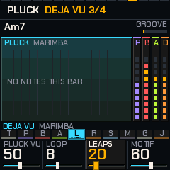

Without Deja vu, the pluck selects every note new. The **Deja vu** page makes the pluck remember, so phrases come
back. To open it, press **ARP** eight times.

| Knob | Does |
|---|---|
| Pluck vu | Each time a note comes back, the chance that it is the same note, rest or leap as the last time. 0: every note is new. 100: the loop is locked and repeats exactly. |
| Loop | How many notes it remembers: 4, 8, 16 or 32 |
| Leaps | How often a new note jumps an octave |
| Motif | How often a bar develops the opening idea of the phrase (0 off, 100 always; 60 by default) |

A locked phrase always plays over the current chord, so it follows the harmony. A change to the Loop length, or a new
piece, makes the pluck forget the loop.

**Motif** makes the pluck play in phrases. The first bar of every eight bars is kept as an idea. The idea is which
sixteenths played, and how far each note moved up or down the chord from the note before. Each bar after it then
develops the idea, as often as the knob sets. The bar plays the same shape, starting from the current position of the
line (so it follows the chords). Sometimes it plays the shape upside down, or with a new last step.

The fifth bar plays the idea again at its first pitch, as an answer to the first bar. Most phrases start a new idea.
Some start with the old idea again. At 0, the pluck makes every bar new. Deja vu has priority over Motif: if Deja vu
replays a note, the note plays again, whatever the motif says.

The acid has its own version of this: **Mutate** on the Acid line page. Mutate changes a few steps each time through
the line. To select what a change does, hold **SEL** and turn the Mutate knob on that page:

- **All:** anything.
- **Notes:** the rhythm stays and the notes change slowly. This is the classic acid change.
- **Rhythm:** the same notes come and go.
- **Accents:** only the accents and slides.

### The kits: 23, and three of your own

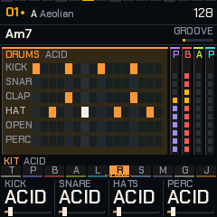

Press **SEQ** three times to open the Kit page. Each knob selects the sound of one drum from the same twenty-three kits.
The drums are the kick, the snare (with the clap), the hats (closed and open) and the perc.

Some kits **duck** other parts. Each kick turns the other parts down for a short time. This gives a pumping feel. Some
kits **crush** the drums. This makes the drums sound grainy and lo-fi (rough and less clean, like an old sampler). 808
and 909 are classic drum machines from Roland.

| Kit | The kick | The rest |
|---|---|---|
| Hypno | Deep | Metallic 808-style hats, a soft rim |
| House | Round | A wide clap, long open hats, congas |
| Techno | Hard, with a rumble tail | A tight clap, metal hats, a bell perc |
| Acid | Punchy, 909-style | A cowbell for the perc |
| Break | Distorted | A cracking snare, noisy hats, a tom. The Break kick also cuts up the drums while they play (ghost snares, extra kicks, fast 32nd rolls, more with Evolve). It also crushes them. |
| Minimal | Short and clicky | A rim for the snare, tight hats, a woodblock |
| Hard | Industrial, distorted, with a long rumble | A noisy snare, a metal clank. It crushes the drums a little. |
| 808 | A long boom | A snappy snare, a wide clap, a cowbell |
| Dusty | Soft and round. It ducks the rest a little. | A loose low snare, a muted clap, dull short hats, a soft rim (lofi) |
| Heavy | A deep sub kick with a long tail. It ducks the bass hard. | A big cracking snare, a wide clap, tight hats, a metal perc (dubstep) |
| 909 | Punchy, with a click | A snappy snare, a clap, ticking hats and long open hats, a tom |
| Electro | Short and high | A tight bright snare, a thin clap, glassy hats, a zappy tom |
| DnB | Tight | A loud cracking snare, a clap, fast tiny hats, a clicky perc |
| Trap | A long 808 sub with almost no click | A snare and a wide clap together, tiny hats, a bell |
| Boom | Round with body (boom-bap, SP-1200 style) | A fat cracking snare, crisp short hats, a rim. It is a little crushed. |
| Ride | Light | Its hats are a ride: the closed one is a long tick and the open one is a wash. A woodblock. |
| Snap | A short sub | Its snare is a snap (high and short). Its clap is one burst. Tight hats, a high rim. |
| 606 | Short and tight | A small snappy snare, bright short hats, a tom (Roland's TR-606) |
| Gabber | Driven hard, with a long tail (hardcore) | A hard noisy snare, harsh hats, a metal perc |
| Linn | Round (the 80s) | A fat long snare for the gated reverb, a wide clap, a tom |
| Shaker | Soft and round | Its perc is a shaker. Its hats are noisy. A rim for the snare. |
| Machine | **Sampled**: an 808 / 909 style drum machine | The 808's six-square hats, its cowbell, the bursts of its clap, a 909-style snare |
| Boombap | **Sampled**: an acoustic kit through an SP-1200 (26 kHz, 12 bits) | A round kick, a fat snare with its wires, the shimmer of a cymbal, a side-stick |

On any of the drum pages, press **SEL** + **ALGORITHM** to change all four drums to the next kit at the same time. You
can mix drums from different kits as you like. For example, a Techno kick under House hats is fine. Since 0.17.34, the
drums of all kits are levelled to each other. A snare or hats from any kit have the same loudness. Thus, when you mix
kits, no drum is too quiet.

**The sampled kits** (Machine, Boombap) play recorded sounds, not the synth. The sounds were made for PERF-1 with heavier
models than the FM-1 can run live. Then they were stored in the memory of the FM-1. Tune moves the pitch of a sampled
drum up or down. Decay below the middle makes the drum shorter.

**Your own sample kits.** There are three more slots at the end of the list of each drum. They hold kits that you load
yourself, from your own sound files. Use the installer page (**Your own sample kits**):

1. Pick a slot.
2. Give the kit a name.
3. Choose up to six files (kick, snare, clap, closed hat, open hat, perc). WAV, MP3 and all files that your browser plays are fine.
4. Stop the music on the FM-1.
5. Press **Load into the FM-1**.

The page changes each sound to mono at 22 kHz. It removes the silence before the sound. It sets the level of the sound,
so that it fits with the other kits. If all six sounds do not fit (about 1.8 seconds for all of them together), the page
makes them a little shorter.

The kit shows with its name in the lists on the Kit page. An empty slot shows Empty 1, 2, 3. If you empty a slot, a
drum on that slot plays the Hypno synth. Your samples are only on your FM-1. PERF-1 itself does not contain any of them.
Thus you can use samples here that you may use but not give to other persons.

### Playing a voice by hand

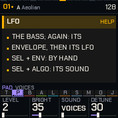

The keys always play a voice over the music. On the pages of a voice, the keys play that voice, together with its own part. You can also take a voice away from the algorithm. Then only you play that voice:

1. Go to one of the pages of the voice: **ENV** for the pad, **LFO** for the bass, **ARP** for the acid.
2. Hold **SEL** and press **ENV**. The voice becomes silent and the line above the knobs shows `BY HAND`. (If the page is not a page of a voice, SEL + ENV only tells you this.)
3. Play the keys. While the pages of that voice are on the screen (any page of the pad, the bass or the acid), the keys play the voice over the rest of the song.

How each voice plays:

- **Pad:** Up to four notes at the same time, each on one of its voices. Attack and Release come from the Pad env page (they are quicker than the slow swells of the pad).
- **Bass:** The last key that you hold, two octaves down. The envelope (the shape of the sound over time) opens on each new press.
- **Acid:** The last key that you hold, an octave down, with its filter and envelope. If you hold a key and press a second key, the note slides to the second key, as on a 303.

All the other parts continue by themselves: the other voices, the chords and the drums. The keys follow the octave of
the voice and the octave of the song (**OCT-** / **OCT+**). The lit keys still show the scale, so you can see which notes
are in key. This also works when the music is stopped. A key plays until you release it, also if you change the page.
On all other pages, the keys play the voice of the Jam page. On the Global page, the keys edit the scale.

To give the voice back to the algorithm, press **SEL** + **ENV** again on one of its pages. The piece stores which
voices you play by hand. MIDI out sends the notes that you play, on the channel of the voice. To play the pluck, use the
**Jam** page (section 10).

### Links: the drums into the voices

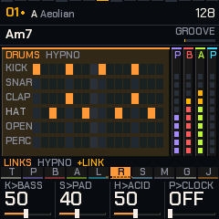

Links let the drum hits change the voices, as trigger cables do on a modular synth. **SEL** + **SEQ** turns the links on
and off. The links keep their settings. While the links are on, `+LINK` shows on the line above the knobs. Set each link
on the **Links** page (press **SEQ** twice). 0 means off. The piece stores the links.

| Link | What it does |
|---|---|
| K>Bass | Each kick opens the filter of the bass. Then the filter closes again over the beat. The bass moves with your kick pattern. The amount sets how far the filter opens and how long it takes to close. |
| S>Pad | Each snare or clap opens the filter of the pad for a short time and makes the pad a little louder. Thus the pad answers the backbeat. |
| H>Acid | If a hat hits on an acid note, the acid note gets an accent (it plays stronger). More hats give a sharper, more "squelchy" 303 (more accented notes). |

If you mute a drum with FX, you do not hear it. But its hits still control the links.

---

## 8. The sequencer

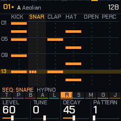

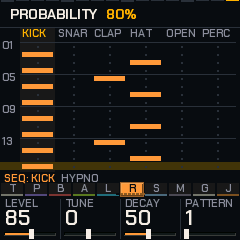

Use the sequencer to write the drum patterns. **Hold SEQ** to open it. Tap **SEQ** to go back to the Drums page.

- There are six **lanes**, one for each drum: kick, snare, clap, closed hat, open hat and perc. Each lane has sixteen steps and its own colour.
- The sixteen **white keys** are the steps of the drum that you are on. They come on where the drum hits. A moving light shows the position of the beat. Tap a key to turn that hit on or off.
- **OCT-** and **OCT+** select the previous or the next drum.
- The knobs set these values for the drum: **Level**, **Tune** (+-1 octave), **Decay**, and **Pattern** (the pattern that you edit). Level goes from 0 to 150. Above 100, the drum is louder than the piece made it, up to +7 dB. Use this for a snare or hats that are too quiet. You can edit a pattern before it plays. A pattern change waits for the next bar.

While you hold **SEL**:

| SEL + | Does |
|---|---|
| White keys 1-6 (F3 G3 A3 B3 C4 D4) | Choose the pattern to edit |
| Black keys 1-6 | Copy this pattern into pattern 1-6 |
| OCT- | Clear the lane of this drum |
| OCT+ | Put back the piece's own lane |

**Tricks: SEL + a knob**, on the lane that you are on:

| SEL + | Does |
|---|---|
| KNOB 1 | Fills the lane with a **Euclidean** pattern: n hits in 16 steps, spread as evenly as possible. Many traditional rhythms use this method. 0 clears the lane. |
| KNOB 2 | **Rotates** that pattern. It moves the pattern 0-15 steps later around the bar. |
| KNOB 3 | Sets the **probability** of the lane, in steps of 5 %. This is the chance that each hit plays. Below 100, the name of the lane shows its chance. Rolls and fills that you hold on top still play. |
| KNOB 4 | Sets the **length** of the lane, 1-16 steps. 16 is a full bar. A shorter lane loops on its own, against the other lanes. This is called **polymeter**. The screen shows `L5` (for 5 steps) under the name of the lane. A mark shows where the lane ends, and the steps after the end are dim. A short lane counts from the start of the song, not from the start of the bar. Thus a 5-step hat against the 16-step kick lines up again only every 80 steps. |

The piece stores the probability and the length. The Euclidean fill and the rotation change the pattern itself. Thus
they stay in the pattern if you store the piece.

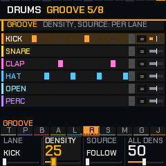

**The Groove page: density and borrowing lanes.** To open the **Groove** page, press **SEQ** five times, or turn the
dial past Drum drift. On this page, you can give a lane more hits or fewer hits, and you do not edit the lane. You can
also let a lane play the lane of a different pattern. The page shows every lane while it plays. A bright hit is as
written. A white hit is added. A dash is a hit that is removed.

| Knob | Does |
|---|---|
| Lane | The lane that you set (kick ... perc) |
| Density | At 50, the lane plays exactly as written. If you turn it down, the least important hits stop first (the off-sixteenths, then the off-eighths, the beats last). If you turn it up, Density adds hits on the most important empty steps (at 100, half of them). The pattern itself never changes. |
| Source | **Follow** plays the piece's own lane. Pattern 1-6 makes the lane play the lane of that pattern from the next bar. For example, take the hats from pattern 4 while the kick stays on pattern 1. A lane with this setting shows the number of its pattern after its name. |
| All dens | Changes the density of every lane at the same time |

You can also set Source in the sequencer. Use **black keys 1-6** to set it for the lane that you are on. Use **black
key 7** to set it back, so that the lane follows the piece. The piece stores Density and Source, and scenes also keep
them.

### Steps: ratchets, push and level

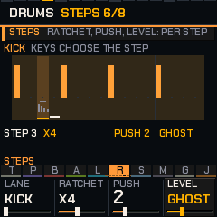

Each lane also has **step tricks**: a ratchet, a push and a level for each of its sixteen steps. The step tricks are on
a layer below the six patterns. Thus they apply to the pattern that plays, whichever pattern it is. Set them on the
**Steps** page (press **SEQ** six times, or turn the dial past Groove).

1. Turn KNOB 1 to choose the lane.
2. Press a **white key** to choose the step. The key comes on, and the page shows the lane while it plays.
3. Set the step with the other knobs:

| Knob | Does |
|---|---|
| Ratchet | Repeats the hit inside its step, as a quick roll: **x2**, **x3**, **x4**, **x6**. A **flam** adds a quiet grace note (a short extra note) just before the hit. A **swell** plays three or four hits that get louder. |
| Push | Makes the hit come late, 0 to 7 twelfths of a step. Use it for a relaxed, late snare. At 128 BPM each twelfth is about 10 ms. The hit can only be late, never early. |
| Level | **Normal**, **ghost** (very soft), **soft** or **accent** |

The page shows each step as a bar. The height of the bar is the level. The push moves the bar to the right. The hits of
the ratchet show below the bar.

The piece stores the tricks. Pieces stored with older firmware have no tricks. The tricks act on the hits that the
pattern plays. Thus a trick on an empty step waits until a hit lands on that step. The tricks do not apply in fills,
builds or breakdowns, on the hit where the drop lands, or in the first bar after **PLAY**.

Some genres have tricks that are already set. In lofi, house, garage, hip-hop and most of the other genres, the hats
between the eighth notes (the second and the fourth 16th of each beat) are soft. In house, disco and electro, the hat
on the "and" of each beat (half a beat after the beat) has an accent. In DnB, breaks, funk and synthwave, the
backbeat has an accent. In lofi and trip-hop, the snare is a little late (laid back). In garage and hip-hop, the snare
is a very little late. In dub and reggae, the rim is a very little late. Trap has triplet rolls and a swell on its
last hat beat.

### Feel: ghosts, accents, comping and looseness

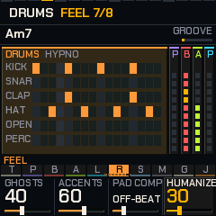

The **Feel** page (press **SEQ** seven times) has the settings that make a groove sound as if a person plays it.

| Knob | Does |
|---|---|
| Ghosts (0-100) | Adds the **ghost notes** of the genre. These are very soft hits between the main hits: soft snares, and also soft kicks in lofi, breaks, funk, trip-hop, industrial and hip-hop. They go on steps that the pattern does not use. At 100, about six in ten of those steps play. Lofi, house, DnB, breaks, garage, funk, trip-hop, industrial, forest and hip-hop have ghost steps. The other genres do not change. |
| Accents (0-100) | Sets how much the accents and ghosts from the Steps page count. At 50, they play as marked. At 0, every level is the same. At 100, the differences are stronger than marked. |
| Pad comp (on the Pad's **Chords** page, **ENV** x4; the knob on this page is empty) | The rhythm of the pad's stabs (short chords). Comping is the rhythm in which a keyboard player plays short chords. It affects the stab sounds: Stabs, Dub, Pings, Hits, Rave, Wurli, Mallet, Brass and Pluck. **Auto** uses the rhythm of the genre. **Hold** never stabs, so a stab sound plays as a held pad. The other settings force stabs on all pad sounds: **Off-beat**, **On-beat**, **3-3-2** (eighths grouped 3+3+2), **Charleston** (the old jazz "long-short" rhythm), **Syncopated**, **Sparse** and **Eighths**. |
| Humanize (0-100) | A little looseness. Each hit comes a little softer and a little late. |

### Phrase: chains, slices, half and double time, conditions

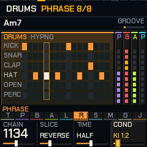

The **Phrase** page (press **SEQ** eight times) controls what the patterns do over several bars. The piece stores all
the settings on this page, also the condition for each lane.

**Chain** plays a different pattern in each bar, in a loop. The settings are **12** (patterns 1, 2), **1112**,
**1123**, **1134** (the chain of the Amen break, the famous drum loop), **1213**, **1234**, **1232**, **1115** and
**123456**. While a chain is on, it selects the pattern at the start of each bar. The chain has priority over the
Pattern knob, the pattern keys that you hold and the pattern changes from Drum drift. But the fills from Drum drift
still play. When you turn the chain off, you control the patterns again. When you turn a chain on or change it, the
chain starts from its first bar.

**Slice** plays the drum steps in a different order. It affects only the drums. A lane with its own length keeps its
steps as they are.

| Slice | What you hear |
|---|---|
| Halves | The two halves of the bar change places |
| Stutter | The first beat of each half repeats |
| Reverse | The bar backwards |
| Delay | The second half an eighth late |
| Beats | The middle two beats change places |
| Mirror | The second half backwards |
| Double | The first half two times |
| Swap | The beats in each half change places |
| Auto | The last bar of every four gets one of the slices above, selected at random |

**Time** changes the speed at which the pattern is read. **Half** makes the pattern two bars long, with the hats in
eighths. This changes DnB into drumstep. **Double** plays the pattern twice in one bar. A hit on an odd step joins the
step before it.

**Cond** sets a **condition** for the lane that you selected on the Groove page, the Steps page or the sequencer. The
condition sets the bars in which the hits of the lane play. The knob shows the first letters of its setting.

| Cond | The lane's hits play |
|---|---|
| Always | Every bar |
| 1:2 | Odd bars (the first, third ...) |
| 2:2 | Even bars |
| 1:4 | The first bar of every four |
| 4:4 | The last bar of every four |
| 1:8 | The first bar of every eight |
| Fill | Only in fill bars |
| No fill | In all bars except fill bars |

A condition only controls whether the pattern's own hits play. Fills still add their hits.

---

## 9. Effects

Use the effects to change the music live while it plays. Press **FX** to open the effects menu. Press it again to close it. While the menu is open, each key is an effect.

The keys have four banks of effects: **FX**, **BEAT FX**, **FLEX BEAT** and **DJ SNIPS**. Turn the **SELECT** dial to go from one bank to another. The dial stops at the first bank and at the last bank. The knobs become the **FX knobs** (see below).

### Tap or hold

- **Tap** a key (release it in less than a quarter of a second). The effect stays on. This is called latching. Tap the key again to turn the effect off.
- **Hold** a key. The effect plays only while you hold the key.

You can latch more than one effect at the same time. On the screen, a key that you hold shows as a lit tile. A latched key has a bar next to it.

Each type of effect has its own colour, so you can find the keys quickly:

| Colour | Effects |
|---|---|
| Cyan | Repeats |
| Green | Filters |
| Yellow | Gates and the pump |
| Red | The drum mutes |
| Pink | Colour effects (phaser, flanger and similar effects) |
| Violet | Builds |
| Orange | Effects that change the playback: reverse, stops, scatter |
| Teal | Flex Beat |

**Latched effects continue to play after you close the menu.** As a reminder, the **FX** button blinks and `FX` shows next to the tempo. The keys play a voice again. To turn an effect off, open FX again and tap its key.

To turn off all effects at the same time, press **OCT-** in the FX menu. This clears all effects and puts the FX knobs back to their home positions. It also clears all mutes and solos. If you did this by mistake, press **GLO** + `B3` to undo it. If you tap **SAVE** in the FX menu, it still starts a breakdown (section 10).

### The FX knobs

These four knobs work in the FX menu, on the Perform screen and on the visualizers. Thus you do not need to open the menu to use them.

| Knob | What it does |
|---|---|
| Filter | Turn it to the left of the centre for a low-pass filter. This filter cuts the high sounds and makes the sound darker. It closes from 16 kHz down to about 250 Hz. Turn it to the right of the centre for a high-pass filter. This filter cuts the low sounds and makes the sound thinner. It goes up from 20 Hz to about 1.6 kHz. In the middle, the filter is off. The screen shows `OFF` in the middle and values like `LP 40` or `HP 40` as you turn. |
| Crush | Makes the sound more gritty and lo-fi, like an old sampler. At the maximum position, it is about 5.5 kHz and 5 bits. |
| Throw | Sends the mix into the echo. Turn it up for more echo with longer repeats. |
| Wash | Sends the mix into the reverb. |

PERF-1 does not save the FX knobs. When you turn off the power, they go back to their home positions. But a scene stores them (section 10). While an FX knob is not at its home position, the header shows `KNOB`.

### The gesture recorder: loop your knob moves

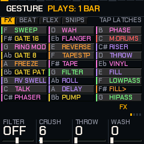

Record up to four bars of FX knob moves and effects. Then they play again by themselves, and your hands are free for the keys.

1. While the music plays, open the FX menu and press **SEL + REC**. The header shows `ARM`: the recorder waits for you.
2. Turn an FX knob or play an effect key. This starts the recording (`REC`), from the start of the bar that plays now.
   For example, move the filter, crush the last beat, send to the echo, or hold a roll or a stutter. The recorder writes
   the knobs and the effect that you hold, every sixteenth.
3. Press **SEL + REC** again. The recorder finishes the bar that plays now. Then it plays your moves in a loop (1 to 4
   bars; after four bars, it starts the loop by itself). The header shows `LOOP`. An effect that you play by hand has
   priority. The effect of the loop comes back when you release the key.

If you turn a knob yourself, you control that knob again. The other knobs continue to play the loop. While the loop
plays, press **SEL + REC** in the FX menu to release all the knobs. The knobs stay where they are. **OCT-** in the FX
menu (it puts everything back to home) also releases them. PERF-1 does not save the loop, the same as the knobs. The
loop continues to play when you change the piece. When you stop the music, the loop pauses.

**Now and then instead of all the time:** before you record, set **Auto FX** to on (on its settings page), and set
**Pick** to **YOURS**. When you close the loop, PERF-1 keeps it (`GESTURE KEPT`). Then Auto FX plays the whole loop
once, so that it ends on its phrase lines (**Every**: 4, 8, 16 or 32 bars). After this, it puts the knobs back. While
the loop plays, the header shows `AUTO`.

### Bank 1: FX

The 27 keys go from `F3` to `G5`. On the screen, they are in three columns of nine.

| Key | Effect | What it does |
|---|---|---|
| F3 | Sweep | A filter moves up and down in time with the tempo. |
| F#3 | Gate 16 | A trance gate: it turns the synths on and off in sixteenth notes. |
| G3 | Ring mod | Gives the sound a metallic tone, like a bell. |
| G#3 | Gate 8 | The same gate, in eighth notes. |
| A3 | Freeze | Captures the sound and holds it as a steady drone. The drone is made from very small repeated grains of the sound. |
| A#3 | Gate pattern | The gate plays its own rhythm. You set this rhythm on the Gate page. |
| B3 | Reverse swell | About the last beat plays backwards once and gets louder as it plays. |
| C4 | Talk | Makes the whole mix "talk": it moves the mix through the vowels A E I O U. The kick and bass below do not change. |
| C#4 | Phaser | A swirling, sweeping sound. |
| D4 | Wah | An auto-wah: a filter that opens more when the music gets louder. The kick and bass below do not change. |
| D#4 | Flanger | A sound like a jet plane that goes past. |
| E4 | Reverse | Plays the music backwards. |
| F4 | Tape stop | The music slows down and stops, like a tape machine that you turn off. |
| F#4 | Tape | Makes the music sound like worn tape: the pitch wobbles (wow and flutter), with drive. |
| G4 | FILTER | A filter on the tracks that you choose: low, high, band, notch, peak, or Morph between them (see below). |
| G#4 | Roll | Repeats that get faster. |
| A4 | DELAY | Sends the tracks that you choose into the echo, with long repeats (see below). |
| A#4 | Pump | Turns the sound down in a rhythm, so that it "pumps" as music does when a kick pushes it down. This is called sidechain ducking. |
| B4 | PHASE | A phaser on the tracks that you choose (see below). |
| C5 | M:DRUMS | Mutes all four drums while you hold the key. This is the classic move that removes the drums. |
| C#5 | Riser | A build-up: a filter and the reverb go up. |
| D5 | Throw | Sends the mix into the echo. When you release the key, the send closes immediately. But the repeats continue for a bar (past the next downbeat), and then they fade out. This is a dub throw. |
| D#5 | Vinyl | Adds record crackle, hiss and pops below the music. |
| E5 | Fill | Plays a drum fill. |
| F5 | Low-pass | A low-pass filter that closes and makes the sound darker. |
| F#5 | FILL> | Tap it, and the drums play a fill in the next bar. |
| G5 | High-pass | A high-pass filter that removes the low sounds and makes the sound thinner. |

M:DRUMS works only while you hold it, the same as all held keys. The mutes for the single drums (kick, hats, snare, perc) are on the same keys in the BEAT FX bank. To mute the other tracks, or to solo a track, use the mix map on the **GLO** layer (section 10).

**Punch-ins on tracks: FILTER, DELAY and PHASE.** The other effects work on the whole mix. These three effects work
only on the tracks that you select, as Caustic puts effects on one machine. For example, hold DELAY, and only the acid
and the pluck echo. Or hold FILTER, and only the synths become thin while the drums stay strong. To open the settings
page of the key, hold **SEL** and press the key. The last knob on the page is **Targets**:

| Targets | What it hits |
|---|---|
| ALL | Everything |
| DRUMS | All four drums together |
| SYNTHS | Pad, bass, acid and pluck (everything except the drums) |
| PAD, BASS, ACID, PLUCK | That one track |
| ACID+PLK, PAD+PLK, BASS+ACID | Those two tracks |

**Morph** (turn FILTER's Type past PEAK) is one filter that moves from low-pass (**MORPH LP**) through band-pass
(**MORPH BP**, at the halfway point) to high-pass (**MORPH HP**). A band-pass filter keeps only the middle sounds. Morph
moves in 5% steps and glides between them. Cutoff and Reso do not change. For example, set the cutoff on an acid line,
hold FILTER and turn Type. The acid changes from full to nasal to thin, and the filter does not sweep.

The band-pass is made louder, so that it is about as loud as the low and high ends. At high resonance, it is made
louder again.

| Key | Settings |
|---|---|
| FILTER | Type (low, high, band, notch, peak, then Morph: see above), Cutoff, Reso, Targets |
| DELAY | Send (how much goes into the echo), Repeats (how long the echo continues; it uses the echo time of the piece), Targets. Like Throw, its repeats continue for a bar after you release the key. |
| PHASE | Rate, Depth, Mix (100 is the deepest swirl), Targets |

If you hold two of them at the same time, they share their tracks. Both effects then act on all the tracks that either
effect is set to. The effect changes only the track's own sound. The reverb and echo sends of the track do not change.
Thus a filtered pad still has its reverb tail without the filter. The versions for the whole mix are still available:
Phaser on C#4, Throw on D5, the filters on F5 and G5.

### Bank 2: BEAT FX

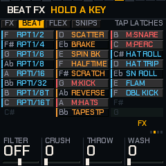

These effects cut up the beat and change it.

| Keys | Effect | What it does |
|---|---|---|
| F3 to C4 | Beat repeats | Loops (plays again and again) a short slice of the music that just played. From slow to fast: 1/2, 1/4, 1/6 (a quarter-note triplet), 1/8, 1/16, 1/32, then 1/8T and 1/16T (triplets: three notes in the time of two). If you hold more than one key, the shortest repeat plays. A repeat starts on the next sixteenth note. |
| D4 | Scatter | Puts the last few slices into a new order. |
| D#4 | Brake | Slows the music down until it stops, like a record when you stop the turntable. Held, it stays stopped and silent until you let go; then the music comes back in time. |
| E4 | Spin back | Turns the music backwards, like a DJ who pulls a record back. Held, it stays stopped and silent until you let go, as the brake does. |
| F4 | Half time | Plays the music at half speed. Held, it goes back to the live music on each bar (on each beat or two at the slowest speeds) and keeps its slowed speed. |
| F#4 | Scratch | Plays an automatic record scratch. |
| G4, A4, B4, C5 | Drum mutes | Mutes the kick, hats, snare or perc while you hold the key (bank 1 has M:DRUMS, all four, on C5). |
| G#4 | Reverse | Plays the music backwards. |
| A#4 | Tape stop | Slows the music down until it stops. |
| C#5 | Hat roll | The hi-hats play on every step, in 32nd notes. |
| D5 | Hat trip | The hi-hats play a roll in triplets. |
| D#5 | Snare roll | Plays a snare roll that gets louder through the bar. |
| E5 | Flam | Adds a quick extra hit just before each snare and clap. |
| F5 | Double kick | Each kick plays again half a step later. |

Beat repeat and reverse play back the last part of the mix: a little less than one second of it. At slow tempos, a 1/2 repeat is longer than this, so it plays as a 1/4.

### Bank 3: FLEX BEAT

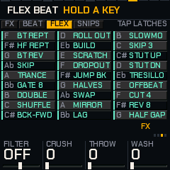

Flex Beat cuts up the last part of the music. Then it plays that part again as a new pattern of one bar, in time with the beat. There are 27 patterns, one on each key from `F3` to `G5`:

| Pattern | What it does |
|---|---|
| **Bt Rept** | Loops the last beat. |
| **Hf Rept** | Loops the last half bar. |
| **Bt Rev** | Plays the last beat backwards. |
| **Skip** | Loops the last beat, but leaves out every second sixteenth note. |
| **Trance** | A 3-3-2 gate: the music goes off and on in a rhythm of three, three, two. |
| **Gate 8** | Turns the music off and on in eighth notes. |
| **Double** | Plays each sixteenth note of the last beat two times. |
| **Shuffle** | Loops the last beat with its sixteenth notes in a new order. |
| **Bck-Fwd** | Plays the last beat forwards, then backwards. |
| **Roll out** | Plays normally for three beats, then plays a stutter (fast repeats of a short slice) on the last beat. |
| **Build** | Plays normally, then plays a stutter that gets faster. |
| **Scratch** | Moves the last two sixteenth notes back and forth, like a scratch. |
| **Dropout** | Mostly silence. The music comes through on only a few steps. |
| **Jump bk** | Jumps back and repeats the last beat, then continues. |
| **Halves** | Swaps the two halves of the last half bar. |
| **Swap** | Swaps the sixteenth notes in pairs. |
| **Mirror** | Plays forwards, then backwards. |
| **Lag** | Plays late and leaves a gap. |
| **Slowmo** | Plays each sixteenth note two times: half time, but the pitch does not go down. |
| **Skip 3** | A pattern in threes over the bar of four. |
| **Stut up** | A stutter that gets faster. |
| **Stut dn** | A stutter that gets slower. |
| **Tresillo** | The 3-3-2 rhythm (its name is tresillo) on the last sixteenth note. |
| **Offbeat** | Plays only the off-beats. |
| **Cut 4** | Leaves a gap on every fourth step. |
| **Rev 8** | Plays the half bar backwards, two times. |
| **Half gap** | Plays the half bar one time, then silence. |

For simple stutters, use the beat repeats on bank 2.

Tap a key to latch it (the pattern stays on after you release the key). Hold a key to play the pattern only while you hold it. If you hold a key down, it repeats its bar again and again. When you release the key, the bar that plays continues to its end. Thus the pattern always stops on the bar line.

Flex Beat uses the last 8 sixteenth notes that you heard (fewer at slow tempos). It continues to use that same part of the music for as long as it plays.

The Flex settings page (below) has three settings:

- **Quant** sets when a pattern starts: immediately (off), on the next beat, or on the next bar. The default is bar.
- **Mode** is one shot or loop. In one shot, the bar plays to its end, and then a latched key turns itself off. In loop, the pattern continues until you release the key or tap it off.
- **Mix** goes from dry (only the music) to wet (only the Flex pattern).

### Bank 4: DJ SNIPS

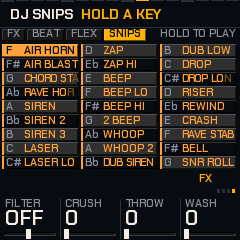

These are the sound effects that a DJ adds over the music during a set. The 27 keys, `F3` to `G5`, are:

AIR HORN (held), AIR BLAST (a short blast), CHORD STAB (the chord that plays now, with saw sounds), OH! (a voice: "oh!"), SIREN, SIREN 2, KICK, LASER, SNARE, ZAP, ZAP HI, BEEP, BEEP LO, BEEP HI, 2 BEEP, WHOOP, WHOOP 2, DUB SIREN, DUB LOW, DROP, DROP LONG, RISER, REWIND, CRASH, OH! LOW (the same voice, an octave down), BELL and SNR ROLL (a snare roll that gets faster).

The horns, the OH!s, the crash, the kick and the snare are samples (recorded sounds). The air horn, the kick and the OH! are recordings in the public domain (CC0, from freesound.org: see LICENSING.md). PERF-1's own models made the crash. The horns play on the root note of the chord that plays now. Tap AIR HORN for one short blast, tap it quickly for a run of blasts, and hold it for the long note. The OH!s play as recorded. The kick is a hard (rawstyle) kick. The snare is the snare of the Dusty kit, made into a sample. PERF-1 makes all the other snips at the moment that they play.

Up to four snips can sound at the same time (three when the unit starts to cut back, `S1`; two from `S2`). A snip plays when you press its key. Snips do not latch. A RISER, REWIND or SNR ROLL pressed again while it plays starts over.

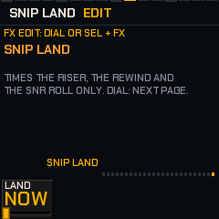

**Land** (the SNIP LAND page, after the SNIPS page) sets the timing of the RISER, REWIND and SNR ROLL. Set it to **Beat**, **2 beats** or **Bar**. Then these three snips time themselves to the next line of that type that is at least that far away. They start immediately, take exactly the time to get to that line, and reach their peak on it. The rewind pulls back into the downbeat, and the riser gets to its top on the line. The roll (on the grid: eighths, then sixteenths, then thirty-seconds) ends with the drop.

If Land is on Bar and you press one of these snips just after a bar line, it takes nearly two bars, because the next line is too near. They play to the line even if you release the key. **Now** (the default) plays them at once, with a length in seconds. The other snips always play immediately when you press the key.

The snips that have a pitch play in key. The horns, the stab and the riser start on the root note of the chord that plays now (the stab plays that chord). The sirens, beeps, whoops, the dub siren and the bell use the nearest note of that chord. All the snips have about the same loudness. The horns, sirens, stabs, crash, riser and roll are wide in stereo (in mono, nothing is lost).

The Snips settings page has four settings:

- **Pitch**: normal, an octave up, or an octave down.
- **Play**: HELD or ONE SHOT. In HELD, the long sounds (the horns, sirens, dub siren, riser and snare roll) continue for as long as you hold the key, and the other sounds play to their end. In ONE SHOT, every snip plays to its end, and the long sounds last about a second.
- **Echo**: dry, some or lots. This sets how much of the snips goes to the echo and the reverb.
- **Level**: how loud the snips are.

While the Snips page shows, the keys play the snips. Use this to try the snips.

### Settings pages

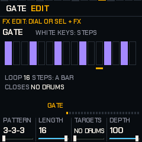

Each effect that has settings has its own page. The page shows a picture of what the effect does. There are four ways to go to a page:

- In the FX menu, hold **SEL** and press a key. The page for the effect of that key opens. If the effect has no settings, the screen tells you.
- From any page, hold **FX** for half a second. The page for the last effect that you used opens. If you did not use an effect yet, the first page opens.
- Press **SEL** + **FX** to go through the pages of all the effects, one by one, and then back to the keys. Talk and Wah come immediately after the phaser and the flanger. (The unit's own settings, for example Auto DJ, SET and MIDI IN, are a separate sequence of pages: hold **HOME**, section 13.)
- When a settings page shows, turn the **SELECT** dial to go to the next or the previous page. The dial stops at the first and the last page.

Press **FX** to close the page.

While its page shows, the effect is on, so you hear the changes that you make. The roll, riser, scatter, brake, half time, scratch, freeze and reverse swell make sound only while you hold a key. The dots on the right side of the knob strip show your position in the list of pages.

The four knobs, **KNOB1** to **KNOB4**, set the four settings on each page:

| Page | **KNOB1** | **KNOB2** | **KNOB3** | **KNOB4** |
|---|---|---|---|---|
| Gate (turns the sound off and on in a rhythm) | Pattern: 3-3-3, tres, offbeat, Euclid 5, 7 or 9, waltz, chop, sparse, dense, dotted, 5/10, custom | Length: 2-16 steps | Targets: no drums, pad, bass, acid, drums, hats, kick, all, no kick, kick+bass, pluck | Depth |
| Phaser (a sound that sweeps and moves around) | Rate | Depth | Feedback | Mix |
| Flanger (a sound like a jet plane that flies past) | Rate | Depth | Feedback | Mix |
| Vinyl (the crackle and hiss of a record) | Level | Crackle | Hiss | Tone |
| Tape (the sound of tape: a pitch that moves, and drive) | Wow | Flutter | Drive | Dull |
| Roll (repeats that get faster) | From: 1/2 to 1/64 | To | Each: 1/2, 1, 2 or 4 beats at a rate | Swell |
| Pump (the volume goes down and up in a rhythm) | Depth | Release | Every: 1/2, 1/4, 1/8, 1/16, or KICK (on each kick, wherever the kicks are) | Targets |
| Riser (a build-up: the sound climbs) | Time: about 1-12 s | Filter | Wash | Echo |
| Scatter (slices in a new order) | Chaos | Reverse | Slice: 1/32, 1/16, 1/8 | Slices: 2-8 |
| Brake (a record that slows down until it stops) | Time | Spin back | Return | Dull |
| Half time (plays at half speed) | Speed: x1.5, x2, x4 | Slide | - | - |
| Sweep (a filter that moves in time with the music) | Every: 8, 4, 2, 1 bar, 1/2, 1/4, 1/8 | Depth | Reso | Type: low, high, band |
| Scratch (a record scratch) | Every: 1/4, 1/8, 1/16, 1/32 | Reach: 1/16, 1/8, 1/4, 1/2 | Style: baby, pull | - |
| Freeze (holds the sound as a drone, a long steady sound) | Size | Spread | Grains: 1-4 | - |
| Rv swell (plays backwards and gets louder) | Length: 1/2, 1, 2 beats | Mix | - | - |
| Ring mod (a hard, metallic sound) | Tone: 40-800 Hz | Mix | - | - |
| Auto DJ (changes the sections for you; section 10) | Scenes: at once, next bar | Groove: 8, 16, 32, 64 bars, sync | Break: short, half, full | Fill: off, on |
| Auto FX (plays effects automatically; section 10) | Auto FX: off, gentle, medium, wild | Every: 4, 8, 16, 32 bars | Length: a beat, half bar, a bar, 2 bars | Pick: genre, any, yours (your gesture) |
| SET (gives a shape to a longer DJ set; section 10) | Rounds: 1, 2, 4, 8 | Ramp: off, +2, +4, +8, +12 BPM | Intro: off, 1, 2, 4, 8 min, break | Mix: cut, 4, 8, 16, 32 bars |
| Settings | Key: same, +2, +3, +5, +7 | Save: anytime, at stop | Form: Song, Few rests, No rests, Loop | Start: Last, Random |
| USB & MIDI | Level: knob, fixed | MIDI out: off, on | MIDI map: GM, M:Samples, MPC Sample, SP-404 | - |
| MIDI IN | Notes: keys, pads, M:S, MPK, chords | Channel: all, 1-16 | USB host: off, on (never kept) | Knob CCs: off, in, out, in+out |
| RESONATOR (percussion with a pitch; section 13) | Amount: 0 (off)-100 | Decay: 0-100 | Register: low, mid, high | Targets: perc, hats, snare, perc+hats, drums, pluck |
| RETURNS (the kick makes the echo and reverb quieter; section 13) | Duck: mix, off, custom | Depth: 0-100 (custom) | Release: 1/16, 1/8, 3/16, 1/4, 1/2, 1 bar (custom) | - |
| LINK (two units play as one band; section 14) | Link: off, auto, lead, follow, cable lead, cable follow | Plays: all, beat, top, drums, no drums | Sections: own, follow | - |
| FILTERS | Pad: low, high, band, notch, peak | Bass: the same | Acid: the same, and 303 | - |
| SCREAM | Drive: 0-100 | Scream: 0-100 | Wow: 0-100 | Target: acid, bass, both |
| SCREEN | Zoom: off, on | Saver: off, 1, 3, 10 min | Lights: off, show | Look: plain, scanlines, calm, calm+scan |
| SAMPLE (section 13) | Sounds: all, drums, synths, by key | FX: off, on | Gap: 0.5, 1, 2, 4 s | - |
| FILTER (G4) | Type: low ... peak, then Morph LP ... BP ... HP | Cutoff | Reso | Targets: all, drums, synths, one track, two |
| DELAY (A4) | Send | Repeats | Targets | - |
| PHASE (B4) | Rate | Depth | Mix | Targets |
| Repeat (the beat repeats on bank 2) | Pitch: -12 to +12 semitones | Decay: 0 to 6 dB for each repeat | Gate: full, 3/4, half, 1/4 | Refresh: off, beat, bar |
| Flex (Flex Beat) | Quant: off, beat, bar | Mode: one shot, loop | Mix | - |
| Snips (DJ snips) | Pitch | Play | Echo | Level |
| Snip land (after Snips) | Land: now, beat, 2 beats, bar | - | - | - |
| Talk (sounds like vowels) | Every: 2 bars, 1 bar, 1/2, 1/4, 1/8 | Depth | Reso | Mix |
| Wah (auto-wah) | Sens | Range | Reso | Mix |

What some of these settings mean:

- **Mix** is the balance between the plain sound and the effect. **Reso** (resonance) makes the filter ring and whistle at its setting. **Feedback** sends the effect back into itself, for a stronger result. **Targets** selects the parts of the music that the effect changes.
- **Gate patterns.** Euclid 5, 7 or 9 puts 5, 7 or 9 hits over the steps, with spaces that are as equal as possible. Custom is a pattern that you edit yourself (below).
- **Roll.** From and To set the speed of the repeats at the start and at the end. Each sets how often a roll occurs.
- **Riser.** Time sets how long the riser takes to climb. Filter, Wash and Echo set how much of each the riser builds up.
- **Settings page.** Key is the key change at the drop (section 13). Save sets when a piece that you store while the music plays is written: Anytime (at once, with a short dip) or At stop (when the music stops).
- **SCREEN page.** Zoom shows the name and value of a knob in large text when you turn it. Saver is the screensaver. Lights makes the key lights follow the music. Look adds scanlines (every second row is a quarter darker, like an old CRT TV) and Calm (the small movements on the screen are off).
- **USB & MIDI page.** Level sets if the USB audio follows the **MASTER** knob or stays at a fixed level. With a fixed level, a recording does not change when you turn the volume. MIDI out sends notes out through USB. MIDI map sets where the notes go (section 14).
- **Repeat page.** Pitch makes each repeat move toward that pitch over four beats while you hold the key, and this sounds like a build. Each repeat still starts on the beat grid. Decay makes each repeat quieter than the one before it, for a tail in dub style. Gate sets how much of each slice sounds: all of it, 3/4, half or 1/4. Refresh takes a new slice of the newest music every beat or bar (DJs call this a slip roll). Refresh works only when enough recent music is held in memory.

**The Gate page.** The white keys show the steps of the pattern. A key is lit where the gate opens, and a mark shows the step that plays now. Press a key to edit a step, and the pattern becomes "custom". A pattern of 12 or 10 steps against the bar of 16 moves away from the beat and then comes back to it. This is called a polymeter. **Gate 16** and **Gate 8** share this page.

PERF-1 keeps all of these settings, and the pattern and targets of the gate, when you power off (section 13).

---

## 10. Performing

These are the actions to play a set live. Most of them wait for the next bar, so all the music stays in time.

- **Breakdown: tap SAVE.** In the bar before the breakdown, the percussion, the open hi-hat and half of the hats stop, so the energy goes down. On the first beat of the next bar, the groove stops with a last kick, a crash and the root note of the bass. PERF-1 sends the echo hard at that moment, so the bar before continues to sound into the breakdown. Then the drums stop.

  In house, techno and dub, the kick continues. In drum and bass, industrial, forest and hip-hop, the hats continue (in hip-hop, the bass too). In breaks and funk, the breakdown has only the drums. The mix becomes darker, the bass filter closes and the pad becomes louder. The breakdown has no fixed length: it continues until you do the next action.
- **Build: tap SAVE again.** A snare roll goes up in pitch while the bass filter opens. The build lasts four bars. In lofi, trip-hop, hip-hop and ambient, it lasts two bars. In house, dubstep, DnB, psytrance and trance, it lasts eight bars. In the last bar, the open hat plays on every eighth note. In the four-on-the-floor genres (a kick on every beat), the kick comes back, and then the drop comes.
- **Drop: hold SAVE.** All the parts come back on the next bar. **SAVE** comes on during a breakdown or a build. It blinks while it waits for the bar.
- **Freeze: REC.** The chord stays and the reverb continues to sound. Press **REC** again to make the music move on.
- **Next chord: EDIT.** Goes to the next chord at the next bar. If your own progression plays, it goes to the next slot.
- **The scale: the keys on Global.** On the Global page, each key adds its note to the scale or removes it, on a keyboard picture of the scale. The root note always stays in the scale. On all other pages, the keys play a voice, so a key that you press by mistake never changes the scale. On Global and on the Chords page, **ALGORITHM** selects a mode (a ready-made scale). On all other pages, **ALGORITHM** sets the mood.
- **Patterns.** To change the drum pattern, turn **KNOB4** on the Drums page, or press **SEL** + white keys 1-6. A change waits for the next bar. If you turn the knob past several patterns, only the pattern where you stop plays.

**Drum drift** makes the drums change automatically while you play. Press **SEQ** four times to go to it. It is off by default. It has four settings:

- **Change** goes to the next pattern, or to a random pattern from pattern 1 up to the **Pool** number.
- **Every** sets how often a change occurs: after a set number of bars, or with each chord change. The bar before each change ends in a fill: the snare and hats play a roll into the change.
- **Pool** sets the highest pattern for a random change. A random change selects a pattern from pattern 1 up to this number.
- **Mutate** changes the pattern a little at the same moments. **Shift** moves one or two hits by one step. **Morph** also adds or removes a hit.

The kick and the clap always stay as written. A snare on a beat never moves. This keeps the groove steady.

The changes that Mutate makes stay in the pattern. To keep them, store the piece. Mutate also works when Change is off: then it slowly changes one pattern into a new pattern. Your Drum drift settings stay the same when you change the piece or the genre.

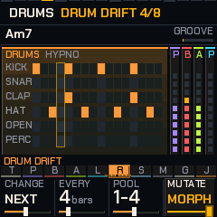

PERF-1 does not save songs. To keep a performance, record the audio (or the MIDI out) with the recording software on your computer. Keep the recordings that you like.

### The Perform screen

Press **HOME** on the Tempo page to go to this screen. From all other pages, press **HOME**, then press **HOME** again (not too quickly). The screen shows:

- the section that plays now (GROOVE, BREAK, BUILD) and how far the auto-DJ is through it
- the sixteen steps of the bar
- the eight tracks (kick, hats, snare, perc, bass, acid, pad, pluck) and their levels. A muted track has a line through it. A soloed track (the only track that you hear) is filled in.
- the four scenes
- the effects that are on
- the **mood**

On this screen, the keys control the track mix (the mix map, below). The knobs are the FX knobs, and **ALGORITHM** sets the mood.

With **SEL** held (here and on the visualizers), some keys move one part on: white keys 1-6 pick the drum pattern and **A#4** gives the drums their next pattern (both on the next bar), **F#4** makes a new acid line and **F#5** a new pluck line. A frozen line stays as it is (`FROZEN: KEPT`).

### The mix map (GLO held)

Use the mix map to mute and solo tracks and to recall scenes while you play. Hold **GLO**, and the screen shows the function of each key. On the Perform screen or on a visualizer, you do not have to hold **GLO**. When FX is closed, press the keys. The load meter shows at the top right only when there is a problem: after a dropout (a short gap in the sound), or when the engine does less work to keep up.

Each key shows its function as an icon and a name. A speaker with a cross mutes. Headphones solo. A snowflake freezes. Four squares recall a scene.

A mute stays on until you press the key again. The black key above a track solos that track, so you hear only that track.

The black keys of the hats, the snare and the perc freeze a part instead. (A solo of one drum was of little use.) Their icon is a snowflake. **freeze BASS** puts the bass on Pedal (the bass holds the key while the chords change, as on the Progression page). **freeze ACID** and **freeze PLUCK** keep that line as it is (as on its steps page, stored with the piece). Press the key again to release the freeze.

| Key | Does |
|---|---|
| F3 / F#3 | Mute / solo the kick |
| G3 / G#3 | Mute the hats / freeze the bass (Pedal) |
| A3 / A#3 | Mute the snare (with the clap) / freeze the acid line |
| B3 | Undo (press again to redo) |
| C4 / C#4 | Mute the perc / freeze the pluck line |
| D4 / D#4 | Mute / solo the bass |
| E4 | Tap tempo |
| F4 / F#4 | Mute / solo the acid |
| G4 / G#4 | Mute / solo the pad |
| A4 / A#4 | Mute / solo all four drums |
| B4 | Mute the pluck |
| C5, C#5, D5, D#5 | Scenes 1-4 |
| E5 | Reset all |
| F5 | Auto-DJ on / off |
| F#5 | Solo the pluck |
| G5 | DJ new pieces on / off |

**Scenes** are snapshots of your performance. You can go back to a scene at any time. A scene stores the latched effects, the mutes and solos, the positions of the FX knobs, and the groove. The groove is the density and source pattern of each drum lane, and the pattern that plays (it comes back from the next bar).

- **Tap** a scene key to recall the scene. If the music plays and the Scenes setting on the Auto DJ page is `NEXT BAR` (the default), the scene comes in on the next bar. In all other conditions, it comes in immediately. The FX knobs move smoothly to their stored positions in about a second.
- **Hold** a scene key for 0.6 seconds to store the current state.

PERF-1 keeps the scenes until you power off.

**Undo** (`B3`) puts back the state from before the last large change: a scene, a reset, a mute of all drums, or a clear. Press it again to redo.

**Reset all** (`E5`) turns off all latched effects, clears all mutes and solos, and puts the FX knobs back to their home positions. You can undo it.

**Tap tempo** (`E4`): tap it approximately four times in time with the beat that you want. The tempo becomes the average of your taps.

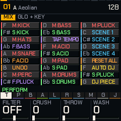

### The auto-DJ

The auto-DJ plays the breakdowns, builds and drops for you. Then you can give your attention to the effects and the mix. Press **GLO** + `F5` to start it. `DJ` shows in the header. The Perform screen counts the bars through each part. The auto-DJ goes through these sections, always on the bar:

1. A **groove** of 8, 16, 32 or 64 bars (16 by default).
2. A **drum fill** in the last bar of the groove, if Fill is on.
3. A **breakdown**: short (4 bars), half the length of the groove (at least 4 bars, the default), or full (as long as the groove).
4. A **build** (its length depends on the genre). The riser (a sound that goes up) climbs. The music stops for the last two sixteenth notes. Then the **drop** comes: all the parts come back together on the first beat. The drop has the kick, a clap and an open hat that rings like a crash. Usually the drop is on the home chord of the key.
5. The groove again.

Set Groove, Break, Fill and Scenes on the **Auto DJ** settings page. Groove has a fifth setting, **Sync**. With Sync, the groove continues until the chord changes. (**Drift** on the Tempo page sets how long a chord lasts.) The bar before a chord change is a fill. The bar of the change is the breakdown.

Turn on **DJ new pieces** (**GLO** + `G5`). Then the auto-DJ brings in the next piece in the bank on the bar of the fill. Thus the breakdown and the drop are part of the new piece. If you press **SAVE** yourself, the auto-DJ continues from that point. If the key change on the drop is on (section 13), the key changes on each drop.

### Auto FX

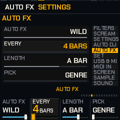

**Auto FX** plays effects automatically. It works as a DJ who adds a filter sweep or a tape stop before the next phrase. Turn it on from the **Auto FX** settings page. To get there, hold **HOME**, then turn **SELECT**. The page comes directly after Auto DJ. Auto FX works with or without the auto-DJ.

- **Each effect ends on a phrase line** (the start of the next phrase). When **Every** is at 8 bars, an effect leads into bar 9, 17, 25 and so on. The effect ends exactly when the next phrase starts. **Length** is the longest time that an effect can take: a beat, half a bar, a bar or two bars. Short effects, such as a throw or a tape stop, always stay short.
- **It selects the effects that suit the moment.** In a groove, it uses gates, repeats, sweeps and filters. In a breakdown, it uses washes such as the reverse swell, freeze and tape. In a build, it uses rolls and rising filters. At the end of a build (Medium and Wild), a stop, reverse, brake or spin-back leads into the drop. Auto FX plays no effect in the four bars after a drop.
- **It knows the genre.** When **Pick** is on Genre, the effects of each genre come four times as often. These are throws and tape in dub and reggae, the pump and filters in house and disco, scratches and repeats in breaks and funk, hat rolls and half time in trap and dubstep, and gates and flangers in psy. **Any** gives all the effects the same chance. **Yours** plays your own gesture instead. It plays the gesture once, complete, and ends it on the phrase line. To record a gesture, use SEL + REC in the FX menu (see the gesture recorder).
- **Auto FX** sets the amount. **Gentle** uses only washes and sweeps. **Medium** adds gates, filters, repeats and rolls. **Wild** adds stops, brakes, scatter and half time. Auto FX never plays the same effect twice in a row. Sometimes it skips a phrase line (more often at Gentle).
- **It does not interfere with you.** No automatic effect plays while you hold or latch an effect yourself. When you play an effect, the automatic effect stops immediately. Auto FX also waits while the FX menu is open, during the intro, and when the music is stopped.

The header shows the name of each effect while it plays. The settings stay after power-off.

The **SET** settings page controls a longer set. Hold **HOME** to see the settings. The SET page comes after Auto FX on the dial.

- **Rounds** gives each piece 1, 2, 4 or 8 rounds before DJ new pieces goes to the next piece. A round is one groove, breakdown, build and drop. The header and the Perform screen count the rounds, like `R2/4`.
- **Ramp** makes the tempo increase during the rounds of groove of a piece, by +2, +4, +8 or +12 BPM. The tempo increases one BPM at a time. If you change the tempo manually, the increase continues from the new tempo. The next piece starts at its own tempo.
- **Intro** builds up the music slowly from silence. When you press Play, the tracks come in one at a time over 1, 2, 4 or 8 minutes. The pad starts in the first bar. Then the hats, the perc, the kick, the snare, the bass, the pluck and last the acid come in. Each track comes in a seventh of the way further through the intro. This is useful when you mix in from another deck. It is also useful when you scratch or sample over only a pad and a hat. The header counts down, like `INTRO 1:42`. The auto-DJ stays in its groove until all the tracks are in. To start the intro again, stop the music and press Play again. **Break** is different. With Break, a piece that you start with PLAY or select with PRESETS starts in its breakdown. Thus you can go from piece to piece through a breakdown. Then you bring in each piece with **SAVE** (the build, then the drop). The new pieces that the auto-DJ brings in do not start in a breakdown.
- **Mix** changes pieces as a DJ changes records. A piece can come in on the bar: the next piece from the auto-DJ, the next slot of the set list, or **SEL** + **PRESETS**. This piece starts at the tempo that was playing. Then its tempo changes slowly to its own tempo over 4, 8, 16 or 32 bars. **Cut** changes immediately to the new tempo, as before. Some set lists go from a slow piece to a fast piece. With these set lists, a long Mix moves the tempo of the whole set up (or down) smoothly. If you turn the tempo manually, the slow change stops at the tempo it has.

### The set list

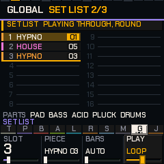

A set list is a list of the pieces that you want to play, in your order, from any genres. To open it, press **GLO** twice (Global, then **Set list**).

| Knob | Setting | What it does |
|---|---|---|
| **KNOB1** | Slot | The slot that you edit, from the 16 slots. The first 16 white keys also select a slot. |
| **KNOB2** | Piece | The piece in the slot. You can select the ten pieces of each genre in turn (`HYPNO 01` ... `AMBIEN 10`: the genre's name cut to six letters). If you turn it on an empty slot, the piece that plays goes into the slot. To clear the slot, turn the knob fully down to *Empty*. |
| **KNOB3** | Bars | How long the slot plays: *Auto* (the rounds of the auto-DJ, as before) or exactly 4, 8, 12, 16, 24, 32, 48, 64, 96 or 128 bars. |
| **KNOB4** | Play | *Loop* or *Once*: the set list replaces the bank (see below). *Once* stops after the last slot. *Loop* plays the list again. |

**Black keys 1-5** remove a part from the slot, or put it back: pad, bass, acid, pluck, drums. The parts line along the bottom shows the slot that you edit. The parts that you removed have a line through them.

**Hold SEL** for two more settings. **KNOB2** is the **Pattern** of the slot (*Piece's*: the pattern that the piece plays, or drum pattern 1-6). **KNOB3** is the **Energy** of the slot (*As is*, or the mood from 0, chill, to 100, peak). Energy is the same macro (one control for many settings) as the mood fader on Perform. These settings start to work when the slot comes in. While you hold SEL, the line along the bottom shows them.

**A song from the set list.** Give bars and parts to each slot, and the list plays as a song. Each slot plays for exactly its bars, from the bar where it comes in, with only its parts. Then the next slot plays. For example, slot 1 has a piece for 8 bars, with only the pad and the pluck, at energy 30 (an intro). Slot 2 has the same piece for 32 bars, with all the parts, on pattern 1. Slot 3 has it for 16 bars without the drums (a break). Slot 4 has it for 32 bars on pattern 3 at energy 85 (the peak), and Play is on *Once*.

When the next slot has the same piece, the piece continues and does not start again. Only the parts, the pattern and the energy change, on the bar line. Press **PLAY**. The song plays through and stops, and the first slot is ready again. A line along the bottom of the slot that plays shows how far it is.

The song makes its own changes:

- **Into a slot that brings the drums in, or lifts the energy by 25 or more:** the slot before it ends with a build over its last bars. The build has the length of the genre, but it is not more than half of the slot. If that slot had the drums out, the drums come in for the build. The next slot starts on the drop.
- **Into a slot without the drums:** the slot comes in as a breakdown. The groove releases on the one (the first beat of the bar).
- **Any other change:** a drum fill in the bar before.

In the example above, the intro builds into slot 2. Slot 3 comes in as a breakdown. Slot 3 builds into the peak.

With **Play** on:

- **PRESETS** goes to the next or the previous slot in the list, across genres. It does not go to the next piece in the bank. If you hold **SEL** while the music plays, the slot waits for the next bar. The header shows `SET 2/5` and the title of the piece.
- The **auto-DJ** brings in the next slot, not the next piece in the bank. (DJ new pieces does not have to be on.) It changes on the bar of the fill, after the **Rounds** of the piece. Thus the breakdown and the drop are part of the new piece. If a slot has **Bars** set, the slot changes when its bars are complete. The breakdowns and builds of the DJ still come in between.
- The set list skips empty slots. After the last slot, it goes back to the first slot.

The list on the screen shows the genre and the piece of each slot. The slot that plays is bright. The slot that you edit has a bar behind it. The white keys light the slots that are in use. The key of the slot that plays blinks.

### Track codes

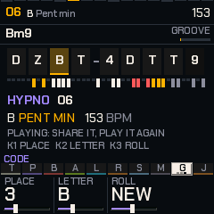

Each time you press **PLAY**, PERF-1 starts a new track. It gives the track a code of nine letters, like `DZBT-4DTT9`. The screen shows the code when the music starts (`PLAYING DZBT-4DTT9`). The code holds the genre, the piece, the key, the mode, the tempo, and the dice (the random values) that each generator starts from. If you start the same code again, you hear the same track, note for note from the start. You hear the same chords, drums, bass line, acid and pluck. When you like a track, write down its code, or share the code in a comment.

To open the Code page, press **GLO** three times (Global, Set list, **Code**). The page shows the code that plays on nine tiles, and a strip of its bits. It also shows what the code starts: the genre and piece, the key and mode, and the tempo.

| Knob | Setting | What it does |
|---|---|---|
| **KNOB1** | Place | The letter that you change (the tile with the bar). |
| **KNOB2** | Letter | The letter in that place. The last letter is a check letter, and it comes from the other letters. Thus one wrong letter shows as `NOT A CODE`. |
| **KNOB3** | Roll | A new code with the same genre, piece, key and tempo, but other dice. Each turn gives a different code. |

**PLAY** on the Code page starts the code that shows. This is the code that you typed or rolled, or the track that plays, again from the start.

What a code keeps and what it does not keep:

- A code gives the piece as it comes (its recipe), in the key, mode and tempo of the code. If you changed the piece (a knob, a pattern, a stored version), the page shows `EDITED: THE CODE GIVES THE RECIPE`. The code still starts the track, but without your changes. To keep your changes, store the piece and share it through the library.
- The same track plays while you let it play without changes. If you turn a knob or play a key, the track changes from that point. A scene, the FX or a change from the auto-DJ also change the track from that point.
- If you start the music while the pad still rings, the first sound of the pad can be different. The notes are the same.
- Codes are for this firmware. A later version can change how the generators work. Then an old code starts a different track.

The FM-1 keeps the set list together with the theme, Tune and MIDI out. The set list plays your stored pieces as you stored them, and the factory pieces as they come.

### Mood

Mood is one control that makes the whole piece calmer or more intense. **ALGORITHM** sets it on all pages except Chords and Global. On those two pages, **ALGORITHM** selects the mode. 0 is chill, 100 is peak, and 50 (the middle, and the default) keeps the piece as it is.

The more you turn from 50, the more Mood changes these:

- the density and the filter cutoff of the acid (how bright it is)
- the levels of the hats and the perc
- the brightness of the pad
- the density, level and decay of the pluck (shorter toward peak)
- the cutoff and the drive of the bass
- the reverb and the echo (less toward peak)
- Evolve
- the level of the drums

Mood changes what you hear, but it does not change the stored piece. When you change the piece, Mood stays where you set it. The FM-1 does not keep Mood when you power off.

### The keys' lights

On most pages, the key lights show the scale. While the music plays, the notes of the chord that plays are bright, and the other notes of the scale are dim. Thus you can see which keys fit at this moment. When the music is stopped, all the notes of the scale are lit.

### Jam

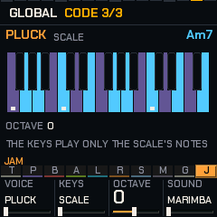

The **Jam** page changes the 27 keys into an instrument, so you can play with the music. Turn the **SELECT** dial to it. It comes after Global. Some pages are not the page of a voice (Tempo, the drums, the mixer and so on). On these pages, the keys also play with the Voice, Keys and Octave of the Jam page.

| Knob | Setting | What it does |
|---|---|---|
| **KNOB1** | Voice | The sound that you play: the pluck, the pad, the acid or the bass. While the page shows, that part stops its own line. The part plays its line again when you leave the page. |
| **KNOB2** | Keys | *Scale*: each key plays a note of the scale. A black key plays the scale note at or below it, so there are no wrong notes. *Chords*: each key plays a three-note chord (a triad) from the scale. *Harp*: the keys play the notes of the scale in order, one note for each key, from C3. *All 12*: each key plays its own note, all twelve notes of the octave, in the scale or not (for chords from outside the scale, or a melody with notes outside it). A MIDI keyboard on **Keys** plays the same way. |
| **KNOB3** | Octave | -2 to +2. |
| **KNOB4** | Sound | The sound of the voice that you play: the DX voice of the pluck, or the sound of the pad, the acid or the bass. It is the same setting as on the page of that voice, and it is saved with the piece. |

The page shows a keyboard. The notes of the scale are lit, and the keys that you hold are bright (orange). While the music plays, the notes of the chord that plays are blue. The name of the chord is in the top right, like `Am7`. If the level of the pluck is almost fully down, the level goes up to 40 when you play the pluck. Then you can hear it.

**Accents (SEL).** The keys of the FM-1 cannot sense how hard you push them. To play an accent, hold **SEL** while you play a key. An accent is a louder note. On the acid, it is a full accent (brighter, with more punch). On the Jam page, SEL + a key always plays a note. It does not change the pattern as it does on other pages.

**The phrase recorder (REC on the Jam page).** Use it for a line that is longer than a bar, with long notes and rests. Record the line while you play it:

1. Go to the Jam page. Make sure that the music plays and that the voice is the **pluck**, the **acid** or the **bass**. Press **REC**.
   The header shows `ARM` and REC blinks: the recorder waits for you. (On the Jam page, REC is the phrase recorder. On all other pages, REC is still Freeze.)
2. Play. Your first key starts the recording (`REC`), from the start of the bar that you are in. The recorder writes each key on its sixteenth note,
   with the time that you held it. Hold **SEL** for an accent.
3. Press **REC** to stop the recording at the end of the bar that you are in. (After four bars, it stops automatically.) If you press REC on the one (the first
   beat of the bar) or just after it, the recording ends with the bar before. Thus you can push REC on the downbeat, as on a looper. From then on, the phrase plays again and again,
   exactly as you played it. Long notes stay long, and rests stay rests. The line of the voice is off while the phrase plays. The header shows `PHR`.
4. Press **REC** again on the Jam page (or **SEL** + **REC** on any other page) to release the phrase. The line of the voice comes back.

A phrase of one bar is also written into the line of the voice (as Capture does, below). Thus the phrase stays when you save the piece. Longer phrases play
until you release them. They are not saved with the piece. The notes play as you played them. When the chords change under a long phrase, the phrase
does not follow them.

On the **pluck**, a chord (the **Chords** mode of the Jam page) plays back as the full chord, with the same notes that you heard. The
acid and the bass play one note at a time, so they record a chord as its root (the note that gives the chord its name). (The line of the pluck keeps one note for each step. Thus a
one-bar phrase that goes into the line keeps the root of the chord. The phrase itself plays the chord.)

**Capture (SEL + REC).** The fastest way to write a riff (a short musical line) is to play it. Capture takes the bar that you played last on the Jam page. (Of the last
four bars, it takes the bar where you played the most.) Capture makes that bar the line of that voice, as you played it. It sets each note against the chord that played under it. If you played a
key a little early, Capture puts it on the step that you meant. The line starts where the bar starts:

- With the voice on **acid**, the bar goes into the Acid steps page as a 16-step line, set to **Frozen**. Each sixteenth where you played a key gets that note. The notes are stored relative to the chord at that time, so the line follows the chords from then on. A key that you played on a beat becomes an accent (a louder note). A key that you hold sounds for as long as you held it. The steps that it covers get the same note, with a slide from the note before. Thus it plays as one long note (the tie of the 303). The line plays when you leave the Jam page.
- With the voice on the **pluck**, the bar goes into the Deja vu loop, set to Loop 16, Rate 1/16 and Pluck vu 100. The loop starts at the next bar line. To let the line change again, turn Pluck vu down.
- With the voice on the **bass**, the bar goes into the Bass steps page, and the Mode of the bass line changes to Steps. Each note becomes a scale step
  above the root of the chord, in the octave nearest to the note that you played. A key on a beat is an accent. A key that you hold continues to sound. The steps that it
  covers become **Hold** steps, so the note lasts as long as you held it. (If you still hold the key when you press **SEL** + **REC**, the note lasts to the end of the bar.)
- You cannot capture the pad.

Capture remembers your last 32 key presses. First, play the bar on the Jam page. Then press **SEL** + **REC** (on the Jam page or on any other page). The header shows `CAPTURED`.

---

## 11. Mixing: the mixer, space and the master bus

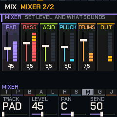

The **Mixer** page sets the balance between the parts. Turn the **SELECT** dial to it. It is between Comp/Limit and Global. It works on one layer at a time.

| Knob | Does |
|---|---|
| **KNOB1** | Selects the layer: pad, bass, acid, pluck or drums. |
| **KNOB2** | The level of the layer. It is the same level as on the page of the layer. |
| **KNOB3** | The **pan** of the layer: its position from left to right, L100 to R100. It works like a balance knob. The middle keeps the sound as it was. |
| **KNOB4** | The **send** of the layer: how much of the layer goes to the echo and the reverb. 50 is as it was, 0 is none, 100 is twice as much. |

The page shows a strip for each layer. Each strip shows the level that you set (the fader, with its number). It also shows the level that you actually hear (the meter next to the fader). A muted track shows an `M`. A soloed track shows its name in the highlight colour. The last strip shows the peak level of the output. The layer that you selected has a frame around it, with a tick below it that shows its pan. The piece keeps all the settings on this page.

**Space** and **Reverb** are the pages for the echo and the reverb. The echo is in time with the tempo: 1/8, 3/16, 1/4, dotted 1/4, 1/2 or 1 bar. **Echo** sets how much the echo repeats. **Reverb** sets how much sound goes into the reverb. **Size** sets how long the reverb tail is (the sound that continues after the note).

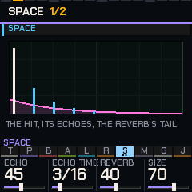

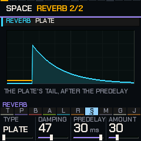

The **Reverb** page selects the type of reverb:

| Type | What it is |
|---|---|
| Plate | A classic, smooth reverb. Amount has no effect. |
| Shimmer | The tail moves up an octave and goes back into the reverb, so it sounds bright. Amount sets how much goes back. |
| Gated | The tail opens with the sound, stays open for a set time, and then stops sharply (in about 10 ms). Amount sets that time, from 80 to 400 ms. |

**Damping** (0-100, 47 by default) makes the reverb lose its high sounds. Higher settings sound darker. **Predelay** (6-30 ms, 30 by default) is a short gap before the reverb starts. This gap keeps the sound clear.

Each genre sets its own damping and predelay. Lofi and dubstep are darker. House is brighter and shorter. Drum and bass and trap use the shimmer. Breaks and electro use the gated reverb. The page shows the tail for the type that you selected.

### The master bus

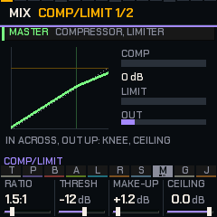

The master bus is the last stage before the sound goes out of the FM-1. It makes the volume more even and stops clipping (distortion when the sound is too loud). After the effects, and before the **MASTER** volume, the mix goes through two stages:

- a **compressor**. It turns the loud parts down, so the mix sounds tighter and more even. It works on the two sides of the stereo together.
- a **limiter**: a hard ceiling that the sound cannot go above. It looks a moment ahead (it delays the sound by about 1.4 ms, which is too short to hear). Thus it is ready before a peak comes. It releases over about 60 ms.

After the **MASTER** volume, there is also a gentle soft clip as a last protection.

| Knob | Range | Does |
|---|---|---|
| Ratio | Off, 1.5:1, 2:1, 3:1, 4:1, 6:1, 10:1 | How strongly the compressor reduces the sound. Higher is stronger. It starts gently (a 6 dB soft knee). |
| Thresh | -30 to 0 dB | The threshold: how loud the sound must be before the compressor starts to work. |
| Make-up | 0 to +12 dB | Turns the sound up again after the compressor. |
| Ceiling | -12 to 0 dB | The ceiling of the limiter, before the **MASTER** volume. |

The compressor does not listen to the deep lows (below about 100 Hz). Thus the kick and the sub do not pull the whole mix down on each beat. It
reacts in 10 ms, so the hit of a drum gets through before the compressor turns it down. This keeps the punch.

The compressor releases in about 80 ms. It releases more slowly (up to half a
second) when it turns the sound down a lot. On average, it gives back most of what it takes. Thus the level stays near where it was, and
the knobs change the feel, not the volume.

The page shows the curve of the compressor. The sound that goes in is along the bottom, and the sound that comes out is up the side. The dotted line is where the input and the output are equal. The vertical tick is the threshold, and the horizontal tick is the ceiling. There are also live meters: **COMP** (how much the compressor turns the sound down), **LIMIT** (how much the limiter turns it down) and **OUT** (the peak of the output).

The piece keeps the four settings. The default is a light 1.5:1 at -12 dB, with +1.2 dB of make-up. Each genre has its own settings. Lofi and garage use 2:1. House, drum and bass and electro use 3:1. Breaks, dubstep and trap use 4:1 with more make-up. The ceiling of the limiter is 0 dB in every genre but HYPNO, so it only catches sounds that would clip. HYPNO squeezes harder: 6:1 at -18 dB, +8.4 dB of make-up and the ceiling at -6 dB (a few of its pieces have their own).

---

## 12. Shift

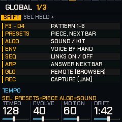

**SEL** is the shift button. When you hold **SEL**, the keys, buttons and knobs do different things:

| Hold SEL and press | What happens |
|---|---|
| White keys 1-6 (F3 G3 A3 B3 C4 D4) | Changes to pattern 1-6 at the next bar. The key of the pattern that you selected lights up. The key of the pattern that plays now flashes until the change. If you tap the key, the new pattern stays. If you hold the key for more than a quarter of a second, that pattern plays only while you hold the key. When you release the key, the previous pattern comes back at the next bar. Use this to play pattern 5 or 6 as a held variation. |
| **PRESETS** | The next or the previous piece starts at the next bar. Until the change, the screen shows `PIECE 03 NEXT BAR`. |
| **ALGORITHM** | Goes through the sounds of the voice on the screen (pad, bass, acid, pluck), one at a time. On the drum pages, it goes through complete kits. |
| **SEQ** | Turns the links on and off (a link sends a drum hit into a voice, section 7). |
| **ENV** | On a pad, bass or acid page: removes that voice from the automatic part. The voice then plays only the notes that you play by hand. Press again to give the voice back to the automatic part. |
| **FX** | Goes through the settings pages of the effects, one at a time, and then back to the keys. |
| A key in the FX menu | Opens the settings page of that effect. |
| **GLO** | Remote: the panel of the FM-1 plays the emulator (section 17). This works only when the music is stopped, because it stops the music. If the music plays, the screen shows `STOP FIRST`. |
| Black keys 1-6 (in the sequencer) | Copies the pattern that you edit into pattern 1-6. Without SEL, the black keys in the sequencer select the source of the lane (section 8). |
| **OCT-** (in the sequencer) | Clears the lane of this drum. |
| **OCT+** (in the sequencer) | Sets the lane of this drum back to the piece's own pattern. |
| **KNOB1**-**KNOB4** (in the sequencer) | Euclid, rotation, probability, lane length. |

While you hold SEL, the keys do not play notes or effects. If you hold SEL alone for a moment, a card comes on the screen. The card shows what shift does on the page that is open.

---

## 13. Settings, visualizers and what is remembered

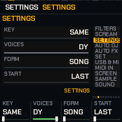

To open the **settings**, **hold HOME** for just under a second (0.7 s). Do not turn anything while you hold it. The settings pages are a separate series from the effects pages. Turn **SELECT** to go through **FILTERS**, **SCREAM**, **Settings**, **Auto DJ**, **Auto FX**, **SET**, **USB & MIDI**, **MIDI IN**, **SCREEN**, **SAMPLE**, **SOUND**, **CHORUS**, **RESONATOR**, **RETURNS** and **LINK**. The series stops at the first page and at the last page. Press **FX** to close the settings.

FILTERS and SCREAM come first because they belong to the piece. Each piece keeps its own FILTERS and SCREAM settings, and they are saved with the piece (**GLO**, then **SAVE**). A piece without these settings plays the defaults.

The Settings page:

| Knob | What it does |
|---|---|
| Key | A key change for the drop (the moment when the groove comes back): same, +2, +3, +5 or +7 semitones. When a breakdown or a build ends and the groove comes back, the whole piece moves up by this value for that round. The next breakdown, a stop or another piece moves it back. While the key change is on, `KEY` shows in the header. |
| Save | Sets when the FM-1 writes a store to memory while the music plays. **Anytime** (the default): at once. The write pauses the FM-1 for a moment, so the music fades out and back in around it. **At stop**: the FM-1 stores the piece immediately (it plays and shows as stored), but writes it only when you stop the music. Thus nothing fades. The settings of the effects and the other settings also wait for the stop. Stop the music before you switch off, or the store is lost. If you change the genre while a store waits, the FM-1 writes the store first, with the usual fade. |
| Form | **Song** (the default): a piece goes through its own drum patterns. A new pattern starts every 8 bars (16 in the slower genres), with a fill just before each change. Thus it plays like a track. Song also arranges the parts. Sometimes a phrase rests the pluck or the acid (or both) for half of the phrase. The bass can stop for the fill bar and come back on the change. The pad always plays. If a set-list slot has its own bars, you do the arranging. **Few rests** is Song with those rests half as often. **No rests** is Song with no rests: every part plays every bar. **Loop**: the piece stays on its first pattern. Use it when you want to control the piece yourself. If you set Drum drift (**SEQ** x4), your drift plays instead, in Song and in Loop. Song keeps the feel of the beat. When it moves to a pattern with a different feel (for example, half time after four on the floor), the kick, snare and clap stay as they were. Only the hats and perc move to the new pattern. |
| Start | **Last** (the default): the FM-1 starts with the piece that you played last, as it is saved. Unsaved changes are not kept: save with **GLO**, then **SAVE**. **Random**: a random piece of HYPNO, as in older versions. |

### The SCREEN page

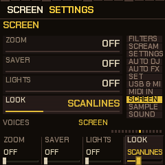

| Knob | What it does |
|---|---|
| Zoom | Off or on. When Zoom is on and you turn a knob, the name and value of the knob show in large text in the middle of the screen for a second. This occurs on all pages. Use it when you play at a distance, outdoors, or on camera. |
| Saver | The screensaver: off, 1, 3 or 10 minutes. If you do not touch the FM-1 for that time while it plays, the visualizers (the AUTO visualizer) fill the **whole screen**, with no header and no knobs. Any key, button or knob shows the page again. The screensaver does not come on in the FX menu or when a visualizer already shows. |
| Lights | Off or show. With show, the key lights move with the visualizers. In a groove, two moving lights chase each other, and the lights flash on the kick and snare. In a breakdown, they pulse slowly. In a build, they fill up. |
| Look | Plain, scanlines, calm or calm+scan. **Scanlines** makes every other row of the screen darker by a quarter, like an old CRT TV. **Calm** stops the small movements of the screen: the imp that jumps into the header on a drop, a break or a build, the brighter flash of a knob when you turn it, and the short time that a new page takes to settle. The movement of the music (the steps, the meters) stays. |

### The sampling helper (SAMPLE)

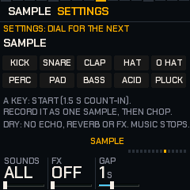

The **SAMPLE** page plays the sounds of PERF-1 one at a time. Thus a sampler (for example, an MPC that samples its input) can record them, and your project keeps them without the FM-1. The page comes after SCREEN.

| Knob | What it does |
|---|---|
| Sounds | **All**, **Drums** or **Synths**: press any key to start a run. **By key**: each white key plays one sound. |
| FX | **Off** (dry): no echo, reverb, effects or FX knobs while the page shows. **On**: the piece's own effects. |
| Gap | The time between sounds in a run: 0.5, 1, 2 or 4 seconds. Use a longer gap for the tails of the pad and the bass. |

**A run.** Start the recording on your sampler. Then press a key. The music stops, and there is a count-in of 1.5 seconds. Then each sound plays one time, with the Gap between them: the six drums (kick, snare, clap, hat, open hat, perc), then the pad (a chord), the bass, the acid and the pluck. Each sound is on the root of the scale. Record the run as one sample and cut it into pads. To stop before the end, press a key again.

**By key.** White keys 1-6 are the drums. White keys 7-10 are the pad, bass, acid and pluck. A synth sound continues while you hold the key. The ten keys are lit while the page shows.

The sounds come from the piece that was playing: its kit, its sounds, its key. Select the piece first. Then open the page.

### The SOUND page

This settings page comes after SAMPLE. It changes how all the parts sound together. These are the settings of the unit. They are the same for every piece.

| Knob | What it does |
|---|---|
| Vintage | The pitch of each voice moves a little and slowly, each voice in its own way, as on an analog synth: the four voices of the pad, the bass, the acid and the pluck. 0 is off. At 100, the pitch moves up to 12 cents. The default, 30, is about 4 cents: you hear it as warmth more than as detuning. |
| Polish | **On** (the default): the lows become mono. The stereo sound below about 140 Hz goes to the middle, as a club system or a phone plays it anyway. Also, the loudest peaks are made round just before the limiter, so the limiter has less to catch. **Off**: the lows stay in stereo and the peaks go straight to the limiter. |
| Tilt | A gentle tone balance on the whole mix: **Genre** (the default: the balance of each genre, a dB or two at most), **Warmer** (more low end, a softer top), **Brighter** (more top), or **Off**. |
| Width | How much wider the top end is (the stereo sound above about 2.5 kHz): 0 adds nothing, up to +6 dB. The default is 30. Mono sound stays as it was. |

### The CHORUS page

This settings page comes after SOUND. It is a chorus in the style of the Juno-106 chorus, and it makes the pluck and the acid wide. As on the Juno, a slow triangle sweeps one short delay. It sweeps the other side in the opposite direction. The chorus mixes this with the dry sound. The lows (under about 200 Hz) stay dry in the middle, so the low end stays mono. These are the settings of the unit, the same for every piece.

| Knob | What it does |
|---|---|
| Type | **Off**, **I** (the default since 0.17.54: slow and deep, about half a sweep a second), **II** (a little faster, the classic wide Juno pad), **I+II** (a fast, shallow shimmer, almost a vibrato), or the two speeds of a rotary speaker: **ROT SLOW** (about 0.8 turns a second) and **ROT FAST** (about 6.7). The rotary moves the sound from side to side with a small change of pitch, like the turning horn of an organ. When it changes from one speed to the other, it gets faster or slower over about a second, as the real one does. Try it with an organ DX voice on the pluck. |
| Target | What goes through the chorus: the **Pluck** (its plain sounds and its DX voices; the chorus replaces the ensemble of the DX voices), the **Acid**, or **Both**. |
| Pad | The pad's own ensemble chorus (0-100). The genres set it between 20 and 50. It makes the pad wider, like several players at the same time. It belongs to the piece and is stored with it (before 0.17.82, it was on the Pad's Chords page). |

The level stays where it was, and in mono nothing is lost. When the load is very high, the chorus switches off automatically, as the pad's chorus does.

### The RESONATOR page

This page comes after CHORUS. It has three ringing filters, tuned to the chord that plays (its root, third and fifth). The drums that you select strike them. A rim, a perc tick or a hat then sounds pitched, in the key. The ringing follows each chord change. These are the settings of the unit, the same for every piece.

| Knob | What it does |
|---|---|
| Amount | How loud the ringing is: **35** by default (0.17.54). **0** is off. |
| Decay | How long it rings. Low is short and woody (a marimba, a log drum). High is long and glassy (a bell, a steel tine). The level stays almost the same across the range. |
| Register | Where the three notes are: **Low**, **Mid** or **High**. |
| Targets | What strikes the filters (**Perc** by default): the **Perc**, the **Hats**, the **Snare** (and clap), **Perc+Hats**, all the **Drums** except the kick, or the **Pluck**. |

The ringing is about equally loud in all pieces. It follows how hard the sound strikes it, not the level of that track. The first note is in the middle, the second a little to the left, the third a little to the right, with some reverb. With the **Pluck**, it rings only when the pluck plays in the octave of the Register: try each Register. Try Perc on an Industrial piece, or Hats with a long Decay on an ambient piece. When the load is very high, it switches off automatically.

### The RETURNS page

This page comes after RESONATOR. It sets how the kick ducks the returns of the echo and the reverb (the sound that comes back from them). Thus a repeat or a tail gets louder between the kicks, and does not smear over them. Only the returns change. The dry sound, the sound that goes into the echo and the reverb, and the repeats of the echo do not change. These are the settings of the unit, the same for every piece.

| Knob | What it does |
|---|---|
| Duck | **Mix** (the default): the returns duck as the rest of the mix ducks under the kick, about 3 to 7 dB (more with the drums louder). **Off**: the returns stay steady. **Custom**: your own depth and release, with the two knobs below (to about 16 dB down). |
| Depth | With Custom: how far the returns go down on each kick, **60** by default. 100 is the deepest. |
| Release | With Custom: how long the returns take to come back, in the tempo: **1/16** (fast) to **1 bar** (they rise and fall with the bar). Mix's release is about 3/16. |

The kick must play, or nothing ducks. The returns are a small part of the sound of most pieces. Thus the change is small until you turn up the echo or the reverb. Try a dub throw (THROW, or the DELAY punch-in on the snare) over a four-on-the-floor kick with Custom, Depth 100, Release 1/2.

### Visualizers

The visualizers are animations that move with the music. To open them from any page, press **HOME twice quickly**. Press **HOME** again to go back to the Perform screen. Turn the **SELECT** dial to select a visualizer. The FM-1 remembers your selection.

While a visualizer shows, the knobs are still the FX knobs, **ALGORITHM** still sets the mood, and the keys still set the track mix, as on Perform. **FX** opens its menu over the picture. All drawings use the colours of your theme. They follow the kicks and snares, the level of each part, the chord, the pattern and the section.

| Visualizer | What you see |
|---|---|
| PLASMA | A field of colour that turns faster when the music gets more intense. It flashes on the kick. |
| KALEIDO | Curves made from the sound, mirrored four ways like a kaleidoscope. They turn and fade. A kick sends out a ring. |
| BARS | A real spectrum analyser (each bar shows the level of one range of sound): 24 bars from 70 Hz (low) to 10 kHz (high). |
| FLUX | A light show in the style of a media player: the spectrum folds back on itself into a shape that opens out like a flower. |
| DISCO | The mascot dances in a room with a disco ball, light beams and a floor. The floor lights up with the drum pattern. He jumps on the kicks and changes moves every couple of bars (sway, twirl, wave, headbang, stomp). He sleeps in a breakdown, shakes in a build, and jumps with confetti on the drop. |
| LIFE | A pattern of cells in the style of the Game of Life. The drums add cells: the kick adds a cluster, the snare a spray, a hat a spark. |
| ORBIT | A line drawing that loops (a harmonograph), made from the notes of the chord. Its shape changes with every chord. |
| TRIP | A kaleidoscope that you fall through: mirrored slices (six, or eight when the chord has four notes) come quickly towards you. The kick pushes you forward and the picture pulls in. The snare turns the twist the other way. A build makes the twist tighter bar by bar. The hats make sparks. In a breakdown, the picture drifts. |
| THEORY | The harmony as it plays, drawn like the circle of fifths in a theory book. **The circle:** C is at the top. Each step clockwise is one fifth higher. The inner ring shows the **key signature** of each key (0, 1#, 2# .. 6#, 5b .. 1b). The signature of your key is lit, so you can read "E major has 4 sharps" directly from it. The scale is **one arc** on the circle (the seven notes of a mode are always neighbours on the circle of fifths). Each chord has its **Roman numeral** on the arc (upper case is major, lower case is minor, ° is diminished). The colour of each numeral shows its job, in the groups that theory books use: the tonic's family (I, iii, vi) has the pad's colour, the subdominant's family (ii, IV) has the bass's colour, and the dominant's family (V, vii) has the acid's colour. The name of the function shows on the right in the same colour. The chord that plays is filled, and the next chord has a ring. A curved arrow goes from one to the other. The next chord comes from your progression, or from the genre's own progression, which the FM-1 selects one chord ahead. The last move stays for half the chord and then fades. Thus you see the progression jump around the circle. The outer ring names every note **the way the key spells it**: G# in E major (not Ab), Cb in Eb minor, E# in F# major. The notes of the chord are marked. A note borrowed from outside the scale, like the G# in the E7 of A minor, is **red**. **The right side:** the numeral of the chord, its name and its notes (with the same spelling). Then what the chord does (tonic, subdominant, dominant ..; **V OF THE NEXT** in red when the genre makes it the dominant of the next chord, **BORROWED** when it comes from the parallel minor). Then the next chord and how the root moves to it (a fifth down, a step up; "home" when it falls a fifth to the tonic). Then the eight slots of your progression as a chord chart. At the bottom: the key and its signature, with the major key that it is written in ("0: C MAJOR" for A minor). When your progression is off, the slots show the genre's walk as you heard it. |
| AUTO | Selects one of the light shows (not THEORY). It changes to a new one at each section change and every 32 bars. |

### What is remembered across power-off

| Kept | When it is saved |
|---|---|
| The pieces that you stored (Global, **SAVE**), in any genre, with their FILTERS and SCREAM settings, their drum drift and their chord types | Immediately (section 6). |
| Theme, Tune, MIDI out, the set list, Zoom, the Mix of the SET page | A couple of seconds after your last change. |
| The settings of every effect, the pattern and targets of the gate, the Auto DJ settings (scenes timing, groove, break, fill), the SET page (rounds, ramp, intro), the Settings page (key, save, form, start), the Auto FX page, the SCREEN page (saver, lights, look), the SOUND, CHORUS, RESONATOR and RETURNS pages, the USB level and MIDI map of the USB & MIDI page, the MIDI IN page, the settings of the Jam page and your visualizer | A couple of seconds after you stop changing them. |
| Your DX7 voices | The same. |
| The panel calibration (if you did it) | When you complete it. |

"A couple of seconds" is 2 seconds when the music is stopped and 4 seconds while it plays. While the music plays, the settings of the effects and the performance settings wait 20 seconds. They are saved 2 seconds after you stop. While the music plays, the sound goes down for a moment during the save, the same as when you store a piece: the music fades out, the FM-1 saves, and the music fades back in.

**Not kept:** anything latched in FX, the FX knobs, the mood, mutes and solos, scenes, the on/off state of the auto-DJ, and edits to a piece that you did not store. If Start is set to Random, the FM-1 does not keep the genre either. When you change to a genre, the genre sets its own tape, vinyl and pump settings.

### Backing up and restoring

If you install another firmware, or install PERF-1 again, the data that PERF-1 stored can be erased. The **Back up and restore** card on the installer page (below the DX7 voices) keeps this data safe:

- **Save a backup** reads all the data that the FM-1 stored and saves it as a `.p1bak` file: the pieces that you saved in every genre, the settings, the DX7 voices, the theme, Tune and MIDI out. Do this *before* you install anything else. The backup does not include changes to a piece that you did not store (store them first, section 6). It also does not include the panel calibration, because the calibration belongs to that one unit.
- **Restore the chosen backup** (select the file first) writes all the items in the file back, one item at a time. Then the FM-1 restarts. The backup replaces the data that is stored now. The music fades out for each write, and the FM-1 saves nothing else until the restart. A backup from an older PERF-1 loads into a newer one. If the firmware does not recognise an item in the file, it refuses the item and does not write it.
- Only PERF-1 reads these files. The FM-1 must run PERF-1 0.14 or later. An older version does not answer, and the page tells you this.

### Sharing pieces

The **Pieces** page on the PERF-1 website shares one piece at a time. You can send a piece that you made to another person, and you can add the pieces that other people share. Connect the FM-1 with a USB cable and open the page in Chrome or Edge.

**What goes with a piece:** all of its settings, its six drum patterns and step tricks, a frozen acid or pluck line, your chord progression, and the DX7 voice that its pluck plays, if you loaded that voice yourself (section 15). Your effects settings, the theme and the set list do not go with the piece.

**To share a piece:**

1. Store the piece on the FM-1 (**GLO**, then **SAVE**). You can share only stored pieces.
2. On the **Library & pieces** page of the website, open **My FM-1**. Press **Read my pieces and set list**. Tick the piece (or tick several: **Tick all** ticks all of them).
3. If you want, add a title, your name and a note (what to play, what to try). If you tick several pieces, your name goes with each one. Each piece keeps its own genre and number as its name.
4. **Submit to the Library** puts the piece in the Library for everyone immediately. **Download .piece** saves a small file (several pieces download as one `.zip`). **Copy link** copies a link that opens the page with your piece in it, ready to add (for several pieces: one link on each line). **Copy code** copies the same data as text that starts with `P1.`. Use the code where links do not work.

**To add a shared piece:**

1. Open the link, paste the code into the box, or select the `.piece` file. The page shows the genre and number of the piece, its tempo, key and pluck sound, and its title and note, if it has them.
2. Select where it goes. It always goes into its own genre. You select which of the ten pieces it replaces. It starts on the number that it had.
3. Press **Add to my FM-1**. If you already stored a piece there, the page asks you before it replaces it.
4. The FM-1 restarts to load the piece. Then go to the genre (**GLO** + **PRESETS**) and the piece (**PRESETS**). Store the piece that you played before you add a piece. The restart loses the changes that you did not store.

**Its DX7 voice.** If the pluck of the piece plays its own DX7 voice, the voice comes with the piece:

- If that voice is already loaded on your FM-1, nothing changes, and the piece uses your voice.
- If the slot of the voice on your FM-1 is empty, the voice goes into that slot.
- If the slot holds a different voice of yours, the page asks you to select: put the new voice in your next empty slot (none of your data changes), or replace your voice in that slot. If you replace it, the sound changes in all of your pieces that use the old voice.

**Hear it in the emulator** puts the piece into the browser emulator (section 17) instead, with its voice. Thus you can listen to it before you add it to your FM-1.

**Sharing a whole set.** The first row after **Read my pieces and set list** is **My set list**: your set list (section 10) with every piece in it, their DX7 voices, Play and the Mix of the SET page. Your stored pieces go with it. A factory piece is the same on every FM-1, so the page sends only its place. The set downloads as a `.perfset` file, or copies as a link or a code. The link or code is long: for a set with many stored pieces, share the file where links get cut short, for example in a Discord message.

When you add a set, each stored piece goes back to its own number in its genre. Its voices go into your empty voice slots (if you already have a voice, the FM-1 uses it as it is). The set also replaces your set list. Before it does this, the page shows the list of your stored pieces that it would replace, and asks you.

**The card.** **Card** draws a picture of the piece or set, to post with its link. The picture shows its name, title, maker, tempo and key, and its drum pattern as rings (one ring for each drum, the kick inside, sixteen steps around). For a set, it shows the places of the set as a ring. **Save the card (PNG)** downloads the picture.

**Based on.** When you add a piece from a share, this browser remembers where the piece came from. If you change it, store it and share it again, it goes out as "based on" the original (its title and maker), and the card shows this. If you share it without changes, the page fills in its original title and maker for you.

**The Library.** The **Library** tab of the **Library & pieces** page collects pieces and sets that people made. Each one has its card, title, maker and note. You can hear it in the emulator or add it to your FM-1 (**Hear or add**). You can filter the Library by genre, search it, or show only the ones that the maker **picked**, the newest ones, or yours.

To put your pieces in, tick them on **My FM-1** and press **Submit**. They are there immediately, for everyone, with no account. The Library checks each submission first: it must be a real PERF-1 piece or set, and the title, name and note must be short and plain. You can remove a submission from the same browser that you submitted it from: its card in that browser has **Remove**.

**Versions.** You and the other person both need PERF-1 0.16.3 or later to add a piece. A piece made on an older PERF-1 loads into a newer one: settings that it does not have yet play as the piece's genre sets them. A piece made on a newer PERF-1 loads into an older one without the newer settings, and the page tells you this.

---

## 14. Themes and MIDI

The **Global** page (**GLO**) has four knobs:

- **Root**: the key of the music.
- **Theme**: the colours: Console (the default), Imp, Synth, Acid, Ice, Ember or Phosphor. All themes use the same layout (section 4). Only the colours change.
- **Tune**: fine tuning, +-50 cents (a cent is a hundredth of a semitone).
- **Genre**: the bank of pieces. It is the same as **GLO** + **PRESETS**.

MIDI out and the USB audio level are on the **USB & MIDI** settings page. Hold **HOME** to show the settings. Then turn **SELECT** to the page.

In a theme, each voice always has the same colour on all pages. In Imp, the pad is bone white, the bass is crimson, the acid is lime, the pluck is ice-teal and the drums are pink. Phosphor uses only one green. The accent colour shows what is happening now. If a piece waits for the next bar, the screen shows `>08` next to the key and mode.

Hold **SEL** alone. A card shows what shift does on this page. The **SCREEN** settings page has **Look**: plain, scanlines, calm (no small movements) or calm with scanlines.

The theme, Tune and MIDI out settings apply to all pieces.

**MIDI out** (over USB): the FM-1 sends the notes that it plays as MIDI notes. You can record them or use them to play other synths.

| Part | MIDI channel |
|---|---|
| Pad | 1 |
| Pluck | 2 |
| Bass | 3 |
| Acid | 4 |
| Drums | 10 (General MIDI drum notes) |

The FM-1 also sends MIDI clock (the tempo signal that other equipment follows), with start, continue and stop. A pluck note is as long as its sound (the decay of a plain sound, or the key time of a DX voice). The FM-1 sends the level of the note as the velocity. The FM-1 does not send the DJ snips. Notes that you play by hand go out on the channel of their voice. To switch MIDI out off, use the USB & MIDI settings page.

**MIDI map: playing a sampler's drums.** The third knob on the USB & MIDI page sends the drums to the place where a sampler plays them. The sampler then needs little or no setup. Load your kick, snare, clap, closed hat, open hat and perc samples as the table below shows. The sampler maps send only the drums and the clock. The FM-1 does not send the pad, pluck, bass and acid, because they would play on other pads or tracks of the sampler.

| Map | Kick | Snare | Clap | Closed hat | Open hat | Perc |
|---|---|---|---|---|---|---|
| GM | ch 10, note 36 | 38 | 39 | 42 | 46 | 37 |
| M:Samples | track 1 (ch 1) | track 2 (ch 2) | track 3 (ch 3) | track 4 (ch 4) | track 5 (ch 5) | track 6 (ch 6) |
| MPC Sample | pad A01 (ch 1, note 36) | A02 (37) | A03 (38) | A04 (39) | A05 (40) | A06 (41) |
| SP-404 | pad 13 of bank A (ch 1, note 36) | pad 14 (37) | pad 15 (38) | pad 16 (39) | pad 9 (40) | pad 10 (41) |

The FM-1 sends MIDI only through its USB port (its TRS jack is an input). The samplers are also USB devices. Thus the notes need a computer between them: in your music software, send the MIDI of the FM-1 to the sampler. Or use a USB MIDI host box, which connects two USB devices.

On the sampler:

- **Model:Samples:** its tracks listen on channels 1-6 in their default setup. Each hit is note 36, the own pitch of the sample. Set the MIDI input to USB (or to MIDI, for a host box with a DIN or TRS out). To follow the tempo of PERF-1, turn clock in on.
- **MPC Sample:** set the MIDI port to USB (or External). Set Pad MIDI In to on. Set the MIDI In channel to All or 1. Set MIDI Sync In to MIDI Clock. The notes follow the default pad map of the MPC, bank A.
- **SP-404MKII:** set MIDI mode A, where channel 1 plays bank A. Set MIDI Sync to Auto. The pad numbers are the Roland numbers: 13 to 16 is the bottom row.

These maps follow the manuals and default settings of the samplers (for the MPC Sample, the pad map in its default project). We did not test all of them on the real samplers yet. If a pad does not respond, check the MIDI settings of the sampler first. Then tell us what you found.

**MIDI in:** notes on channel 1 (or on the channel that you choose on the MIDI IN page) play like the keys of the FM-1. They play the voice whose page is open, or the voice of the Jam page. The notes snap to the scale (they move to a note of the scale). On **Global**, each note adds its note to the scale. If the note is already in the scale, it removes it. MIDI clock and start / stop from other equipment set the tempo. Then `EXT` shows in the usual position of the tempo. The FM-1 receives MIDI on its USB MIDI port. It also receives MIDI on the TRS MIDI input, if the build has one.

**Playing the chords from a keyboard (CHORDS).** This mode works like an arranger keyboard. Your left hand plays the chords, and PERF-1 plays the band around them. Set **Notes** on the **MIDI IN** page to **CHORDS**. Then play a keyboard that sends MIDI to the FM-1 (on any channel, or on the channel that you choose):

- **Below middle C**, the FM-1 reads the keys as a chord. The song follows the chord immediately: the pad plays it, the bass plays the lowest
  key, and the acid and the pluck change the scale to fit it. The screen shows the chord that it received (`CHORD IN Dm7`). When you release
  the keys, the chord stays until you play the next chord. The walk and the progression wait.
- The FM-1 knows the usual chords: major, minor, 7, maj7, m7, dim, aug, sus4, sus2, m7b5, dim7, m(maj7), 7sus4, 6, m6, add9, m(add9), 9, maj9,
  m9, 7b5, 7#5, and the 7ths without their fifth. **The lowest key is the bass**: E G C is C over E (a first inversion). A key under a
  chord that does not contain that key makes a slash chord (D under C E G is C/D). **One key** plays the chord of the scale on that key (for
  a key outside the scale, it plays the major chord). This is the quickest way to change the chords.
- **From middle C up**, the keys play the voice, the same as with **KEYS**. This is the melody on top.
- If you set Notes to a different setting, the chord control stops. The walk continues from the last chord.

**Playing PERF-1 from a pad controller.** An MPC, or any other device with pads that sends MIDI notes, can play PERF-1. Connect the MIDI out of the pad device to the TRS MIDI input of the FM-1. Use a 3.5 mm TRS MIDI cable (both ends type A for an MPC Sample). Or connect over USB through a computer. Then open the **MIDI IN** settings page: hold **HOME**, then turn **SELECT** past USB & MIDI. Set **Notes** to **Pads**. With **Channel**, the FM-1 listens to all channels, or only to the channel that you choose.

The FM-1 reads the pads in banks of 16, from note 36. This is the factory layout of the MPC pads (bank A is notes 36-51, bank B 52-67, and so on):

| Bank | Pads |
|---|---|
| A | 1-6: the drums (kick, snare, clap, closed hat, open hat, perc), with the velocity of the pad. 7: mutes all the drums, or brings them back. 9: breakdown. 10: build. 11: drop. 12: the next chord. 13: a fill. 14: freeze. 15: the auto-DJ on or off. 16: the next piece. The sections, chords and pieces wait for the bar, as they do from the panel. |
| B | The pluck. Each pad plays the next note of the scale, up from the root. Thus every pad is in key. The velocity of the pad sets the level of the note, as for the drums (on the acid, hit hard for an accent). |
| C | The bass, in the same way. |
| D | The acid, in the same way. |
| E | The chords: pads 1-7 change immediately to the chords I to VII of the scale. |

On an MPC Sample, turn on **Pad MIDI Out** so that the pads send notes. For the TRS cable, set its MIDI port to External. When Notes is on Pads, notes on channel 1 play PERF's pads, not a voice. To play a voice, set Notes back to Keys.

**USB host: plugging a MIDI device straight into the FM-1.** Normally, the USB port of the FM-1 is a device: you connect a computer to it. If you turn **USB host** on (the third knob of the MIDI IN page), the port becomes the host. Then you can connect a class-compliant USB MIDI device directly to it: an MPC Sample, a keyboard, a pad controller or a groovebox. Its notes, clock and transport (start and stop) come in like all MIDI in. Thus, when Notes is on Pads, its pads play PERF-1. The MIDI out of PERF-1 goes to the device and follows the MIDI map.

- **Power:** the FM-1 does not supply power to the port. Connect the device through a **powered USB hub**, or through an adapter that supplies power to the device. Use one device, directly or behind one hub.
- **While it is on,** the computer side of the port is off. You get no USB audio, no MIDI to the computer, no editor and no updates. To get them back, turn USB host off. The FM-1 never keeps this setting: at each power-on, USB host is off. Thus the installer always works.
- **What it says:** first `ON: PLUG IN A DEVICE`, then `DEVICE CONNECTED` when it finds a device. `NO MIDI DEVICE` means that it found a device without USB MIDI, or that no device answered. Then the MIDI IN page shows what it found: `NO ANSWER` with its codes, `HUB INSIDE` for a dock with a hub behind its hub, or the device and the step where it stopped. The page also shows the last MIDI message that came in on any input, and if a clock comes in. The FM-1 does not support low-speed devices (some old keyboards). `DEVICE LOST: LOOKING` means that the device is disconnected. It connects again automatically.
- Only full-speed USB MIDI 1.0, with notes and clock. No SysEx (the kind of MIDI message that carries sound data) goes to the device or comes from it.

This is Melodee's USB host, by Kerem Kilic, with host code by recursivefieldinstruments. Reception from a device was tested on hardware with Melodee. Transmission to a device was not tested yet. If your device does not respond to the notes of PERF-1, tell us.

**The link: two units as one band.** Two units with PERF-1 (two FM-1s, or an FM-1 and a PERF-1 SMK) find each other and play together.
One unit leads, and the other unit follows.

1. Connect the two units. There are two ways:
   - **The cable (simplest):** use one plain USB-C to USB-C cable between the two units, with no hub and no computer. Set **Link** to
     **Cable lead** on one unit and to **Cable follow** on the other unit (on the LINK settings page, the last page). The port then carries
     only the link, not USB. Each unit uses its own power (battery or its own charger). The third line of the page counts the link
     messages (`WIRE OUT`, `IN`, `BAD`). The FM-1 never keeps the cable setting: after a power-off, the port is plain USB again. Thus the
     installer always finds the unit. The cable and **USB host** do not go together: with USB host on, a cable setting shows
     `LINK CABLE / USB HOST OFF FIRST`; with a cable setting on, USB host shows `USB HOST / LINK CABLE OFF FIRST`.
   - **Over USB:** turn on **USB host** on one unit (on the MIDI IN page). Connect the other unit to it through a powered hub. Keep **Link**
     on **Auto** on the two units: the unit that is the USB host leads. To set the lead by hand, use **Lead** or **Follow**.
2. The units send a hello message about once a second. When each unit receives the other, both show `LINKED`.
3. Press **PLAY** on the lead. The follower starts at the same time and uses the tempo of the lead (`EXT`).

While the units are linked:

- **The harmony is shared.** The lead sends its key, scale and every chord change. The follower plays its own pad, bass, pluck and acid
  over the chords of the lead. Thus two different genres or pieces still play in the same key.
- **The sections are shared** (Sections on **Follow**): when the lead plays a breakdown, build or drop, the follower plays it on the same
  bar. On **Own**, the follower keeps its own sections.
- **Plays splits the band.** Each unit can leave parts to the other unit. **Beat** plays the drums and bass. **Top** plays the pad, pluck
  and acid. **Drums** plays only the drums. **No drums** plays the other parts. For example, set the lead to Beat and the follower to Top.
  Or set the two units to All for a thicker sound.
- **Neither sends its notes** over the link. The units send only the clock and the link messages. Thus the follower does not play the
  notes of the lead as keys.
- **The LINK page shows** the partner (`PERF-1 FM-1` or `PERF-1 SMK`) and if this unit leads or follows. If it shows `TWO LEADS: SET ONE`
  or `NO LEAD: SET ONE`, set one unit to Lead (or Follow).

If the partner is gone for 3.5 seconds (disconnected or switched off), each unit shows `PARTNER GONE: ALONE`. It then continues alone,
with its own chords and all its parts again. The link uses MIDI channel 16, CCs 20-31 (CCs are MIDI control messages). When Link is on,
other equipment on your MIDI out receives a CC 20 on channel 16 about once a second. If this causes a problem, set Link to **Off**.

We tested the cable with an FM-1 as the lead and a PERF-1 SMK as the follower for eight minutes (2026-11-16). The units stayed linked
all the time, all messages arrived, and there was no measurable load on either unit. We did not test the link over USB between two units
yet. If the follower does not link or does not follow over USB, tell us. Each unit keeps its own mood, piece and (on Own) sections. The
link shares the tempo, the harmony and which unit plays which parts.

**A Model:Samples (or any Elektron Model) as a controller.** The Model:Samples sends each of its six tracks on a different channel (1-6). Each track sends the note of its own pitch. Thus the **Pads** layout does not fit it. Set **Notes** to **M:S** instead. Then the channel sets what a trig (a note that a track plays) does, and the note has no effect:

| M:S track (channel) | 1 | 2 | 3 | 4 | 5 | 6 |
|---|---|---|---|---|---|---|
| PERF-1 | Next chord | Fill | Breakdown | Build | Drop | Next piece |

The sections and pieces wait for the bar, as they do from the pads. Connect its MIDI out to the TRS MIDI input of the FM-1. On the Model:Samples, turn on MIDI out for the tracks that you use as triggers. Keep it off for the tracks that you play yourself. Its trigs still play their own samples. Thus a trigger track can be a quiet track, or a track that you like to hear with the change.

**An Akai MPK mini as the keyboard.** Set **Notes** to **MPK**. Connect its MIDI out to the TRS MIDI input of the FM-1. On the MPK mini MK4, use the DIN MIDI out with a TRS type A to DIN cable or adapter. Or connect over USB through a computer. This mode expects the factory program of the MPK: keys on channel 1, pads on channel 10 from note 36, and knobs on CC 24-31 (on the MK4). The CC 70-77 of an older MPK mini also work. The knobs of the MK4 turn with no end and send steps. Thus PERF-1 moves each setting from its current value. It takes about fifty clicks to go from one end of the range to the other. The knobs of an older MPK (CC 70-77) set the value immediately to the knob position.

| MPK | PERF-1 |
|---|---|
| Keys | Play the voice of the Jam page (pluck, pad, acid or bass) with their velocity. The notes snap to the scale, so there are no wrong notes. When Keys on the Jam page is on Chords, each key plays a triad (a three-note chord) of the scale. |
| Pads, bank A (1-8) | The drums (kick, snare, clap, closed hat, open hat, perc), with velocity. Pad 7 mutes all the drums or brings them back. |
| Pads, bank B (9-16) | Breakdown, build, drop, next chord, fill, freeze, auto-DJ on or off, next piece (the same as pads 9-16 of the MPC). |
| Knobs 1-4 (CC 24-27) | The FX knobs: Filter, Crush, Throw, Wash. |
| Knobs 5-7 (CC 28-30) | The cutoff and resonance of the acid, and the cutoff of the bass. |
| Knob 8 (CC 31) | The mood. |
| Pitch bend | Bends the voice that the keys play, two semitones up or down. |
| Mod wheel (CC 1) | Vibrato on the voice that the keys play, up to half a semitone up or down. |

The keys play over the song on any page. On the Jam page, only you play the voice: its own line stops while the page is open. The **Channel** setting does not apply in this mode (keys and pads use their own channels). The bend and vibrato work on the pluck (plain and DX sounds), the bass and the acid. They do not work on the pad. While you hold them, they also bend the own line of that voice. If the program of your MPK sends other numbers, the `LAST IN` line on the MIDI IN page shows what each knob and pad sends. Tell us the numbers, and we will match them.

**Knob CCs** (the fourth knob of the MIDI IN page) controls the four FX knobs over MIDI:

| FX knob | CC | On a Model:Samples |
|---|---|---|
| Filter (open in the middle) | 74 | Filter cutoff |
| Crush | 71 | Resonance |
| Throw | 12 | Delay send |
| Wash | 13 | Reverb send |
| Mood (in only) | 1 | (the mod wheel on a keyboard) |

- **In:** these CCs on the channel that the FM-1 listens to (**Channel**, All by default) move the FX knobs of PERF-1. On a Model:Samples, turn on the MIDI out of its knobs (ENCS). Then its filter, resonance, delay send and reverb send knobs control the Filter, Crush, Throw and Wash of PERF-1.
- **Out:** when you turn the FX knobs of PERF-1, it sends the same CCs on every channel that the **MIDI map** uses (GM: 1-4 and 10; M:Samples: 1-6, so the filter moves on all six tracks at the same time). MIDI out must be on. The CCs go out over USB, so the same limits apply as for notes (below). PERF-1 does not send back out a CC that came in.
- **In+Out:** both.

**Freeze from MIDI:** CC 64 (the number of the sustain pedal) works like holding **REC**. The chord freezes while the pedal is down (or while the CC is 64 or more). The chord unfreezes when you release the pedal. This works in all Notes modes, on the channel that the FM-1 listens to. Thus a pedal on a keyboard or a button in an editor can freeze PERF-1. Start, Continue and Stop always start and stop the music.

**Any controller as the panel:** make a map with MIDI learn in the emulator. The map makes the pads, keys, buttons and knobs of any controller work as the controls of the FM-1 (section 17, "Your MIDI map on the FM-1"). This map gets its messages before all the modes above.

Limits of the FM-1 here: its TRS jack is an input. Thus nothing goes back to the Model:Samples over TRS. The notes and knob CCs of PERF-1 get to it only over USB: through a computer, a USB MIDI host box, or the USB host of the FM-1 (above; not tested with a Model:Samples yet). Clock works in the two directions: PERF-1 follows the clock of the Model:Samples over TRS, or sends its own clock over USB.

**USB audio:** on a computer, the FM-1 is also a stereo USB audio input (16-bit, 44.1 kHz). It carries the master output. Thus you can record the FM-1 through the same cable. On the USB & MIDI settings page, the level can follow the **MASTER** knob (KNOB). Or it can stay at a fixed level (FIXED, about the same as the knob at three quarters). With FIXED, you can turn your speakers down and the recording does not change.

---

## 15. Your own DX7 voices

The DX7 was a classic FM synth from Yamaha. Thousands of its sounds (voices) are free on the internet as `.syx` files. PERF-1 can keep **16 of your own DX7 voices**. It plays them on the pluck. They stay in memory when you switch off. On the Pluck page, they come after the 60 built-in DX voices. To select them, use the Sound knob, or **SEL** + **ALGORITHM** on a pluck page. Each voice shows the name of the voice (ten characters).

### Loading them from the installer page

1. Open the [installer](../install/). Find **Load DX7 voices**.
2. Choose one or more `.syx` files. A 32-voice bank, single voices or a bare 4096-byte bank all work. The page shows a list of the voices in them.
3. Tick up to 16 voices. Press **Send the chosen voices**. The page clears the loaded voices and sends the new voices in order.

**Clear the loaded voices** empties the slots.

The FM-1 must run PERF-1 and must be connected. Use Chrome or Edge. When the browser asks, allow MIDI with SysEx (the kind of MIDI message that carries sound data). Make sure that nothing else uses the MIDI port of the FM-1. If the FM-1 does not answer, the page shows `The FM-1 did not answer (an older firmware?)`.

### Loading them from a MIDI librarian

You can also send a DX7 SysEx dump from any MIDI librarian app (an app that keeps and sends sounds) to the USB MIDI port of the FM-1.

- A **32-voice bank** replaces the loaded voices with its first 16.
- A **single voice** goes after the last loaded voice. If all 16 slots are full, it replaces the last voice.

The FM-1 checks the two types against the DX7 checksum (a number that shows if the data is damaged). It rejects a damaged file. The header shows the result: `DX7 VOICES 16 LOADED`, `1 ADDED`, `CLEARED`, `BAD CHECKSUM` or `NOT TAKEN`.

(For people who write their own tools: the page also uses its own message: `F0 7D 50 56`, slot, 128 bytes, checksum, `F7`. `7F` alone clears. The FM-1 answers `F0 7D 50 57`, so a sender can wait for each voice.)

### Good to know

- The FM-1 saves the voices a couple of seconds after your last change (the music dips, as for all saves). The voices stay after power-off.
- A voice plays as it was made: the algorithm, the envelopes (how the sound changes over time) and their scaling, velocity, LFO (a slow wave that moves the sound), pitch envelope and feedback. PERF-1 does not use the pitch bend range, mod wheel, portamento (a slide between notes) and mono mode (one note at a time) settings of the voice yet. The pitch bend and the mod wheel of a MIDI keyboard still work on a DX voice (section 14). To edit the voice itself, use the [editor page](../editor/) (below).
- Loaded voices are **not level-matched** (their levels are not made equal) to each other or to the other sounds. They play up to four notes at the same time. If a voice is too loud or too quiet, turn the Level of the pluck.
- A piece keeps the sound of the pluck **by slot number**. For example, a piece uses your voice in slot 3, and then you load other voices. The piece now plays the voice that is in slot 3. The factory pieces never use your slots.
- The Sound knob can stop on an empty slot. The screen shows it as `(empty)`, and it makes no sound. **SEL** + **ALGORITHM** skips empty slots.

### Editing them: the editor page

Use the [editor](../editor/) to change sounds and DX7 voices from a computer. Use Chrome or Edge. Connect the FM-1 with USB. Allow MIDI with SysEx. Make sure that nothing else uses the MIDI port of the FM-1. The editor has two tabs.

**Sound** has all the settings of the piece, in groups by voice (Tempo & global, Pad, Bass, Acid, Pluck, Drums, Space & master, Mixer). It uses the names, ranges and values of the FM-1. A last page has the other settings: the level, tune, decay, probability and length of each drum lane; the pan and send of each layer; the noise; the octaves; and the by-hand switches.

When you move a control, it changes the piece that plays, the same as when you turn the knob. **To keep the change, store the piece on the FM-1 itself** (GLO page, **SAVE**). The page reads the values of the FM-1 when it connects. It reads them again when you press **Read everything from the FM-1**. Thus the page shows the values that the FM-1 has. The **↺** button puts a setting back to its default.

**DX7 voices** edits the 16 slots. Press **Read the slots from the FM-1**. Select a slot. Then edit:

- the name of the voice
- the **algorithm** (how the six operators connect together; the operators are the six sound sources of a DX7 voice). The page shows a drawing of all 32. It marks the operators that you hear (carriers), and a curl shows feedback. To edit an operator, click it in the drawing.
- feedback, oscillator sync, transpose, the pitch envelope and the LFO
- for each of the six operators: output level, ratio or fixed frequency (coarse, fine, detune), the four-stage envelope (with a graph), level scaling (break point, left and right depth and curve), rate scaling, amplitude-modulation sensitivity and velocity sensitivity.

When **Live** is on, each change goes to the slot immediately. Thus the pluck plays the voice that you edit. **Choose it on the pluck** sets the pluck to that slot. The slots fill in order. To add a voice, send it to the next free slot. **Init voice** starts from a plain sine wave.

**Choose files** loads `.syx` banks and single voices into a list. You can take voices from this list (click a voice to edit it). **Save the slots as a bank** and **Save this voice** write `.syx` files. Use them in a librarian, or keep them for later. The FM-1 saves the slots a couple of seconds after your last change.

---

## 16. Load, telemetry and the logger

Read this section if the sound crackles or stutters, or if you want to report a problem. It explains the load numbers on the mix map. It also tells you how to record a status log to send with a bug report.

### The load line on screen

Hold **GLO** to see the mix map. After a dropout, or while the FM-1 is easing off (it does less work to keep up), the top right shows a line like `CPU 41 XR 0`. Below it are `C2 38` and `S1`, and below them is the phase of the auto-DJ. The help card of **GLO** always shows this line (hold GLO alone for about a second).

| You see | It means |
|---|---|
| CPU nn | How hard the FM-1 works to make the sound, in percent. The work to draw the screen does not count. |
| XR n | The number of dropouts. Each dropout is a click or a stutter, where a very small part of the sound plays again. If this number goes up, you heard a glitch (a short fault in the sound). |
| C2 nn | The second processor of the FM-1 helps, and it is nn % busy. |
| C1 | The second processor stopped after a fault. Everything runs on one processor until you switch off. Switch off and on again to get the second processor back. |
| S1 | The FM-1 eases off to keep up. The sound enhancers are off: the pad's chorus, the CHORUS page, the DX voices' shimmer and the RESONATOR. The DX voices do not change. Three DJ snips at most play at the same time. |
| S2 | The FM-1 eases off more. The DX voices are also limited to four notes at the same time, and two DJ snips at most play at the same time. |
| S3 | The last step. The DX voices are limited to two notes, and the Echoplex and the vinyl noise are off. The output clip uses the version that needs less work. |
| QD n | Commands that the sound engine did not get, because too many came at the same time (for example, a knob turned or a piece loaded). Nobody has seen this yet. If it shows, a setting possibly did not change, so tell us. |

The FM-1 makes its sound in many very short pieces, one after another. It eases off one step when there is a dropout. It also eases off one step when the load stays too high: when about one piece in four is finished late, over ten seconds. A late piece that loses sound counts as a dropout. A late piece that does not lose sound causes no problem by itself.

`S1` comes earlier, before any dropout: when pieces are finished late now and then (40 times in ten seconds), a sign that the margin is small. This step turns off only the enhancers, not the DX voices. The FM-1 goes back one step after twenty seconds without a dropout or a high load. With `S1` to `S3` on, the sound is a little thinner, but it is not broken.

The heaviest combinations are the DX plucks with the shimmer reverb, and the fast genres (dnb, breaks). If you hear crackles there, this is the probable cause.

There is always a delay of a few milliseconds between the time you press a key and the time you hear it. The DX plucks start very slightly later than the plain sounds.

### Recording a status log in the browser

This is the easiest way to record what happens:

1. Connect the FM-1 by USB. Then open the [installer page](../install/).
2. Find the **Live status** panel. Press **Start**. The page asks the FM-1 for its numbers four times a second. It shows the CPU, the second processor, the dropouts and the longest render against its budget (the time that the render has). It also shows the work that is shed (turned off) or moved to the other processor, the genre and piece, the flash writes and the frames drawn.
3. Play the piece that crackles for about one minute.
4. Press **Save CSV** to save the log as a file.
5. Attach the file to a bug report. Include the piece, its sounds and the tempo (section 19 has the link).

### Recording with the logger (for people comfortable with Python)

The PERF-1 source has a small Python tool. It records the same type of log from a computer.

1. Install the software that the tool needs: `pip install mido python-rtmidi`.
2. When the FM-1 is connected by USB, run `python tools/fm1log.py`. Use `--list` to see the MIDI ports. Use `--port` and `--out` to select a port and a file name.
3. The tool writes `telemetry/fm1_<time>.csv`. Send that file.

`python tools/fm1sum.py telemetry/<file>.csv` prints a summary of the load, the dropouts and the stage times for each genre and piece. Do not use `fm1log.py --bench` while you make music. It is a development test, and it causes one glitch.

The FM-1 sends nothing until it gets a request. It stops ten seconds after the last request. If it is busy, it skips a reading and does not wait. Thus the logging cannot delay the music.

### Details for helpers

| Item | Detail |
|---|---|
| CPU nn | The part of the render's time budget that the first core uses. The FM-1 measures it inside the audio interrupt, and it includes the time that the first core waits for the second core. Screen drawing does not count. |
| XR n (xruns) | Halves of audio that were never rendered. The last 11.6 ms play a second time. Since 0.17.56, it also counts a render so late that the second part of its half already played (a series of late renders adds up). A render that only ran a little past its half does not count: the next render starts immediately and no sound is lost. The status log counts those renders as `late`. |
| C2 nn | The percent of a chunk's time that the second core uses for its work: the pad with its chorus, the DX voices, the reverb, and sometimes the bass and the acid. The engine moves some of this work between the cores when the load changes. `C1`: the second core stopped after a fault. |
| Shedding | S1: the enhancers are off (the pad's chorus, CHORUS, the DX shimmer, the RESONATOR). S2: the DX voices are limited to four. S3: the DX voices are limited to two, and the Echoplex, the vinyl noise and the exact clip are off. The level goes up one step at a time: on an xrun (this includes a late render that lost sound) or on 200 late renders in ten seconds. S1 also comes at 40. The level goes back one step after twenty seconds without either. |
| Audio blocks | 512 frames at a time, as two renders of 256 (11.6 ms for the pair). Thus a slow render can use time from a fast render next to it. The second core renders the DX plucks one chunk early, and they sound 5.8 ms later than the plain sounds. |
| Logger columns | CPU and CPU1 %, xruns, the longest render since the last frame against its budget, the longest gap between main-loop turns, the longest screen frame (a flash write or a long frame shows there), the shed level, flash writes (and how long the last one stopped the chip), crashes, the genre and piece, and the first core's time by stage. |
| Logger events | XRUN, LATE, FLASH, OVER, GAP, SHED. |
| `fm1log.py --bench` | It measures the time of loops on the chip one time. Interrupts are off for a few milliseconds, thus the music has one glitch. Use it only for development. |

---

## 17. The emulator

The [emulator](../emu/) runs the real PERF-1 firmware in your web browser. You can try it without the FM-1, or use it while you read this manual.

- Drag a knob up or down, or scroll over it.
- Click buttons and keys.
- To hold a button down, Shift-click (or right-click) it. Click again to release it. Use this to hold **SEQ**, **SAVE**, **SEL** or **HOME**.
- **New start** switches the emulator off and on. Stored pieces stay, in that browser. **Forget stored** clears them.

| Computer key | FM-1 control |
|---|---|
| Space | **PLAY** |
| Enter | **REC** |
| Esc | **HOME** |
| V / L / P | **ENV** / **LFO** / **ARP** |
| M | **SEQ** (hold for the sequencer) |
| O / C / N | **GLO** / **EDIT** / **SEL** |
| ` | **FX** |
| B | **SAVE** |
| Z / X | **OCT-** / **OCT+** |
| Up / Down | **SELECT** |
| Q-I, A-K | White keys 1-8, 9-16 |
| 1-0, - | Black keys 1-11 |

### Playing it from the FM-1 (remote)

You can use the panel of the real FM-1 to play the emulator. This is useful for streaming, or to see the screen at a large size.

1. Connect the FM-1 by USB.
2. Open the emulator in Chrome, Edge or Firefox. Switch it on and press **Connect MIDI**. When the browser asks, allow MIDI.
3. On the FM-1, hold **SEL** and press **GLO**. The screen shows REMOTE, and the FM-1 stops and becomes silent. Now its full panel plays the emulator: every button, key and knob, and **MASTER** too.

The emulator sends its lights back to the buttons and keys of the FM-1. Thus the panel lights come on as usual, but look at the screen of the emulator. The FM-1 shows `PLAYING THE BROWSER` while the emulator answers, and `WAITING FOR THE BROWSER` when it does not answer. To get the FM-1 back, press **SEL** + **GLO** again. The FM-1 comes back stopped (**PLAY** starts it).

**For livestreams:** the **Stream view** button of the emulator (or `?stream` added to the address) shows the FM-1 and its screen at a large size. They show on a clean 16:9 stage for OBS or other capture software. Each control that you push glows, on the real FM-1 through the remote or with a click in the browser. A knob that turns gets a ring, and a strip below the screen shows the names of the last moves. FM-1 LINKED shows while the remote is on. The small bar (Connect MIDI, Exit) and the mouse pointer hide when the mouse does not move.

How it communicates, for people who want to know: USB MIDI channel 16. The keys are notes 48-74. The buttons are CC 102-115 (127 down, 0 up). A CC is a MIDI control change message. The knobs are CC 85-91 (64 plus or minus the number of clicks), and **MASTER** is CC 7. CC 116 is a hello message, sent each second. The emulator sends its lights back the same way, with CC 117 each second.

### Any other controller (MIDI learn)

You can play the emulator from an FM-1 that runs the M-VAVE firmware, or from any MIDI keyboard or controller. When it is connected, its keys play the keys of the emulator by pitch, from F3 to G5. Notes outside that range are moved into it.

To use the other buttons and knobs of the controller:

1. Press **MIDI learn**.
2. Click a control on the emulator. The control gets an outline.
3. On your controller, push or move the control that you want.
4. Do steps 2 and 3 again for as many controls as you want. Then press **Done learning**.

Buttons and keys can use a note or a CC. Knobs use a CC. The CC can be absolute (a normal knob or fader) or relative (an endless encoder that turns without a stop). Select the type in the list. The browser keeps the list. **Forget learned** clears it.

### Your MIDI map on the FM-1 (experimental)

*Experimental: it works in the tests, and we continue to try it on more controllers. Tell us what your controller does.*

The controls that you learn in the emulator can also play the real PERF-1, with no computer between them. The pads, keys, buttons and knobs of your controller become the buttons, keys and knobs of the FM-1.

1. Learn the controls in the emulator, as above.
2. Press **Send it to your FM-1**. It opens the **Your MIDI map** section of the Install page. This section lists the controls that you learned.
3. Connect the FM-1 and press **Send to my FM-1**. The FM-1 keeps the map and starts again.
4. Connect your controller to the FM-1 (USB host, or the TRS MIDI jack), or play it through the computer.

A learned control works in every mode, before PERF-1 does anything else with MIDI. For example, a pad that you learned as **PLAY** starts and stops. A fader that you learned on **SELECT** moves through the pages. An encoder on a page knob turns that knob.

A button or key stays held while its note is down (or while its CC is at 64 or more). Thus holds also work (**SEQ** held opens the sequencer, **SEL** held is a shift). A control that you did not learn does the same as before. **MASTER** stays the FM-1's own knob: a learned MASTER works only in the emulator. The map holds up to 48 controls.

If no control learns: some controllers do not send MIDI from their pads until you turn it on. On an **MPC Sample**: SHIFT + pad 8 (MIDI Config), **MIDI Port** USB (the TRS jacks are External), **Pad MIDI Out** Always. While you learn, the emulator shows all the MIDI that it receives. Thus you can see if the controller sends anything.

**Download .perfmap** saves the map as a file that you can keep or share. **load one** reads a map file back (also into the emulator). **Read it from my FM-1** brings the map of the FM-1 back into the list, so that you can change it. **Clear the FM-1's map** removes it. Your backups also contain the map.

### A knob on each setting (MIDI CC to settings)

*Experimental. Tell us how it works with your controller.*

A learned panel knob turns the setting that the page on screen shows. A learned **setting** is different. A knob or fader on your controller is connected to one setting (the acid's Cutoff, the reverb, the swing). It sets that setting on any page, also while the screen shows something else. A controller with 32 knobs and faders can control 32 settings at the same time, with no computer between them.

1. Open the **Editor** page in Chrome or Edge. Connect your controller to the computer. You can also connect the FM-1 to hear each setting while you learn, but this is not necessary.
2. Under **Your controller**, press **Connect a controller**. Then press **Learn**.
3. Click a setting in the list (for example Acid, Cutoff). The setting gets an outline.
4. Move the knob or fader that you want for it. The setting now shows its CC, for example `CC 21`.
5. Do steps 3 and 4 again for as many settings as you want. Then press **Done**.
6. Press **Send to my FM-1**. This opens the **Your MIDI map** section of the Install page, which lists the settings with your panel controls. Connect the FM-1 and press **Send to my FM-1** on that page. The FM-1 keeps the map and starts again.
7. Connect the controller to the FM-1 (USB host, or the TRS MIDI jack).

How it works:
- A fader or knob sets the value directly. The bottom of its travel is the lowest value of the setting, and the top is the highest value. The value jumps to the position of the knob. The FM-1 has no pick-up mode.
- An endless encoder (select **64 ± n** or **1 up, 127 down** in the list) changes the setting from its current value, one step for each click.
- If the page on screen shows that setting, its knob lights up (and zooms, if ZOOM is on). On all other pages, the screen shows the name and value of the setting for a short time.
- The change is the same as when you turn the FM-1's own knob. It belongs to the piece that plays until you store it. (The player's own settings, such as Tune, are kept immediately, as always.)
- Only CCs work, on the channel that they were learned on. Each setting has one control. If you learn a new control for a setting, it replaces the old control.
- Panel controls (learned in the emulator) and settings use the same map: 48 in total.
- An FM-1 with an older PERF-1 does not accept a map that has settings. Install 0.16.18 or later first.

#### Novation Launch Control XL 3: a ready map

Press **Use the Launch Control XL 3 map** on the Editor page (or load [launch-control-xl-3.perfmap](maps/launch-control-xl-3.perfmap) on the Install page). Then send it. The map uses the factory custom mode of the controller, channel 1: faders CC 5-12, the knobs CC 13-20 (top row), 21-28 (middle) and 29-36 (bottom). If you changed the custom mode in Novation Components, learn your own map instead. The buttons are free. If you want, learn them as panel buttons in the emulator (PLAY, SEQ and so on).

| Control | CC | Setting | | Control | CC | Setting |
|---|---|---|---|---|---|---|
| Fader 1 | 5 | Pad level | | Middle knob 1 | 21 | Acid Cutoff |
| Fader 2 | 6 | Bass level | | Middle knob 2 | 22 | Acid Reso |
| Fader 3 | 7 | Acid level | | Middle knob 3 | 23 | Acid Env mod |
| Fader 4 | 8 | Pluck level | | Middle knob 4 | 24 | Acid Decay |
| Fader 5 | 9 | Drums level | | Middle knob 5 | 25 | Acid Accent |
| Fader 6 | 10 | Vinyl level | | Middle knob 6 | 26 | Acid Slide |
| Fader 7 | 11 | Echo | | Middle knob 7 | 27 | Acid Density |
| Fader 8 | 12 | Reverb | | Middle knob 8 | 28 | Acid Mutate |
| Top knob 1 | 13 | Pad Bright | | Bottom knob 1 | 29 | Drums Drive |
| Top knob 2 | 14 | Pad Detune | | Bottom knob 2 | 30 | Drums Swing |
| Top knob 3 | 15 | Pad Attack | | Bottom knob 3 | 31 | Humanize |
| Top knob 4 | 16 | Pad Release | | Bottom knob 4 | 32 | Ghost notes |
| Top knob 5 | 17 | Pad Chorus | | Bottom knob 5 | 33 | Pluck Density |
| Top knob 6 | 18 | Bass Cutoff | | Bottom knob 6 | 34 | Pluck Decay |
| Top knob 7 | 19 | Bass Reso | | Bottom knob 7 | 35 | Echo time |
| Top knob 8 | 20 | Bass line Move | | Bottom knob 8 | 36 | Reverb Size |

You can learn every setting. The Editor page lists all 176 settings, in groups by voice.

---

## 18. Troubleshooting

**No sound.**
Check the **MASTER** knob. Make sure that **PLAY** is lit. Then check these items:
- The level of a layer can be at 0. Each voice page has its level on **KNOB1**, and the Mixer shows all the levels.
- A voice marked `BY HAND` is silent until you play it. To give it back to the automatic part, push **SEL** + **ENV** on its page.
- A track can be muted on the mix map (hold **GLO** to see it).
- An effect latched (held on) in FX can make sounds silent. The header shows `FX` when an effect is latched.
- On the Jam page, the voice that you play stops its own line while that page is open.
- REMOTE makes the FM-1 silent on purpose (section 17).

**A short dip or tick when you change a setting or store a piece.**
This is normal. While the FM-1 saves, the music fades out and then fades in again. The FM-1 saves settings a few seconds after your last change. Thus many fast changes cause only one dip.

**A stored piece came back the way it was before.**
You stored it while it played, and the power went off before the save was complete. A store occurs immediately, with a short dip in the sound. Do not switch off during the dip.

**Everything I saved is gone after I switch off, or an install stops immediately.**
Newer FM-1s (sold since autumn 2026) have a different memory chip. PERF-1 before 0.16.23, and many other firmwares, do not recognise this chip. They keep your saves only until power-off, and they cannot take an update (the installer says "nothing was written"). Nothing is broken.

Install 0.16.23 or newer. If the installer cannot connect to the FM-1, first put the original (stock) firmware back. Use a recovery tool such as FM-SWITCH, or the rescue page of the Firmware Hub. The Live status on the Install page shows which chip your FM-1 has (P25Q80 or UC25HQ80).

**PERF-1 got heavier after I tried M-VAVE's V16 (CPU higher, easing off sooner).**
V16 also changes the startup code of the FM-1. With this code, the full FM-1 runs about 12% slower. If you install PERF-1 again, this does not change. On the Install page, **Full speed** checks your FM-1. It can put the V15 startup code back (it installs M-VAVE's V15, then PERF-1). FM-1s with the newer memory chip stay on V16 for now.

**My changes are gone.**
The FM-1 keeps only a piece that you stored (Global, **SAVE**). If you did not store your changes, you lose them when you change the genre or switch off. See "What is remembered" in section 13.

**The installer does not find the FM-1.**
Use Chrome or Edge. Use a USB data cable (some cables can only charge). Close all music software (DAW, a program to record and make music) that can use the MIDI port of the FM-1. When the page asks, allow MIDI with SysEx.

**The installer offers an old version.**
Do a hard refresh of the page: Ctrl+F5, or Cmd+Shift+R on a Mac.

**An install stopped before the end.**
Run it again. The FM-1 stays in update mode until an install is complete. If the FM-1 does not come back at all, see "Recovering an FM-1 that won't start" in section 1.

**The screen says `PERF-1 SAFE MODE`.**
The FM-1 crashed two times during startup. Install again from the installer, or press **PLAY** to try again.

**`UPDATE MODE IN 3..` appeared.**
You held **OCT-** and **OCT+** together. Release them before the countdown ends, and the FM-1 cancels the update mode.

**The buttons or knobs do not match their labels.**
Do the **hardware calibration** (a Felucca feature). Hold **OCT-** and **OCT+** while you switch the FM-1 on. The FM-1 asks you to press each button and turn each knob, one after the other. Then it saves the result. If you do not touch anything for 30 seconds, it stops and changes nothing.

**The DX7 voices that I loaded do not show.**
Use the Sound knob of the pluck, or **SEL** + **ALGORITHM** on a Pluck page. Your voices come after the 60 built-in DX7 voices. Make sure that the page said that the voices were sent, and that the header showed `DX7 VOICES n LOADED`. Also make sure that the Level of the pluck is not 0. A bank must pass the DX7 checksum (a check that the data is correct).

**Crackles or dropouts.**
Look at the load line (section 16). `XR` goes up by one for each click. `S1` or `S2` means that the FM-1 already eases off to keep up. Heavy DX plucks, a shimmer reverb and the fast genres cause the highest load. Record a status log for one minute (Live status on the installer page, or `fm1log.py`). Send the CSV to deamonSLINKY, with the piece, its sounds and the tempo.

**The emulator does not see the FM-1.**
Close all DAWs that use the MIDI port of the FM-1. Use Chrome, Edge or Firefox (Safari does not support Web MIDI). If you want the panel of the FM-1 to play the emulator, the FM-1 must be in remote (**SEL** + **GLO**).

**MIDI notes change my scale.**
Since 0.17.7, they change the scale only on the Global page, the same as the FM-1's own keys. On all other pages, they play a voice. On Global, send on a different channel, or set Notes on the MIDI IN page to Pads.

---

## 19. Credits

**Feedback and contributing.** Comments, ideas and bug reports are welcome, and anyone can help: [open an issue on GitHub](https://github.com/deamonSLINKY/PERF-1/issues/new/choose). The source is at <https://github.com/deamonSLINKY/PERF-1>. A bug report is most useful when it includes the version (the boot card shows it) and the genre and piece. For a problem with load or crackles, also include a status log (section 16).

PERF-1 is by **deamonSLINKY**. This includes the firmware, the slinky mascot and the pages around them. It is a fork (a changed copy) of **HYP-1**, a [RedtailWorks](https://www.redtail.works) project. HYP-1 is a fork of [AMB-1](https://github.com/charlesvestal/fm1-amb) by Charles Vestal.

The platform (USB, update loader, storage, installer, panel calibration) is [Felucca](https://github.com/hugelton/Felucca) by Leo Kuroshita (@kurogedelic), Hügelton Instruments. It comes to PERF-1 through X0X and FoMni. The boot guard, knob acceleration, help cards and anti-aliased drawing came from X0X.

The six-operator FM engine that plays the DX7 voices is from **Melodee**, by Kerem Kilic (Ellic Studio, GPL-3.0). Melodee also gave the second-core work (the reverb, the pad and the DX voices on the other processor core of the FM-1) and the safe core hold. Melodee also gave the USB MIDI host, with host code by recursivefieldinstruments, and the fix for the TRS MIDI input. The FM engine is based on **Dexed** by Pascal Gauthier (GPL-3.0), on **MSFA** by Raph Levien (Google, Apache 2.0). The boot stub that recovers an install that stopped before the end is from **ChoralRoot FM-1**, as Melodee supplies it.

The plate reverb is Jon Dattorro's design ("Effect Design, Part 1", 1997), through FoMni. The RESONATOR is modelled on **Rings** by Mutable Instruments (Emilie Gillet, MIT). The idea of a resonator, and the chord slots of the Progression page, came from **DUB-1**. Auto FX follows an idea from **DARK-1** by Polystellarflow. The punch-in effects and the filter types follow the per-machine effects of Caustic (Single Cell Software). Each one is written new for PERF-1.

The bass modes, the pad's comping rhythms, the ghost notes and accents of the genres, and the deja vu loop in the pluck follow ideas in **Tuna** by delirioux ([github.com/delirioux/tuna](https://github.com/delirioux/tuna), GPL-3.0). Tuna is a generative firmware for the FM-1 on Felucca. Tuna's random section is a port of **Marbles** by Emilie Gillet (Mutable Instruments, MIT). PERF-1's versions are written for its own engine.

The sixty built-in DX7 voices are patches that people made, from banks published as public domain. Most are from [Bobby Blues' DX7 page](https://bobbyblues.recup.ch/yamaha_dx7/dx7_patches.html): Pafreak's SYNTHOXICATED banks, madFame's Custom Patches, the folders of Clyde Jones, Toby, Frank Carvalho, Narfman, Godric and Jezreel, and the Aftertouch, Keyboards, Guitares & Claviers, E&MM and Keyboard magazine banks. One is from Jack Deckard's collection on [Dave Benson's DX7 page](https://homepages.abdn.ac.uk/d.j.benson/pages/html/dx7.html). PERF-1 uses no voice from Yamaha's own banks.

The idea to run FM-1 firmware in the browser comes from the emulator of [Groove OS](https://www.groove-os.com/). Most of what is known about the FM-1's hardware comes from the [FM-1-RE](https://github.com/AL-255/FM-1-RE) reverse-engineering work. The rescue route uses the protocol of [FM-1-transporter](https://github.com/kurogedelic/FM-1-transporter) and JieLi's flash loader from kagaimiq's jl-uboot-tool.

Players made two factory pieces and shared them in the Library: FUNK 10, "Funky Space Jam", by **Golfhole**, and HOUSE 09, "About last night", by **Roj**.

Screen and page fonts: Chakra Petch (Cadson Demak) and Barlow Semi Condensed (The Barlow Project Authors), SIL Open Font License 1.1.

Licence: GPL-3.0-only, no warranty. The source is at <https://github.com/deamonSLINKY/PERF-1>, and its LICENSING.md says where each part comes from.

M-VAVE and FM-1 are trademarks of their owners. PERF-1 is independent firmware. It is not affiliated with or endorsed by them. Other product names in this manual are trademarks of their owners, used only to describe sounds and gear.
