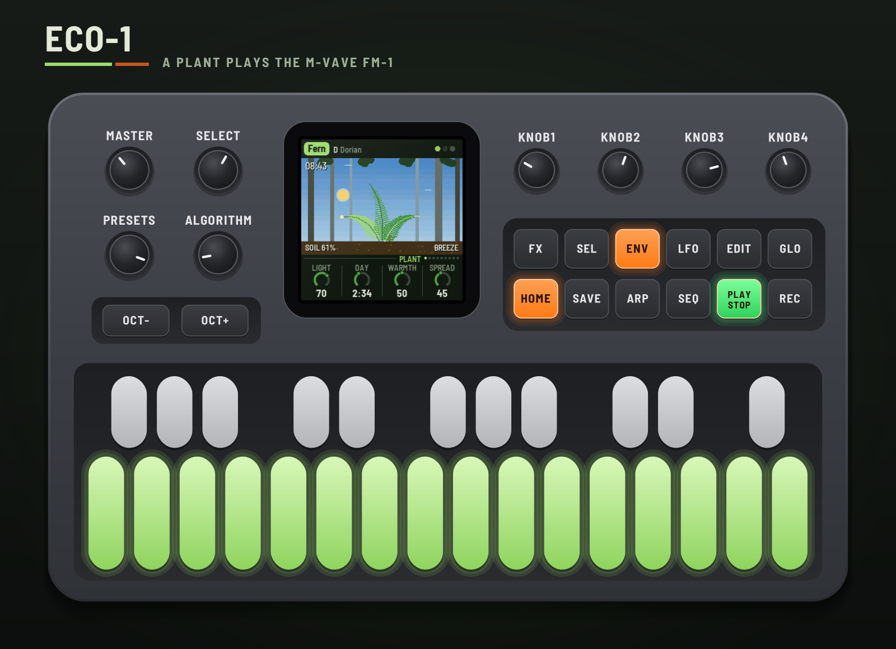
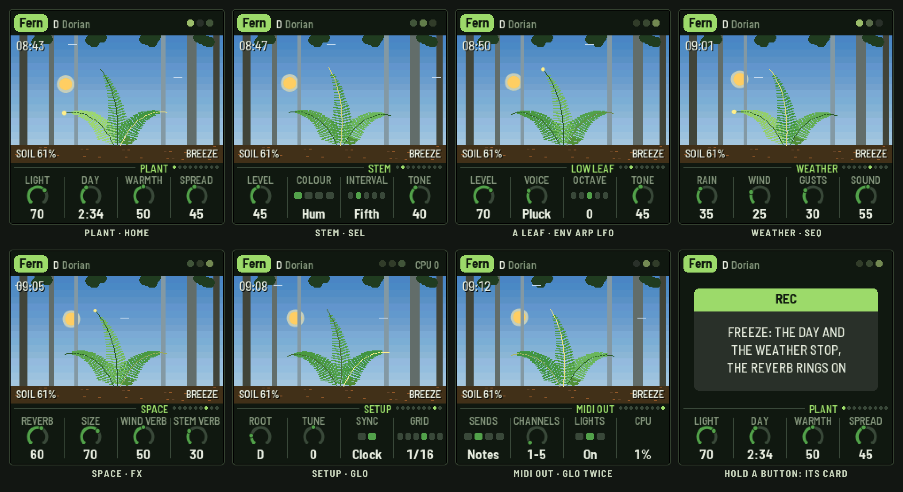
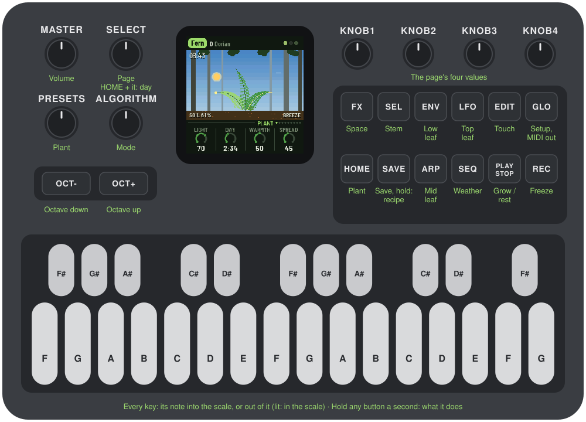
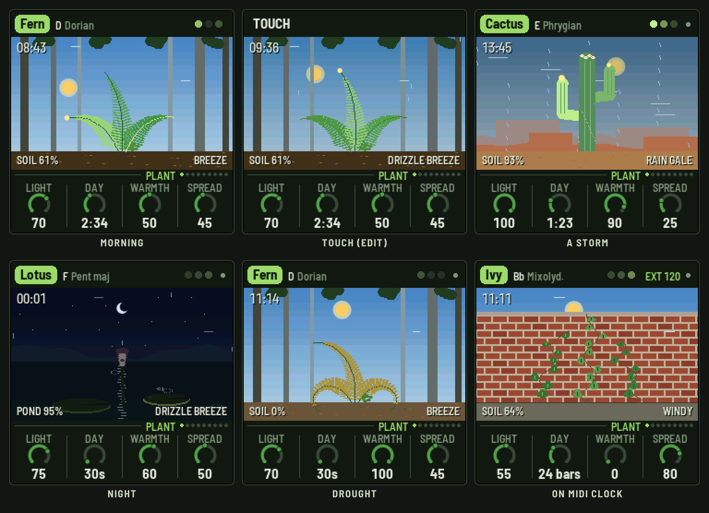
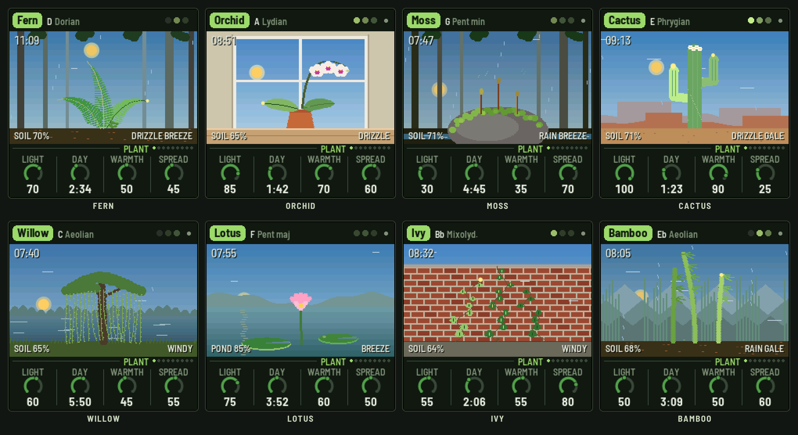
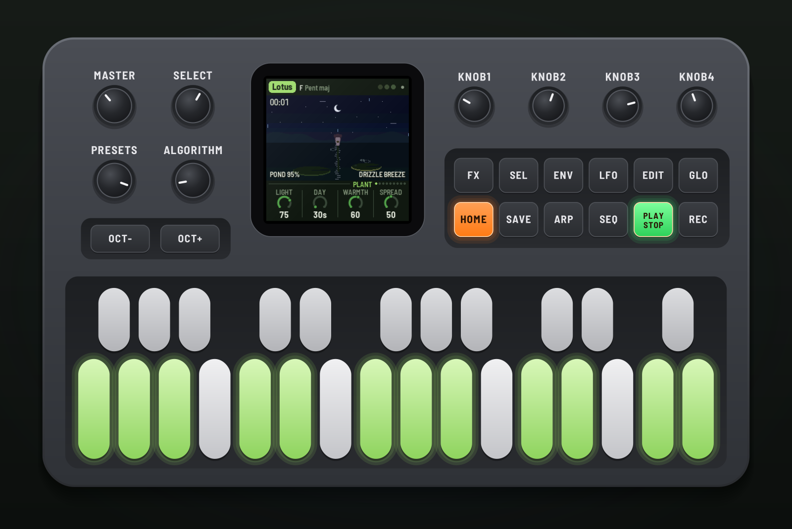
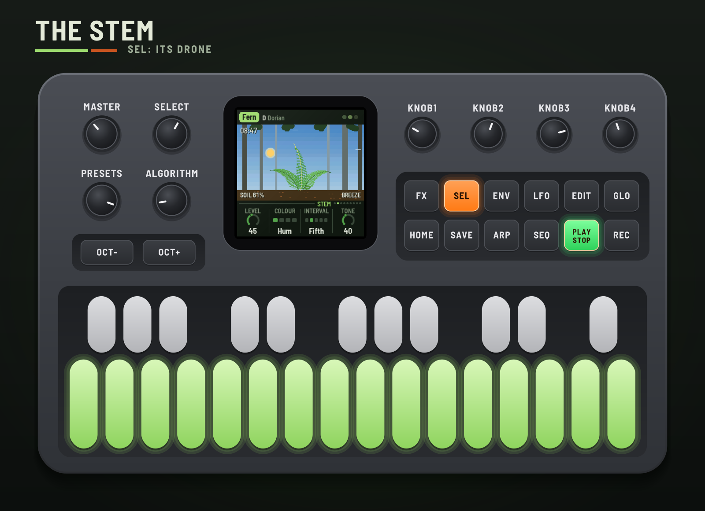
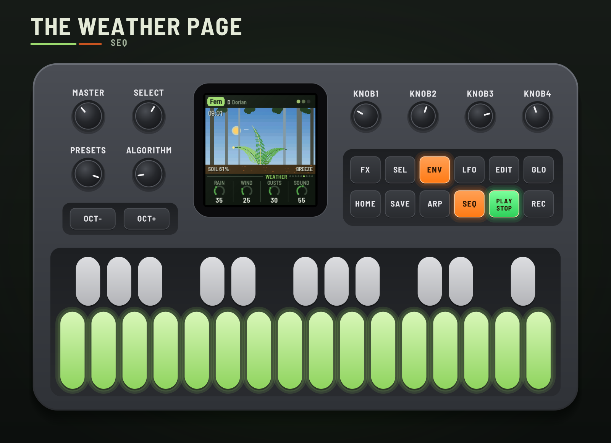
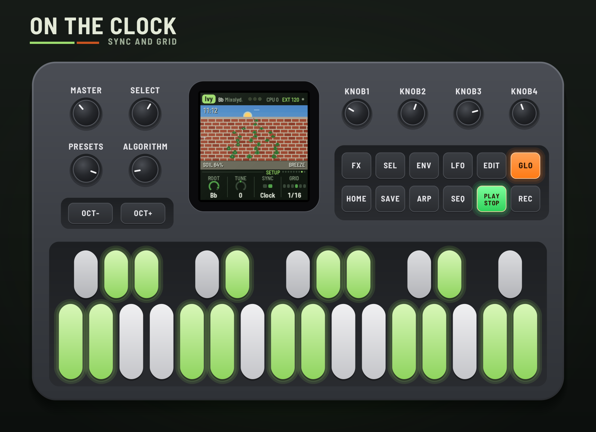
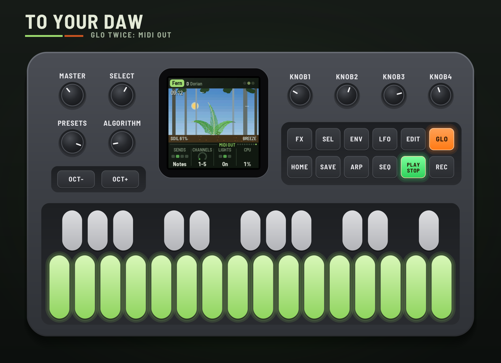

# ECO-1

ECO-1 turns the M-VAVE FM-1 into a small plant that plays music. Each of its three leaves holds a charge
that light and water build up; when a leaf's charge is full it fires, and that's a note. A stem drones
underneath. The day turns, rain comes and goes, the wind picks up, and the plant answers all of it: busy
at noon, sparse at night, wilting in a drought, shaking in a gale. You don't play it so much as grow it.

This manual covers ECO-1 version 0.1.0.

> **Experimental.** ECO-1 is new: it has been built and tested in the simulator and the browser
> emulator, not yet on a real FM-1. Install it at your own risk; HYP-1, or M-VAVE's own firmware, goes
> back on the same way.

---

## Contents

1. Install
2. Getting started
3. Controls
4. The screen
5. How the plant plays
6. The plants
7. The pages
8. MIDI clock and your DAW
9. Saving
10. Troubleshooting
11. Credits

---

## 1. Install

**Try it first:** the emulator runs the same code in the browser, with sound, played with the mouse, a
touch screen or the keyboard.

**Install:** open the installer in Chrome or Edge, connect the FM-1 with a USB data cable and press
Install. Don't unplug it while it's writing; when it finishes, the FM-1 restarts into ECO-1.

From the command line instead (needs `pip3 install mido python-rtmidi`):
`python3 tools/fm1_install.py eco1-VERSION.fwsc`, with the file from the site's download.

**Go back:** "Back to the stock firmware", at the bottom of the installer, puts M-VAVE's firmware back.
M-VAVE's own updater, M-UPGRADE, works too.

> Installing other firmware is at your own risk. If the FM-1 won't start, hold OCT− and OCT+ together for
> five seconds for the update mode, then install again.

---

## 2. Getting started

ECO-1 starts by itself: the RedtailWorks card, then ECO-1, then the plant wakes. A few minutes with it:

1. **Listen.** The first plant, Fern, is playing on a forest floor, mid-morning. Turn MASTER for volume.
2. **Watch it.** Each leaf's vein warms as its charge builds, and the leaf flashes as it fires. Its page
   button (ENV, ARP, LFO) flashes with it.
3. **Try another plant.** Turn PRESETS. Each of the eight has its own body, place, key, voices and way
   with the weather.
4. **Change the weather.** Press SEQ: turn Rain up for showers, Wind and Gusts for a storm.
5. **Touch it.** Press EDIT: a charge runs up the plant from the soil.
6. **Freeze it.** Press REC: the day and the weather stop where they are and the reverb rings on. REC again
   lets them go.
7. **Rest.** Press PLAY: the plant rests and its sounds fade. PLAY again and it wakes.

---

## 3. Controls

| Control | What it does |
|---|---|
| Keys | The scale. Each key adds its note to the scale or takes it out; lit keys are in it. Every octave of a note is the same key. The root stays, and the scale keeps at least three notes. |
| PLAY | Grow / rest. Lit green while growing. |
| REC | **Freeze**: the day and the weather stop, the reverb rings on. Lit while frozen. |
| EDIT | **Touch**: a charge runs up the plant from the soil, waking each part in turn. |
| HOME | The Plant page. Hold it and turn SELECT for the day's length, from any page. |
| SEL | The Stem page. |
| ENV · ARP · LFO | The low, middle and top leaf's pages. Each flashes as its leaf fires. |
| SEQ · FX | The Weather and Space pages. |
| GLO | The Setup page; GLO again, the MIDI out page. |
| SELECT | The previous or next page. |
| ALGORITHM | Mode: Ionian, Dorian, Phrygian, Lydian, Mixolydian, Aeolian, pentatonic major and minor. Editing the scale with the keys makes it Custom. |
| PRESETS | The plant (see [The plants](#s6)). |
| KNOB 1–4 | The four values on the screen. A few clicks are single steps; a quick turn speeds up. |
| OCT− / OCT+ | An octave down or up: on a leaf's page that leaf, on the Stem page the stem, anywhere else the whole plant. |
| MASTER | Volume. |
| SAVE | Saves all eight plants. Held 1.5 s: the plant back to its recipe. |

**Help:** hold any button but PLAY for a second and a card says what it does.

---

## 4. The screen

- **Top line:** the plant in a tag, its root and mode. On the right, three dots, one a leaf, lit as they
  fire (a play triangle while resting), STILL while frozen, EXT and the tempo while on MIDI clock, and a
  dot when there's something unsaved. Messages ("ADDED F#", "TOUCH") show here for a moment.
- **The scene:** the plant in its place under the day's sky: the sun or the moon on its arc, stars at
  night, grey in the rain, rain falling and wind streaking through. Parts green as they're watered and
  yellow, droop and shrink as they dry; they sway as the wind moves them; a part's vein warms as its charge
  builds and the whole part flashes as it fires.
- **Top left:** the time of day.
- **Along the ground:** the soil's water (the pond's, for the lotus), and the weather in words: DRIZZLE,
  RAIN, POURING; BREEZE, WINDY, GALE.
- **Bottom:** the page's name and dots, one a page, then its four values, one for each knob. The one
  you're turning lights up.

---

## 5. How the plant plays

**The leaves.** Each leaf holds a charge, as a plant cell holds an electrical potential. Light and water
build it; it leaks slowly away. When it crosses its threshold the leaf fires: that's a note. Its pitch is
where the leaf's slow walk through the scale has got to (wetter leaves climb, wind makes the steps
wilder); its strength is how far past the threshold the charge went. The top leaf gets the most light and
the most wind; the low leaf drinks first and dries last.

**The stem.** A firing runs down the stem and nudges the other leaves (Spread), and one that fires soon
after answers a third above, so phrases call and answer. The stem also drones, on the root and an
interval over it, as loud as the soil is wet and brighter in daylight.

**The day.** Night, dawn, noon, dusk on a cycle of Day length. Light charges the leaves, so noon is busy and
night sparse; at dawn the leaves wake together. Warmth speeds the plant up and dries the soil faster.

**The weather.** Rain sets how often showers come and how heavy they are. While it rains there's a rain
track, a hiss and the chirps of drops, and drops landing on the leaves give them a charge. Without rain,
the soil dries and the plant wilts and goes quiet, top leaf first; the rain brings it back. Wind sets how
hard it blows and Gusts how much it swells: it shakes the leaves (more chaos), sings (a synthesized whistle
that slides up with the gusts, a second tone in strong wind), and opens the space: more reverb, longer
tails, a sway in them.

---

## 6. The plants

Each preset is a plant in its own place, with its own body, key, voices and stem, and its own way with the
weather. The weather and the sound settings are each plant's to change; what it is stays.

| Plant | Where | Its way |
|---|---|---|
| Fern | A forest floor | Three fronds that curl as they dry. A shade plant: busy even in low light; thirsty. |
| Orchid | A windowsill | Two broad leaves and a flower spike (the top leaf is its flowers). The weather is outside the glass: the wind barely touches it, its whistle is muffled, and the rain only half waters it. |
| Moss | A boulder by a stream | Three spore stalks that puff spores as they fire. Low and still in the wind; thirsty; a shade plant. |
| Cactus | The desert | A saguaro: two arms and a crown. Nearly deaf to the wind, holds water for a long time, and blooms when the rain comes, waking the whole plant. |
| Willow | By a lake | Three curtains of hanging strands that swing hardest of all. |
| Lotus | A pond | Never dry. Two lily pads and a flower that closes at night and opens as it fires; rain rings the water and lands on the pads more often. |
| Ivy | A brick wall | Three vines, their leaves fluttering. Hardy. |
| Bamboo | Under misty mountains | Three culms that bend with the wind. Starts in a storm. |

---

## 7. The pages

### Plant (HOME)

| Knob | What it does |
|---|---|
| Light | How strong the sun is. |
| Day | How long a day and a night take: 30 s to 30 min (4 to 512 bars on MIDI clock). Also HOME + SELECT. |
| Warmth | The plant's metabolism: warmer fires faster and dries the soil sooner. |
| Spread | How strongly a firing runs down the stem to the other leaves. |

### Stem (SEL)

| Knob | What it does |
|---|---|
| Level | How loud the drone is (it follows the soil too: louder wet). |
| Colour | Hum, Organ, Reed or Choir (the notes doubled a few cents apart). |
| Interval | What sits over the root: nothing, a fifth, a fourth, an octave, or the scale's third. Kept to the scale (the octave if the scale hasn't it). |
| Tone | Dark to bright; daylight opens it up further. |

OCT− / OCT+ on this page move the stem's octave.

### Low, Mid, Top leaf (ENV, ARP, LFO)

| Knob | What it does |
|---|---|
| Level | How loud. |
| Voice | Glass, Wood, Pluck, Chime, Reed, Flute, Swell or Kalimba. |
| Octave | Two octaves down to two up from the leaf's register (low C3, middle C4, top C5). |
| Tone | Soft to bright. |

### Weather (SEQ)

| Knob | What it does |
|---|---|
| Rain | How often showers come and how heavy. 0: a drought. |
| Wind | How hard the wind blows. |
| Gusts | How much it swells and falls. |
| Sound | How loud the rain track and the wind's whistle are. |

### Space (FX)

| Knob | What it does |
|---|---|
| Reverb | The plate's send. |
| Size | How long it rings. |
| Wind verb | How far the wind opens the space: more send, longer tails, a sway in them. |
| Stem verb | How much of the drone goes into the reverb. |

### Setup (GLO) and MIDI out (GLO again)

| Knob | What it does |
|---|---|
| Root | The key's root. |
| Tune | Fine tuning, ±50 cents. |
| Sync | Free: its own time. Clock: follows MIDI clock while it comes. |
| Grid | On the clock, the leaves fire on 1/4, 1/8, 1/16, 1/8T or 1/16T, or Free. |
| Sends | MIDI out: Off, Notes, Notes+CC or CC. |
| Channels | The five channels it uses: 1–5 up to 12–16. |
| Lights | The key lights and the buttons' glow: On, Keys (no glow), Off. |
| CPU | The audio's share of the processor. |

Sync, Grid and the MIDI settings belong to you, not the plant: they stay as you set them across plants.

---

## 8. MIDI clock and your DAW

**Clock in** (USB or the TRS jack). With Sync on Clock, ECO-1 follows MIDI clock whenever it comes: EXT and
the tempo show top right. START grows the plant from the morning, STOP rests it, and Day counts in bars.
With a Grid, a leaf that's ready waits for the next step, so its notes land on the beat. When the clock
stops, the plant goes back to its own time.

**MIDI out** (USB). On the MIDI out page (GLO twice), Sends picks what goes out:

| Channel (default) | What |
|---|---|
| 1 | The low leaf's notes |
| 2 | The middle leaf's notes |
| 3 | The top leaf's notes |
| 4 | The stem's note |
| 5 | The signals, as CCs (about 20 a second, when they change) |

| CC | Signal |
|---|---|
| 20, 21, 22 | Each leaf's charge, building to its firing |
| 23, 24, 25 | Each leaf's water |
| 26 | The soil's water |
| 27 | Light |
| 28 | Rain |
| 29 | Wind |
| 30 | The stem's level |
| 31 | A spark: 127 as any leaf fires, falling away |

Record the notes on their own tracks, or map the CCs to anything: the wind opening a filter on another
synth, the spark gating a delay.

**Audio per voice** is in the emulator for now: choose "8 channels" under its device and it gives the mix on
1–2, then each voice dry on its own: 3 low leaf, 4 middle leaf, 5 top leaf, 6 stem, 7 weather, 8 reverb.
The FM-1 itself sends the stereo mix from its output.

---

## 9. Saving

What you change is kept with the plant. ECO-1 saves by itself a few seconds after a change while resting,
or press SAVE. Hold SAVE for 1.5 s to put the plant back to its recipe (saved when you next save).

---

## 10. Troubleshooting

- **No sound:** turn MASTER up; check PLAY is lit (press it to grow); check the page levels.
- **Silent plant:** look at the soil. In a drought the plant wilts and stops; turn Rain up on the Weather
  page, or pick the Lotus or Cactus.
- **The clock does nothing:** Sync must be Clock (Setup). EXT shows while the clock comes.
- **No MIDI out:** Sends must not be Off (MIDI out page), and your DAW must listen on channels 1–5 (or the
  ones you chose).
- **The FM-1 won't start:** hold OCT− and OCT+ together for five seconds for the update mode, then install
  again.

---

## 11. Credits

ECO-1 is a RedtailWorks project. It's a fork of [AMB-1](https://github.com/charlesvestal/fm1-amb) by Charles
Vestal, by way of HYP-1. The platform (USB, update loader, storage, installer) is
[Felucca](https://github.com/hugelton/Felucca) by Leo Kuroshita (@kurogedelic), Hügelton Instruments. The
reverb is Jon Dattorro's plate. Screen font: Barlow Semi Condensed (SIL OFL). GPL-3.0.

M-VAVE and FM-1 are trademarks of their owners; ECO-1 is not affiliated with M-VAVE.

Leave the garden be a while, and look again when it's dark.
