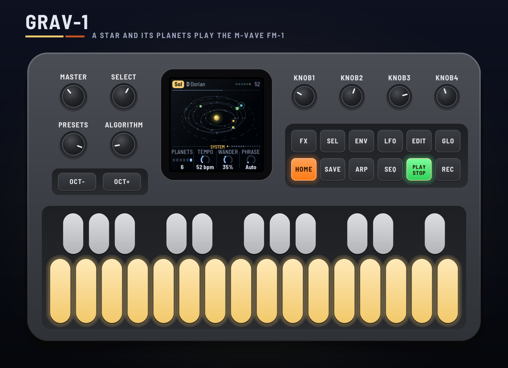
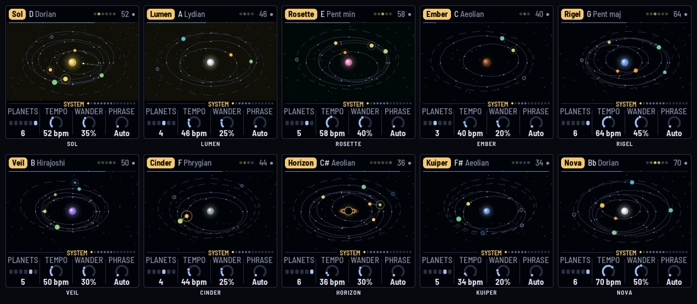

# GRAV-1 for the M-VAVE FM-1 (experimental)

GRAV-1 turns the M-VAVE FM-1 into a small solar system that plays slow, dark, spacey ambient. A star hisses
and roars in coloured noise, drawn in its noise's colour. Up to six planets orbit it, each a voice playing a
short phrase round its orbit, warm and dry near the star, cold and wet far out. A drum sequencer sets their
years (and, by Kepler, how close they orbit), larger planets swell smaller ones as they pass, and dust
clouds, asteroids and comets drift through. A RedtailWorks project, alongside HYP-1 in this repository.

> **Experimental.** Built and tested in the simulator and the browser emulator, not yet on a real FM-1.
> Versions are 0.x until it has been. Install it at your own risk; HYP-1 or M-VAVE's firmware goes back on
> the same way.

- **Try it in the browser:** <https://rustypawz.github.io/fm1-HYP1/grav/emu/>: with sound, MIDI in and
  out, and eight channels (each voice apart) for your DAW.
- **Install it** (Chrome or Edge, the FM-1 plugged in): <https://rustypawz.github.io/fm1-HYP1/grav/install/>
- **Manual:** <https://rustypawz.github.io/fm1-HYP1/grav/manual/> (source: [docs/MANUAL.md](docs/MANUAL.md))

## In short

| | |
|---|---|
| Keys | The scale. On Pulse and in the sequencer (SEQ held): the lane's 16 steps (black keys 1–6 the lane; SELECT one of eight banks). On Weather: black keys 1–3 call dust, an asteroid, a comet |
| PLAY · REC · EDIT | Grow / rest · eclipse (the orbits hold) · the Great Year now |
| HOME · ENV · ARP · LFO · SEQ · FX · GLO | The pages: System, Star, Planet, Gravity (again: Weather), Pulse, Space, Setup (again: Display, MIDI out) |
| SELECT | Every page in turn, each planet's one by one; with HOME held, the tempo |
| ALGORITHM · SEL · PRESETS | The planet (on Pulse, the lane) · the next one · the system (ten) |
| OCT− / OCT+ | The selected planet's octave |
| SAVE | On the Setup pages, saves all ten; elsewhere, starts the system again; held, back to the recipe |

**To your DAW:** MIDI clock in (USB or TRS) drives the steps and the orbits; MIDI out sends each planet's
notes on its own channel, the drums on another, and the system's signals as CCs 20–29.

## Renders

`docs/img/` holds the renders: the device on several pages (`grav-device-*.png`, `grav-hero.png`), every
screen at 2× (`grav-screen-*.png`), and the sheets `grav-systems.png`, `grav-pages.png`, `grav-themes.png`
and `grav-boot.png`, all drawn from the firmware itself in the simulator. The workflow redraws them on each
push.

## Building

Self-contained in this folder: see [BUILDING.md](BUILDING.md). HYP-1's workflow
(`../.github/workflows/firmware.yml`) builds it on every push, after HYP-1. Licensing:
[LICENSING.md](LICENSING.md) (GPL-3.0-only).

GRAV-1 is a fork of [AMB-1](https://github.com/charlesvestal/fm1-amb) by Charles Vestal, by way of HYP-1 and
ECO-1, on [Felucca](https://github.com/hugelton/Felucca) by Leo Kuroshita (@kurogedelic), Hügelton
Instruments. M-VAVE and FM-1 are trademarks of their owners; GRAV-1 is not affiliated with M-VAVE.
