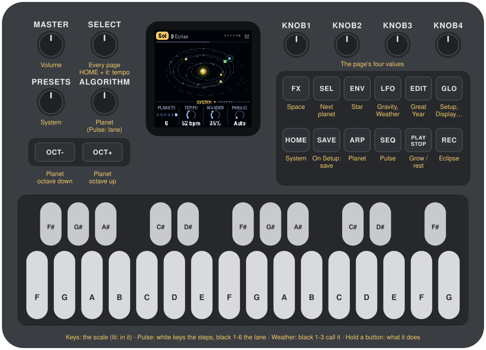
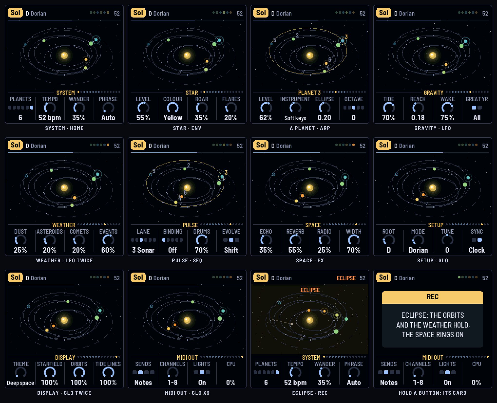
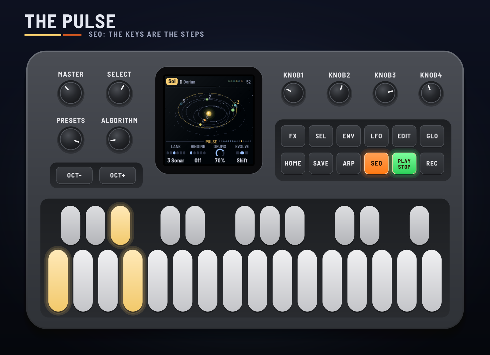
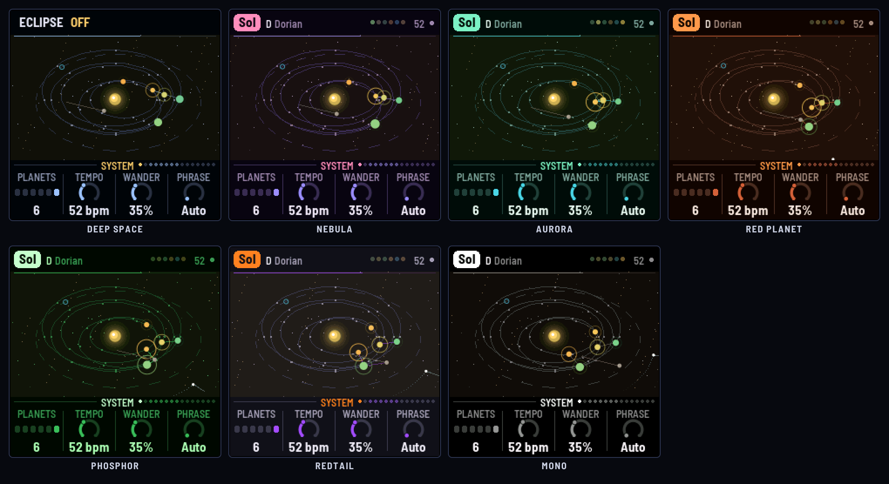
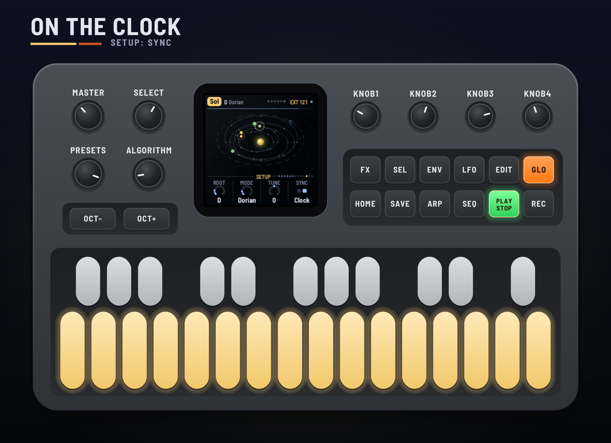
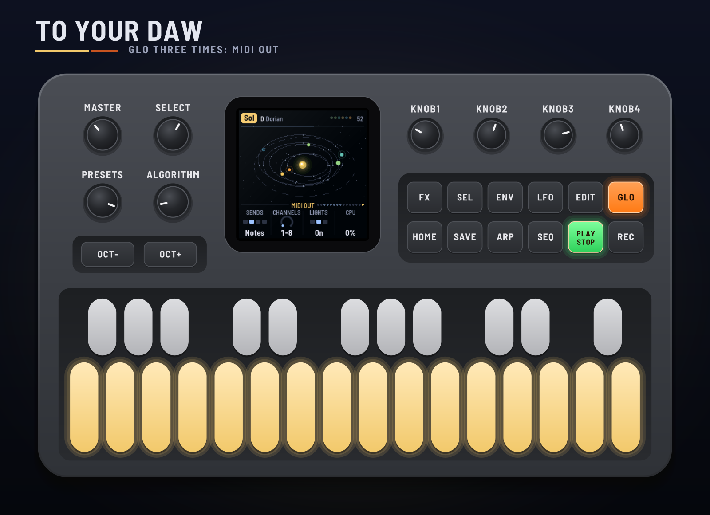

# GRAV-1

GRAV-1 turns the M-VAVE FM-1 into a small solar system that plays slow, dark, spacey ambient. A star in the
middle hisses and roars in coloured noise. Up to six planets orbit it, and each one is a voice: it plays a
short phrase as it goes round, kept to the scale, warm and dry near the star, thin, cold and wet far out. A
drum sequencer sets how long each planet's year is. Larger planets swell smaller ones as they pass, and dust
clouds, asteroids and comets drift through. You set the system going and tend it.

This manual covers GRAV-1 version 0.1.0.

> **Experimental.** GRAV-1 is new: it has been built and tested in the simulator and the browser emulator,
> not yet on a real FM-1. Install it at your own risk; HYP-1, or M-VAVE's own firmware, goes back on the
> same way.

---

## Contents

1. Install
2. Getting started
3. Controls
4. The screen
5. How the system plays
6. The systems
7. The pages
8. MIDI clock and your DAW
9. Saving
10. Troubleshooting
11. Credits

---

## 1. Install

**Try it first:** the emulator runs the same code in the browser, with sound, played with the mouse, a
touch screen or the keyboard.

**Install:** open the installer in Chrome or Edge, connect the FM-1 with a USB data cable and press
Install. Don't unplug it while it's writing; when it finishes, the FM-1 restarts into GRAV-1.

From the command line instead (needs `pip3 install mido python-rtmidi`):
`python3 tools/fm1_install.py grav1-VERSION.fwsc`, with the file from the site's download.

**Go back:** "Back to the stock firmware", at the bottom of the installer, puts M-VAVE's firmware back.
M-VAVE's own updater, M-UPGRADE, works too.

> Installing other firmware is at your own risk. If the FM-1 won't start, hold OCT− and OCT+ together for
> five seconds for the update mode, then install again.

---

## 2. Getting started

GRAV-1 starts by itself: the RedtailWorks card, then GRAV-1, then the system. A few minutes with it:

1. **Listen.** The first system, Sol, is playing: a yellow star, six planets. Turn MASTER for volume.
2. **Watch it.** Each planet flashes as it plays. Near the star they glow red and orange, far out blue and
   ice. The thin line along the top of the screen is the Great Year going round.
3. **Turn SELECT.** It walks every page: System, Star, each planet in turn, Gravity, Weather, Pulse, Space,
   Setup, Display, MIDI out. The dots at the right of the knob strip show where you are.
4. **Change a planet's year.** Press SEQ. The white keys are now the lane's 16 steps and black keys 1–6
   pick the lane. Add a hit: the planet's year gets shorter and it drifts closer to the star.
5. **Call the weather.** Press LFO twice for Weather. Black key 1 brings a dust cloud, 2 an asteroid, 3 a
   comet.
6. **Try another system.** Turn PRESETS. There are ten.

---

## 3. Controls

| Control | What it does |
|---|---|
| **Keys** | The scale: each key adds its note or takes it out (lit: in the scale). The root stays. On Pulse, the white keys are the lane's steps and black keys 1–6 pick the lane; on Weather, black keys 1–3 call a dust cloud, an asteroid, a comet. |
| **PLAY** | Grow / rest. Resting, everything fades and the tails ring on. |
| **REC** | Eclipse: the orbits and the weather hold still, the space rings on. Again to let go. |
| **EDIT** | The Great Year now: the chord moves and the drums evolve. |
| **HOME ENV ARP LFO SEQ FX GLO** | The pages: System, Star, Planet, Gravity (again: Weather), Pulse, Space, Setup (again: Display, then MIDI out). |
| **SEL** | The next planet (on Pulse, the next lane). |
| **SELECT** | Every page in turn, each planet's page one by one. With HOME held: the tempo. |
| **ALGORITHM** | The planet (on Pulse, the lane). |
| **PRESETS** | The system: ten of them, each keeping its own settings. |
| **KNOB 1–4** | The page's four values. On the Star and each Planet page, KNOB 1 is the level. |
| **OCT− / OCT+** | The selected planet an octave down / up. |
| **SAVE** | On the Setup pages (Setup, Display, MIDI out): saves all ten systems. Elsewhere: starts the system again, planets on fresh orbits. Hold 1.5 s: the system back to its recipe. |
| **MASTER** | Volume. |

Hold any button for a second and a card says what it does.

---

## 4. The screen

- **The header:** the system's name in a tag, the key and mode, then on the right the planets as dots (lit
  as they play; resting, a play triangle; ECLIPSE in an eclipse), the tempo (EXT and the clock's tempo on
  MIDI clock) and a dot while something is unsaved. Messages take its place for a moment: a Great Year, a
  comet burning up, a planet waking.
- **The system,** seen from a little above, zooming to fit its orbits. The star in the middle in the colour
  of its noise. The orbits, and on each the points where its phrase sounds. Planets in their warmth's
  colour, sized by their level; a dormant one is a ring until a tide wakes it. A ring round a planet is its
  tide, and a faint line runs from whoever is swelling it. Dust browns the sky, an asteroid streaks
  through, a comet trails a tail away from the star. The line along the top is the Great Year.
- **The knob strip:** the page's name and the walk's dots (blue: the planets' pages), then the four knobs.
  The one being turned lights up.

---

## 5. How the system plays

**Years and orbits.** Lane *n* of the Pulse belongs to planet *n*. Its hits set the planet's year: 32 bars
over the number of hits, so two hits make a 16-bar year and sixteen hits a 2-bar one. By Kepler's third law
a shorter year means a smaller orbit, so busy lanes orbit close to the star and sparse ones far out. Change
a lane and its planet drifts to its new orbit over a bar or so. Planets with the same number of hits share
an orbit, a sixth of a turn apart, and never pass each other.

**Notes.** Each planet has a phrase: three to eight notes of the scale (Auto gives the slow ones more),
spread at points round its orbit. It plays a note as it passes each point, on the beat. Every time it
completes an orbit (a year) a note or two change; Wander sets how many. The scale comes from the keys, and
each Great Year moves the chord the phrases are built on.

**Warm and cold.** Near the star a planet is warm and dry: darker, little reverb. Far out it turns thin and
cold, with more echo and reverb. An ellipse makes it warm up and cool down once every orbit.

**Tides.** A larger planet (a higher level) passing close to a smaller one swells it: louder and brighter,
peaking at the closest approach and fading as they part. Tide sets how much, Reach from how far.

**Dormant worlds.** A lane with no hits leaves its planet dormant, on the slowest orbit just outside the
others. It stays silent until a larger neighbour's tide reaches it, then sounds one held note that swells
and fades with the pass. Wake sets how loud.

**The Great Year.** The outermost planet's year (dormant ones included, unless Great year is Active). Each
one moves the chord, and with Evolve on, the drums change a little: Shift moves a hit or two, Drift also
adds or takes one, so the planets slowly move to new orbits.

**Bindings.** Each hit of a lane does something to its planet: Pump ducks it, Blip brightens it, Flicker
cuts it on and off, Nudge bends its pitch up and back.

**The star.** Its noise is its colour on screen. It roars now and then, louder and lower with a sub under
it, and flares in bright bursts. Its Level is the ceiling for both: it never takes over.

**Weather.** A dust cloud lasts 20 seconds to a minute: the whole mix warmer, softer and grainy, the sky
brown. An asteroid crosses in 20 to 30 seconds, a heavy body swelling the planets it passes (it can wake
dormant ones), with a low rumble that pans with it. A comet falls into the star, faster and faster, ringing
a glass bell from the scale at each step, higher and quicker as it nears, and burns up in a chord of bells,
a crackle and a flare. Weather holds in an eclipse and while resting.

---

## 6. The systems

| System | Star | Its character |
|---|---|---|
| **Sol** | Yellow | Six planets in D Dorian: a drone, bells, keys, ether, a sleeping choir. |
| **Lumen** | White | Four planets in A Lydian, open and bright, a slow choir. |
| **Rosette** | Pink | Five planets in E minor pentatonic, two sharing an orbit, a laser. |
| **Ember** | Brown dwarf | Three planets in C Aeolian, a low roar, dusty. |
| **Rigel** | Blue giant | Six planets in G major pentatonic, quick, a long-ellipse laser. |
| **Veil** | Violet | Five planets in B Hirajoshi, ether and ring hiss. |
| **Cinder** | Grey dwarf | Four planets in F Phrygian, sparse, two dormant worlds. |
| **Horizon** | Black hole | Six planets in C# Aeolian, very slow, radio-heavy, crackling. |
| **Kuiper** | Blue giant | Five planets far out, three of them dormant; asteroids and comets. |
| **Nova** | White | Six planets in Bb Dorian at 70 BPM, flaring, comets. |

Each system keeps its own settings as you leave it. SAVE on the Setup page keeps all ten.

---

## 7. The pages

### System (HOME)

- **Planets:** one to six. The rest go quiet; their lanes still drum.
- **Tempo:** 30–90 BPM (also HOME + SELECT).
- **Wander:** how much a phrase changes each year.
- **Phrase:** Auto, or 3–8 notes round every orbit.

### Star (ENV)

- **Level:** its loudness, the ceiling for its roar and flares.
- **Colour:** White, Pink, Brown, Blue, Violet, Grey, Black (crackle), Yellow (radio hiss). The star's colour
  on screen follows: a pink star, a brown dwarf, a blue giant, a black hole.
- **Roar, Flares:** how often it roars; how often it flares.

### Planet (ARP; ALGORITHM or SEL for which)

- **Level:** its loudness, and its size: its pull on the others.
- **Instrument:** Drone, Glass bell, Pluck, Soft keys, Choir, Laser, Ether, Ring hiss.
- **Ellipse:** a circle to a long ellipse (0.00–0.45).
- **Octave:** two down to two up (also OCT− / OCT+).

### Gravity (LFO)

- **Tide:** how much a passing neighbour swells a planet.
- **Reach:** from how far.
- **Wake:** how loud a woken dormant planet is.
- **Great year:** All (the outermost planet, dormant ones too) or Active.

### Weather (LFO again)

- **Dust, Asteroids, Comets:** how often each comes.
- **Events:** how loud the asteroid's rumble and the comet's bells are.
- Black keys 1–3 call a dust cloud (or end one), an asteroid, a comet; they light while it's there.

### Pulse (SEQ)

- **Lane:** Kick, Pulsar, Sonar, Geiger, Rim, Shaker (black keys 1–6 too). The white keys are its steps;
  the step playing blinks.
- **Binding:** what its hits do to its planet: Off, Pump, Blip, Flicker, Nudge.
- **Drums:** their level.
- **Evolve:** Off, Shift, Drift (at each Great Year).

### Space (FX)

- **Echo:** a dotted-eighth echo, darker each time round.
- **Reverb:** the plate: more of it, and longer.
- **Radio:** a band of hiss coming and going, and now and then a falling whistler.
- **Width:** how wide the planets spread across the stereo field.

### Setup (GLO), Display (GLO again), MIDI out (GLO a third time)

- **Setup:** Root, Mode (a scale for the keys to start from), Tune (cents), Sync (Free or Clock).
- **Display:** Theme (Deep space, Nebula, Aurora, Red planet, Phosphor, Redtail, Mono), and how bright the
  Starfield, the Orbits and the Tide lines are (0 hides them). The planets keep their warm-to-cold colours
  and the star its own in every theme.
- **MIDI out:** Sends (Off, Notes, Notes+CC, CC), Channels (which eight), Lights (the key lights), CPU (the
  audio load).

---

## 8. MIDI clock and your DAW

**Clock in** (USB or the TRS jack). With Sync on Clock, GRAV-1 follows MIDI clock whenever it comes: EXT and
the tempo show top right. START plays from step one, STOP rests it, and the steps and the orbits follow the
clock. When the clock stops, the system goes back to its own tempo.

**MIDI out** (USB). On the MIDI out page, Sends picks what goes out:

| Channel (default) | What |
|---|---|
| 1–6 | Each planet's notes |
| 7 | The drums: notes 36–41, a lane each |
| 8 | The signals, as CCs (about 20 a second, when they change) |

| CC | Signal |
|---|---|
| 20–25 | Each planet's tide |
| 26 | The star's roar |
| 27 | The dust cloud |
| 28 | The Great Year, round from 0 to 127 |
| 29 | A flare |

**Audio per voice** is in the emulator for now: choose "8 channels" under its device and it gives the mix on
1–2, then 3 the star, 4 planets 1–3, 5 planets 4–6, 6 the drums, 7 the weather and the radio, 8 the echo and
the reverb. The FM-1 itself sends the stereo mix from its output.

---

## 9. Saving

What you change is kept with the system while the FM-1 is on. Press SAVE on the Setup, Display or MIDI out
page to keep all ten systems through a power-off (a dot top right shows something is unsaved). Hold SAVE for
1.5 s to put the system back to its recipe. Tune, Sync, MIDI out and the Display settings are the same for
every system.

---

## 10. Troubleshooting

- **No sound:** turn MASTER up; check PLAY is lit (press it to grow); check the levels on the Star and Planet
  pages.
- **A planet never plays:** its lane may be empty (it's dormant, waiting for a tide); add a hit on Pulse.
- **The orbits stopped:** REC (eclipse) may be on: ECLIPSE shows in the header.
- **The clock does nothing:** Sync must be Clock (Setup). EXT shows while the clock comes.
- **No MIDI out:** Sends must not be Off, and your DAW must listen on channels 1–8 (or the ones you chose).
- **The FM-1 won't start:** hold OCT− and OCT+ together for five seconds for the update mode, then install
  again.

---

## 11. Credits

GRAV-1 is a RedtailWorks project. It's a fork of [AMB-1](https://github.com/charlesvestal/fm1-amb) by Charles
Vestal, by way of HYP-1 and ECO-1. The platform (USB, update loader, storage, installer) is
[Felucca](https://github.com/hugelton/Felucca) by Leo Kuroshita (@kurogedelic), Hügelton Instruments. The
reverb is Jon Dattorro's plate. Screen font: Barlow Semi Condensed (SIL OFL). GPL-3.0.

M-VAVE and FM-1 are trademarks of their owners; GRAV-1 is not affiliated with M-VAVE.
