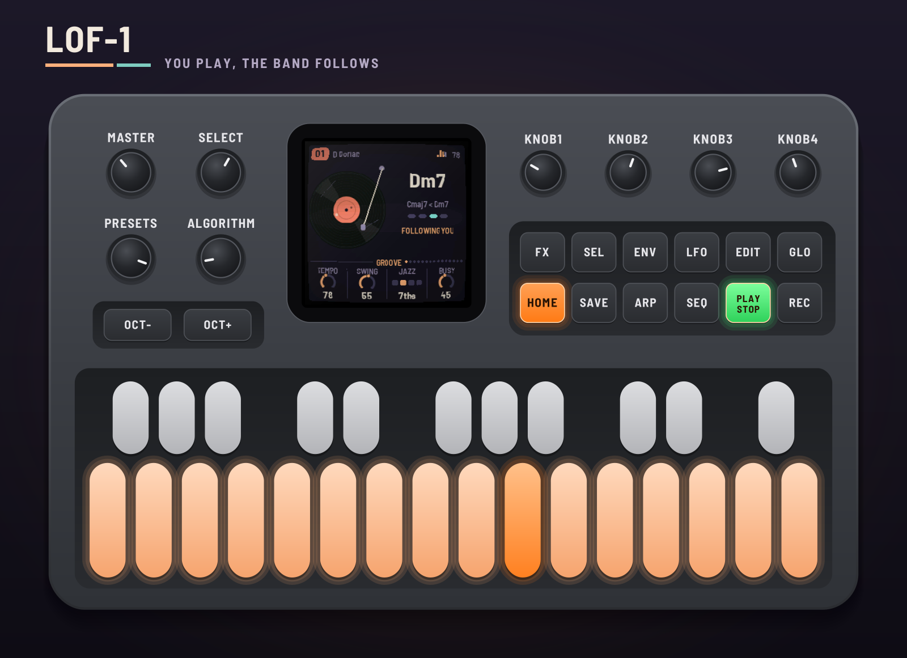
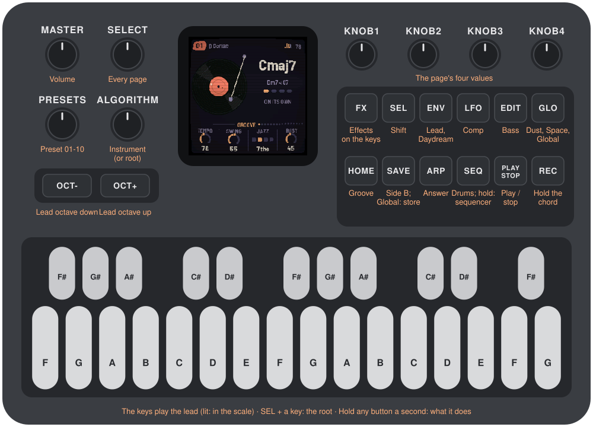
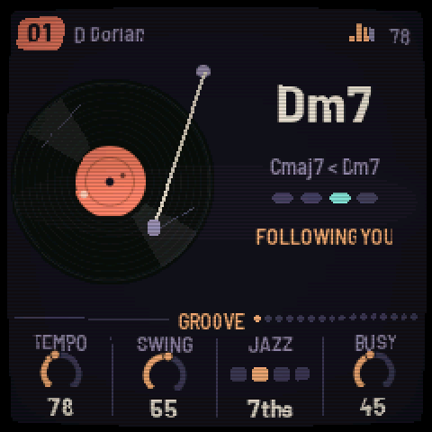
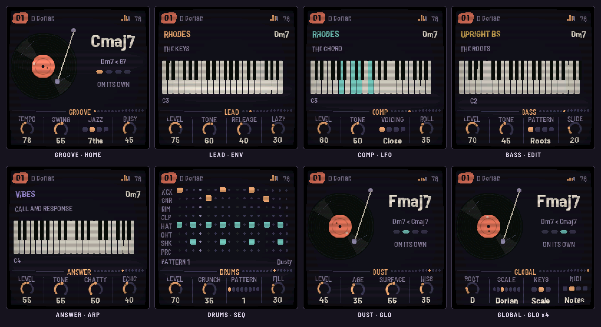
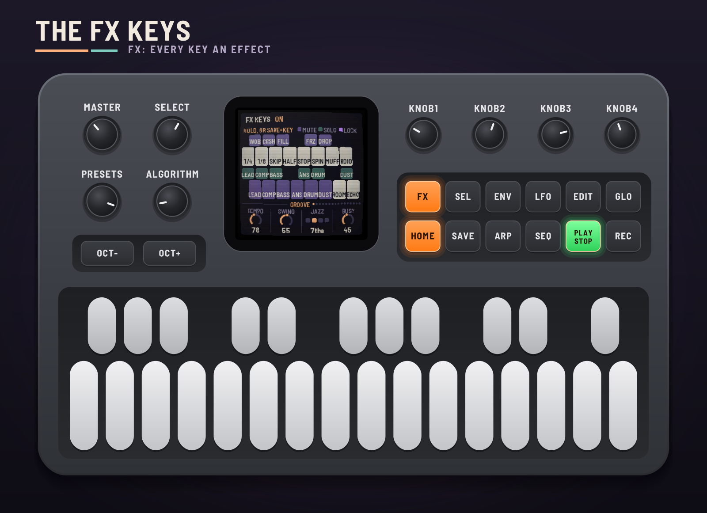
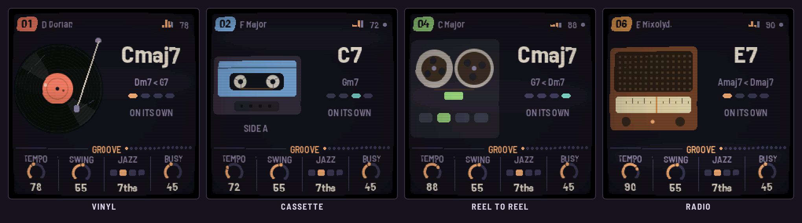
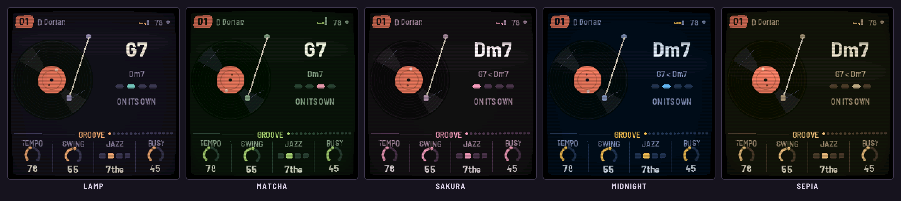

# LOF-1

LOF-1 turns the M-VAVE FM-1 into a lofi groovebox. You play the lead on the keys and a tired jazz band
follows you: it hears which chord your notes imply, and the comp, bass and drums move with it on the beat.
Rest after a phrase and another instrument answers. Stop playing and the band carries on by itself; after
a while a ghost takes the lead. Under it all an old record crackles, or a cassette hisses, or a radio
drifts off the station.

This manual covers LOF-1 version 0.1.0.

> **Experimental.** LOF-1 is new: it has been built and tested in the simulator and the browser
> emulator, not yet on a real FM-1. Install it at your own risk; HYP-1, or M-VAVE's own firmware, goes
> back on the same way.

---

## Contents

1. Install
2. Getting started
3. Controls
4. The screen
5. How the band plays
6. The pages
7. Playing: chords, FX, the sequencer
8. The presets and saving
9. MIDI and your DAW
10. The screen: themes and the old TV
11. Troubleshooting
12. Credits

---

## 1. Install

**Try it first:** the emulator runs the same code in the browser, with sound, played with the mouse, a
touch screen, your computer's keyboard or a MIDI keyboard.

**Install:** open the installer in Chrome or Edge, connect the FM-1 with a USB data cable and press
Install. Don't unplug it while it's writing; when it finishes, the FM-1 restarts into LOF-1.

From the command line instead (needs `pip3 install mido python-rtmidi`):
`python3 tools/fm1_install.py lof1-VERSION.fwsc`, with the file from the site's download.

**Go back:** "Back to the stock firmware", at the bottom of the installer, puts M-VAVE's firmware back.
M-VAVE's own updater, M-UPGRADE, works too. HYP-1 goes on from its own installer, the same way.

> Installing other firmware is at your own risk. If an install is cut off, run it again: the FM-1 stays
> in update mode until it finishes.

---

## 2. Getting started

LOF-1 starts by itself: the RedtailWorks card, then LOF-1, then the record drops and the band starts. A few
minutes with it:

1. **Listen.** Preset 01 is playing: Rhodes, upright bass and the Dusty kit on vinyl, in D Dorian at 78
   BPM. The screen says ON ITS OWN: nobody is playing the lead, so the band cycles its own progression.
   Turn MASTER for volume.
2. **Play.** Every key that's lit is in the key. Play a few notes, or hold two or three: the screen says
   FOLLOWING YOU and the chord changes, on the beat, to the one your notes imply.
3. **Stop and wait.** Leave the keys alone. The band carries on; after eight bars (the Daydream page's
   Wait) a ghost takes the lead. Touch a key and it's yours again.
4. **Try another preset.** Turn PRESETS: ten sessions, each its own key, tempo, band and tape.
5. **Shape it.** HOME is the Groove page: Tempo, Swing, Jazz (how rich the chords are) and Busy (how
   much the band plays). Every other voice has its own button and page.
6. **Hold a button** for a second and a card says what it does.

---

## 3. Controls

| Control | What it does |
| --- | --- |
| MASTER | Volume |
| SELECT | Steps through every page. HOME held + SELECT: the tempo |
| PRESETS | Preset 01–10 |
| ALGORITHM | The page's instrument (on Lead, Comp, Bass, Answer), kit (Kit), or the tape (Dust). On other pages: the key's root |
| KNOB1–4 | The page's four values |
| OCT− / OCT+ | The lead's octave. In the sequencer: the lane |
| HOME | Groove; again: Groove 2 (Drift). SEL + HOME: the keys play notes or chords |
| ENV | Lead; again: Daydream; again: Daydream 2. SEL + ENV: Daydream on and off |
| LFO | Comp; again: Comp style |
| EDIT | Bass |
| ARP | Answer. SEL + ARP: the answer on and off |
| SEQ | Drums; again: Kit. Held: the sequencer. SEL + SEQ: a change on the next bar |
| GLO | Dust, Dust 2, Space, Global, Global 2. SEL + GLO: remote (the panel plays the browser emulator) |
| FX | The keys play effects. SEL + FX: every locked effect off |
| SAVE | Side B: a breakdown on the next bar; again, back in with a fill. On Global: store the preset (held: the factory's back). On Global 2: store the theme, CRT, Tune and lights. In FX, held: lock effects on |
| PLAY | Play / stop |
| REC | Chord hold: the band stays on this chord while you solo |
| SEL + a key | The key's root. On the drum pages, SEL + white keys 1–8: the pattern |
| Keys | The lead (or, in FX, effects; in the sequencer, the steps) |

---

## 4. The screen

**The header:** the preset's number, the key, then what's on: FX, LOCK, SEQ, HOLD, SIDE B, DREAM, CHORDS;
a little level meter and the tempo (EXT when MIDI clock drives it).

**The main band:** on Groove and the pages without a keyboard, the tape (a record turning, a cassette, a
reel-to-reel deck or a radio, as the Dust page's character) and the chord: its name big, the chords before
it, the beat, and what the band is doing: ON ITS OWN, FOLLOWING YOU, DAYDREAMING, CHORD HELD, with a
countdown to Daydream or to Drift's next change. On a voice's page, a keyboard showing what that voice is
playing. On the drum pages, the pattern.

**The knobs:** the page's four values, its name between them, and dots for where it sits among the pages.

---

## 5. How the band plays

**The chord.** You set the key (Global: Root and Scale). LOF-1 listens to the lead: the notes you hold
count most, then the last few you played; the chord now is a little sticky. On the beat it moves to the
chord of the key your notes fit best. Jazz sets how rich it is: triads, 7ths, 9ths or 11ths. With no notes
it cycles a progression in the key; REC holds the chord where it is.

**Comp** re-voices the chord on every change, close, open, shell or spread, and rolls it like a tired
pianist: held, stabs, offbeats or an arpeggio. **Bass** plays the chord's roots: plain, root and fifth,
walking, or dub. **Drums** play the pattern, swung, with fills. Busy sets how much they all play around you.

**Answer** listens for your phrases: when you rest after one, it answers, echoing your phrase (Echo high)
or inventing its own (Echo low). Chatty sets how often.

**Daydream.** When the keys have been still for the Wait (4, 8 or 16 bars, or Always), a ghost takes the
lead with phrases of its own in the key, on the chord. Fill sets how much of the time it plays, from sparse
phrases to non-stop; Density how many notes a beat; Mood stepwise or leaping; Range how wide; Legato how
long its notes are; Repeat how often it comes back to its last motif; Dynamics how much it accents. Any
key takes the lead back.

**Drift** (Groove 2) changes things every few bars by itself: the drums to another pattern (Next, or
Random from patterns 1 to the Pool), and the progression to its other. SEL + SEQ makes a change now.

**Dust** is the tape under it all: crackle, pops and surface noise, hiss, hum, wow and flutter, the
run-out groove when you stop, and Grain, a haze made of the music itself.

---

## 6. The pages

### Groove (HOME) and Groove 2 (HOME again)

| Knob | Range | What it does |
| --- | --- | --- |
| Tempo | 60–100 BPM | Also HOME + SELECT |
| Swing | 0–100 | How late the off-sixteenths fall |
| Jazz | Triads, 7ths, 9ths, 11ths | How rich the chords are |
| Busy | 0–100 | How much the comp, bass and drums play around you |
| Drift | Off, 4–64 bars | A change every so many bars |
| Drums | Keep, Next, Random | On a change: the drum pattern |
| Pool | 1–2 to 1–8 | The patterns Random picks from |
| Chords | Keep, Swap | On a change: the progression to its other |

### Lead (ENV), Daydream, Daydream 2 (ENV again)

Lead: **Level, Tone, Release, Lazy** (loosens the velocity, and the ghost's timing). ALGORITHM picks the
instrument: Rhodes, Wurli, Upright, Old upright, Vibes, Kalimba, Glock, Strumstick, Mute tpt, Tenor sax,
Flute, Harmonica, Bell, Sine, FM piano, Marimba, Harp, Clarinet, Ocarina, Music box. OCT− / OCT+ move it by
octaves.

Daydream: **Wait** (4, 8, 16 bars, Always), **Fill**, **Density**, **Mood**. Daydream 2: **Range,
Legato, Repeat, Dynamics**. SEL + ENV turns Daydream on and off.

### Comp (LFO), Comp style (LFO again)

Comp: **Level, Tone, Voicing** (Close, Open, Shell, Spread), **Roll**. Comp style: **Pattern** (Held,
Stabs, Offbeat, Arp), **Length, Push** (how often it anticipates the next chord), **Spread**. Instruments:
Rhodes, Wurli, Upright, Old upright, Vibes, Strumstick, Warm pad, Organ, Strings, FM piano, Marimba, Harp.

### Bass (EDIT)

**Level, Tone, Pattern** (Roots, Root-5th, Walking, Dub), **Slide**. Instruments: Upright bs, Sub, Round,
Pluck, Moog, Cello pizz.

### Answer (ARP)

**Level, Tone, Chatty, Echo**. Instruments: Mute tpt, Tenor sax, Flute, Harmonica, Vibes, Kalimba, Glock,
Bell, Whistle, Square, Clarinet, Ocarina, Marimba, Music box. SEL + ARP turns it on and off.

### Drums (SEQ), Kit (SEQ again)

Drums: **Level, Crunch, Pattern** (1–8, changing on the bar), **Fill**. Kit: **Kick, Snare, Hats, Perc**
levels; ALGORITHM: **Dusty** (samples) or **Tape** (synthesized). Hold SEQ for the sequencer (section 7).

### Dust, Dust 2 (GLO)

Dust: **Level, Age** (wear: more crackle and pops, and scratches on the record), **Surface, Hiss**.
ALGORITHM: **Vinyl, Cassette, Reel, Radio**. Dust 2: **Grain** (a haze of the music itself), **Smear,
Duck** (under the kick), **Hum**.

### Space (GLO again)

**Tape** (wow, flutter, saturation), **Mellow** (a low-pass over everything), **Room** (a plate reverb),
**Echo** (a dotted eighth, dark and fading).

### Global (GLO, four times)

**Root, Scale** (Major, Minor, Dorian, Mixolydian, Minor and Major pentatonic, Blues), **Keys**
(Chromatic, Scale, or Chords: section 7), **MIDI** (Off, Notes, Clock, Both: section 9). SAVE here stores
the preset, and only that: no Side B on this page.

**A scale of your own** (AMB-1's way): on the Global page the keys set the scale instead of playing. The lit
keys are the notes in it; tap one to take it out, or tap a dark one to put it in (you hear it while you hold
it). Scale then reads **Custom**; the band plays in your notes, its chords taken from whichever seven-note
scale fits them best. Tap your way back to a named scale and it takes its name again; turning Scale goes
back to the named ones. SAVE stores your scale with the preset.

### Global 2 (GLO, five times)

**Theme** (Lamp, Matcha, Sakura, Midnight, Sepia: section 10), **CRT** (the old-TV look, on or off),
**Tune** (±50 cents, for playing along with something not quite at A440), **Lights** (Off; Glow: the keys
in the scale lit and the buttons glowing dimly; Keys: the keys only). These are the FM-1's, not a
preset's: SAVE here stores them alone.

---

## 7. Playing: chords, FX, the sequencer

**Keys mode.** Chromatic: every key its own note. Scale: the keys snap into the key. Chords: each key plays
the scale's chord on that note, as rich as Jazz has it, and the band follows. SEL + HOME switches between
notes and chords.

**Chord hold.** REC: the band stays on this chord while you solo over it. REC again lets it go.

**Side B.** SAVE: the band drops to a breakdown on the next bar. Again: back in, with a fill.

**FX.** Press FX and the keys play effects while you hold them; the screen shows which key does what.

| Keys | Effects |
| --- | --- |
| White 1–8 | Stutter 1/4, Stutter 1/8, Record skip, Half time, Tape stop, Backspin, Muffle, Radio |
| White 9–14 | Mute: lead, comp, bass, answer, drums, dust |
| White 15–16 | Throws: Room, Echo |
| Black 1–5 | Wobble, Crush, Fill, Grain freeze, Dropout |
| Black 6–11 | Solo: lead, comp, bass, answer, drums, dust |

Hold **SAVE** in FX to lock effects on: tap as many keys as you like (they turn violet); keys already held
lock too. Tap a locked key alone to unlock it. Press FX again and the locked effects keep playing while
the keys play notes; SEL + FX turns every lock off.

**The sequencer.** Hold SEQ: the white keys are the sixteen steps of the lane, lit where it hits, and the
step playing blinks across them. OCT− and OCT+ pick the lane (Kick, Snare, Rim, Clap, Hat, Open hat,
Shaker, Perc); SEL + OCT− clears it, SEL + OCT+ puts it back. SEQ again leaves. On the drum pages, SEL +
white keys 1–8 picks the pattern.

---

## 8. The presets and saving

| Preset | The session |
| --- | --- |
| 01 | Rhodes, upright bass, vinyl. D Dorian, 78 |
| 02 | The felt upright, vibes answering, a cassette. F major, 72 |
| 03 | Muted trumpet, walking bass, Tape kit. G minor, 84 |
| 04 | Kalimba over an organ, on reel to reel. C major, 88 |
| 05 | Tenor sax, a warm pad, sub bass. A minor, 70 |
| 06 | Strumstick arpeggios, harmonica, the radio. E Mixolydian, 90 |
| 07 | Glock, tape strings, slow. B♭ major, 64 |
| 08 | Hands off from the start (Daydream always), Drift on. E minor pentatonic, 76 |
| 09 | Wurli over organ offbeats, root-fifth bass, 9ths. A Dorian, 92 |
| 10 | Late night: sine lead, pad, sub, a worn record, 11ths. E♭ minor, 60 |

Each preset keeps your changes while you play. To keep them for good, go to Global and press **SAVE**: the
preset playing is stored, with the drum patterns. Hold SAVE on Global for a second and a half to put the
factory's version back (then SAVE to store that). Storing while it plays fades the music out for a moment
(the FM-1 can't play while it writes its flash) and back in where it was.

---

## 9. MIDI and your DAW

**MIDI in** (USB, or the TRS jack): notes on any channel play the lead, as the keys do. With Global › MIDI
on **Clock** or **Both**, a DAW's clock drives the tempo (EXT in the header): START plays from the top,
STOP stops.

**MIDI out** (Global › MIDI on **Notes** or **Both**): the lead on channel 1, the comp on 2, the bass on 3,
the answer on 4, the drums on 10 (kick 36, snare 38, rim 37, clap 39, hat 42, open hat 46, shaker 70,
perc 45).

**The emulator** can send the six voices apart, on eight output channels (the mix, then lead, comp, bass,
answer, drums, dust), for recording into a DAW. **Remote:** with the emulator open and MIDI connected,
SEL + GLO on the FM-1 makes its panel play the emulator (the FM-1 goes quiet); SEL + GLO again comes back.

---

## 10. The screen: themes and the old TV

Global 2's Theme picks the screen's colours: **Lamp** (dusk purple and lamp light), **Matcha** (deep green
and a pink blossom), **Sakura** (plum and cherry blossom), **Midnight** (navy and a streetlight) or
**Sepia** (an old photograph).

Every screen comes out as if on an old TV: a slight curve, scanlines, darker edges, and a soft bright band
rolling slowly down the screen. Global 2's CRT turns that off.

And if you leave LOF-1 alone long enough, someone may drop by to listen.

---

## 11. Troubleshooting

- **No sound:** turn MASTER up; check PLAY is lit; check the levels on the voices' pages and that no mute
  is locked in FX (LOCK in the header: SEL + FX clears it).
- **The band doesn't follow me:** it follows on the beat, a beat or two after you. With REC lit, the chord
  is held.
- **A ghost is playing:** that's Daydream. Play a key, or turn it off with SEL + ENV.
- **The clock does nothing:** Global › MIDI must be Clock or Both. EXT shows while the clock comes.
- **No MIDI out:** Global › MIDI must be Notes or Both.

### Recovering an FM-1 that won't start

If LOF-1 crashes twice while starting, it comes up in safe mode, quiet, with the installer still able to
reach it: install again. If the FM-1 won't start at all, hold OCT− and OCT+ together for five seconds for
the update mode, then install again, or put the stock firmware back from the installer.

---

## 12. Credits

LOF-1 is a RedtailWorks project. It's a fork of [AMB-1](https://github.com/charlesvestal/fm1-amb) by Charles
Vestal, by way of HYP-1 and ECO-1. The platform (USB, update loader, storage, installer) is
[Felucca](https://github.com/hugelton/Felucca) by Leo Kuroshita (@kurogedelic), Hügelton Instruments. The
sampled instruments are from Versilian Studios' CC0 libraries (VCSL, VSCO-2 Community Edition). The reverb
is Jon Dattorro's plate. Screen font: Barlow Semi Condensed (SIL OFL). GPL-3.0.

M-VAVE and FM-1 are trademarks of their owners; LOF-1 is not affiliated with M-VAVE.
